# Shifa patient app

The Shifa patient app for Android and iOS, built with Kotlin Multiplatform and Compose Multiplatform (one shared UI
in `composeApp/src/commonMain`). It replaced the Flutter app on `main` in v1.2.0.

- Android: `com.shifa.patientapp` (Google Play)
- iOS: `uz.shifa.patient` (TestFlight / App Store, team `NH97PGA9PT`)
- Backend: `ApiConfig.BASE_URL` (OpenAPI at `/v3/api-docs`)

## Features

- Sign in, create an account (OTP), forgot password, delete account
- Home: live appointment, upcoming visits, tasks, my doctors
- Bookings: doctors, booking with clinic and service, payment (pay now, pay in clinic, free), appointment details,
  cancel, reschedule, reviews
- Video visits (Daily) with a minimised call window, and signing during the visit
- My Tasks: calendar and check-ins
- Notifications inbox and push (Firebase), routed to the right screen
- Messages (chat with the clinic), Documents (upload, view, download)
- Shifa AI chat with voice input
- Profile: edit, avatar, language (en / ru / uz)

## Screens

<table>
  <tr>
    <th>Booking with payment</th>
    <th>Video visit and signing</th>
  </tr>
  <tr>
    <td>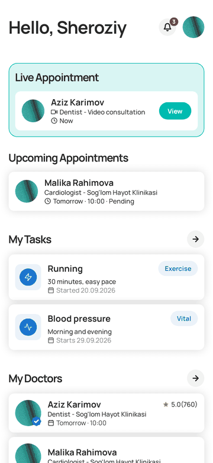</td>
    <td></td>
  </tr>
</table>

| Home | Bookings | Doctor | Appointment |
|---|---|---|---|
| 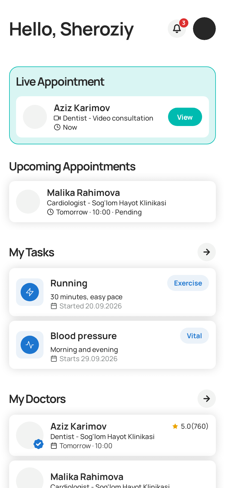 | 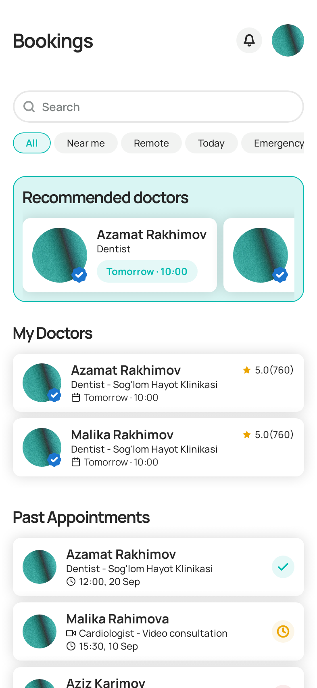 | 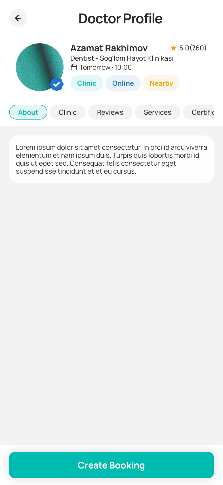 | 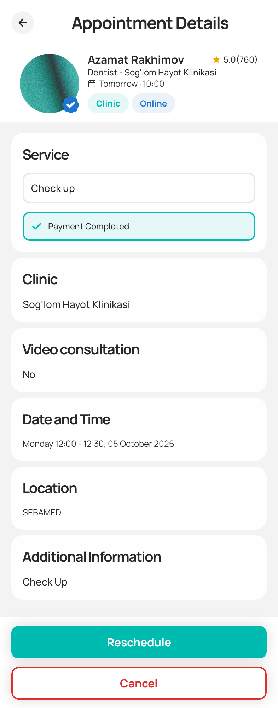 |
| **My Tasks** | **Check-in** | **Notifications** | **Messages** |
| 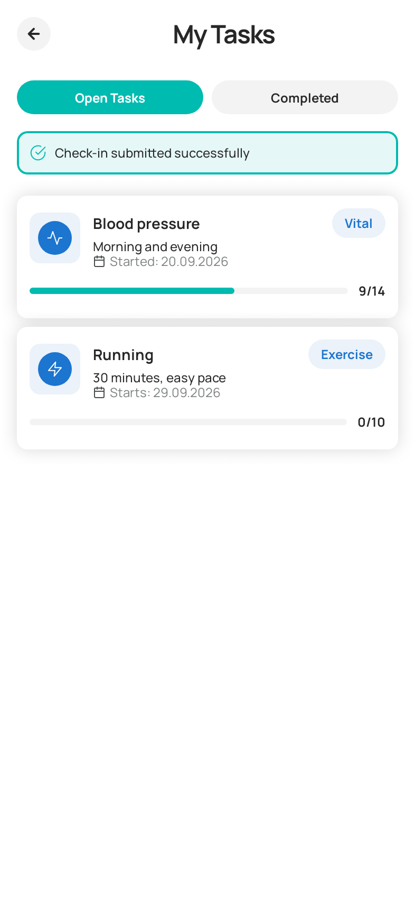 | 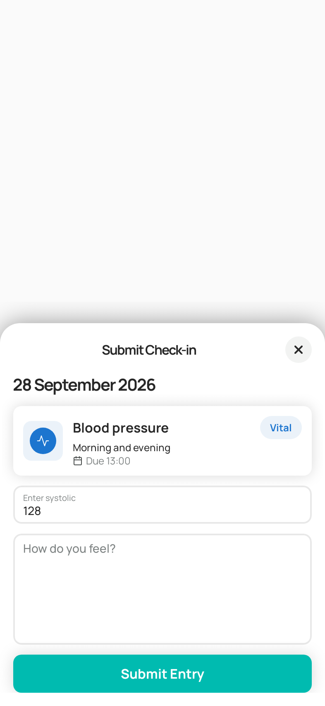 | 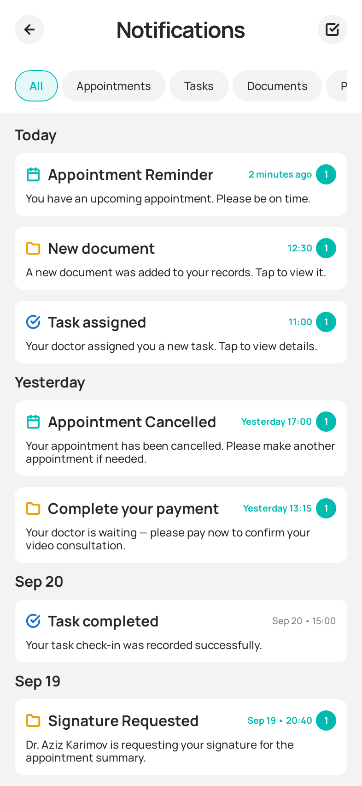 | 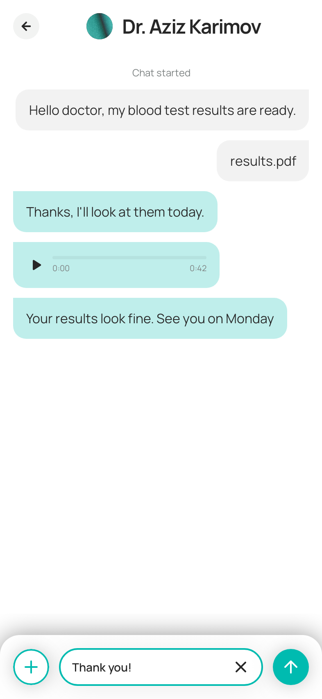 |
| **Documents** | **Shifa AI** | **Profile** | **Sign in** |
| 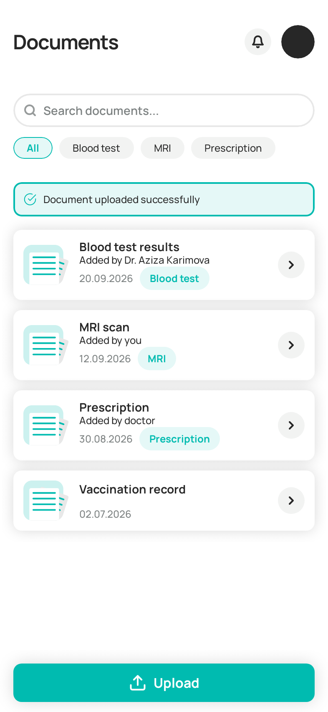 | 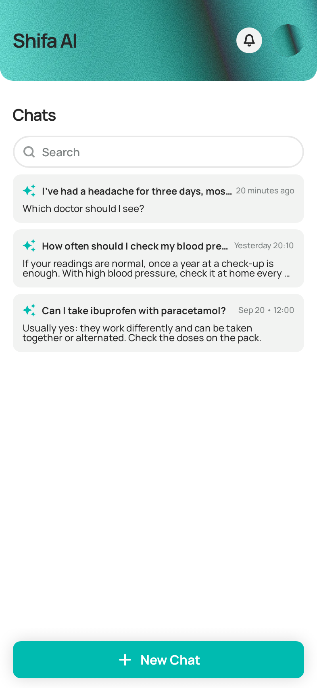 | 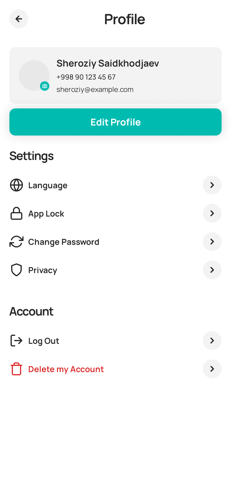 | 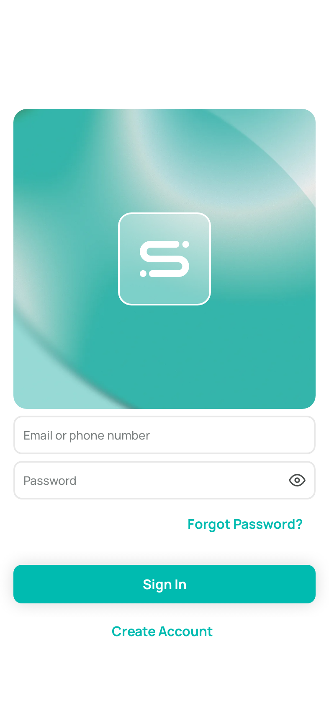 |

The screens are the Roborazzi screenshots in `composeApp/screenshots`, so they stay current when those are
re-recorded. After that, rebuild the animations: `python3 docs/readme/make_gifs.py composeApp/screenshots docs/readme`
(needs Pillow).

What is built and what isn't, per ticket: [docs/implemented/README.md](docs/implemented/README.md).
Architecture, tech stack and coding rules: [CLAUDE.md](CLAUDE.md).

## Build and test

```bash
./gradlew :composeApp:assembleDebug        # Android debug APK
./gradlew :composeApp:testDebugUnitTest    # unit tests
./gradlew :composeApp:verifyRoborazziDebug # screenshot tests (recordRoborazziDebug to re-record)
./gradlew ktlintFormat
```

iOS: open `iosApp/iosApp.xcodeproj` in Xcode and run the `iosApp` scheme.

Debug builds have Profile → Debug menu: demo data (a fake backend) and fake pushes. Release builds leave it out.

## Releases

- **Version:** `MARKETING_VERSION` in `iosApp/Configuration/Config.xcconfig` is the version for both apps (Android reads
  it). Build numbers come from CI.
- **CI** (`.github/workflows/ci.yml`): ktlint, unit tests and screenshot verification on every pull request.
- **Google Play** (`google_play_deploy.yml`) and **TestFlight** (`ios_testflight.yml`): run by hand from the Actions
  tab. They don't run tests. The Play workflow uploads to the **production** track with a full rollout.

## Branches

- `main`: the released app.
- `shifa3.0`: the next features. Merge into `main` through a pull request.
