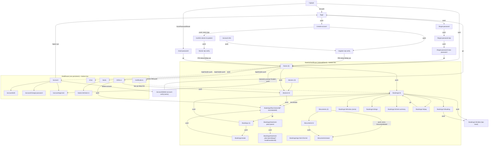

# 02 — Navigation and App Shell

Scope: the root app composition, the GoRouter configuration (every route, the auth guard, the refresh trigger, exception handling), the splash screen, both shells (a persistent 4-tab shell and a non-persistent shell), the custom bottom bar with the centre **Shifa AI** FAB, how notification taps are deep-linked, and back-button behaviour.

Source files:
- `lib/app/router.dart` (618 lines)
- `lib/app/main_shell.dart` (148)
- `lib/app/persistent_bottom_bar.dart` (195)
- `lib/app/shell_tab_index_provider.dart` (4)
- `lib/app/shifa_ai_nav_fab.dart` (238)
- `lib/app/app.dart` (178)
- `lib/features/auth/presentation/screens/splash_screen.dart` (202)
- `lib/features/notifications/services/notification_tap_handler.dart` (318)
- `lib/core/subscription/patient_subscription.dart`
- `lib/state/subscription/patient_subscription_provider.dart`

Related docs: `03-app-lock.md` covers the lock gates that wrap the shells, and `04-design-system-and-ui-kit.md` covers the colour and size tokens referenced here.

---

## 1. Root composition

The widget tree, from the top (`lib/app/app.dart:129-150`):

```
ProviderScope (main.dart)
└── ShifaApp (ConsumerStatefulWidget + WidgetsBindingObserver)
    └── AppLockLifecycleLayer            ← root lock gate (see 03-app-lock.md)
        └── MaterialApp.router
              title: l10n.appName, debugShowCheckedModeBanner: false,
              theme: AppTheme.lightTheme, locale: languageProvider.locale,
              supportedLocales: en, de, uz, ru
              routerConfig: routerProvider (GoRouter)
```

Behaviours wired in `app.dart`:

| Behaviour | Source |
|---|---|
| On `AppLifecycleState.resumed`, if authenticated, calls `profileProvider.notifier.syncTimeZoneFromDevice()`. This also runs once after login. | `app.dart:46-50`, `:88` |
| `apiClient.setOnAuthError(...)` logs the user out when the API reports 401 and the user is authenticated. The router guard then sends them to `/login`. | `app.dart:68` |
| Uploads the FCM token when authenticated. On logout, clears the "shown notification ids" set. | `app.dart` (auth listener) |
| If `build` throws, a fallback `MaterialApp` is shown: `Icons.error_outline` (size 64, red), the text `"{appInitializationError}: {exception}"` and then `pleaseRestartApp` (fontSize 12). | `app.dart:153-170` |

The `GoRouter` instance is created once inside `routerProvider` (a Riverpod `Provider`, `router.dart:181`). It is not rebuilt when auth changes; `refreshListenable` is used instead.

---

## 2. Router configuration (`router.dart:181-205`)

| Setting | Value |
|---|---|
| `initialLocation` | `/` (splash) |
| `refreshListenable` | `GoRouterRefreshNotifier(ref)` |
| `debugLogDiagnostics` | `true`. This is on in every build, including production. |
| `onException` | If the URI string contains `/link` or `/__/auth`, it does nothing (swallows Firebase Phone-Auth reCAPTCHA callbacks on iOS). Every other unknown route goes to `/login` via `router.go('/login')`. |

### 2.1 Refresh trigger (`router.dart:72-91`)

`GoRouterRefreshNotifier` is a `ChangeNotifier`. It runs `ref.listen(authStateProvider)` and calls `notifyListeners()` **only when `isAuthenticated` changes** (`previous?.isAuthenticated != next.isAuthenticated`).

- A change to `forcePasswordReset` on its own does **not** re-run redirect. Redirect re-runs only on the next navigation.
- The class also exposes `ref` so that `redirect` can read providers.
- `GoRouterRefreshStream` (`router.dart:56-69`) is dead code.

### 2.2 Allowed-route whitelist (`router.dart:94-128`)

The prefixes are:

- `/`
- `/login`, `/create-account`, `/confirm-doctor-to-patient`, `/doctor-otp-verify`, `/register-otp-verify`, `/account-info`
- `/reset-password`, `/forgot-password`, `/forgot-password-otp`, `/forgot-password-new-password`
- `/home`, `/bookings`, `/documents`, `/doctors`
- `/account`, `/account/delete-account-verify`
- `/chat`, `/notifications`, `/tasks`, `/shifa-ai`

Matching rules in `_isAllowedRoute(location)`:
- An empty location is allowed.
- The prefix `/` matches only exactly `/` (or `''`).
- Any other prefix matches when `location == prefix` or `location.startsWith(prefix + '/')`.

### 2.3 Redirect guard (`router.dart:206-289`)

The guard is evaluated on every navigation and on every refresh. The rules run **in this order**, and the first one that returns a value wins:

1. `matchedLocation == '/'` returns `null`. The splash screen navigates by itself.
2. The URI contains `/link` or `matchedLocation == '/link'` → go to `/forgot-password`. This keeps the forgot-password widget alive for the iOS reCAPTCHA return.
3. Compute `isAuthRoute`. It is true when `matchedLocation` is one of these 10 routes: `/login`, `/create-account`, `/confirm-doctor-to-patient`, `/doctor-otp-verify`, `/register-otp-verify`, `/account-info`, `/reset-password`, `/forgot-password`, `/forgot-password-otp`, `/forgot-password-new-password`.
4. `!isAuthenticated && !isAuthRoute` → go to `/login`.
5. `isAuthenticated && forcePasswordReset && location != /reset-password` → go to `/reset-password`.
6. `isAuthenticated && !forcePasswordReset && location == /reset-password` → go to `/home`.
7. `isAuthenticated && !forcePasswordReset && isAuthRoute` → go to `/home`.
8. `!_isAllowedRoute(location)` → go to `/home` if authenticated, otherwise `/login`.
9. **Shifa AI subscription gate.** It applies when the user is authenticated and the location is `/shifa-ai` or starts with `/shifa-ai/`.
   - Read `profileProvider.profile`.
   - If the profile is loaded, compute `parsePatientTier(profile.subscriptionTier)`. If `!tierAllows(tier, shifaAi)` (tier is `PRO`), go to `/home`.
   - If the profile is not loaded yet, allow navigation. The screen re-checks by itself (§6.3).
   - This gate uses the **tier only**. The bottom bar and the screen use `profile.features` first (§6.3).
10. Otherwise return `null`.

If anything throws inside redirect, it logs with `AppLogger.error` and goes to `/login`.

The rules as pseudocode, for porting:

```
fun redirect(loc, uri, auth, profile): String? {
  if (loc == "/") return null
  if ("/link" in uri || loc == "/link") return "/forgot-password"
  val authRoute = loc in AUTH_ROUTES_10
  if (!auth.isAuthenticated && !authRoute) return "/login"
  if (auth.isAuthenticated && auth.forcePasswordReset && loc != "/reset-password") return "/reset-password"
  if (auth.isAuthenticated && !auth.forcePasswordReset && loc == "/reset-password") return "/home"
  if (auth.isAuthenticated && !auth.forcePasswordReset && authRoute) return "/home"
  if (!isAllowed(loc)) return if (auth.isAuthenticated) "/home" else "/login"
  if (auth.isAuthenticated && (loc == "/shifa-ai" || loc.startsWith("/shifa-ai/")) && profile != null
      && parseTier(profile.subscriptionTier) == PRO) return "/home"
  return null
}
```

---

## 3. Route table

`AppRoutes` constants are in `router.dart:130-178`. The path column shows full resolved paths.

Shell legend:
- **Top** = a top-level route with no bottom bar, on the root navigator.
- **S-Tabs** = the `StatefulShellRoute.indexedStack` shell (persistent state, custom bottom bar).
- **S-Plain** = the plain `ShellRoute` (non-persistent, same bottom bar with no highlighted tab).

| # | Path | Screen | Params / extra | Shell | Source |
|---|---|---|---|---|---|
| 1 | `/link` | `SizedBox.shrink()` (Firebase reCAPTCHA sink; redirect sends it to `/forgot-password`) | – | Top | `router.dart:293` |
| 2 | `/` | `SplashScreen` | – | Top | `:299` |
| 3 | `/login` | `LoginScreen` | – | Top | `:305` |
| 4 | `/create-account` | `CreateAccountScreen` | – | Top | `:309` |
| 5 | `/confirm-doctor-to-patient` | `ConfirmDoctorToPatientScreen` | extra `Map{phone, email, firstName, lastName}` (all String). If extra is null, renders `CreateAccountScreen`. | Top | `:313-325` |
| 6 | `/doctor-otp-verify` | `DoctorOtpVerifyScreen` | – (screen reads its own provider state) | Top | `:326` |
| 7 | `/register-otp-verify` | `RegisterOtpVerifyScreen` | – | Top | `:330` |
| 8 | `/account-info` | `AccountInfoScreen` | – | Top | `:334` |
| 9 | `/reset-password` | `ResetPasswordScreen` (forced password reset) | – | Top | `:338` |
| 10 | `/forgot-password` | `ForgotPasswordScreen` | – | Top | `:342` |
| 11 | `/forgot-password-otp` | `ForgotPasswordOtpScreen` | – | Top | `:346` |
| 12 | `/forgot-password-new-password` | `ForgotPasswordNewPasswordScreen` | – | Top | `:350` |
| 13 | `/account/delete-account-verify` | `DeleteAccountOtpVerifyScreen(challengeId, email)` | extra `Map{challengeId: String, email: String}`. If either is missing or empty, renders `LoginScreen`. | Top | `:354-368` |
| 14 | `/home` | `HomeScreen` | – | S-Tabs branch 0 | `:378` |
| 15 | `/bookings` | `BookingsScreen` | – | S-Tabs branch 1 | `:386` |
| 16 | `/bookings/create` | `CreateBookingScreen` | – | S-Tabs 1 | `:390` |
| 17 | `/bookings/sign-form/:formId` | `SignAppointmentScreen(patientFormId: formId)` (medical form 025-2) | path `formId` | S-Tabs 1 | `:394` |
| 18 | `/bookings/treatment-plan/:planId` | `TreatmentPlanSummaryScreen(planId)` | path `planId` | S-Tabs 1 | `:401` |
| 19 | `/bookings/treatment-plan/:planId/pay` | `TreatmentPlanPaymentScreen(planId, installmentItemId)` | query `installmentItemId` (optional) | S-Tabs 1 | `:408` |
| 20 | `/bookings/:id` | `AppointmentDetailsScreen(appointmentId: id)` | path `id` | S-Tabs 1 | `:422` |
| 21 | `/bookings/:id/waiting` | `WaitingRoomScreen(appointmentId)` | – | S-Tabs 1 | `:429` |
| 22 | `/bookings/:id/review` | `SubmitReviewScreen` | extra `Map{doctorId, doctorName, appointmentId}`. `doctorName` defaults to `translate('doctor')`, then `'Doctor'`. | S-Tabs 1 | `:436` |
| 23 | `/bookings/:id/sign` | `SignAppointmentScreen(appointmentId)` | – | S-Tabs 1 | `:450` |
| 24 | `/bookings/:id/visit-summary` | `VisitSummaryScreen(appointmentId)` | – | S-Tabs 1 | `:457` |
| 25 | `/bookings/:id/pay` | `ConsultationPaymentScreen(appointmentId)` | – | S-Tabs 1 | `:464` |
| 26 | `/bookings/flow/:doctorId` | `AppointmentBookingFlowScreen(doctorId, rescheduleId)` | query `rescheduleId` (optional; puts the flow in reschedule mode) | S-Tabs 1 | `:473` |
| 27 | `/documents` | `DocumentsScreen` | – | S-Tabs branch 2 | `:491` |
| 28 | `/documents/viewer` | `DocumentViewerScreen(document)` | extra `DocumentModel`. If extra is null, renders `DocumentsScreen`. | S-Tabs 2 | `:495` |
| 29 | `/documents/:id` | `DocumentDetailsScreen(documentId)` | – | S-Tabs 2 | `:505` |
| 30 | `/doctors` | `DoctorsScreen` | – | S-Tabs branch 3 | `:518` |
| 31 | `/doctors/:id` | `DoctorProfileScreen(doctorId)` | – | S-Tabs 3 | `:522` |
| 32 | `/account` | `ProfileScreen` | – | S-Plain | `:545` |
| 33 | `/account/edit` | `EditProfileScreen` | – | S-Plain | `:549` |
| 34 | `/account/change-password` | `ChangePasswordScreen` | – | S-Plain | `:553` |
| 35 | `/account/app-lock` | `AppLockSettingsScreen` | – | S-Plain | `:557` |
| 36 | `/chat` | `ChatScreen` (conversation list) | Notification taps pass extra `{chatId}`, **but ChatScreen ignores it** | S-Plain | `:563` |
| 37 | `/shifa-ai` | `ShifaAiScreen` | – (subscription-gated) | S-Plain | `:567` |
| 38 | `/notifications` | `NotificationsScreen` | – | S-Plain | `:571` |
| 39 | `/tasks` | `TasksScreen` | – | S-Plain | `:575` |
| 40 | `/tasks/:id/check-in` | `TaskCheckInScreen(taskId: int)` | path `id` goes through `int.tryParse`. If that returns null, renders `TasksScreen`. | S-Plain | `:579` |
| 41 | `/bookings/confirm` | `ConfirmBookingScreen(doctorId, date, time, reason?, isVideo)` | extra `Map{doctorId, date, time, reason, isVideo: bool=false}` | Top | `:595` |
| 42 | `/bookings/:id/video` | `VideoCallScreen(appointmentId)` (full screen) | – | Top | `:610` |

Branch children are declared in this order under `/bookings`: `create`, `sign-form/:formId`, `treatment-plan/:planId` (child `pay`), `:id` (children `waiting`, `review`, `sign`, `visit-summary`, `pay`), and then `flow/:doctorId`. The order matters for matching (see Quirks).

### 3.1 AppRoutes constants that do not match real routes
- `AppRoutes.bookingFlow = '/bookings/flow'`. The real route is `/bookings/flow/:doctorId`, so callers build `'/bookings/flow/$doctorId'` by hand.
- `AppRoutes.confirmBooking = '/bookings/confirm'`. It is never navigated to, and in any case `/bookings/:id` shadows it (Quirks §Q2).
- `AppRoutes.taskCheckIn`, `videoCall`, `waitingRoom`, `signAppointment`, `signPatientForm`, `visitSummary` and `treatmentPlanSummary` are templates with `:id`. Callers interpolate them by hand.

### 3.2 Imperative (non-router) pushes

These screens are opened with `Navigator.push(MaterialPageRoute(...))` and have **no URL**. A KMP port can model them as child routes or modal destinations.

| From | Screen pushed | Notes |
|---|---|---|
| Tasks list | `TaskCheckInScreen` | Also reachable by the route `/tasks/:id/check-in` |
| Chat list | `ChatConversationScreen` | No deep link to a single conversation |
| Chat image bubble | `_FullScreenImageViewer` | |
| Bookings list | `_BookingsPaymentCheckoutScreen` | Payment checkout (see the bookings/payments doc) |
| Booking flow | `_PaymentCheckoutScreen`, `_PaymentPendingScreen` | |
| Doctor profile | `CertificateViewerScreen` | |
| Location picker (profile) | `_MapPickerScreen` | |

---

## 4. Navigation graph



Navigation verbs used at each call site. **go** replaces the stack; **push** stacks on top.

| Call site | Verb and target |
|---|---|
| AppHeader logo (Home/Bookings/Documents/Doctors) | `go('/home')` |
| AppHeader profile / bell / chat icons | `push('/account')`, `push('/notifications')`, `push('/chat')` |
| Login → forgot password / create account | `push` |
| Registration OTP and doctor OTP success | PIN-setup dialog (see 03), then `go('/home')` |
| Forgot-password chain | `push` → `push` → final `go('/home')` |
| Reset password success | `go('/home')` |
| Delete-account OTP success, and profile logout | `go('/login')` |
| Home "see all" and cards | `push('/bookings')`, `push('/bookings/{id}')`, `push('/tasks')`, `push('/doctors/{id}')` |
| Bookings → create → flow | `push('/bookings/create')` → `push('/bookings/flow/{doctorId}')` |
| Appointment details | `push` review (extra), visit-summary, sign, `/bookings/{id}/video`. Reschedule: `push('/bookings/flow/{doctorId}?rescheduleId={id}')`. Doctor: `push('/doctors/{id}')`. |
| Waiting room | `push('/bookings/{id}/video')` |
| Consultation payment done | `go('/bookings/{id}')` |
| Treatment plan summary | `push('.../pay[?installmentItemId=]')`. App-bar back: `canPop ? pop : go('/bookings')` (`treatment_plan_summary_screen.dart:83`). |
| Treatment plan payment done | `go` back to the summary |
| Booking flow and confirm booking done | `go('/bookings')` |
| Documents list / details | `push('/documents/viewer', extra: DocumentModel)` |
| Notifications screen back | `canPop ? pop : go('/home')` (`notifications_screen.dart:48`) |
| Shifa AI | `push('/doctors/{id}')`, `push('/bookings/flow/{id}')`; back = `context.pop()` |

---

## 5. Shells

### 5.1 Tab shell: `StatefulShellRoute.indexedStack` (`router.dart:371-533`)

- Builder: `AppLockWrapper(child: MainShell(navigationShell: shell))`. See 03 for `AppLockWrapper`.
- There are 4 branches, and each has its own navigator and back stack. **All branch states are kept alive** (IndexedStack).

| Index | Root | Tab label key | Icon (Material Rounded) |
|---|---|---|---|
| 0 | `/home` | `home` (fallback 'Home') | `Icons.home_rounded` |
| 1 | `/bookings` | `bookings` | `Icons.calendar_today_rounded` |
| 2 | `/documents` | `documents` | `Icons.folder_rounded` |
| 3 | `/doctors` | `doctors` | `Icons.medical_services_rounded` |

### 5.2 `MainShell` (`main_shell.dart`)

`MainShell` is a `ConsumerStatefulWidget` that holds `navigationShell`. Its `build` does the following:

1. **FCM tap handler** (once, and only when `Firebase.apps.isNotEmpty`). After the first frame it calls `PushNotificationService().setOnNotificationTap(data => pendingNotificationTapProvider.setPending(data))`. After a second frame it calls `processPendingInitialMessage()` to handle a cold-start tap (`main_shell.dart:32-45`).
2. **Local-notification tap handler** (once). It calls `LocalNotificationService().setOnNotificationTap(...)`, which sets the same pending provider (`:48-57`).
3. `ref.listen(pendingNotificationTapProvider)` fires when the value is non-empty. If l10n is null it clears the value; otherwise it calls `NotificationTapHandler.handleTapFromPayload(context, data, notificationsController, l10n.translate)` and then `clear()` (`:59-75`).
4. `ref.listen(pendingNotificationDialogProvider)` receives an in-app, foreground notification to present. After a frame it shows an `AlertDialog` with `barrierDismissible: false` (`:77-147`):
   - **title**: `NotificationLocalization.getTitle(n)`; **content**: a scrollable `getMessage(n)`.
   - `TextButton(l10n.close)` pops and clears.
   - `FilledButton(translate('view'))` awaits `NotificationTapHandler.handleTap(...)` (mark read, then `go(target)`), pops, and clears. If the notification is a document access request it also does `go('/notifications')`.
5. After every frame it writes `shellTabIndexProvider = navigationShell.currentIndex` (`:86-90`).
6. It returns `Scaffold(body: navigationShell, resizeToAvoidBottomInset: true, bottomNavigationBar: PersistentBottomBar(currentIndex, navigationShell))`.

`shellTabIndexProvider` (`shell_tab_index_provider.dart:4`) is a `StateProvider<int>` with default 0. Screens listen to it to refresh when their tab becomes visible:
- `home_screen.dart:190` reloads doctors when the index becomes 0.
- `doctors_screen.dart:255` re-applies filters when the index becomes 3 and its inner `_selectedTab == 1`.

### 5.3 Plain shell: `ShellRoute` (`router.dart:535-591`)

- Builder: `AppLockWrapper(child: Scaffold(body: child, resizeToAvoidBottomInset: true, bottomNavigationBar: const PersistentBottomBar()))`.
- Its routes are `/account/**`, `/chat`, `/shifa-ai`, `/notifications` and `/tasks/**`.
- Pages are rebuilt on every visit because state is not preserved.
- `PersistentBottomBar` receives **no** `navigationShell` and **no** `currentIndex`, so the highlighted tab is worked out from the path, which gives -1. **No tab is highlighted** on these screens (the FAB shows `active` only on `/shifa-ai`).
- When one of these routes is `push`ed from inside the tab shell, GoRouter puts the whole plain-shell page on top of the tab shell. Back pops back to the tab shell, which is still alive. Tapping a tab in this bar calls `context.go('/home' | ...)`, which replaces the stack and discards the plain-shell page. **UNVERIFIED** runtime detail: whether GoRouter 14 keeps the tab shell mounted underneath the pushed plain shell. It is expected to.
- The split between the two shells is also a **lock-scope** split: each shell has its own `AppLockWrapper` instance.

---

## 6. Bottom bar: `PersistentBottomBar` (`persistent_bottom_bar.dart`)

### 6.1 Layout

Constants: `_iconSize = 24`, `_fabSize = 74`, `_barHeight = 56` (`:65-68`).

```
canUseShifaAi = patientFeatureProvider(PatientFeature.shifaAi)
bottomInset   = MediaQuery.viewPadding.bottom
stackHeight   = 56 + (canUseShifaAi ? 37 : 0) + bottomInset          (:116)

Column(min) → SizedBox(height: stackHeight, width: ∞) → Stack(clip: none, align: bottomCenter)
 ├─ Align(bottomCenter) → Padding(bottom: bottomInset)
 │    → Material(elevation 8, color #FFFFFF) → SizedBox(h 56, w ∞) → Row
 │         [Home][Bookings][if AI: SizedBox(w 74)][Documents][Doctors]    (each item Expanded)
 └─ if AI: Positioned(left 0, right 0, bottom: bottomInset + 56 − 37)     (:176-188)
          → Center → ShifaAiNavFab(size 74, active: onShifaAiPath, onPressed: push('/shifa-ai'))
```

- The FAB centre therefore sits exactly on the top edge of the 56 dp bar, with half the disc (37 dp) above the bar.
- When Shifa AI is **not** allowed (PRO tier), the gap and the FAB are removed, the 4 items share the width evenly, and the bar is 56 dp plus the inset.
- **Scroll padding contract**: scrollable content above the bar should reserve `AppDesignSystem.bottomNavHeight (93) + viewPadding.bottom` (`AppDesignSystem.safeBottomWithNavBar`). This constant is fixed at 93 even when the FAB is hidden.

### 6.2 Nav item (`:70-104`)

`Expanded` → `Material(color #FFFFFF)` → `InkWell` (default ripple) → `Column(center, min)`:
- `Icon(size 24, color)`
- 4 dp gap
- `Text(label, maxLines 1, ellipsis, style: caption 12/1.35 with color and weight)`

| State | Colour | Weight |
|---|---|---|
| selected | `primary #00BBB0` | w600 |
| unselected | `textTertiary #9CA3AF` | normal |

Selected index:
- In the tab shell: `navigationShell.currentIndex`, which is always 0–3.
- In the plain shell: `_indexFromPath(path)` (`:30-37`):
  - `/shifa-ai…` gives -1.
  - A path starting with `/home` gives 0, `/bookings` 1, `/documents` 2, `/doctors` 3.
  - Anything else gives -1.
- Any index outside 0–3 means nothing is highlighted.

### 6.3 Tap behaviour (`:39-48`)

- With a `navigationShell`: `navigationShell.goBranch(index)` followed by `context.go(rootPathOfTab)`. **Effect: tapping any tab, including the current one, resets that branch to its root.** A deep stack such as `/bookings/12/visit-summary` is lost when the user switches away and back via the bar.
- Without a `navigationShell` (plain shell): `context.go(rootPathOfTab)`.

### 6.4 Shifa AI gating (applies to the bar, the router and the screen)

`patientFeatureProvider(feature)` (`patient_subscription_provider.dart:17-29`):
- If `profile.features` (a String list from `/patients/me/profile`) is non-empty, the result is `features.contains('PATIENT_SHIFA_AI')`.
- Otherwise it is `tierAllows(parsePatientTier(profile.subscriptionTier), shifaAi)`.

`parsePatientTier` (`patient_subscription.dart:50-58`):
- `'PRO'` → pro; `'PREMIUM'` → premium.
- null or unknown → **premium** (fail-open, so the UI does not flash "locked" during cold start).
- Shifa AI requires PREMIUM.

`ShifaAiScreen` (`shifa_ai_screen.dart:509-518`):
- If the feature is not allowed, it renders an empty `Scaffold` and does `go('/home')` after the frame.
- Its AppBar has background primary, foreground white, and title `shifaAiTitle`.
- Leading is `Icons.arrow_back`, which calls `context.pop()`.
- The action is clear chat (`copilotClearChat*` keys; see the chat/AI doc).

---

## 7. Shifa AI centre FAB: `ShifaAiNavFab` (`shifa_ai_nav_fab.dart`)

Parameters: `size` (74 in the bar), `active` (bool), `onPressed`.

### 7.1 Animations (`:36-41`, `:61-69`)

| Controller | Duration | Curve | Behaviour |
|---|---|---|---|
| pulse | 4200 ms | `easeInOutSine` | `repeat(reverse: true)`, runs forever |
| press | 130 ms | `easeOutCubic` | `forward()` on tapDown, `reverse()` on tapCancel and after tap |

Derived values each frame (`pulse` and `press` are 0..1 after their curves):

```
scale          = (1 + pulse*0.012) * (1 - 0.048*press)
glowBoost      = active ? 1.18 : 1.0
glowOpacity    = clamp((0.11 + pulse*0.07) * glowBoost * (1 + 0.5*press), 0.07, 0.32)
glowBlur       = 16 + pulse*5.5 + press*11
glowBlurOuter  = 26 + pulse*7   + press*13
```

### 7.2 Layers

All layers are wrapped in `Transform.scale(scale)` and use `OverflowBox(maxW/H = s + 12)` so the glow can overflow without enlarging the layout. `s` is the size.

| # | Layer | Size | Paint |
|---|---|---|---|
| 1 | Outer halo (circle) | s + 10 | RadialGradient `[primaryAi α0 → primaryAi α0.11]`. Shadows: `primaryLight α(glowOpacity*0.52)`, blur = glowBlurOuter, spread −3; `primaryAi α(glowOpacity*0.44)`, blur = glowBlur, spread −1. |
| 2 | Glass ring (circle) | s + 7 | Border 2 dp, colour `lerp(primaryAi, primaryLight, 0.35)` at α0.48. Shadow `secondaryLight α0.35`, blur 8, spread −1. |
| 3 | Disc (circle) | s | RadialGradient center `(-0.2, -0.26)`, radius 1.02, colours: `primaryDark`, `lerp(primaryDark, primaryAi, .42)`, `primaryAi`, `lerp(primaryAi, primaryLight, .5)`, `lerp(primaryLight, secondaryLight, .55)`. Stops `[0, .22, .46, .72, 1]`. Shadows: black α0.06 (blur 14, offset 0,6) and primaryDark α0.09 (blur 10, offset 0,3). |
| 4 | Ink | s | `InkWell(customBorder: CircleBorder)`, splash white α0.22, highlight white α0.07 |
| 5 | Specular highlight | s | RadialGradient center `(-0.35, -0.45)`, radius 0.92, `[white α0.2 → white α0]`, stops `[0, .55]` |
| 6 | Icon | padding `s*0.182` | SVG `assets/branding/Shifa AI Icon.svg`, `ColorFilter.mode(white, srcIn)` |

Token values: primaryAi `#26BAA4`, primaryLight `#59C2BC`, primaryDark `#129B8A`, secondaryLight `#CCF1EF`.

Accessibility: `Semantics(label: 'Shifa AI', button: true)`. The label is hard-coded English.

Tap: `onPressed` → `context.push('/shifa-ai')`. There is no guard against pushing while already on `/shifa-ai`, so duplicate pages stack (Quirks §Q5).

---

## 8. Splash screen (`splash_screen.dart`)

Timing:

| Constant | Value |
|---|---|
| `_minSplashDuration` | 1600 ms (animation length; also the minimum on-screen time) |
| `_authWaitTimeout` | 4 s for `authStateProvider.notifier.ensureInitialAuthChecked()` |
| `_hardFallback` | a 5 s `Timer` that forces navigation |

Navigation (`:45-75`) is triggered on animation complete or by the fallback timer, and runs at most once:
1. Wait for the rest of the 1600 ms.
2. Await the auth restore (4 s timeout; a timeout is swallowed).
3. `go('/login')` if not authenticated; otherwise `go('/reset-password')` if `forcePasswordReset`; otherwise `go('/home')`.

Visuals (`:85-201`):
- `brand = #17C3B2` (the legacy teal, not `primary`).
- `t = easeInOutCubic(0..1)`, and `bg = lerp(brand, white, t)`.
- Two "blob" containers (no blur; the code notes that blur froze low-end Android GPUs):
  - Blob size is `size*1.2 × size*0.85`, radius `size*0.45`.
  - RadialGradient radius 0.85, `[c α0.70, c α0.25, c α0]`, stops `[0, .55, 1]`.

| Blob | Base size | Translate x | Translate y | Scale | Rotation | Colour |
|---|---|---|---|---|---|---|
| bottom-left | `max(w,h)*1.0` | −0.15w → −0.55w | 0.25h → 0.55h | 1.35 → 1.05 | −10° → −25° | brand |
| top-right | `max(w,h)*0.95` | 0.10w → 0.55w | −0.20h → −0.45h | 1.10 → 0.95 | 10° → 22° | brand α0.90 |

- Centre logo: `assets/branding/shifa_logo.png`, 96×96, `ClipRRect` radius 20. Opacity is `easeIn(t)` and scale goes 0.96 → 1.0.

---

## 9. Deep links and notification routing

### 9.1 Platform-level
- **Android**: `MainActivity` uses `launchMode="singleTop"` and `windowSoftInputMode="adjustResize"`. The only intent filter is MAIN/LAUNCHER. There are **no App Links or custom-scheme deep links** (`android/app/src/main/AndroidManifest.xml`).
- **iOS**: `Info.plist` `CFBundleURLTypes` holds **two** URL schemes, both belonging to Firebase/Google Sign-In (the reversed client id and the app-id scheme). They exist only so that the Firebase Phone Auth reCAPTCHA can return to the app. Get the values from the new project's Firebase config; they are not copied here.
- The Firebase return URL appears as a `/link` or `/__/auth/...` path. `onException` swallows it, and redirect maps `/link` to `/forgot-password` (§2, §2.3 step 2).
- Therefore **all in-app deep links come from notification payloads**. There are no external URLs.

### 9.2 Payload → path (`notification_tap_handler.dart:29-141`)

The payload is the FCM `data` map, or the local-notification payload.

Normalisation:
- `typeRaw = lower(type).replace('-', '_')`; `TYPE = upper(typeRaw)`.
- `id = entityId ?? appointmentId ?? documentId ?? chatId`.
- `appointmentId`, `taskId`, `treatmentPlanId` and `patientFormId` are parsed as int from either camelCase or snake_case keys (e.g. `appointment_id`).

| `type` (lower-case switch) | Target path |
|---|---|
| `signature_requested` | `/bookings/sign-form/{patientFormId}`, else `/bookings/{id}`, else `/bookings/{appointmentId}` |
| `appointment_reminder`, `appointment_scheduled`, `appointment_cancelled`, `appointment_changed`, `appointment_confirmed`, `appointment_upcoming` | `/bookings/{id}` (else `/bookings/{appointmentId}`) |
| `ai_visit_summary_ready` | `/bookings/{id}/visit-summary` |
| `consultation_payment_reminder`, `consultation_payment_due_24h`, `consultation_payment_due_6h`, `consultation_payment_due_1h` | `/bookings/{id}/pay` |
| `treatment_plan_payment_reminder`, `treatment_plan_updated`, `installment_due_soon`, `installment_due_today`, `installment_overdue`, `installment_schedule_created` | `/bookings/treatment-plan/{treatmentPlanId}`. If there is no plan id: `treatment_plan_payment_reminder` → `/bookings`; the others fall through. |
| `prophylaxis_reminder` | `/bookings` |
| `document_access_approved`, `document_access_rejected` | `/documents/{id}`, else `/documents` |
| `new_document`, `document` | `/documents/{id}` |
| `new_message`, `chat_message` | `/chat`, with extra `{chatId}` when present (ignored by ChatScreen) |
| `task_assigned`, `task_reminder`, `task_cancelled` | `/tasks/{taskId}/check-in`, else `/tasks` |
| `task_completed` | `/tasks` |

When the switch does not return, these upper-case fallbacks run in order:
1. `SIGNATURE_REQUESTED` with a form id → sign-form.
2. `AI_VISIT_SUMMARY_READY` → visit-summary.
3. A consultation-payment type → pay.
4. Any type containing `TREATMENT_PLAN`, or an `INSTALLMENT_*` type, with a plan id → treatment-plan.
5. `PROPHYLAXIS_REMINDER` → `/bookings`.
6. A type containing `APPOINTMENT` (or `SIGNATURE_REQUESTED`) → `/bookings/{id}`.
7. Any `documentId` when the type does not contain `ACCESS` → `/documents/{documentId}`.
8. `NEW_MESSAGE`/`CHAT_MESSAGE` → `/chat`.
9. A type containing `TASK` → the task check-in, or `/tasks`.
10. Otherwise `data['route']`, with a leading `/` added if missing.

If nothing matched, the target is `/notifications`.

### 9.3 Tap handling (`:178-220`)
1. Mark the notification read, ignoring failures:
   - The id is `data['notificationId'] ?? data['id']`.
   - An int (or numeric string) > 0 calls `controller.markAsRead(int)`. Any other value calls `markAsReadById(String)`.
2. If the context is still mounted, **`context.go(path)`** (not push), so the current stack is replaced by the target.

The in-app list and dialog use a second mapper, `getTargetLocation(NotificationModel)` (`:223-280`), with the same targets plus:
- `AI_SCRIBE_READY` → visit-summary.
- A title containing "signature" with an appointment id → `/bookings/{id}`.
- Any appointment id without a document id → `/bookings/{id}`.
- Document access **requests** return null; the caller routes them to `/notifications`.
- When there is no target for an appointment-type notification, it shows the SnackBar `notificationCannotOpen`.

Because `go` targets the tab-shell paths, the tab shell is rebuilt at that branch. Nested targets such as `/bookings/12/pay` get a synthetic back stack: the parent route pages `/bookings` → `/bookings/12` → `/bookings/12/pay`, which is GoRouter's normal behaviour for nested routes.

---

## 10. Back-button behaviour

| Situation | Behaviour | Source |
|---|---|---|
| A pushed screen inside a branch | Pops within the branch navigator (Android system back and the iOS edge-swipe from the default `MaterialPage` transitions) | GoRouter default |
| A branch root (e.g. `/bookings`) | No custom handling. It **probably exits or backgrounds the app** on Android instead of switching to the Home tab. **UNVERIFIED** | no `PopScope` in shells |
| `AppHeader` back arrow (`showBack: true`) | `onBackTap ?? Navigator.of(context).maybePop()` | `app_header.dart:69` |
| Lock screens | `PopScope(canPop: false)`, so back is blocked entirely | `app_lock_screen.dart:110`, `app_lock_lifecycle_layer.dart:129` |
| Notifications screen back | `context.canPop() ? pop : go('/home')` | `notifications_screen.dart:48` |
| Treatment-plan summary back | `canPop ? pop : go('/bookings')` | `treatment_plan_summary_screen.dart:83` |
| Forgot password back | `Navigator.canPop ? pop : ...` | `forgot_password_screen.dart:71` |
| Shifa AI back | `context.pop()` with no `canPop` check. It would fail if Shifa AI was opened with `go` (e.g. a `route: '/shifa-ai'` payload). **UNVERIFIED** | `shifa_ai_screen.dart` AppBar leading |

---

## 11. l10n keys used by this area

`appName`, `home`, `bookings`, `documents`, `doctors`, `close`, `view`, `notificationCannotOpen`, `doctor`, `shifaAiTitle`, `appInitializationError`, `pleaseRestartApp`.

Notification dialog titles and bodies come from `NotificationLocalization`; see the notifications doc.

---

## 12. KMP/CMP porting notes

- **Router choice.** Use Navigation Compose (type-safe `@Serializable` routes, KMP-ready since 2.8) or Decompose. Either way, model **two shell types**:
  1. A tab host with 4 back stacks that stay alive. In Navigation Compose, use a `NavHost` per tab with `saveState/restoreState`, or a `ChildStack` per tab in Decompose.
  2. An overlay "plain shell" that is pushed on the root stack and shows the same bottom bar with no highlighted tab.
- **Guard.** Put the redirect in a single pure function (the pseudocode in §2.3) that runs:
  1. before every navigation;
  2. whenever `isAuthenticated` changes. Consider also re-running when `forcePasswordReset` changes; the original does not (quirk Q7).

  The splash screen should run its own auth wait and bypass the guard.
- **Routes as a sealed class.** Carry the ids as typed params (`appointmentId: String`, `taskId: Int`, `planId: String`, `formId: String`, `doctorId: String`, `rescheduleId: String?`, `installmentItemId: String?`).
- **Replacing `state.extra`.** Use in-memory args for the review data (`doctorId`, `doctorName`, `appointmentId`), `DocumentModel` for the viewer, the confirm-doctor map, and the delete-account `challengeId`/`email`. Do not serialise PII into route strings. Keep the fallbacks: a missing arg renders the fallback screen instead of crashing.
- **Deep-link resolver.** Port `getTargetPathFromPayload` as a pure function `(Map<String, Any?>) -> Route?`, with the table in §9.2 as unit tests. Navigating from a notification should **replace** the stack, building a synthetic parent stack for nested targets.
- **Bottom bar.** Build a custom `Box` with a 56 dp `Surface(shadowElevation = 8.dp)`, a `Row` of 4 weighted items (plus a 74 dp spacer), and the FAB offset `y = -(56 - 37)` above the inset. Use `WindowInsets.navigationBars` for `bottomInset`.
  - Provide a `LocalBottomBarPadding` (93 dp + insets) so scroll content can pad itself.
  - Tab re-tap should probably **not** reset the stack (decide with the product owner). The original resets it (quirk Q4).
- **FAB.** Use an `InfiniteTransition` (4200 ms reverse, `EaseInOutSine` ≈ `CubicBezierEasing(0.37, 0, 0.63, 1)`) and an `Animatable` for press (130 ms, `EaseOutCubic` ≈ `CubicBezierEasing(0.33, 1, 0.68, 1)`). Draw the layers in a `Canvas` or with `drawBehind`; Compose `Modifier.shadow` cannot produce coloured glows with spread, so draw radial gradients.
  - The icon is an SVG, so convert it to an `ImageVector` (Compose Multiplatform resources support SVG→XML vector at build time).
- **Tab-visibility events.** Instead of `shellTabIndexProvider`, expose a `StateFlow<Int>` of the current tab and trigger Home and Doctors refreshes when the tab becomes selected.
- **FCM and local-notification taps.** Keep a "pending tap" `StateFlow` that the shell consumes once it is mounted. This handles a cold-start tap that arrives before the UI exists (the original's `processPendingInitialMessage`).
- **Subscription gate.** One `canUseShifaAi: StateFlow<Boolean>` using the features-list-first logic from §6.4, used in all three places (bar, guard and screen) so they cannot disagree.
- **Firebase reCAPTCHA return.** Handle it on iOS only if phone auth is kept. The KMP app does not need the `/link` path hack if the Firebase SDK handles the URL before the navigation layer sees it.

---

## 13. Observed quirks / tech debt

- **Q1.** `debugLogDiagnostics: true` is shipped in production (`router.dart:191`).
- **Q2.** `/bookings/confirm` (`ConfirmBookingScreen`) is shadowed by the tab shell's `/bookings/:id`, which is declared earlier. A `go('/bookings/confirm')` would open `AppointmentDetailsScreen(appointmentId: 'confirm')`. This is inferred from GoRouter's first-match-with-backtracking rules and is **UNVERIFIED** at runtime.
  - The route is never navigated to; booking confirmation happens inside `AppointmentBookingFlowScreen._confirmBooking`.
  - `/bookings/flow/:doctorId` and `/bookings/:id/video` still resolve, because `:id` has no child `{doctorId}` or `video`, so the matcher backtracks.
  - **Do not port `/bookings/confirm`.**
- **Q3.** `AppRoutes.bookingFlow` and `confirmBooking` do not match real routes (§3.1).
- **Q4.** Tapping a tab calls `goBranch` and then `go(root)`, which wipes that tab's back stack every time, including a re-tap of the active tab and a return to a previously deep tab. This partly defeats the purpose of `indexedStack`.
- **Q5.** The centre FAB `push('/shifa-ai')` has no "already there" check, so every tap on Shifa AI stacks another page.
- **Q6.** Shifa AI gating is inconsistent:
  - The router checks only `subscriptionTier`.
  - The bar and the screen check `profile.features` first.
  - An admin-granted feature on a PRO tier is shown in the bar but blocked by the router. A PREMIUM tier with the feature removed is hidden in the bar but allowed by the router, and the screen then bounces the user.
- **Q7.** The refresh notifier ignores `forcePasswordReset` changes.
- **Q8.** `GoRouterRefreshStream` is unused.
- **Q9.** The chat deep link passes `extra: {chatId}`, but `ChatScreen` never reads `state.extra`, so a message notification only opens the conversation list.
- **Q10.** The tab and plain shells each wrap their content in a separate `AppLockWrapper`. Every switch between them re-initialises the wrapper, which shows a white spinner for a few frames (see 03).
- **Q11.** The branch-root Android back behaviour is unhandled (probably exits the app) (**UNVERIFIED**).
- **Q12.** `/tasks/:id/check-in` with a non-numeric id silently shows `TasksScreen`. The extra-fallbacks for viewer, confirm-doctor and delete-account render other screens silently, with no error.
- **Q13.** `bottomNavHeight` is fixed at 93 even when the FAB is hidden (PRO), so PRO users get 37 dp of extra blank space at the bottom of lists.
- **Q14.** The splash screen and many other screens use the legacy `#17C3B2` instead of `primary #00BBB0` (see 04).
- **Q15.** The FAB semantics label 'Shifa AI' and the notification fallback strings are hard-coded English.
