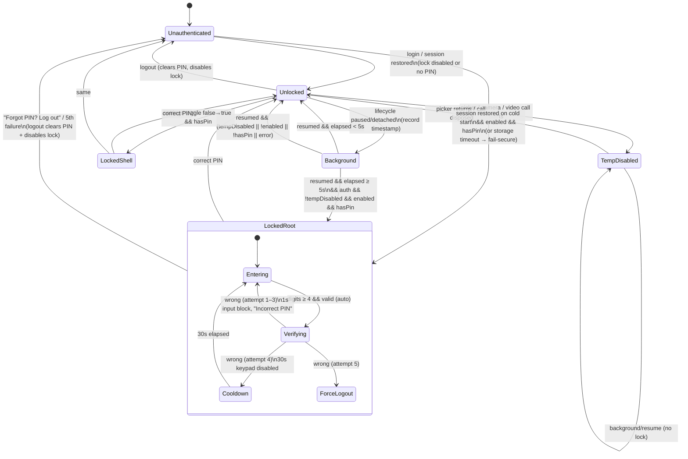

# 03 — App Lock (PIN + biometrics)

Scope: the local "app lock". It covers PIN storage and rules, the lock triggers (cold start, background ≥ 5 s, "just enabled"), the lock screen UI, the settings screen, PIN setup after registration, the one-time biometric prompt, the temporary-disable mechanism for pickers and video calls, how logout cleans up, and the lessons from the "PIN freeze" incident.

Source files:
- `lib/core/services/app_lock_service.dart` (166 lines)
- `lib/core/services/app_lock_provider.dart` (85)
- `lib/core/services/lock_manager.dart` (91)
- `lib/core/widgets/app_lock_lifecycle_layer.dart` (138)
- `lib/core/widgets/app_lock_wrapper.dart` (125)
- `lib/core/widgets/app_lock_screen.dart` (317)
- `lib/features/settings/presentation/screens/app_lock_settings_screen.dart` (562)
- `docs/APP_LOCK_PIN_FREEZE_FIX.md`

Touchpoints elsewhere:
- `auth_provider.dart:198-217`
- `register_otp_verify_screen.dart:278-325, 404-460`
- `doctor_otp_verify_screen.dart:123-170, 263-315`
- `home_screen.dart:43-78`
- `profile_screen.dart:136-139`
- the pickers and video call screens listed in §9

> The app lock is **purely local**. There is no backend endpoint. The PIN never leaves the device.

---

## 1. Summary of the actual behaviour

| Aspect | Implemented behaviour |
|---|---|
| Factor | A numeric PIN of 4–6 digits. **Biometrics are NOT used to unlock**; the code exists but is never called (§8). |
| Storage | `flutter_secure_storage` (Android Keystore-backed EncryptedSharedPreferences; iOS Keychain). The PIN is stored in **plaintext** (not hashed). |
| Lock triggers | (a) cold start while authenticated; (b) resume after the app has been in background (`paused`/`detached`) for **≥ 5 s**; (c) the moment the lock is switched on while a PIN already exists. All three require lock enabled AND a PIN set AND authenticated AND not temporarily disabled. |
| Attempts | 5 wrong PINs trigger a forced logout. Attempts 1–3 have no cooldown; attempt 4 or later causes a 30 s keypad cooldown. The counter lives in memory only. |
| Recovery | The "Forgot PIN? Log out" link logs the user out, which also clears the PIN and disables the lock. |
| Inactivity setting | The settings UI offers 30 s or 60 s, but this value is **ignored**; the threshold is hard-coded at 5 s. |
| Default | The lock is off. It is offered after registration via a "Set up PIN" dialog; if the user accepts, the lock is enabled. |

---

## 2. Storage model (`app_lock_service.dart:9-19`)

```
FlutterSecureStorage(
  aOptions: AndroidOptions(sharedPreferencesName: 'shifa_app_lock_prefs', resetOnError: false),
)   // no iOS options → default Keychain accessibility
```

`resetOnError: false` is deliberate. It prevents the PIN from being wiped on a transient `BadPaddingException` (see the comment at `:6-8`).

| Key | Values | Meaning | Used by |
|---|---|---|---|
| `app_lock_pin` | a digit string of 4–6 characters (trimmed) | The PIN, **plaintext** | set, verify, hasPin, clear |
| `app_lock_enabled` | `'true'` / `'false'` (absent means false) | Master switch | everywhere |
| `biometric_enabled` | `'true'` / `'false'` | Would be the biometric toggle; **never read in UI** | unused |
| `app_lock_inactivity_seconds` | an int string, default 30 | "Lock after inactivity" choice | settings screen only (not enforced) |
| `app_lock_seen_biometric_prompt` | `'true'` | Whether the one-time home prompt has been shown | home screen |

API of `AppLockService`, with constants at `:22-42`:
- Constants: `maxPinAttempts = 5`, `minPinLength = 4`, `maxPinLength = 6`, `defaultInactivitySeconds = 30`.
- `static isValidPin(pin)`: `trim()`, the length must be 4–6, and the value must match `^\d+$`.
- `static cooldownSecondsAfterFailedAttempt(n)`: `n <= 3 ? 0 : 30`.
- `isLockEnabled()`, `setLockEnabled(bool)`.
- `setPin(pin)` throws `ArgumentError('PIN must be 4-6 digits')` if the PIN is invalid, and writes `pin.trim()`. `getPin()`, `hasPin()` (non-null and non-empty), `clearPin()` (delete).
- `verifyPin(entered)`: returns false if the PIN is invalid or none is stored; otherwise `stored.trim() == entered.trim()`. This is a plain string compare, not constant-time.
- `getInactivitySeconds()` (default 30) and `setInactivitySeconds(int)`.
- `hasSeenBiometricPrompt()` and `setHasSeenBiometricPrompt()`.
- `isBiometricAvailable()`: returns false on web; otherwise `canCheckBiometrics && isDeviceSupported()`, and false on any exception.
- Unused biometric methods: `getAvailableBiometrics()`, `isBiometricEnabled()`, `setBiometricEnabled()`, and `authenticateWithBiometric()`. The last uses `localizedReason: 'Please authenticate to unlock the app'` (hard-coded English), `biometricOnly: true` and `stickyAuth: true`.

The first-launch cleanup in `main.dart:34-38` (the `has_launched_before` flag in SharedPreferences) clears only the **auth token**, with a 3 s timeout. It does **not** clear the app-lock keys. On iOS the Keychain survives an uninstall, so a stale `app_lock_pin` and `app_lock_enabled` can survive a reinstall. The user is unauthenticated after the reinstall, so the lock does not trigger; logging in again does not reset these keys, although logout does (§10). **UNVERIFIED**: whether a stale enabled PIN then locks the user right after they log in again on iOS. It probably does, via the resume or "just enabled" paths.

---

## 3. Riverpod state (`app_lock_provider.dart`)

| Provider | Type | Purpose |
|---|---|---|
| `appLockServiceProvider` | `Provider<AppLockService>` | Singleton service |
| `lockManagerProvider` | `StateNotifierProvider<LockManager, bool>` | `true` = "resume-lock required". It registers `WidgetsBinding.addObserver(manager)` and removes it in `ref.onDispose`. |
| `appLockStateProvider` | `StateNotifierProvider<AppLockStateNotifier, bool>` | Mirrors `app_lock_enabled`. The **initial value is `false`**, followed by an async `_checkLockStatus()` read from storage. `setLockEnabled(b)` writes storage and then the state. |
| `appLockTemporaryDisableProvider` | `StateNotifierProvider<..., bool>` | `disable()` sets true and `enable()` sets false. It suppresses the lock during pickers and calls. |
| `appLockNeedsUnlockProvider` | bool | **Unused** (left over from the pre-fix design) |
| `appLockPausedAtProvider` | `StateProvider<DateTime?>` | **Unused** |

---

## 4. Architecture: three gates

```
ProviderScope
└── AppLockLifecycleLayer           (ROOT gate: cold start + resume; replaces the entire app)
    └── MaterialApp.router
        ├── StatefulShellRoute → AppLockWrapper → MainShell (tabs)          (SHELL gate #1)
        └── ShellRoute         → AppLockWrapper → Scaffold + bottom bar    (SHELL gate #2)
```

### 4.1 Root gate: `AppLockLifecycleLayer` (`app_lock_lifecycle_layer.dart`)

State: `_showLockScreen` (the cold-start lock) and `_coldStartCheckDone`. The storage timeout is 5 s.

**Cold-start check** (`:57-75`). It is scheduled post-frame in `initState`. It is also re-scheduled from `ref.listen(authStateProvider)` when auth becomes authenticated and the check has not run yet (`:101-105`), because auth restore is async.
1. If the check is already done, or the widget is unmounted, return.
2. If not authenticated, return without marking done, so it retries when auth arrives.
3. Set `_coldStartCheckDone = true`. It runs **once per process**.
4. If temporarily disabled, return.
5. `_shouldShowLock()`: `Future.wait([isLockEnabled, hasPin]).timeout(5 s)`, which returns `enabled && hasPin`. **On timeout or exception it returns `true` (fail-secure).**
6. If the result is true, `setState(_showLockScreen = true)`.

**Build** (`:97-137`):
- `shouldShowLockFromResume = ref.watch(lockManagerProvider)`.
- If neither flag is set, return the child, the normal app.
- Otherwise **replace the whole app** with a dedicated gate app:
  ```
  MaterialApp(debugShowCheckedModeBanner: false, theme: AppTheme.lightTheme,
              locale: languageProvider.locale, supportedLocales: en,de,uz,ru, l10n delegates,
              home: PopScope(canPop: false, child: AppLockScreen(onUnlock, onForceLogin)))
  ```
- `onUnlock`: calls `lockManager.unlock()` (state false) and sets `_showLockScreen = false`.
- `onForceLogin`: calls `authStateProvider.logout()` (not awaited), then `lockManager.unlock()`, then `_showLockScreen = false`. The router refresh then sends the user to `/login`.

Consequence of the replacement: while locked, `MaterialApp.router` and everything under it is **unmounted**. On unlock it is rebuilt from the same `GoRouter` object, which lives in a provider. The following are therefore affected (**UNVERIFIED** runtime specifics):
- The GoRouter location should be restored.
- Widget state is lost: scroll positions, text fields, open dialogs and bottom sheets, and imperative `Navigator.push` pages (§3.2 of 02).
- If the lock triggers during the splash screen, the splash is disposed and **replays** after unlock.
- Background providers keep running while locked because the codebase has no `autoDispose`. The unread-count pollers, for example, continue.

### 4.2 Resume trigger: `LockManager` (`lock_manager.dart`)

`LockManager` is a `StateNotifier<bool>` with `WidgetsBindingObserver`, and `backgroundLockThreshold = 5 s` (`:17`).

| Lifecycle event | Action |
|---|---|
| `paused`, `detached` | `_backgroundTimestamp = now` |
| `resumed` | If there is no timestamp, return. `elapsed = now - ts`, then clear ts. If `elapsed < 5 s`, return (a brief interruption). Otherwise `Future.microtask(_requireUnlockIfNeeded)`. |
| `inactive`, `hidden`, others | Ignored. This covers the notification shade, share sheets, system dialogs, the biometric prompt and screenshots. |

`_requireUnlockIfNeeded` (`:61-82`) returns without locking in each of these cases, in order:
1. The state is already true (double-trigger guard).
2. The user is not authenticated.
3. Temporary disable is active.

Otherwise it awaits `Future.wait([isLockEnabled, hasPin])`, with **no timeout here**, and sets state true if both are true. Errors are swallowed, so there is **no lock** on error. This is fail-open, unlike the root gate.

`unlock()` sets state false.

### 4.3 Shell gate: `AppLockWrapper` (`app_lock_wrapper.dart`)

Each shell has its own instance, with state `_isLocked`, `_isInitialized` and `_prevLockEnabled`.

- **Not authenticated**: it returns the child directly (`:63-65`).
- **Init** (post-frame):
  - If not authenticated, it is initialised and unlocked.
  - Otherwise it reads `isLockEnabled()` with a 5 s timeout (the timeout yields `false`) and sets `_prevLockEnabled` to the result.
  - Until init is done it renders `Scaffold(backgroundColor: white, body: Center(CircularProgressIndicator(color #17C3B2)))`. That spinner flashes briefly every time a shell is mounted.
- **"Just enabled" lock** (`:79-98`):
  - `lockJustEnabled = appLockStateProvider && !_prevLockEnabled`.
  - If it is true and the gate is not already locked, it checks `hasPin()` post-frame. If a PIN exists, it sets `_isLocked = true`.
  - `_prevLockEnabled` is then updated on every build.
  - Effect: switching the lock on in settings while a PIN exists **immediately shows the PIN screen**, and the user must enter it.
- If the provider becomes disabled while locked, it unlocks post-frame.
- **While locked** it renders `AppLockScreen(onUnlock: _isLocked = false, onForceLogin: logout + unlock)` in place of the shell. It sits inside the router page, so the bottom bar is hidden, and it is not in the gate `MaterialApp`.
- **UNVERIFIED race**:
  - `appLockStateProvider` starts at `false` and loads asynchronously.
  - If the wrapper's init reads `true` before the provider does, one build sets `_prevLockEnabled = false`. The provider's later flip to `true` then looks like "just enabled" and locks again.
  - The result would be a second PIN prompt right after a cold-start unlock. The ordering normally prevents this, because the provider's read is started first.

---

## 5. State machine



`LockedShell` uses the same `AppLockScreen` and the same attempt rules, but it renders inside the shell rather than in the root gate.

---

## 6. Lock screen: `AppLockScreen` (`app_lock_screen.dart`)

Parameters: `onUnlock: VoidCallback` (required) and `onForceLogin: VoidCallback?`. When `onForceLogin` is set, the recovery link and the 5-attempt logout are enabled; all current call sites set it.

### 6.1 Layout (`:106-230`)

```
PopScope(canPop: false)
└─ Scaffold(background #FFFFFF) → SafeArea → Center → Padding(24) → Column(mainAxis: center)
   ├─ ClipRRect(r14) Image.asset('assets/branding/shifa_logo.png', 64×64, contain)
   ├─ 24
   ├─ Text(unlockShifa)            24sp, bold, Colors.black87
   ├─ 8
   ├─ Text(enterPinToUnlock)       14sp, Colors.grey (#9E9E9E), centred
   ├─ 40
   ├─ Container(width 200, vertical padding 16) → Row(center)
   │     6 dots (always maxPinLength=6, even for a 4-digit PIN):
   │     16×16 circle, horizontal margin 8; filled = #17C3B2, empty = grey[300] #E0E0E0
   ├─ if (error || cooldown): 16 + Text(red, 14sp)
   │     cooldown active → translate('tryAgainInSeconds').replace('{{seconds}}', remainingSec.clamp(0,999))
   │     else            → errorMessage (incorrectPin)
   ├─ 24
   ├─ if onForceLogin: TextButton(Text(forgotPinLogOut, 14sp, #17C3B2, underline))
   ├─ 24
   └─ IgnorePointer(ignoring: cooldownActive) → Opacity(cooldownActive ? 0.5 : 1) → Keypad
```

Keypad (`:232-316`):
- Rows are `1 2 3`, `4 5 6`, `7 8 9`, `[80 dp spacer] 0 ⌫`.
- Horizontal gaps are 16 between keys. The last row has **no** gap between the spacer and `0`, so `0` sits 8 dp left of centre; reproduce this or fix it deliberately.
- Vertical gaps between rows are 16.
- Each key is an 80×80 circle with a 1 dp `grey[300]` border, a transparent fill, and an `InkWell` with radius 40.
- Digit text is 24sp w500 black87. Backspace is `Icons.backspace`, 24, black87.
- The column is not scrollable. On very short screens (below about 740 dp of usable height) it may overflow. **UNVERIFIED**.

### 6.2 Input logic (`:26-98`)

State: `_enteredPin`, `_errorMessage`, `_failedPinAttempts` (in memory only), `_cooldownUntil`.

Digit press:
1. Ignore the press if `_cooldownUntil != null`, even a zero-length cooldown (see step 4 of the verify flow), or if the length is already 6.
2. Append the digit and clear the error.
3. `HapticFeedback.selectionClick()`.
4. **If `length >= 4` and the PIN is valid, call `_verifyPin()` immediately.** This is auto-submit with no confirm button.

Backspace:
- Blocked while `_cooldownUntil != null`.
- Removes the last digit, clears the error, and plays the selection haptic.

`_verifyPin()`:
1. `service.verifyPin(entered)`. If it matches, call `onUnlock()`.
2. If it does not match:
   - `attempts = failed + 1`.
   - Set `_errorMessage = incorrectPin` and clear the input.
   - `_cooldownUntil = now + cooldownSecondsAfterFailedAttempt(attempts)`, which is 0 for attempts 1–3 and 30 s from attempt 4.
3. Start a 1 s tick loop. It calls `setState` every second until `now >= _cooldownUntil`, then clears **both** `_cooldownUntil` and `_errorMessage`. The net effect:
   - After attempts 1–3, "Incorrect PIN" shows and input is blocked for about 1 s. Then the error disappears.
   - After attempt 4, a 30 s "Try again in N seconds" countdown runs, with the keypad dimmed and disabled.
4. `HapticFeedback.vibrate()`.
5. If `attempts >= 5`, call `onForceLogin()`.

> **CRITICAL BUG — do not port as-is.** Auto-verify fires as soon as 4 digits are entered. A user whose PIN is **5 or 6 digits** can never type it. Every attempt is checked at 4 digits, fails, and counts toward the 5-attempt forced logout. 5- and 6-digit PINs **can** be created, through the settings dialog (explicit Confirm) and the registration dialog (TextField, maxLength 6).
>
> Recommended port: store the PIN length (or a hash plus the length) and auto-submit when `entered.length == storedLength`, or require the user to press a confirm key.

Other behaviours:
- The attempt counter resets whenever the lock screen is re-mounted, for example after any unlock or app restart. Killing the app during the 30 s cooldown therefore resets it.
- Biometrics are **never offered** on this screen.

---

## 7. Settings screen: `AppLockSettingsScreen` (`/account/app-lock`)

Entry points:
- Profile screen tile: label `appLock` (fallback 'App Lock'), `Icons.lock_outline_rounded`, `push('/account/app-lock')` (`profile_screen.dart:136-139`).
- The home biometric prompt's "Enable" button (§8).

The screen lives in the plain `ShellRoute`, so the bottom bar is visible and no tab is highlighted.

### 7.1 Load
`initState` → `_loadSettings()`: `hasPin()` and `getInactivitySeconds()`. While loading it shows `Scaffold(AppBar(title: appLock), body: Center(CircularProgressIndicator()))`. The AppBar uses the theme: primary background, white 20 bold centred title.

### 7.2 Layout (`:235-340`)
`ListView(padding: 16)` with these children:

1. **Only if `lockEnabled && hasPin`**: `Card` → `ListTile`, followed by a 16 dp gap.
   - Leading: `Icon(Icons.timer_outlined, color #17C3B2)`.
   - Title: `translate('lockAfterInactivity')`.
   - Subtitle: `"{n} {translate('seconds')}"`.
   - Trailing: `DropdownButton<int>` with items `[30, 60]`, displayed as `"{s} {translate('sec')}"`. On change it calls `setInactivitySeconds(v)` and updates local state.
   - **The chosen value has no effect** (LockManager uses 5 s).
2. `Card` → `SwitchListTile`:
   - Title `enableAppLock`.
   - Subtitle: `appLockEnabled` when on, `appLockDisabled` when off.
   - Value: `appLockStateProvider`.
   - Secondary: `Icon(Icons.lock_outline, #17C3B2)`.
   - `onChanged: _toggleAppLock`.
3. 16 dp gap.
4. `Card` → `Column`:
   - Header `Padding(16) Row[Icon(Icons.pin, #17C3B2), 12, Text(pinCode, 18 bold)]`, then `Divider(height 1)`.
   - If there is no PIN: a `ListTile` with title `setUpPin`, subtitle `setUpPinDescription`, trailing `Icons.arrow_forward_ios` 16, and `onTap: _setUpPin`.
   - If a PIN exists:
     - `ListTile(changePin / changePinDescription, arrow_forward_ios 16, onTap _changePin)`.
     - `Divider(1)`.
     - `ListTile(title: Text(clearPin, red), subtitle: clearPinDescription, trailing: Icon(Icons.delete_outline, red, 20), onTap _clearPin)`.

### 7.3 Flows

**Toggle** (`_toggleAppLock(enabled)`, `:42-79`):
1. Call `appLockStateProvider.setLockEnabled(enabled)` **first**, whether or not a PIN exists.
2. If enabling with no PIN, show an `AlertDialog` (dismissible) with title `setUpPin`, content `setUpPinRequired`, and buttons `cancel` (returns false) and `setUp` (returns true).
   - true → `_setUpPin()`.
   - Anything else, including a barrier tap → `setLockEnabled(false)`.
3. `_loadSettings()`.

If a PIN already exists and the user switches the lock on, the shell `AppLockWrapper` detects "just enabled" and **locks immediately** (§4.3).

**Set up PIN** (`_setUpPin`, `:81-114`):
1. `pin = _PinEntryDialog(title: setUpPin, hint: enterPinCode)`.
2. If the PIN is valid, `confirm = _PinEntryDialog(title: confirmPin, hint: reEnterPin)`.
   - If they match: `setPin(pin)`, then a SnackBar `pinSetSuccessfully`, then reload. **Note: this does NOT enable the lock.** Only the toggle path has already enabled it.
   - If they do not match: SnackBar `pinsDoNotMatch`.
3. If the PIN is invalid and non-empty: SnackBar `translate('pinLengthRequirement')`. This branch is practically unreachable because the dialog only returns valid PINs.

**Change PIN** (`_changePin`, `:116-173`):
1. `current = dialog(title: enterCurrentPin, hint: enterCurrentPin)`. If the dialog is cancelled, stop.
2. `verifyPin(current)` fails → SnackBar `incorrectPin`, stop. **Wrong attempts here are not counted or rate-limited.**
3. `newPin = dialog(enterNewPin, enterNewPin)`, then `confirm = dialog(confirmNewPin, reEnterPin)`.
   - If they match: `setPin`, SnackBar `pinChangedSuccessfully`, reload.
   - If they do not: `pinsDoNotMatch`.
   - Invalid: `pinLengthRequirement`.

**Clear PIN** (`_clearPin`, `:193-223`):
1. `AlertDialog(title: clearPin, content: clearPinConfirmation, actions: cancel, TextButton(clear, red foreground))`.
2. On confirm: `clearPin()`, then `setLockEnabled(false)`, then SnackBar `pinCleared`, then reload.
3. The current PIN is **not required** to clear it.

### 7.4 `_PinEntryDialog` (settings version, `:345-562`)

It is opened with `showDialog(barrierDismissible: false)` and returns `String?` (null means cancel).

```
Dialog → Padding(24) → Column(min)
  Text(title, 20sp bold) · 8 · Text(hint, 14sp, grey[600] #757575) · 24
  Dots row (identical to the lock screen: 6 × 16dp, #17C3B2 / grey[300], container 200 wide, v-pad 16)
  24 · Keypad (identical to the lock screen: 80dp circles, 16 gaps)
  16 · Row(center)[ TextButton(cancel) → pop(null),
                    if length ≥ 4: FilledButton(confirm) → pop(pin) if isValidPin ]
```

- There is no auto-submit here.
- Each digit and each backspace triggers `HapticFeedback.selectionClick()`.
- A maximum of 6 digits is enforced.

---

## 8. Biometrics (currently a dead end)

- **One-time prompt on Home** (`home_screen.dart:43-78`). It runs after the Home screen's first frame.
  - It is skipped on web.
  - It is shown only if `!hasSeenBiometricPrompt() && isBiometricAvailable()`.
  - It is an `AlertDialog(barrierDismissible: false)` with title `enableBiometricForAppSecurity` and content `enableBiometricPrompt`. The actions are `TextButton(skipBiometric)` and `FilledButton(enableBiometric, fallback 'Enable')`.
  - Afterwards `setHasSeenBiometricPrompt()` is **always** called, so the prompt never repeats.
  - If the user chose "enable", it does `push('/account/app-lock')`.
- The settings screen has **no biometric toggle**, and nothing ever calls `authenticateWithBiometric()`. The prompt therefore promises something the app does not do.
- It appears regardless of whether a PIN or lock exists, and even right after the user skipped the PIN setup at registration.
- Recommended KMP behaviour, to be confirmed with product:
  - Add "Unlock with biometrics" in settings. It should be visible only when a PIN exists and biometrics are available, and backed by `biometric_enabled`.
  - On the lock screen, auto-prompt biometrics when enabled, with the PIN as fallback. Use `biometricOnly`, and ignore the `inactive` lifecycle caused by the system prompt, which the original already does.

---

## 9. Temporary disable (pickers, camera, video)

The OS picker, camera or call UI sends the app to `paused`. Without this mechanism, returning after 5 s or more would lock the user out mid-flow. Callers call `appLockTemporaryDisableProvider.notifier.disable()` before the external UI and `enable()` afterwards, on every exit path including errors.

| Call site | Wrapped operation |
|---|---|
| `chat_conversation_screen.dart:172-185, 229, 259-265, 332` | image gallery picker and camera for chat attachments |
| `appointment_booking_flow_screen.dart:760-770` | `FilePicker` (PDF) during booking |
| `documents_screen.dart:320-513` (multiple) | camera, file picker and gallery for document upload |
| `video_call_screen_mobile.dart:122` disable, `:59` enable in `dispose()` | **for the entire video call** |
| `video_call_screen_web.dart:53` disable, `:47` enable | web variant |

The flag is checked in `LockManager._requireUnlockIfNeeded` (`:67`) and in the root cold-start check (`app_lock_lifecycle_layer.dart:64`). It is not persisted.

---

## 10. Interaction with auth

- **Logout** (`auth_provider.dart:198-217`) runs only if currently authenticated:
  1. `updateFcmToken('')` (errors ignored).
  2. **`clearPin()`, then `setLockEnabled(false)`, then `appLockStateProvider.setLockEnabled(false)`** (errors ignored).
  3. Repository logout.
  4. `state = AuthState.initial()`.

  The biometric-seen flag and the inactivity value are **not** cleared. Every logout, including the forced one after 5 failed PINs and a 401 from the API, therefore wipes the PIN.
- **Post-registration PIN setup** (`register_otp_verify_screen.dart:278-325`, and the identical `doctor_otp_verify_screen.dart:123-170`). It runs after a successful OTP verification, before `go('/home')`:
  1. `AlertDialog(barrierDismissible: false)` with title `setUpPin` and content `setUpPinDescription`. Actions: `TextButton(translate('skip'))` returns false; `FilledButton(setUpPin)` returns true.
  2. If true, a PIN dialog: a **different** widget from the settings one. It is an `AlertDialog` with a `TextField`:
     - `keyboardType: number`, `obscureText: true`, `maxLength: 6`, `FilteringTextInputFormatter.digitsOnly`.
     - hint `enterPinCode`, helper `translate('pinLengthRequirement')`, `counterText: ''`.
     - Actions: Material `cancelButtonLabel` and `FilledButton(okButtonLabel)`. OK and keyboard submit pop only when `isValidPin`.
  3. A confirm dialog with title `confirmPin` and hint `reEnterPin`.
  4. If the two match: `setPin(pin)`, then **`appLockStateProvider.setLockEnabled(true)`**, then SnackBar `pinSetSuccessfully`. Any cancel or mismatch silently skips; there is no mismatch message here.
  5. `go('/home')`.
- **Password login** (`/login`) does **not** offer PIN setup. A user who logs in normally gets a lock only through Settings.
- A **401 while locked**: background pollers keep running, so a 401 can arrive. It calls logout, which clears the PIN. The root gate stays visible because `_showLockScreen` is not reset by auth changes. The user can only leave through "Forgot PIN? Log out": `onForceLogin` calls logout (a no-op at that point) and then unlocks, which reveals `/login`. **UNVERIFIED** but follows from the code.

---

## 11. Lessons from the freeze fix (`docs/APP_LOCK_PIN_FREEZE_FIX.md`)

1. **The lock UI must not be an overlay over a live app.** The first version drew the PIN screen in a `Stack` above `MaterialApp.router`. After a resume, the underlying Navigator/Overlay could steal hit-testing or focus, so the PIN screen was visible but ignored touches, which looked like a freeze. The fix **replaces** the whole app with a separate `MaterialApp` that contains only the PIN screen.
2. **Storage reads must be time-bounded.** Secure storage can hang on resume on some devices. A 5 s timeout was added, and a timeout **shows the lock** (fail-secure).
3. **There must be a single resume handler.** Duplicate post-frame callbacks and a lost `mounted` check caused a PIN bypass. The current code centralises resume handling in `LockManager`, with an "already locked" guard. The doc's references to `_resumeCheckScheduled` and `_maybeShowLockOnResumed` inside the layer are **stale**; that logic moved into `LockManager`.
4. **Ignore `inactive`.** Only `paused`/`detached` count as background, and there is a 5 s minimum absence, so screenshots, the notification shade and permission or biometric dialogs do not lock.
5. **Debug logging** is gated by `kDebugMode`, with the prefixes `[LockManager]` and `[AppLockLifecycle]`.

---

## 12. l10n keys used

These keys are used on the lock screen, in settings, in the registration setup, and in the home prompt:

`unlockShifa`, `enterPinToUnlock`, `incorrectPin`, `tryAgainInSeconds` (placeholder `{{seconds}}`), `forgotPinLogOut`, `appLock`, `lockAfterInactivity`, `seconds`, `sec`, `enableAppLock`, `appLockEnabled`, `appLockDisabled`, `pinCode`, `setUpPin`, `setUpPinDescription`, `setUpPinRequired`, `setUp`, `cancel`, `changePin`, `changePinDescription`, `clearPin`, `clearPinDescription`, `clearPinConfirmation`, `clear`, `pinCleared`, `confirmPin`, `reEnterPin`, `pinSetSuccessfully`, `pinsDoNotMatch`, `pinLengthRequirement`, `enterCurrentPin`, `enterNewPin`, `confirmNewPin`, `pinChangedSuccessfully`, `enterPin`, `enterPinCode`, `confirm`, `skip`, `enableBiometricForAppSecurity`, `enableBiometricPrompt`, `skipBiometric`, `enableBiometric`.

Many getters have hard-coded English fallbacks, such as `'Forgot PIN? Log out'` and `'Incorrect PIN'`. The registration PIN dialog uses the platform `MaterialLocalizations` for Cancel and OK.

---

## 13. KMP/CMP porting notes

- **A single lock gate at the root of the Compose tree:**
  ```kotlin
  if (locked) LockScreen(...) else AppNavHost(...)
  ```
  This is the equivalent of the fix. Do **not** use an overlay dialog over the NavHost.
  - To keep navigation state across a lock, keep the NavController or back stack in a holder that survives. With Navigation Compose, `rememberNavController` recreated under an `if` would lose state, so hoist it above the gate. The original loses widget state on lock; decide whether to match it or improve on it.
  - One gate is enough. Merge the three original gates (root cold-start, resume, and the per-shell "just enabled") into one `AppLockController` with a `StateFlow<LockState>`.
- **Lifecycle.** Use `ProcessLifecycleOwner` (`ON_STOP`/`ON_START`) on Android, and `UIApplicationDidEnterBackground`/`WillEnterForeground` notifications on iOS, via `expect/actual`. These correspond to `paused` and `resumed` and naturally ignore `inactive`. Keep the 5 s threshold, or honour the (currently ignored) 30/60 s setting after confirming with product.
- **Secure storage.**
  - Android: `EncryptedSharedPreferences` / Jetpack DataStore plus a Keystore-wrapped key.
  - iOS: Keychain via `expect/actual`, or a KMP library such as `multiplatform-settings` with a Keychain backend, or KVault.
  - Use `kSecAttrAccessibleWhenUnlockedThisDeviceOnly` on iOS.
  - **Hash the PIN** (PBKDF2 or Argon2 with a per-install salt) and compare in constant time. Store the PIN length separately to support auto-submit.
  - On first launch after an iOS reinstall (tracked by a non-Keychain flag), also clear the lock keys.
- **Biometrics.** `androidx.biometric.BiometricPrompt` with `BIOMETRIC_STRONG` on Android, and `LAContext.evaluatePolicy(.deviceOwnerAuthenticationWithBiometrics)` on iOS, behind an `expect class BiometricAuthenticator`. `NSFaceIDUsageDescription` must be in `Info.plist`. Localise the reason string; the original hard-codes English.
- **Attempt limit.** Persist the failed-attempt count and the cooldown deadline in secure storage, so killing the app cannot reset them. Keep 5 attempts to logout and a 30 s cooldown from attempt 4. The original counter is in memory only.
- **Temporary disable.** Expose `AppLockController.suspend()` and `resume()` (a ref-counted `AtomicInt` is better than a boolean, because nested pickers could otherwise re-enable too early). Use it around ActivityResult launchers and PHPicker/UIImagePickerController, and for the whole video call.
- **Logout** must call `appLock.reset()`: clear the PIN and disable the lock. Keep this cross-feature contract.
- **Keypad UI.** Build it as a Compose grid of 80 dp circular `Surface`s with a 1 dp `#E0E0E0` border, 16 dp gaps, 24 sp w500 digits and a 6-dot indicator. Use `LocalHapticFeedback` or platform haptics (`TextHandleMove` for the key click, a longer vibration for errors).

---

## 14. Observed quirks / tech debt

1. **A 5–6 digit PIN can never unlock**, because verification auto-fires at 4 digits. This is critical (§6.2).
2. **Biometrics are not implemented.** The home prompt leads to a settings screen with no biometric option. `authenticateWithBiometric`, `biometric_enabled` and `getAvailableBiometrics` are dead code.
3. The **inactivity setting (30/60 s) is ignored**. The hard-coded threshold is 5 s. The subtitle `appLockEnabled` says the app will lock "when you close it".
4. **The toggle writes `enabled=true` before a PIN exists.** A crash or kill during the setup dialog leaves the lock enabled with no PIN. This is harmless, because the lock requires `hasPin`, but the stored state is inconsistent.
5. **Setting a PIN from the "Set Up PIN" tile does not enable the lock**, whereas registration does. The two behave inconsistently.
6. There are three lock mechanisms: the root cold-start flag, the `LockManager` resume flag, and the per-shell `AppLockWrapper`.
   - Switching between the tab shell and the plain shell re-mounts a wrapper, which flashes a white spinner.
   - There is a possible double-lock race (§4.3, **UNVERIFIED**).
7. The fail-secure/fail-open behaviour is inconsistent: the root cold-start check shows the lock on a storage timeout, while `LockManager` does not lock on error and has no timeout.
8. The fail-secure path can show the lock screen **even when no PIN is set** (for example, on a storage timeout). The only exit is then "Forgot PIN? Log out", or 5 wrong attempts.
9. The PIN is stored in plaintext, compared with a non-constant-time string compare, and the attempt counter is not persisted.
10. The lock keys survive an iOS reinstall. The first-launch cleanup clears only the auth token (§2).
11. "Change PIN" does not rate-limit wrong current-PIN attempts. "Clear PIN" requires no PIN at all, so anyone holding an unlocked phone can remove the lock.
12. Legacy colour `#17C3B2` is hard-coded throughout the lock UI instead of `AppDesignSystem.primary #00BBB0`. Colours from `Colors.grey`, `black87` and `red` bypass the design tokens.
13. On the lock screen and in the dialog keypad, `0` is 8 dp off-centre (the spacer has no gap). The lock screen column is not scrollable, so it may overflow on small screens (**UNVERIFIED**).
14. The PIN-entry dialog is implemented in **three** places: the settings `_PinEntryDialog` keypad, plus identical private TextField dialogs in the register-OTP and doctor-OTP screens.
15. `appLockNeedsUnlockProvider` and `appLockPausedAtProvider` are dead code. `APP_LOCK_PIN_FREEZE_FIX.md` describes fields that no longer exist.
