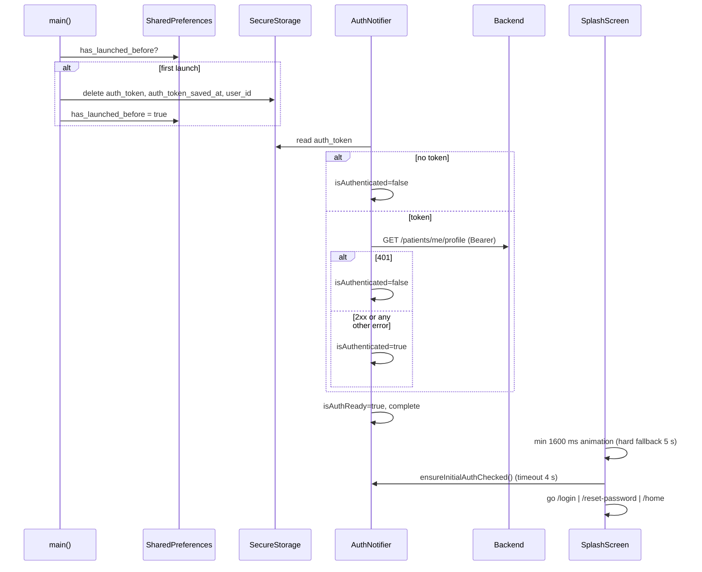
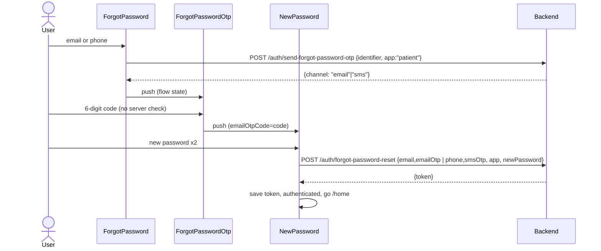
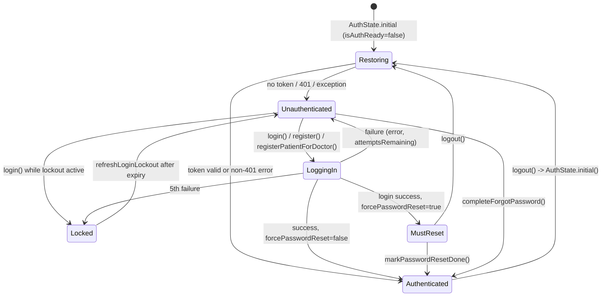

# 05 — Authentication & Account Lifecycle

> Scope: login, registration (with OTP), existing-doctor to patient conversion, existing-patient detection, forgot password, forced password reset, change password, splash/session restore, logout, login lockout, 401 handling.
> Source of truth is the Flutter app `shifa_patient_app_v1` (a.k.a. "Shifa Bemor"). Every claim cites `lib/<path>.dart:<line>`. Anything that could not be confirmed from code is marked **UNVERIFIED**.
> Strings are exported separately; this doc lists **l10n keys** only (section 10).

---

## 0. Source files covered

| Area | File |
|---|---|
| Repository (all auth HTTP) | `lib/features/auth/data/auth_repository.dart` |
| Firebase phone auth (dead code, see 1.1) | `lib/features/auth/data/phone_auth_repository.dart`, `lib/features/auth/providers/phone_auth_provider.dart` |
| OTP exceptions | `lib/features/auth/data/auth_exceptions.dart` |
| Auth state machine | `lib/features/auth/providers/auth_provider.dart` |
| Flow-scoped state holders | `lib/features/auth/providers/otp_verification_provider.dart`, `lib/features/auth/providers/registration_provider.dart` |
| Screens | `lib/features/auth/presentation/screens/*.dart` (12 files) |
| Token storage | `lib/core/utils/storage_service.dart` |
| Lockout | `lib/core/services/login_attempt_service.dart` |
| Password policy | `lib/core/utils/password_validation.dart` |
| Error sanitizing | `lib/core/utils/auth_error_sanitizer.dart`, `lib/core/localization/error_localizations.dart` |
| Phone input + normalization | `lib/core/widgets/phone_input_field.dart` |
| HTTP client (token injection, 401) | `lib/core/network/api_client.dart` |
| Router guard | `lib/app/router.dart` |
| Logout callback, FCM upload | `lib/app/app.dart` |
| First-launch keychain clear | `lib/main.dart` |
| User model (unused by auth) | `lib/core/models/user_model.dart` |

`lib/core/models/country_catalog.dart` is **not** used by auth (only by doctors filter: `lib/features/doctors/data/doctors_filter_catalog.dart:1`). The phone field uses the `country_code_picker` package instead (`lib/core/widgets/phone_input_field.dart:1`).

---

## 1. Feature overview

- Credentials: **identifier (email or phone) + password**. There is no SMS-login / passwordless login.
- Backend: Spring Boot REST, base URL `…/api` (see networking doc). All auth endpoints live under `/auth/*`.
- The login call is scoped to the patient app with the query param `app=patient` (`auth_repository.dart:59`). Forgot-password calls send `"app": "patient"` in the JSON body instead (`auth_repository.dart:408,433,463`).
- Auth result is a **JWT** (`token`) that goes to secure storage (`auth_repository.dart:67`). There is no refresh token. The session ends on logout, on a 401 from a protected endpoint, or on first launch after a reinstall.
- OTP codes are always **6 digits** (client check: `register_otp_verify_screen.dart:93`, `doctor_otp_verify_screen.dart:64`, `forgot_password_otp_screen.dart:79`).
- OTP delivery is **backend-driven**: `POST /auth/send-email-otp` (email) and `POST /auth/send-sms-otp` (SMS, Uzbek numbers only; the backend uses an SMS provider, "DevSMS" per the comment at `auth_exceptions.dart:1`, and can fall back to email on the server side).
- After successful registration or doctor conversion, the user is offered an optional **app-lock PIN setup** (4–6 digits). See the app-lock doc; the dialog lives in the auth screens (`register_otp_verify_screen.dart:278-325`).

### 1.1 Firebase Phone Auth: present but NOT used

- `PhoneAuthRepository` wraps `FirebaseAuth.verifyPhoneNumber` (120 s timeout, `phone_auth_repository.dart:44`) and web reCAPTCHA. `phoneAuthRepositoryProvider` is declared (`phone_auth_provider.dart:4`), but **nothing reads it**. Grep finds no consumer.
- `AuthRepository.forgotPasswordReset(idToken, newPassword)` (`auth_repository.dart:375-399`) is labeled "legacy". It only runs if `ForgotPasswordFlowState.idToken != null` (`forgot_password_new_password_screen.dart:84`), and nothing ever sets `idToken`.
- Leftover fields: `DoctorOtpVerificationState.verificationId` / `webConfirmationResult` (`otp_verification_provider.dart:10-11`) are set to `''`/null (`confirm_doctor_to_patient_screen.dart:49`). `ForgotPasswordFlowState.verificationId/webConfirmationResult/resendToken/idToken` (`otp_verification_provider.dart:46-49`) are never set.
- The router swallows the Firebase iOS reCAPTCHA callback URLs `/link` and `/__/auth` (`router.dart:196-205, 217-222, 292-295`).
- **KMP decision:** do not implement Firebase Auth. Firebase is still needed for FCM and Crashlytics only.

### 1.2 Orphaned / dead pieces (do not port unless the product asks)

- `AccountInfoScreen` (`/account-info`, a birth date / gender / address "step 2"). The route is registered (`router.dart:333-336`), but **nothing navigates to it** (grep for `AppRoutes.accountInfo` finds only the router). Because of this, `birthDate`, `gender`, `address` and `language` are **never sent** on registration (`register_otp_verify_screen.dart:102-110` passes only name, email, phone, password, OTP).
- `AuthRepository.checkExistingDoctor` (`auth_repository.dart:130-159`) is unused; `checkIdentifier` replaced it.
- `AuthState.user` (`auth_provider.dart:243`) is never populated. `StorageService.saveUserId` (`storage_service.dart:47`) is never called. `UserModel` is not used by the auth flows.

---

## 2. User flows

### 2.1 Cold start: splash and session restore

1. `main()` runs the first-launch check. If SharedPreferences `has_launched_before != true`, it calls `StorageService.clearAuthToken()` (3 s timeout) and then sets `has_launched_before = true` (`main.dart:34-38`). Purpose: iOS Keychain survives uninstall; this clears the stale token.
2. `AuthNotifier` is constructed with `AuthState.initial()` (`isAuthReady=false`) and schedules `_completeInitialAuthCheck` on a microtask (`auth_provider.dart:20-34`).
   - Test hook: when `PROMO_CAPTURE=true` (dart-define), state is forced to authenticated with token `promo-capture` (`auth_provider.dart:22-31`). Not needed in KMP.
3. `_checkAuth` (`auth_provider.dart:52-66`):
   - No token in secure storage → `isAuthenticated=false`.
   - Token present → `validateToken()` = `GET /patients/me/profile` (`auth_repository.dart:345-356`):
     - HTTP **401** → invalid → `isAuthenticated=false`.
     - Any other error (network, 5xx, timeout, non-Dio) → treated as **valid**, so the user stays signed in offline.
     - Success → `isAuthenticated=true`.
   - Any exception in the check → `isAuthenticated=false`.
   - The 401 also reaches the ApiClient interceptor (2.9), which clears the stored token.
   - `finally`: `isAuthReady=true` and the completer resolves (`auth_provider.dart:42-47`).
   - **`forcePasswordReset` is NOT persisted or restored.** It is always `false` after a cold start (quirk Q4).
4. `SplashScreen` (`splash_screen.dart`):
   - Plays a 1600 ms animation (`_minSplashDuration`, line 26): background lerps from brand `#17C3B2` to white, two radial-gradient blobs translate/scale/rotate, and a 96×96 logo fades in (lines 86-151).
   - When the animation completes, or after a 5 s hard fallback timer (`_hardFallback`, lines 28, 42), `_navigateAway` runs once (`_navigated` guard):
     - It waits for the remaining minimum splash time (lines 50-54).
     - It awaits `ensureInitialAuthChecked()` with a **4 s timeout** (`_authWaitTimeout`, lines 27, 56-63). On timeout it continues with the current state.
     - It then calls `context.go(...)`: `/login` if not authenticated, `/reset-password` if `forcePasswordReset`, otherwise `/home` (lines 67-74).
   - The router never redirects away from `/` (`router.dart:213-215`).



### 2.2 Login (identifier detection, normalization, lockout)

Screen `LoginScreen` at `/login` (`login_screen.dart`).

1. On first frame: `refreshLoginLockout()` (`login_screen.dart:33-35`). This re-reads the persisted lockout and clears a stale "attempts remaining" value (`auth_provider.dart:225-234`).
2. The user enters the identifier and password and taps **Sign In**. Form validation only checks that both fields are non-empty (`login_screen.dart:210-215, 235-240`).
3. Identifier normalization (`_usernameValue`, `login_screen.dart:46-51`):
   - `raw = text.trim()`.
   - If `raw` contains `@` → send `raw` as-is (not lowercased).
   - Else `normalizePhoneForSms(raw)` (`phone_input_field.dart:200-205`):
     - Strip to digits. If there are no digits, return `''`, and the login then sends `raw` unchanged.
     - If trimmed `raw` starts with `+` → return the trimmed raw string **unchanged** (spaces and dashes kept).
     - Else return `'+' + digits`. **No country code is prepended** (quirk Q8): `901234567` becomes `+901234567`.
   - Password is sent **untrimmed**.
4. `AuthNotifier.login(username, password)` (`auth_provider.dart:68-116`):
   - If `LoginAttemptService.isLockedOut()` is true, set `loginLockedUntilMinutes = clamp(ceil(remainingSec/60), 1, 5)`, `loginAttemptsRemaining=0`, `error=null`, and **return without calling the API** (lines 71-82).
   - Otherwise set `isLoading=true` and clear error, lockout and remaining (lines 84-89).
   - `POST /auth/login?app=patient` with body `{username, password}` (`auth_repository.dart:53-60`).
   - Success (200, non-empty `token`): save the token and its timestamp to secure storage, `clearAttempts()`, then set `isAuthenticated=true`, `token`, and `forcePasswordReset = response.forcePasswordReset ?? false` (`auth_provider.dart:91-101`).
   - Failure (**any** exception, including network errors): `recordFailedAttempt()`, then read `remainingAttempts()` and `lockoutRemainingSeconds()` and set `error=<sanitized message>` (the `Exception: ` prefix is stripped), `loginAttemptsRemaining=remaining`, `loginLockedUntilMinutes = justLocked ? clamp(ceil(sec/60),1,5) : (unchanged)` (lines 102-115).
5. Navigation after success is done by the **router redirect**, not the screen. `GoRouterRefreshNotifier` fires when `isAuthenticated` changes (`router.dart:76-81`). `/login` is an auth route, so the redirect goes to `/reset-password` if `forcePasswordReset`, else `/home` (`router.dart:244-260`).
6. Error UI (`login_screen.dart:82-110`). When `error` changes, a red SnackBar (5 s) shows `translateError(l10n, error)`. If `loginAttemptsRemaining > 0`, it appends `" " + loginAttemptsRemaining` with `{{count}}` replaced.
7. Inline banners (`login_screen.dart:151-201`):
   - Locked (`loginLockedUntilMinutes > 0`): red banner with a lock-clock icon and `accountLockedTryAgainIn` (`{{minutes}}` replaced).
   - Else if `0 < loginAttemptsRemaining < 5`: orange warning banner with `loginAttemptsRemaining` (`{{count}}`).
8. While locked, a 30 s periodic timer calls `refreshLoginLockout()` so the minutes count down and the lock clears when it expires (`login_screen.dart:86-93`). The Sign In button is disabled while `isLoading || isLoginLocked` (`login_screen.dart:257`).
9. Other actions: **Forgot password** text button → `push /forgot-password`. **Create Account** → `push /create-account`. The AppBar has a language toggle (`LanguageMiniToggle`) and there is an app version footer (`login_screen.dart:117-122, 276`).

Lockout rules are in 5.2.

```mermaid
sequenceDiagram
  actor U as User
  participant LS as LoginScreen
  participant AN as AuthNotifier
  participant LA as LoginAttemptService
  participant R as AuthRepository
  participant API as Backend
  participant Router
  U->>LS: identifier + password, tap Sign In
  LS->>LS: validate non-empty; normalize identifier
  LS->>AN: login(username, password)
  AN->>LA: isLockedOut()
  alt locked
    AN-->>LS: loginLockedUntilMinutes=N, remaining=0 (no API call)
  else not locked
    AN->>R: login()
    R->>API: POST /auth/login?app=patient {username,password}
    alt 200 + token
      R->>R: save auth_token + auth_token_saved_at
      AN->>LA: clearAttempts()
      AN-->>Router: isAuthenticated=true (+forcePasswordReset)
      Router->>Router: redirect /home or /reset-password
    else error
      R-->>AN: Exception(sanitized)
      AN->>LA: recordFailedAttempt()
      AN-->>LS: error, attemptsRemaining, maybe locked
      LS->>U: red SnackBar + banner
    end
  end
```

### 2.3 Forced password reset (first login)

- Trigger: the login response has `forcePasswordReset: true` (`auth_repository.dart:64`). The router then forces `/reset-password` for every location except splash (`router.dart:244-248`).
- `ResetPasswordScreen` (`reset_password_screen.dart`): no back button (`automaticallyImplyLeading:false`, line 91). Fields are new password (full policy) and confirm (must match). A live requirement checklist renders from the start (line 31).
- Submit: `POST /auth/reset-password` with `{ "newPassword": <trimmed> }` and the **Bearer token** (`auth_repository.dart:359-372`; not in the public list, so the token is attached).
- Success: `markPasswordResetDone()` sets `forcePasswordReset=false` (`auth_provider.dart:220-222`), then `context.go('/home')` (`reset_password_screen.dart:64-68`). The router does not refresh on this flag, so the explicit `go` is required.
- Failure: red SnackBar `userFriendlyError(...)`. Default message `Failed to reset password`.
- If an authenticated user without the flag lands on `/reset-password`, they are redirected to `/home` (`router.dart:251-255`).

### 2.4 Registration with OTP (new patient)

Screen `CreateAccountScreen` at `/create-account` (`create_account_screen.dart`). Fields and validation are listed in section 3.

1. Tap **Continue** (`continueToVerification`). Form validation runs, then `_isCheckingDoctor=true` (button shows a spinner) (lines 361-369).
2. `phone = _effectivePhone()` (lines 194-201): the full phone from the picker (`+<dial><digits>`) is normalized. It is `null` if there are fewer than 10 digits.
3. Guards (lines 375-392):
   - No email and no phone → SnackBar `phoneOrEmailRequired`.
   - No email and the phone is not Uzbek → SnackBar `emailRequiredForForeignPhone`.
4. **Existing-account detection**: `POST /auth/check-identifier` with `{phone?, email?}` (lines 394-397; `auth_repository.dart:93-126`).
   - `type == "patient"` → dialog `accountAlreadyExists` / `existingPatientMessage` / `ok`. Stop (lines 399-414).
   - `type == "doctor"` → dialog `existingDoctorTitle` / `existingDoctorMessage` (`{{name}}` = "first last") with `cancel` or `createPatientAccount`. On confirm: `push /confirm-doctor-to-patient` with extra `{phone, email|null, firstName, lastName}` (lines 415-445). See 2.5.
   - `type == "none"` (or HTTP 404, or empty body) → continue.
5. **Choose and send the OTP** (`_sendRegistrationOtp`, lines 71-120):
   - **Email given** → always the email channel: `POST /auth/send-email-otp {email}`. Destination = email. This holds even when a phone was also entered.
   - **No email** (so the phone is Uzbek):
     - If this screen instance has already sent 3 SMS (`_maxSmsAttempts=3`, line 37) → email fallback (step 6).
     - Otherwise `POST /auth/send-sms-otp {phone, fallbackEmail?}`:
       - Response `channel == "email"` (server fell back) → use the email channel. The email is the typed one, or else the user is prompted for one. **No second email send happens here**; the server already sent it (lines 97-108).
       - Otherwise the SMS channel is used and `_smsSendAttempts++`.
       - `SmsOtpUnavailableException` (503) or `OtpRateLimitException` (429) → email fallback.
6. **Email fallback** (`_continueWithEmailFallback`, lines 122-139): use the typed email, or show the non-dismissible `smsUnavailableTitle` dialog (text `smsFailedUseEmailMessage`, an email field, `cancel` / `continueWithEmail`). The dialog validates the email with the same regex and lowercases it (lines 141-191). Then `POST /auth/send-email-otp`. Cancel aborts silently.
7. Store the flow state:
   - `registrationProvider.updateStep1(firstName, lastName, phone, email=<channel email or null>, password, otpChannel)` (lines 456-463; values trimmed in `registration_provider.dart:84-99`).
   - `registerOtpVerificationProvider = {channel, destination}`.
   - Then `push /register-otp-verify`.
8. `RegisterOtpVerifyScreen` (`register_otp_verify_screen.dart`):
   - If the flow state is missing or incomplete, `go /create-account` (lines 44-51).
   - Message: `otpSentToEmail` (`{email}`), or `otpSentToPhone` (`{phone}`) with the phone masked as `+998 ** *** <last4>` (lines 77-82, 337-346).
   - Resend cooldown is **300 s**, starting at screen open, shown as `m:ss` (lines 18, 58-68, 272-276).
   - Resend (lines 203-270):
     - Email channel → `send-email-otp`.
     - SMS channel → if `_smsSendsUsed >= 3` (`_maxSmsSends`, line 20; the initial send counts as 1, line 35), switch to email: use the existing email or prompt, then `send-email-otp` and update the flow state to the email channel (lines 182-201).
     - Otherwise `send-sms-otp` with `fallbackEmail`, with the same fallback handling as step 5.
     - On success: restart the cooldown and show SnackBar `codeSentAgain`.
   - Verify (lines 84-124):
     - Code = digits of input. If the length is not 6 → SnackBar `invalidVerificationCode`.
     - `AuthNotifier.register(...)` → `POST /auth/register-patient` (see 4.x) with `emailOtp` or `smsOtp` according to the channel.
     - The backend verifies the OTP; the client has no separate verify call.
     - Success: token saved, `isAuthenticated=true` (`auth_provider.dart:131-150`). Both flow providers are cleared, then the **PIN setup prompt** shows, then `go /home`.
   - Back arrow clears `registerOtpVerificationProvider`, then pops (lines 353-356).
9. PIN setup prompt (`register_otp_verify_screen.dart:278-325`, same code in `doctor_otp_verify_screen.dart:123-170`):
   - Dialog `setUpPin` / `setUpPinDescription` with `skip` or `setUpPin`.
   - PIN dialog: numeric, obscured, max 6 digits, helper `pinLengthRequirement`. It accepts only when valid, meaning 4–6 digits (`app_lock_service.dart:25-39`).
   - Confirm dialog: must equal the first PIN.
   - Then `AppLockService.setPin(pin)`, `appLockStateProvider.setLockEnabled(true)`, and SnackBar `pinSetSuccessfully`.
   - Any mismatch or cancel skips silently.

```mermaid
flowchart TD
  A[Create Account form valid] --> B{email or phone?}
  B -- neither --> E1[SnackBar phoneOrEmailRequired]
  B -- phone only, non-UZ --> E2[SnackBar emailRequiredForForeignPhone]
  B -- ok --> C[POST /auth/check-identifier]
  C -- type=patient --> P[Dialog accountAlreadyExists - stop]
  C -- type=doctor --> D[Dialog existingDoctor] -->|createPatientAccount| DC[/confirm-doctor-to-patient/]
  C -- type=none or 404 --> F{email entered?}
  F -- yes --> EM[POST /auth/send-email-otp] --> V
  F -- no --> G{SMS sends on this screen >= 3?}
  G -- yes --> FB[Email fallback: use/prompt email, send-email-otp] --> V
  G -- no --> S[POST /auth/send-sms-otp phone, fallbackEmail?]
  S -- channel=email --> FE[email channel, no extra send] --> V
  S -- sms --> V
  S -- 503 SMS unavailable / 429 rate limit --> FB
  V[/register-otp-verify/ 6-digit code] --> R[POST /auth/register-patient + emailOtp or smsOtp]
  R -- token --> PIN[Optional PIN setup] --> H[/home/]
  R -- error --> V
```

### 2.5 Existing doctor → patient account conversion

Precondition: `check-identifier` returned `type=doctor` and the user confirmed (2.4 step 4).

1. `ConfirmDoctorToPatientScreen` at `/confirm-doctor-to-patient` (`confirm_doctor_to_patient_screen.dart`). If `state.extra` is null the router shows `CreateAccountScreen` instead (`router.dart:314-323`).
   - UI: medical icon (teal), text `doctorPatientAccountMessage` (the code replaces `{{name}}`, but the EN string has no placeholder), and button `sendVerificationCode`.
2. Send code (lines 32-63):
   - **Email is required**: it must be non-empty and contain `@`, else SnackBar `emailRequired`. A doctor matched by phone only dead-ends here (quirk Q7).
   - `POST /auth/send-email-otp {email}`.
   - Set `doctorOtpVerificationProvider = {phone, email, verificationId:'', doctorFirstName, doctorLastName}`, then `push /doctor-otp-verify`.
3. `DoctorOtpVerifyScreen` (`doctor_otp_verify_screen.dart`):
   - If state is null → spinner + `error`. If the email is empty → an error page with a back button (lines 176-206).
   - Text `otpSentToEmail`, field `enterEmailCode`, resend cooldown **300 s** (line 16). Resend = `send-email-otp` again.
   - Verify: 6 digits → `AuthNotifier.registerPatientForDoctor(phone?, email, emailOtp)` → `POST /auth/create-patient-for-doctor` (`auth_repository.dart:261-287`).
   - Success: token saved, `isAuthenticated=true` (`auth_provider.dart:172-196`), state cleared, PIN prompt, `go /home`.
   - The user later logs in with their **doctor password** (per the comment at `auth_provider.dart:171` and the copy).

### 2.6 Forgot password (email or phone OTP)

1. `ForgotPasswordScreen` at `/forgot-password` (`forgot_password_screen.dart`):
   - One field `emailOrPhone`, required (`emailOrPhoneRequired`).
   - Normalization: contains `@` → `toLowerCase()`, else `normalizePhoneForSms(raw)` (line 34).
   - `POST /auth/send-forgot-password-otp {identifier, app:"patient"}` returns `channel` (`"email"` default, or `"sms"`) (`auth_repository.dart:402-419`).
   - State: `forgotPasswordFlowProvider = {identifier, email: channel=='email' ? identifier : null, phone: channel=='sms' ? identifier : null, channel}`. Then `push /forgot-password-otp` (lines 41-49).
   - Back clears the flow state, then pops, or goes to `/login` if it cannot pop (lines 69-76).
2. `ForgotPasswordOtpScreen` at `/forgot-password-otp` (`forgot_password_otp_screen.dart`):
   - Message `otpSentToPhone`/`otpSentToEmail`. The phone is **not masked** here (lines 134-143).
   - Countdown **`codeExpiresIn` 600 s** (display only; it turns red at ≤ 60 s). **Resend cooldown 60 s** (lines 12-13, 170-174).
   - Resend = `send-forgot-password-otp` with the same identifier. It restarts both timers and shows SnackBar `codeSentAgain` (lines 101-123).
   - **Verify does NOT call the backend.** It checks for 6 digits, stores `emailOtpCode = code` (also used for SMS), and pushes `/forgot-password-new-password` (lines 71-99).
3. `ForgotPasswordNewPasswordScreen` at `/forgot-password-new-password` (`forgot_password_new_password_screen.dart`):
   - Guard: flow null, or both `idToken` and `emailOtpCode` null → spinner + `error` (lines 121-134).
   - No AppBar back button (line 138).
   - Fields: new password (full policy + checklist) and confirm.
   - Submit (lines 50-115), with `newPassword` trimmed:
     - `channel=='sms' && phone && code` → `POST /auth/forgot-password-reset {phone, smsOtp, app:"patient", newPassword}`.
     - else `email && code` → `POST /auth/forgot-password-reset {email, emailOtp, app:"patient", newPassword}`.
     - else `idToken` → legacy `{idToken, newPassword}` (dead).
     - else → throws `errorSessionExpiredPleaseStartAgain`.
   - Success: the response `token` is saved (**auto-login**). Flow cleared, `completeForgotPassword()` (`isAuthenticated=true`, `forcePasswordReset=false`), green SnackBar `passwordResetSuccess`, `go /home`.
   - An invalid OTP only surfaces here, as a red SnackBar.



### 2.7 Change password (signed in)

- Entry: Profile → Change password: `push /account/change-password` (`profile_screen.dart:146`). The route is inside the Account `ShellRoute`, so the bottom bar is visible (`router.dart:552-555`).
- `ChangePasswordScreen` (`change_password_screen.dart`):
  - Current password: required (trimmed non-empty, `required`).
  - New password: **only `length >= 6`** (`minimum6Characters`). This is not the full policy (quirk Q9).
  - Confirm: must equal the new password (`passwordsDoNotMatch`).
- Submit: `POST /auth/reset-password {currentPassword:<trimmed>, newPassword:<trimmed>}` with Bearer (`auth_repository.dart:499-516`). The same endpoint as the forced reset, told apart by the presence of `currentPassword`.
- Success: green SnackBar `passwordChangedSuccess`, then pop. The token is kept; whether the backend revokes other sessions is **UNVERIFIED**.
- Failure: red SnackBar, default `Failed to change password`. A 401 here does **not** log out because the path starts with `/auth/`.

### 2.8 Logout

Triggers:

| Trigger | Where |
|---|---|
| Profile → Log Out dialog (`logOut`, `signOutConfirm`, `cancel`) → `logout()` (not awaited) then `go /login` | `profile_screen.dart:373-397` |
| ApiClient 401 callback (2.9) | `app.dart:63-80` |
| App-lock screen "force login" (e.g. max PIN attempts) | `app_lock_wrapper.dart:116`, `app_lock_lifecycle_layer.dart:87` |
| Account deletion confirmed → `await logout()` → SnackBar `accountDeletedSuccess` → `go /login` | `delete_account_otp_verify_screen.dart:122-127` |

`AuthNotifier.logout()` (`auth_provider.dart:198-218`) is a no-op unless `isAuthenticated`. Order:

1. `PUT /patients/me/fcm-token` with body `{"fcmToken": ""}` to unregister push on the backend (`notifications_repository.dart:81-87`). Errors are ignored.
2. App lock: `clearPin()`, `setLockEnabled(false)` on the service, and `appLockStateProvider.setLockEnabled(false)`. Errors are ignored.
3. `StorageService.clearAuthToken()` deletes `auth_token`, `auth_token_saved_at`, `user_id` (`storage_service.dart:41-45`).
4. `state = AuthState.initial()`. Note that `isAuthReady` goes back to `false`.
5. `isAuthenticated` changing triggers the router, which redirects any non-auth route to `/login`.
6. `app.dart` reacts when it sees `!isAuthenticated`:
   - resets `_fcmTokenUploadSetup`;
   - once, calls `notificationPollingService.clearShownNotifications()`, which clears in-memory IDs and the SharedPreferences key `shown_notification_ids` (`app.dart:117-124`, `notification_polling_service.dart:148-156`);
   - resets the timezone-sync flag (`app.dart:91-93`).

Not done on logout:
- The Firebase device token is not deleted locally.
- Other feature providers (profile, bookings, chat, …) are not invalidated. Nothing outside auth, router, app and app-lock watches `authStateProvider`, so their in-memory caches for the previous user remain until they reload (**UNVERIFIED** whether any screen shows stale data).
- The login lockout counters are not cleared.
- `registrationProvider` and the flow providers are not cleared.

On the next login, `app.dart` re-uploads the FCM token (`PUT /patients/me/fcm-token {"fcmToken": <token>}`) once per authenticated session (`app.dart:95-116`) and syncs the timezone (`app.dart:85-90`).

### 2.9 Global 401 handling (ApiClient)

`api_client.dart:115-183`. For any error response:

- Only **401** is considered. 403 never logs out (comment at line 122).
- Skipped when:
  - the path starts with `/public/` or `/auth/` (lines 124-126);
  - a logout is already in progress;
  - the request carried **no** `Authorization` header (a keystore read failed, lines 132-135);
  - the last logout attempt was less than **5 s** ago (lines 137-143);
  - the token cannot be read, or is null (lines 145-155);
  - the token was saved less than **10 s** ago (the grace period, `auth_token_saved_at`, lines 157-170).
- Otherwise: `_isLoggingOut=true`, `clearAuthToken()`, the `onAuthError` callback on a microtask, and `_isLoggingOut` resets after 5 s (lines 172-182).
- The callback (set once, post-frame, in `app.dart:63-80`) calls `authNotifier.logout()` only if still authenticated. The token is already cleared at this point, so the FCM-unregister PUT goes out **without** a token and most likely fails (quirk Q17).

---

## 3. Screens

Common UI: white background, 24 px padding, `ShifaPrimaryButton` (disabled + spinner when `isLoading` or `onPressed==null`, `shifa_button.dart:19-59`), and red SnackBars for errors unless noted. The password checklist is 6 rows (icon `check_circle` teal `#17C3B2` / `cancel` grey, 12 pt text) in the order MinLength, Uppercase, Lowercase, Digit, SpecialChar, MaxLength (`password_validation.dart:43-52`).

### 3.1 Splash: `/`
See 2.1. No l10n. Asset: Shifa logo PNG. Timers: 1600 ms min, 4 s auth wait, 5 s hard fallback.

### 3.2 Login: `/login`

| Element | Details |
|---|---|
| AppBar | transparent, action `LanguageMiniToggle` |
| Logo | 80×80, radius 16 |
| Lock banner | red, when `isLoginLocked`: `accountLockedTryAgainIn` (`{{minutes}}`) |
| Attempts banner | orange, when `0 < remaining < 5`: `loginAttemptsRemaining` (`{{count}}`) |
| Identifier | `TextFormField`, keyboard email, label `emailOrPhone`, hint `emailOrPhoneHint`, icon person; validator non-empty → `emailOrPhoneRequired` |
| Password | obscured with visibility toggle, label/hint `password`; validator non-empty → `"${required}: ${password}"` |
| Forgot password | underlined text button `forgotPassword` → push `/forgot-password` |
| Sign In | `signIn`; disabled when loading or locked |
| Create account | underlined text button `createAccount` → push `/create-account` |
| Footer | `AppVersionFooter` |
| Timers | lockout refresh every 30 s while locked |

### 3.3 Create Account: `/create-account`

| Field | Rule (`create_account_screen.dart`) |
|---|---|
| Name (`name`) | required (untrimmed `isEmpty`) → `required` (234) |
| Surname (`surname`) | same (240) |
| Email (`email` + ` (optional)`) | optional; if non-empty must match `^[\w-\.]+@([\w-]+\.)+[\w-]{2,4}$` → `invalidEmail` (64-66, 251-258) |
| Phone (`phoneNumber`) | `PhoneInputField` (default +998 UZ). The validator receives `null` if the national part is empty, else `+<dial><digits>`. **If email empty**: required → `phoneOrEmailRequired`; digits ≥ 10 else `invalidPhone`; must be Uzbek else `emailRequiredForForeignPhone`. **If email present** and phone non-empty: digits ≥ 10 else `invalidPhone` (265-285) |
| Password (`password`) | required → `passwordRequired`; then `PasswordValidation.validate` key (299-308). The checklist appears once the field is non-empty |
| Confirm (`confirmPassword`) | required → `pleaseConfirmPassword`; equal → `passwordsDoNotMatch` |
| Button | `continueToVerification` with spinner while checking/sending |

"Uzbek phone" (`_isUzbekPhone`, 203-209): digits start with `998` with length exactly 12, **or** length 9 starting with `9`.
Effective phone (194-201): normalized, and ≥ 10 digits, else null.
Dialogs: `accountAlreadyExists`/`existingPatientMessage`/`ok`; `existingDoctorTitle`/`existingDoctorMessage`/`cancel`/`createPatientAccount`; SMS fallback `smsUnavailableTitle`/`smsFailedUseEmailMessage`/`email`/`cancel`/`continueWithEmail`/`invalidEmail`.

### 3.4 Register OTP Verify: `/register-otp-verify`

- Title and button `verifyAndCreate`.
- Message `otpSentToEmail`/`otpSentToPhone`; label `enterEmailCode`/`enterSmsCode`.
- Numeric field, maxLength 6. There is no digit input filter; non-digits are stripped at submit.
- Resend `resendCodeIn` (`{{time}}` = `m:ss`) → `resendCode`; 300 s cooldown. Disabled while loading or counting down.
- Errors: `invalidVerificationCode`; `codeSentAgain` on resend.
- PIN dialogs: `setUpPin`, `setUpPinDescription`, `skip`, `enterPinCode`, `confirmPin`, `reEnterPin`, `pinLengthRequirement`, `pinSetSuccessfully`. The PIN dialog OK/Cancel labels are the platform Material labels.

### 3.5 Confirm Doctor→Patient: `/confirm-doctor-to-patient` (extra `{phone?, email?, firstName, lastName}`)
Title `existingDoctorTitle`, body `doctorPatientAccountMessage`, button `sendVerificationCode`, error `emailRequired`.

### 3.6 Doctor OTP Verify: `/doctor-otp-verify`
Same layout as 3.4 but email only. Resend cooldown 300 s. Keys: `verifyAndCreate`, `otpSentToEmail`, `enterEmailCode`, `resendCodeIn`, `resendCode`, `codeSentAgain`, `invalidVerificationCode`, `error`, plus the PIN keys.

### 3.7 Forgot Password: `/forgot-password`
Title `forgotPassword`, intro `forgotPasswordEnterEmailOrPhone`, field `emailOrPhone` (outlined, required `emailOrPhoneRequired`), button `sendCode`.

### 3.8 Forgot Password OTP: `/forgot-password-otp`
- Title `forgotPassword`.
- Message `otpSentToPhone`/`otpSentToEmail`.
- `codeExpiresIn` (`{{time}}`, 600 s, red ≤ 60 s).
- Code field `enterSmsCode`/`enterEmailCode` (max 6).
- Resend `resendCodeIn`/`resendCode` (60 s).
- Button `verify`.
- Errors `invalidVerificationCode`, `error`; success `codeSentAgain`.

### 3.9 Forgot Password New Password: `/forgot-password-new-password`
Title and button `resetPassword`; intro `enterNewPassword`; `newPassword` (policy), `confirmPassword` (`pleaseConfirmPassword`, `passwordsDoNotMatch`); success `passwordResetSuccess`; error `errorSessionExpiredPleaseStartAgain`.

### 3.10 Reset Password (forced): `/reset-password`
Title `resetPassword`, intro `mustChangePassword`, `newPassword` (policy), `confirmPassword`, button `savePassword`. No back button.

### 3.11 Change Password: `/account/change-password`
Title `changePassword`, `currentPassword` (`required`), `newPassword` (`minimum6Characters`), `confirmPassword` (`passwordsDoNotMatch`), button `save`, success `passwordChangedSuccess`. Uses `Navigator.pop` rather than go_router.

### 3.12 Account Info: `/account-info` (orphaned)
- Fields:
  - `dateOfBirth`: read-only, date picker 1900..today, initial today − 25 y. Displayed as `dd MMMM yyyy`, stored as `yyyy-MM-dd`. Required.
  - `gender`: dropdown values `Male`/`Female`/`Other`, labels `male`/`female`/`other`. Required.
  - `address` + ` (optional)`: hint `enterYourAddress`, 2 lines.
- Two step dots; button `next`, which sends an email OTP and pushes `/register-otp-verify`; error `emailRequired`.
- Do not port unless product wants it (and then also send the fields on register).

---

## 4. API endpoints

All paths are relative to `<base>/api`. Headers: `Content-Type: application/json`, `Accept: application/json`, timeouts 30 s connect / 30 s receive (`api_client.dart:83-93`).

### 4.1 Paths that must be called WITHOUT a token

`ApiClient.isUnauthenticatedAuthPath` (`api_client.dart:53-77`) skips the secure-storage read and the `Authorization` header when the path equals or ends with any of:

```
/auth/login                 /auth/register              /auth/register-patient
/auth/register-clinic-staff /auth/verify-key            /auth/check-existing-patient
/auth/check-existing-doctor /auth/check-identifier      /auth/create-patient-for-doctor
/auth/send-email-otp        /auth/send-sms-otp          /auth/verify
/auth/verify-email-otp      /auth/send-login-otp        /auth/send-forgot-password-otp
/auth/forgot-password-reset
```

Used by the patient app: `login`, `register-patient`, `check-identifier`, `create-patient-for-doctor`, `send-email-otp`, `send-sms-otp`, `send-forgot-password-otp`, `forgot-password-reset`, and `check-existing-doctor` (dead code). The rest are listed but never called.
`/auth/reset-password` is **not** on the list and needs Bearer.
Separately, 401s on any `/auth/*` or `/public/*` path never trigger logout (`api_client.dart:124-126`).

### 4.2 Endpoint catalogue

**Error extraction** (all endpoints): `AuthErrorSanitizer.sanitize(statusCode, data, defaultMessage)` reads `data.message ?? data.error` (or `data` itself if it is a string) (`auth_error_sanitizer.dart:126-135`). Rules are in 5.4.

#### `POST /auth/login?app=patient`
```json
{ "username": "user@example.com | +998901234567", "password": "Secret#123" }
```
- 200 → reads `token` (string, required non-empty) and `forcePasswordReset` (bool, default false) (`auth_repository.dart:62-68`).
- A missing token or non-200 → `Login failed`.
- DioException → sanitized, default `Login failed`.
- Expected backend messages (known-safe list):
  - `Invalid credentials`
  - `Invalid credentials - password mismatch`
  - `Account is locked`
  - `Account is disabled`
  - `Your account has been blocked.`
  - `No patient account found`
  - **403** `You need to create a patient account first. Use Create Account in the patient app and link your doctor account.` (a doctor without a patient role; comment at `auth_repository.dart:49-50`)
- A 401 with an unknown message → `Invalid credentials`. 404 → `No account found`. 429 → `Too many requests. Please try again later.`

#### `POST /auth/check-identifier`
```json
{ "phone": "+998901234567", "email": "a@b.com" }
```
- At least one field; empty ones are omitted.
- 200 → `{ "type": "doctor" | "patient" | "none", "firstName"?: "…", "lastName"?: "…" }`. A missing `type` or null body → `none`.
- **404 → `none`**.
- Other errors → sanitized, default `Could not verify account details`, or the timeout/network messages (`auth_repository.dart:93-126, 248-258`).

#### `POST /auth/check-existing-doctor` (dead code)
- Body as above.
- 200 `{firstName, lastName}` → doctor; if either is missing → null.
- 404, or body `exists:false`/`found:false` → null. Other errors are rethrown raw (`auth_repository.dart:130-159`).

#### `POST /auth/send-email-otp`
```json
{ "email": "a@b.com" }
```
- Account-deletion variant: `{ "email": "a@b.com", "purpose": "ACCOUNT_DELETION" }` (`auth_repository.dart:482-496`). Sent **without a token**, because the path is public.
- Non-200 → `Could not send verification email. Please try again later.`
- Errors → sanitized with the same default (the deletion default is `Failed to send verification code`) or the timeout/network message. The response body is not read.

#### `POST /auth/send-sms-otp`
```json
{ "phone": "+998901234567", "fallbackEmail": "a@b.com", "purpose": "…" }
```
- `phone` is passed through `normalizePhoneForSms`. `fallbackEmail` is trimmed and lowercased, and only sent if provided. `purpose` is optional and never passed by any caller.
- 200 → `{ "channel": "sms" | "email" }` (case-insensitive; anything other than `email` means SMS) (`auth_repository.dart:188-218`).
- Error mapping (`_mapOtpSendDioException`, `auth_repository.dart:220-246`):
  - 503 where the sanitized message contains `SMS could not be sent`, or equals `kSmsOtpUnavailableMessage` → `SmsOtpUnavailableException`.
  - 429, or a message containing `Too many verification requests` or `Too many requests` → `OtpRateLimitException`.
  - Connect/send/receive timeout → `Connection timed out. Check your internet and try again.`
  - Connection error → `Network error. Check your internet connection and try again.`
  - Else the sanitized message (default `Could not send verification SMS. Please try again later.`).
- Backend limit: **3 SMS per hour** per the comments at `register_otp_verify_screen.dart:19` and `create_account_screen.dart:36` (backend `SmsOtpService.MAX_SMS_SENDS_PER_HOUR`; the value is **UNVERIFIED** server-side).

#### `POST /auth/register-patient`
```json
{
  "firstName": "Ali", "lastName": "Valiyev", "password": "Secret#123",
  "phone": "+998901234567", "email": "a@b.com",
  "emailOtp": "123456"
}
```
- Or `"smsOtp": "123456"` instead of `emailOtp`.
- Optional keys supported by the repository but never sent by the UI: `birthDate` (`yyyy-MM-dd`), `gender` (`Male|Female|Other`), `address`, `language` (`auth_repository.dart:289-318`).
- 2xx → reads `token` (cast as String). Missing → `Registration failed`.
- Errors → sanitized, default `Registration failed`. Known messages: `Email already registered`, `Phone already registered`, `Patient with this phone number already exists.`, `Invalid or expired verification code`, `Invalid or expired email verification code`, `Email OTP required when email is provided`.

#### `POST /auth/create-patient-for-doctor`
```json
{ "phone": "+998901234567", "email": "doc@b.com", "emailOtp": "123456" }
```
- 2xx → `token` (missing → `No token received`).
- Errors → sanitized, default `Failed to create patient account` (`auth_repository.dart:261-287`).

#### `POST /auth/send-forgot-password-otp`
```json
{ "identifier": "a@b.com | +998901234567", "app": "patient" }
```
- 200 → `{ "channel": "email" | "sms" }` (default `email`).
- Errors → the same mapping as send-sms-otp, default `Could not send verification code` (`auth_repository.dart:402-419`).
- 404 → `No account found`. Possible `No email address on file. Please contact support.` (mapped in `error_localizations.dart`, but **not** on the sanitizer's safe list, so it arrives as the default; **UNVERIFIED**).

#### `POST /auth/forgot-password-reset`
- SMS variant: `{ "phone": "+998901234567", "smsOtp": "123456", "app": "patient", "newPassword": "Secret#123" }`
- Email variant: `{ "email": "a@b.com", "emailOtp": "123456", "app": "patient", "newPassword": "Secret#123" }`
- Legacy (dead): `{ "idToken": "<firebase id token>", "newPassword": "…" }`
- 2xx → `token` (required, missing → `No token received`). It is saved and logs the user in.
- Errors → sanitized, default `Failed to reset password` (`auth_repository.dart:375-479`).

#### `POST /auth/reset-password` (Bearer required)
- Forced reset: `{ "newPassword": "Secret#123" }`. Default error `Failed to reset password`.
- Change password: `{ "currentPassword": "Old#123", "newPassword": "New#1234" }`. Default error `Failed to change password`.
- Response body not read (`auth_repository.dart:359-372, 499-516`).

#### `GET /patients/me/profile` (Bearer), used as the token validator
Only the status matters: 401 → invalid; anything else → valid (`auth_repository.dart:345-356`).

#### `PUT /patients/me/fcm-token` (Bearer)
`{ "fcmToken": "<token>" }` after login; `{ "fcmToken": "" }` on logout (`notifications_repository.dart:81-87`, `auth_provider.dart:202`, `app.dart:95-116`).

---

## 5. Data models and state

### 5.1 Models

**`LoginResult`** (`auth_repository.dart:12-17`): `token: String`, `forcePasswordReset: Boolean`.

**`CheckIdentifierResult`** (`auth_repository.dart:27-41`)

| Field | JSON key | Type | Default |
|---|---|---|---|
| type | `type` | `"doctor"\|"patient"\|"none"` | `none` |
| firstName | `firstName` | String? | null |
| lastName | `lastName` | String? | null |

**`ExistingDoctorInfo`** (`auth_repository.dart:19-24`): `firstName`, `lastName` (dead).

**`RegistrationOtpChannel`** enum `{ email, sms }` (`registration_provider.dart:4`).

**`RegistrationData`** (in-memory only, `registration_provider.dart:6-71`):
- Fields: `firstName, lastName, phone, email, password, birthDate, gender, address, language` (all String?) and `otpChannel`.
- `canRegister == isStep1Complete`: firstName and lastName non-empty, (email or phone) non-blank, password non-empty, otpChannel != null.
- `updateStep1` trims names, phone and email (blank → null) and keeps the step-2 fields. `updateStep2` trims address and language. `clear()` resets everything.

**`RegisterOtpVerificationState`** `{channel, destination}` (`otp_verification_provider.dart:28-38`).

**`DoctorOtpVerificationState`** `{phone, email?, verificationId(''), webConfirmationResult?, doctorFirstName, doctorLastName}` (`otp_verification_provider.dart:7-25`).

**`ForgotPasswordFlowState`** `{identifier, email?, phone?, channel ('email'|'sms', default 'email'), verificationId?, webConfirmationResult?, resendToken?, idToken?, emailOtpCode?}` plus `copyWith` (`otp_verification_provider.dart:41-88`). `emailOtpCode` holds the code for **both** channels.

**`UserModel`** (`user_model.dart`). Defined, but not used by auth. Included for completeness:

| Field | JSON key | Type | Default / derivation |
|---|---|---|---|
| id | `id` | String | `toString()` or `''` |
| email | `email` | String? | |
| phone | `phone` | String? | |
| firstName | `firstName` | String | else first word of `fullName`, else `''` |
| lastName | `lastName` | String | else remaining words of `fullName`, else `''` |
| fullName | `fullName` | String? | else `"$firstName $lastName".trim()` |
| photoUrl | `photoUrl` | String? | |
| birthDate | `birthDate` | String? | |
| gender | `gender` | String? | |
| address | `address` | String? | |
| language | `language` | String? | |
| role | `role` | String | `PATIENT` |

### 5.2 AuthState (`auth_provider.dart:237-299`)

| Field | Type | Initial | Notes |
|---|---|---|---|
| isAuthenticated | Boolean | false | drives the router |
| isLoading | Boolean | false | login/register spinners |
| isAuthReady | Boolean | **false** in `initial()` (constructor default true) | true after the first restore |
| token | String? | null | mirror only; ApiClient reads storage, not this |
| user | UserModel? | null | never set |
| error | String? | null | **`copyWith` always overwrites it**: omitted means null |
| forcePasswordReset | Boolean | false | from the login response only |
| loginAttemptsRemaining | Int? | null | `clearLoginAttemptsRemaining` flag nulls it |
| loginLockedUntilMinutes | Int? | null | `clearLoginLockedUntilMinutes` flag nulls it |
| isLoginLocked (derived) | Boolean | | `loginLockedUntilMinutes > 0` |


(After logout the state is `initial()` with `isAuthReady=false`, but no restore runs again. Treat it as Unauthenticated.)

### 5.3 Router guard (`router.dart:206-289`)

Auth routes: `/login`, `/create-account`, `/confirm-doctor-to-patient`, `/doctor-otp-verify`, `/register-otp-verify`, `/account-info`, `/reset-password`, `/forgot-password`, `/forgot-password-otp`, `/forgot-password-new-password` (lines 227-237).

Rules are applied in order:
1. `/` (splash) → no redirect.
2. URI contains `/link` → `/forgot-password` (legacy Firebase).
3. Not authenticated and not an auth route → `/login`.
4. Authenticated, `forcePasswordReset`, and not `/reset-password` → `/reset-password`.
5. Authenticated, not forced, on `/reset-password` → `/home`.
6. Authenticated, not forced, on an auth route → `/home`.
7. Not in the allow-list (`router.dart:94-116`) → `/home` or `/login`.
8. (Shifa-AI tier gate, not auth.)
9. Exception in redirect → `/login`. Unknown route (`onException`) → `/login`, except `/link` and `/__/auth`, which are swallowed.

The redirect re-runs only when `isAuthenticated` flips (`router.dart:76-81`).

---

## 6. Security rules

### 6.1 Token storage (`storage_service.dart`)
- Secure storage (Android Keystore-backed EncryptedSharedPreferences file **`shifa_auth_secure`**, `resetOnError: true`; iOS Keychain with plugin defaults). Keys:
  - `auth_token`: the JWT.
  - `auth_token_saved_at`: ISO-8601 local time, written after the token. A failure to write it is ignored; it only feeds the 10 s 401 grace period.
  - `user_id`: never written; deleted on clear.
- `resetOnError: true`: an undecryptable entry (restored backup, rotated key) wipes storage instead of throwing forever, which means the user has to log in again (`storage_service.dart:11-17`).
- Android backup exclusion of `shifa_auth_secure.xml` and `shifa_app_lock_prefs.xml` in both `android/app/src/main/res/xml/backup_rules.xml` and `data_extraction_rules.xml`.
- First launch after install clears the three keys (`main.dart:34-38`).
- Token read on **every** non-public request. A read failure sends the request without auth, and that 401 never logs out (`api_client.dart:97-114, 132-135`).

### 6.2 Login lockout (`login_attempt_service.dart`)
- SharedPreferences (non-secure) keys `login_failed_attempts` (int) and `login_lockout_until_epoch_ms` (int epoch ms).
- `maxAttempts = 5`, `lockoutDurationMinutes = 5` (lines 8-9).
- `recordFailedAttempt`: if already locked → returns true. Else the counter increments, and at ≥ 5 it sets `until = now + 5 min` and returns true (just locked) (lines 74-87).
- Expiry is checked lazily. Once `now >= until`, both keys are removed, so the counter resets to 0 (lines 37-50).
- `remainingAttempts = clamp(5 - failed, 0, 5)`, or 0 when locked. Success → `clearAttempts()` removes both keys.
- Device-wide, not per account. Every failure counts, including network errors and 403s. Client-side only; the backend may also return `Account is locked`.

### 6.3 Password policy (`password_validation.dart`), matches the backend PasswordPolicy
- Length **8..128**.
- Must contain `[A-Z]`, `[a-z]`, `[0-9]`, and a special character matching `[^A-Za-z0-9\s]` (whitespace does not count).
- `validate()` returns the **first** failing key, in order: `passwordRequired` (empty), `passwordTooShort`, `passwordTooLong`, `passwordRequirementUppercase`, `passwordRequirementLowercase`, `passwordRequirementDigit`, `passwordRequirementSpecialChar` (lines 31-40).
- Used by Create Account, Forgot-new-password and Forced reset. **Not** used by Change Password (≥ 6 chars only).

### 6.4 Error sanitization pipeline
1. **Repository**, `AuthErrorSanitizer.sanitize` (`auth_error_sanitizer.dart:75-124`):
   1. A trimmed backend message that exactly matches the **known-safe list** (lines 7-47) is returned as-is.
   2. `Login error: <inner>` where `<inner>` is known-safe → `<inner>`.
   3. Status defaults: **401** → `Invalid credentials`; **403** → caller default; **404** → `No account found`; **429** → `Too many requests. Please try again later.`; **500/502/503** → caller default.
   4. Otherwise the caller default. Unknown messages are never shown, even non-technical ones.
   - The technical-pattern filter (SQL, `ORA-`, stack frames, `Caused by:`, `Exception:`, Java/Kotlin/Spring/Hibernate names, raw JSON, > 500 chars) only matters as a guard at this point (lines 50-66).
2. The repository throws `Exception(msg)` (or a typed `SmsOtpUnavailableException` / `OtpRateLimitException`).
3. **UI**, `userFriendlyError(l10n, e)` (`error_localizations.dart:271-280`): the typed exceptions map to `errorSmsCouldNotBeSent` / `errorTooManyVerificationRequests`. Otherwise `translateError` (`error_localizations.dart:136-269`) strips `Exception:` prefixes, looks up the exact English message in `_errorMessageToKey` (lines 7-89), tries fuzzy OTP/network phrases and prefix patterns, and returns the raw message only if it is short (≤ 120 chars) and non-technical, else `errorSomethingWentWrong`.
4. Logging goes through `AppLogger` with redaction. The login API error is logged via `AppLogger.apiError` (`auth_repository.dart:78`).

**KMP recommendation:** keep the canonical English backend strings as keys (the safe list above) and map them to l10n keys, exactly as in section 10.

### 6.5 Other
- OTP input only accepts exactly 6 digits after stripping non-digits.
- The registration password is held in memory in `RegistrationData` until register succeeds or the user leaves; it is not persisted.
- `PROMO_CAPTURE` bypass must not ship in KMP.

---

## 7. Timers and limits (exact values)

| What | Value | Source |
|---|---|---|
| Splash min duration | 1600 ms | `splash_screen.dart:26` |
| Splash auth wait timeout | 4 s | `splash_screen.dart:27` |
| Splash hard fallback | 5 s | `splash_screen.dart:28` |
| First-launch keychain clear timeout | 3 s | `main.dart:37` |
| Login lockout threshold / duration | 5 failures / 5 min | `login_attempt_service.dart:8-9` |
| Lockout banner refresh | every 30 s | `login_screen.dart:88` |
| Register OTP resend cooldown | 300 s | `register_otp_verify_screen.dart:18` |
| Register max SMS sends (client) | 3 per screen instance (create) + 3 incl. initial (verify) | `create_account_screen.dart:37`, `register_otp_verify_screen.dart:20,35` |
| Doctor OTP resend cooldown | 300 s | `doctor_otp_verify_screen.dart:16` |
| Forgot OTP resend cooldown | 60 s | `forgot_password_otp_screen.dart:13` |
| Forgot OTP expiry display | 600 s (red ≤ 60 s) | `forgot_password_otp_screen.dart:12,172` |
| 401 grace after token save | 10 s | `api_client.dart:158` |
| 401 logout rate limit | 5 s | `api_client.dart:139-142, 180-182` |
| HTTP timeouts | 30 s connect / 30 s receive | `api_client.dart:86-87` |
| PIN length | 4–6 digits | `app_lock_service.dart:25-26` |
| Account-deletion OTP send timeout | 10 s | `delete_account_otp_verify_screen.dart:77-82` |

Countdown format: `m:ss` (`register_otp_verify_screen.dart:272-276`).

---

## 8. KMP / CMP porting notes

- **Networking (Ktor):**
  - Replicate the public-path list (4.1) so auth calls never touch secure storage.
  - Attach `Authorization: Bearer` from storage per request.
  - Port the 401 rules exactly: skip `/auth/` and `/public/`, skip requests without an auth header, 5 s rate limit, 10 s grace via `auth_token_saved_at`, clear the token, then invoke the logout callback.
  - Note the query param `app=patient` on login vs the body field `app` on the forgot-password calls.
- **Secure storage:**
  - Android: EncryptedSharedPreferences/Keystore file `shifa_auth_secure`. On decrypt failure, clear the file (mirrors `resetOnError`). Keep the backup exclusions.
  - iOS: Keychain via `expect/actual` or a KMP lib (e.g. KVault, multiplatform-settings `KeychainSettings`).
  - Keep the first-launch clear using a non-secure `has_launched_before` flag, because the iOS Keychain survives uninstall.
- **Non-secure prefs:** multiplatform-settings with the keys `login_failed_attempts`, `login_lockout_until_epoch_ms`, `has_launched_before`, `shown_notification_ids`.
- **Firebase Auth:** not required (1.1). Drop the `/link` and `/__/auth` deep-link swallowing. If product later wants Firebase phone auth, use GitLive `firebase-auth` or native SDKs via `expect/actual`. The backend already accepts `idToken` on `/auth/forgot-password-reset`.
- **State:**
  - A single `AuthRepository` + `AuthViewModel` exposing `StateFlow<AuthState>` with the same fields.
  - Flow-scoped holders (registration, OTP destination, forgot-password) can be a nav-graph-scoped ViewModel instead of global singletons.
  - Clear them on back, as the Flutter code does.
- **Navigation guard:**
  - Implement 5.3 centrally by observing `isAuthenticated` **and** `forcePasswordReset`, which fixes Q5.
  - Decide deliberately whether to persist `forcePasswordReset` (Q4).
  - Sequence the post-registration PIN prompt before switching to the authenticated graph (Q6).
- **Phone input:**
  - Default country UZ (`+998`). The hint is `901234567`. `fullPhone = dial + digits(national)`.
  - A dial-code→ISO map is in `phone_input_field.dart:69-111`, and `parseFullPhone` is a greedy 4→1-digit heuristic (lines 36-53).
  - In CMP, build a country picker (flag + dial code). Optionally use libphonenumber (Android) / PhoneNumberKit (iOS) via `expect/actual`, but preserve the exact client rules in 3.3 (≥ 10 digits, the Uzbek check).
- **Regex portability:** Dart `[\w-\.]` treats `-` literally. In Kotlin write the email regex as `^[\w.-]+@([\w-]+\.)+[\w-]{2,4}$`. The password special-character class `[^A-Za-z0-9\s]` ports as-is.
- **Timers:** use coroutine `ticker` flows. Cooldowns are not persisted: leaving and re-entering a screen restarts them. The backend is the real limiter.
- **Error pipeline:** Dart's `Exception('x').toString() == 'Exception: x'` explains the prefix stripping. In Kotlin use a sealed `AuthError` (`Message(canonicalEnglish)`, `SmsUnavailable`, `RateLimited`, `Timeout`, `Network`) and map it to l10n keys.
- **Logout side effects** must include the FCM unregister PUT **before** clearing the token, the app-lock PIN clear and disable, and clearing shown-notification IDs. Consider invalidating all per-user caches (Q17).

---

## 9. Observed quirks and tech debt

- **Q1. Firebase phone auth is dead code:** `PhoneAuthRepository`, the unused provider, flow-state fields, the legacy `idToken` reset, and the router `/link` handling (1.1).
- **Q2. `AccountInfoScreen` is orphaned:** birth date, gender, address and language are never sent at registration (1.2).
- **Q3. Unused methods and paths:** `checkExistingDoctor` is unused, and several public-listed paths are never called (4.1).
- **Q4. `forcePasswordReset` lives only in memory.** Killing the app on `/reset-password` and relaunching lands on `/home` with the old password still valid. Whether the backend enforces the reset is **UNVERIFIED**.
- **Q5. Router refresh listens only to `isAuthenticated`**; screens must call `go('/home')` themselves after `markPasswordResetDone`.
- **Q6. PIN prompt vs redirect race.** After register or doctor conversion, `isAuthenticated=true` triggers the redirect `auth route → /home` while the screen is about to show the PIN dialog. Whether the dialog survives the redirect is **UNVERIFIED** (it may be dismissed immediately).
- **Q7. Doctor conversion needs an email.** A phone-only match dead-ends at `emailRequired`. The copy (`existingDoctorMessage`) says a code goes "to your phone", but only email OTP is used. The `{{name}}` replace on `doctorPatientAccountMessage` does nothing (no placeholder in EN).
- **Q8. `normalizePhoneForSms` is weak:**
  - It does not prepend `998` to local numbers.
  - It keeps spaces and dashes when the input starts with `+`.
  - At login, any identifier without `@` that contains digits becomes `+<digits>` (for example username `ali99` becomes `+99`).
- **Q9. Change Password only checks ≥ 6 characters** (the backend policy will reject weak passwords with the generic `Failed to change password`).
- **Q10. Inconsistent password trimming.** New passwords are trimmed on the reset and change endpoints; login and register passwords are not.
- **Q11. Lockout is client-only and device-wide**, it counts network errors, and it resets when app data is cleared.
- **Q12. Forgot-password OTP screen never verifies the code.** A wrong code only errors on the next screen, which has no AppBar back button (system back still works). The 10-minute expiry is cosmetic.
- **Q13. Wrong key for email-channel phone resets.** If a phone identifier returns `channel:"email"`, the flow stores the phone string as `email` and the reset sends `{"email": "+998…", "emailOtp": …}`. Backend acceptance is **UNVERIFIED**. The masked display also differs: the register screen masks the phone as `+998 ** *** 1234` (hard-coded +998), while forgot-password shows it unmasked.
- **Q14. SMS send counters live per screen instance** and reset when the screen is recreated.
- **Q15. Unused user fields:** `AuthState.user` is never filled and `saveUserId` is never called.
- **Q16. Logout sets `isAuthReady=false`.** The profile logout does not await `logout()` before `go('/login')`.
- **Q17. Logout gaps:**
  - On a 401-driven logout the token is cleared **before** `logout()` runs, so the FCM-unregister PUT goes out unauthenticated and the backend likely keeps the device token. Pushes for the old account may keep arriving (**UNVERIFIED**).
  - The Firebase token is never deleted locally.
  - Feature providers are not reset on logout.
- **Q18. Offline tolerance:** `validateToken` treats every non-401 failure as valid.
- **Q19. Email regex limits the TLD to 2–4 characters** (rejects `.museum`, `.solutions`). Name fields are validated untrimmed, so a spaces-only name passes the form but fails `canRegister`, which bounces the user back to `/create-account`.
- **Q20. Dead UI code and hard-coded colors:**
  - `l10n.translate(...) ?? 'fallback'` in `reset_password_screen.dart`: `translate` never returns null, so the fallbacks are dead.
  - Colors are hard-coded (`#17C3B2`, red/orange shades) instead of `AppDesignSystem`.
  - The `LoginScreen._handleLogin` catch is unreachable because the notifier never throws.
- **Q21. Deletion OTP is sent without a token.** `sendDeletionOtp` uses the public `/auth/send-email-otp` path, so the account-deletion OTP request carries no JWT.
- **Q22. `existingPatientMessage` vs forgot-password.** The message tells users to use Forgot Password, but the patient dialog only offers "OK".

---

## 10. l10n keys used by auth

**Login:** `emailOrPhone`, `emailOrPhoneHint`, `emailOrPhoneRequired`, `password`, `required`, `forgotPassword`, `signIn`, `createAccount`, `loginAttemptsRemaining` (`{{count}}`), `accountLockedTryAgainIn` (`{{minutes}}`).

**Create account / register OTP:** `name`, `surname`, `email`, `optional`, `invalidEmail`, `phoneNumber`, `phoneOrEmailRequired`, `invalidPhone`, `emailRequiredForForeignPhone`, `passwordRequired`, `confirmPassword`, `pleaseConfirmPassword`, `passwordsDoNotMatch`, `continueToVerification`, `accountAlreadyExists`, `existingPatientMessage`, `ok`, `existingDoctorTitle`, `existingDoctorMessage` (`{{name}}`), `cancel`, `createPatientAccount`, `smsUnavailableTitle`, `smsFailedUseEmailMessage`, `continueWithEmail`, `verifyAndCreate`, `otpSentToEmail` (`{email}`, single braces), `otpSentToPhone` (`{phone}`, single braces), `enterEmailCode`, `enterSmsCode`, `resendCodeIn` (`{{time}}`), `resendCode`, `codeSentAgain`, `invalidVerificationCode`.

**PIN prompt:** `setUpPin`, `setUpPinDescription`, `skip`, `enterPinCode`, `confirmPin`, `reEnterPin`, `pinLengthRequirement`, `pinSetSuccessfully`.

**Doctor conversion:** `doctorPatientAccountMessage` (`{{name}}` replace attempted), `sendVerificationCode`, `emailRequired`, `error`.

**Forgot / reset / change:** `forgotPasswordEnterEmailOrPhone`, `sendCode`, `codeExpiresIn` (`{{time}}`), `verify`, `resetPassword`, `enterNewPassword`, `newPassword`, `passwordResetSuccess`, `errorSessionExpiredPleaseStartAgain`, `mustChangePassword`, `savePassword`, `changePassword`, `currentPassword`, `minimum6Characters`, `save`, `passwordChangedSuccess`.

**Password policy:** `passwordTooShort`, `passwordTooLong`, `passwordRequirementMinLength`, `passwordRequirementMaxLength`, `passwordRequirementUppercase`, `passwordRequirementLowercase`, `passwordRequirementDigit`, `passwordRequirementSpecialChar`.

**Account info (orphaned):** `accountInformation`, `dateOfBirth`, `gender`, `male`, `female`, `other`, `address`, `enterYourAddress`, `next`.

**Logout / delete (owned by profile):** `logOut`, `signOutConfirm`, `accountDeletedSuccess`, `verificationCodeSent`, `requestTimeout`.

**Error keys** reachable from auth (`error_localizations.dart:7-89, 94-103, 271-280`): `errorFailedToSendSmsCode`, `errorFailedToSendEmailCode`, `errorFailedToSendVerificationCode`, `errorNoEmailOnFileContactSupport`, `errorNoAccountFound`, `errorNoDoctorAccountFound`, `errorNoPatientAccountFound`, `errorNoAdminAccountFound`, `errorDoctorProfileNotFound`, `errorEmailOtpRequiredWhenEmailProvided`, `errorEmailVerificationCodeRequired`, `errorInvalidOrExpiredEmailVerificationCode`, `errorInvalidPhoneNumber`, `errorAccountIsDisabled`, `errorNotADoctorAccount`, `errorMissingBearerToken`, `errorFirebaseVerificationNotConfigured`, `errorInvalidOrExpiredToken`, `errorAccessRestrictedToDoctors`, `errorYourAccountHasBeenBlocked`, `errorInvalidKey`, `errorKeyAlreadyUsed`, `errorUsernameRequired`, `errorPasswordRequired`, `errorInvalidCredentials`, `errorAccountLocked`, `errorInvalidCredentialsPasswordMismatch`, `errorCreatePatientAccountFirst`, `errorPhoneVerificationNotConfigured`, `errorInvalidOrExpiredPhoneVerification`, `errorPhoneNumberNotFoundInVerification`, `errorInvalidPhoneInVerification`, `errorPhoneNumberDoesNotMatchVerification`, `errorEmailAlreadyRegistered`, `errorPhoneAlreadyRegistered`, `errorPatientWithPhoneAlreadyExists`, `errorPhoneNumberNotFound`, `errorUserNotFound`, `errorSessionInvalid`, `errorSessionExpiredOrSignedOut`, `errorInvalidToken`, `errorTooManyRequests`, `errorTooManyVerificationRequests`, `errorSmsCouldNotBeSent`, `errorNoTokenReceivedFromServer`, `errorLoginFailed`, `errorSmsOnlyForUzbekPhone`, `errorCouldNotVerifyAccountDetails`, `errorConnectionTimedOut`, `errorNetworkConnection`, `errorNoTokenReceived`, `errorFailedToCreatePatientAccount`, `errorRegistrationFailed`, `errorFailedToResetPassword`, `errorFailedToChangePassword`, `errorUnknownError`, `errorSomethingWentWrong`, `errorInvalidResponseFromServer` (`{{code}}`), `errorNetworkError` (`{{type}}`), `errorStatusCode` (`{{code}}`), `errorAccessDeniedThisAppRequiresRole` (literal `${requiredRole.name}` placeholder), plus `invalidVerificationCode` (mapped from `Invalid or expired verification code`).

Canonical English → key mapping for the auth messages is in `error_localizations.dart:7-47, 72-85`. Reuse it verbatim.

---

## 11. Cross-feature references (for other spec docs)

- **Networking doc:** public-path list (4.1), 401 logout rules (2.9), the token read per request, `app=patient`.
- **Push / notifications doc:** FCM token upload `PUT /patients/me/fcm-token {"fcmToken"}` once per authenticated session, `""` on logout, and `shown_notification_ids` cleared on logout.
- **App-lock doc:** the PIN setup prompt after registration or doctor conversion (4–6 digits, then `setLockEnabled(true)`); logout clears the PIN and disables the lock; the app-lock "force login" calls `logout()`.
- **Profile doc:** the Change Password entry point, the Log Out dialog, account deletion (uses `sendDeletionOtp` → `/auth/send-email-otp` with `purpose: ACCOUNT_DELETION`, then `logout()`), `GET /patients/me/profile` doubling as the token validator, and the timezone sync on auth.
- **Router doc:** the redirect table (5.3) and the allow-list.
