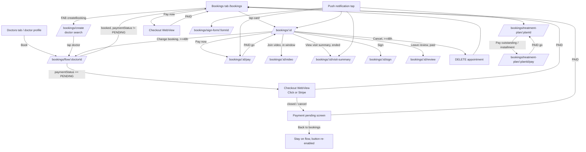
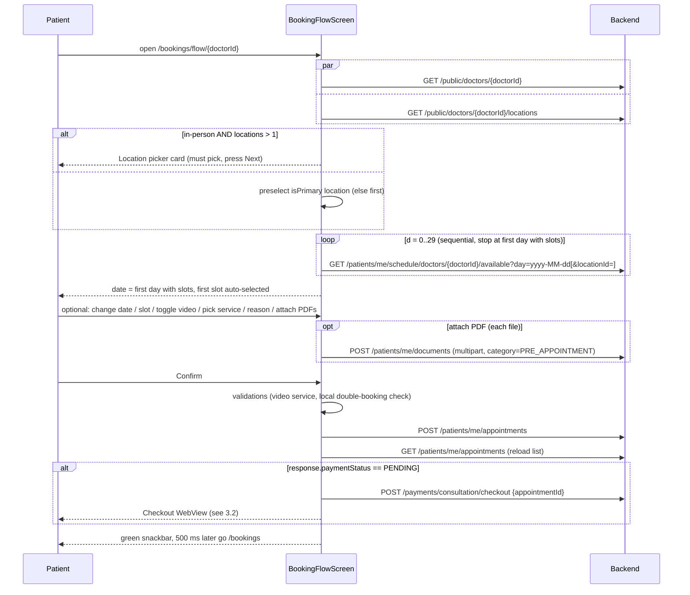
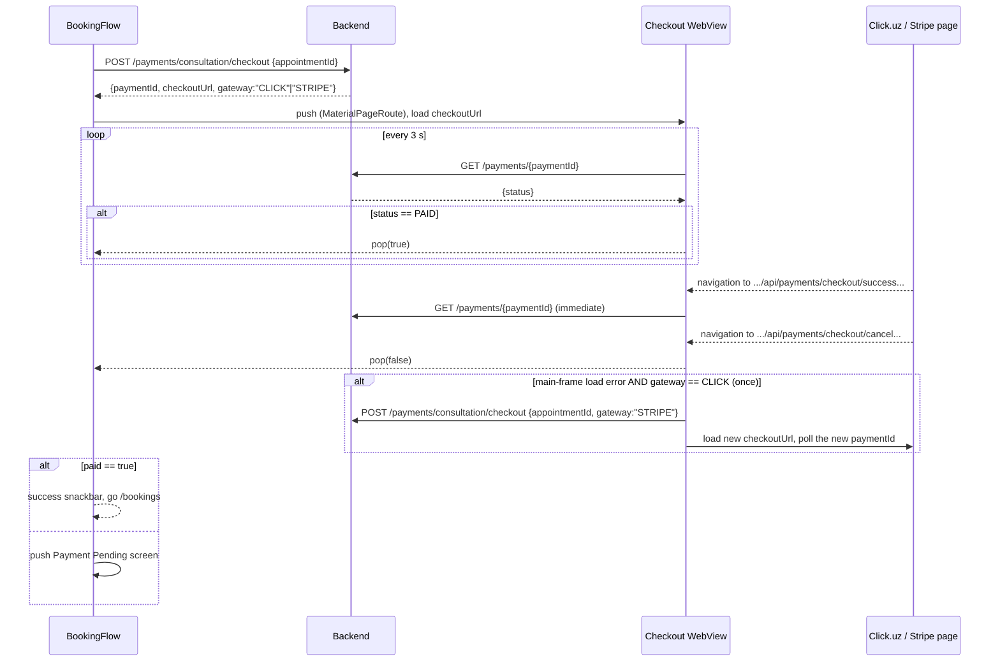
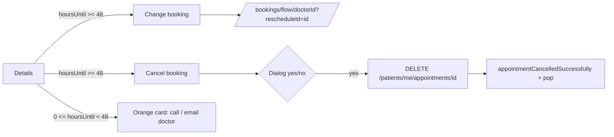
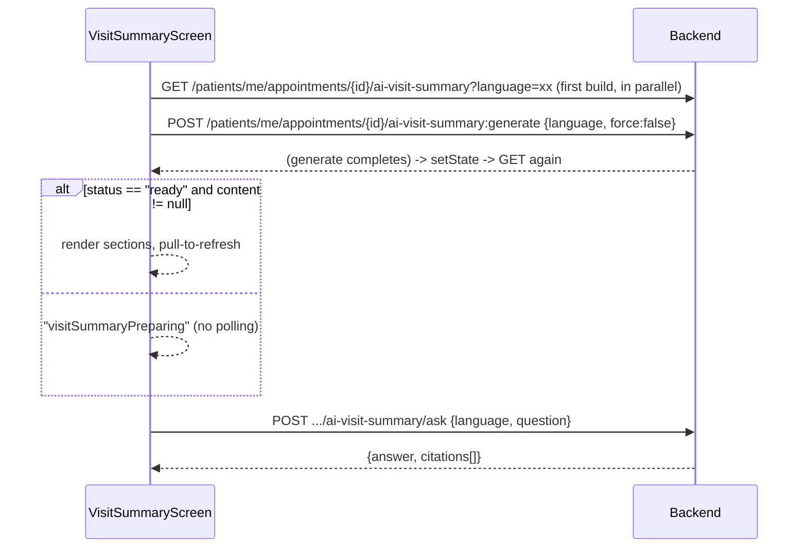

# 06 - Bookings, Payments (Click.uz / Stripe), Video Consultations, Visit Summaries, Treatment Plans, Reviews, E-Signing

Scope: everything under `lib/features/bookings/`, plus the pieces that live in `lib/core/` (appointment model, appointment card, date utils, Daily video service, local notification reminders) and in `lib/features/doctors/` (locations, reviews) that the booking flows depend on.

Conventions used in this document:
- Citations are `lib/path.dart:line` and point to the Flutter source.
- **UNVERIFIED** means the behaviour depends on backend code or runtime behaviour that the Flutter code does not prove.
- All API paths are relative to the API base URL. That base URL already ends in `/api`, e.g. `https://<host>/api` (see the core/networking doc). So `POST /payments/consultation/checkout` is really `POST https://<host>/api/payments/consultation/checkout`.
- There is exactly one HTTP client (Dio wrapper `ApiClient`). It sends `Authorization: Bearer <jwt>`. Any non-2xx response throws, so there is no custom `validateStatus`. Timeouts are 30 s. On 401 it logs out, except on `/public/*` and `/auth/*`. See the core doc.
- l10n: keys are listed per screen and in section 9. The strings themselves are exported by another doc. Some keys are reached through typed getters (`l10n.payNow`) and some through `l10n.translate('key')`. They are the same catalogue.

---

## 1. Feature overview

| Capability | Entry points | Main screen(s) |
|---|---|---|
| List my appointments (upcoming/past) | Bottom-nav tab "Bookings" | `BookingsScreen` `/bookings` |
| Pick a doctor for a new booking | FAB on bookings list | `CreateBookingScreen` `/bookings/create` |
| Book / reschedule (location, date, slot, video/in-person, service, reason, PDF attachments) | Doctor list, doctor profile, create-booking list, "Change booking" | `AppointmentBookingFlowScreen` `/bookings/flow/:doctorId[?rescheduleId=]` |
| Pay consultation (Click.uz, with a Stripe fallback) | Right after booking; "Pay now" on list card; "Pay now" on details; push notification | In-flow WebView, list WebView, `ConsultationPaymentScreen` `/bookings/:id/pay` |
| Appointment details, cancel, reschedule, contact doctor | Tap list card; push notifications | `AppointmentDetailsScreen` `/bookings/:id` |
| Video consultation (Daily.co) | "Join video call" on details (within the join window); local reminder notification | `VideoCallScreen` `/bookings/:id/video` (full-screen, outside the shell) |
| AI visit summary + Q&A + care-plan reminders | "View visit summary" on past appointments; push `ai_visit_summary_ready` | `VisitSummaryScreen` `/bookings/:id/visit-summary` |
| Treatment plan summary + online pay (Click, UZS only) | Push notifications `treatment_plan_*`, `installment_*` | `TreatmentPlanSummaryScreen` `/bookings/treatment-plan/:planId`, `TreatmentPlanPaymentScreen` `.../pay[?installmentItemId=]` |
| E-sign appointment summary / medical form 025-2 | "Sign" on details; push `signature_requested` | `SignAppointmentScreen` `/bookings/:id/sign` and `/bookings/sign-form/:formId` |
| Review a doctor after a visit | "Leave review" on past appointment details | `SubmitReviewScreen` `/bookings/:id/review` |
| Waiting room (dead) | Nothing navigates to it | `WaitingRoomScreen` `/bookings/:id/waiting` |
| Confirm booking (dead) | Nothing navigates to it | `ConfirmBookingScreen` `/bookings/confirm` |

### 1.1 Top-level flow map



---

## 2. Routing

All routes are declared in `lib/app/router.dart`.

Shell branch "bookings" (a `StatefulShellRoute.indexedStack` branch, so its state is preserved and the bottom nav is visible), `lib/app/router.dart:383-480`:

| Path | Screen | Params | Source |
|---|---|---|---|
| `/bookings` | `BookingsScreen` | - | `lib/app/router.dart:386` |
| `/bookings/create` | `CreateBookingScreen` | - | `:390` |
| `/bookings/sign-form/:formId` | `SignAppointmentScreen(patientFormId)` | path `formId` | `:394` |
| `/bookings/treatment-plan/:planId` | `TreatmentPlanSummaryScreen(planId)` | path `planId` | `:401` |
| `/bookings/treatment-plan/:planId/pay` | `TreatmentPlanPaymentScreen(planId, installmentItemId)` | query `installmentItemId` (optional) | `:408` |
| `/bookings/:id` | `AppointmentDetailsScreen(appointmentId)` | path `id` | `:422` |
| `/bookings/:id/waiting` | `WaitingRoomScreen` | - | `:429` |
| `/bookings/:id/review` | `SubmitReviewScreen` | `state.extra` map `{doctorId: String, doctorName: String}`. `doctorName` falls back to `translate('doctor')` | `:436-448` |
| `/bookings/:id/sign` | `SignAppointmentScreen(appointmentId)` | - | `:450` |
| `/bookings/:id/visit-summary` | `VisitSummaryScreen` | - | `:457` |
| `/bookings/:id/pay` | `ConsultationPaymentScreen` | - | `:464` |
| `/bookings/flow/:doctorId` | `AppointmentBookingFlowScreen(doctorId, rescheduleId)` | query `rescheduleId` (optional) | `:473` |

Top-level routes, outside the shell and with no bottom nav:

| Path | Screen | Source |
|---|---|---|
| `/bookings/confirm` | `ConfirmBookingScreen`. `extra` is `{doctorId, date, time, reason, isVideo}` | `lib/app/router.dart:595` |
| `/bookings/:id/video` | `VideoCallScreen` (full screen) | `lib/app/router.dart:610` |

Notes:
- Order matters in GoRouter. `sign-form/...` and `treatment-plan/...` are declared before `:id`, so they are not swallowed by `:id`. `flow/:doctorId` is declared after `:id`. It still works because `:id` has no `flow` child, so matching falls through. `/bookings/confirm` is probably matched by the shell's `:id` first (id=`confirm`). **UNVERIFIED** at runtime, and moot because nothing navigates there.
- The auth redirect allow-list includes the `/bookings` prefix (`lib/app/router.dart:107`). Unauthenticated users are redirected to `/login`.
- Route constants live in `AppRoutes` (`lib/app/router.dart:148-177`): `bookings`, `createBooking`, `appointmentDetails`, `bookingFlow='/bookings/flow'`, `confirmBooking`, `videoCall`, `waitingRoom`, `signAppointment`, `signPatientForm`, `visitSummary`, `treatmentPlanSummary`.
- KMP: preserve these exact paths. Push notification payloads and local notification payloads carry them as strings (section 8).

### 2.1 Deep links from push notifications (feature-relevant subset)

Source: `lib/features/notifications/services/notification_tap_handler.dart:30-125` (the data-map path) and `:238-272` (the stored-notification path).

`type` is lower-cased and `-` is replaced by `_`. `id = entityId ?? appointmentId ?? documentId ?? chatId`. Ids are read from both camelCase and snake_case keys (`appointmentId`/`appointment_id`, `patientFormId`/`patient_form_id`, `treatmentPlanId`/`treatment_plan_id`).

| type | Route |
|---|---|
| `signature_requested` | `/bookings/sign-form/{patientFormId}` if a form id is present, else `/bookings/{id}` |
| `appointment_reminder`, `appointment_scheduled`, `appointment_cancelled`, `appointment_changed`, `appointment_confirmed`, `appointment_upcoming` | `/bookings/{id}` |
| `ai_visit_summary_ready` (also upper `AI_VISIT_SUMMARY_READY`) | `/bookings/{id}/visit-summary` |
| `consultation_payment_reminder`, `consultation_payment_due_24h`, `consultation_payment_due_6h`, `consultation_payment_due_1h` | `/bookings/{id}/pay` |
| `treatment_plan_payment_reminder`, `treatment_plan_updated`, `installment_due_soon`, `installment_due_today`, `installment_overdue`, `installment_schedule_created` | `/bookings/treatment-plan/{treatmentPlanId}`. With no plan id, `treatment_plan_payment_reminder` goes to `/bookings` |
| `prophylaxis_reminder` | `/bookings` |

Local notifications created by this feature use payload `route` values of `/bookings/{id}/video` and `/bookings/{id}/visit-summary` (section 8).

---

## 3. User flows

### 3.1 Book an appointment (new booking)



Step by step (`lib/features/bookings/presentation/screens/appointment_booking_flow_screen.dart`):

1. **initState** (`:64-74`) runs `_loadDoctor()` (`:115-135`) through `doctorsProvider.notifier.getDoctorById(doctorId)`, which calls `GET /public/doctors/{id}` (see the doctors doc). If it fails, it shows a snackbar `failedToLoadDoctor: <userFriendlyError>`. A post-frame callback then runs `_loadLocationsThenSlots()` (`:76-109`).
2. **Locations** come from `GET /public/doctors/{doctorId}/locations` (`lib/features/doctors/data/doctor_locations_repository.dart:72-80`). A non-list response gives `[]`. Entries with `id <= 0` are filtered out, and any error gives `[]`.
   - `requiresLocationStep = !isVideo && locations.length > 1` (`:82`).
   - When there is no location step, it preselects `firstWhere(isPrimary) ?? first` (`:86-91`).
   - If fetching locations throws, it sets `_locationStepCompleted = true` and continues with no location filter (`:97-104`).
   - If the location step is required, slots are not loaded until the user presses **Next** on the location card.
3. **Next available date** is found by `_findAndLoadNextAvailableDate()` (`:147-184`). It runs `for d in 0..29` and, for each day `today + d`, calls the slots API **sequentially** with `day = DateFormat('yyyy-MM-dd').format(localDate)` (`:152-154`) and `locationId = isVideo ? null : selectedLocationId`.
   - For d = 0 (today), it keeps only slots where `DateTime.parse(startAt).isAfter(now)` (`:166`).
   - The first day with at least one remaining slot becomes `_selectedDate`, and that day's slots stay in `scheduleProvider`. If none is found within 30 days, it ends on the last loaded day, which shows the empty state. **UNVERIFIED** exact end state; the loop leaves the last response in state.
4. **Date picker**: `firstDate = now`, `lastDate = now + 90 days` (`:191`). Changing the date resets `_selectedTime` and reloads slots for that single day (`:138`).
5. **Slot auto-select** (`_handleScheduleUpdate`, `:658-680`): when loading finishes without an error, the first filtered slot is selected if the current selection is null or no longer in the list. If the list is empty, the selection is cleared. This runs via `ref.listen(scheduleProvider)` and a check in build.
6. **Video toggle** (a SwitchListTile). Title `videoConsultation`, subtitle `haveYourAppointment`. Toggling:
   - resets the time;
   - clears `serviceId` when switching to in-person;
   - re-forces the location step when switching to in-person with more than one location;
   - re-runs `_findAndLoadNextAvailableDate()` (`:474`).
7. **Video service** (shown only when video is on). The source is `doctor.serviceItems` (see `DoctorServiceItem` below).
   - If the list is empty, a warning card shows `bookingVideoNoServicesOffered`.
   - Otherwise a dropdown labelled `videoConsultationServiceLabel`, hint `videoConsultationServiceHint`, lists items as `title`, plus `" — {consultationServiceFreeBadge}"` when `isFreeConsultation`. The value is `int.tryParse(item.id)`.
8. **Reason**: text field, label `reasonForVisitOptional`, hint `describeYourReason`, `maxLines: 3`. It is sent only if non-empty.
9. **Attach documents** (optional, max 5 = `_maxBookingDocs`, `:605`, `:747`).
   - `FilePicker.pickFiles(type: custom, allowedExtensions: ['pdf'], allowMultiple: true, withData: true)` (`:765`). The app lock is temporarily disabled while the picker is open (the app goes to background).
   - Each file is uploaded immediately as multipart `POST /patients/me/documents` with fields `file`, `title=<file name>`, `isChatAttachment='false'`, `category='PRE_APPOINTMENT'` (`:794`). The returned document id is appended to `_pendingDocs`.
   - Files without bytes are skipped with `bookingDocUnreadableSkipped`. Going over the limit shows `maxBookingDocuments` (`{count}` placeholder).
   - Removing a chip calls `DELETE /patients/me/documents/{id}` best-effort, with errors ignored.
   - Labels: `attachDocumentsOptional`, `attachDocumentsHint`, `addDocument`, `uploadingDocument`.
10. **Confirm button** is disabled when `_selectedTime == null || _isBooking || _isUploadingDoc` (`:630`).
11. **`_confirmBooking()`** (`:842-1025`):
    1. Video service checks. If video has no catalog, show an orange snackbar (5 s) `bookingVideoNoServicesOffered` and abort. If video has a catalog but nothing is selected, highlight the service section in orange, scroll to it, show `bookingSelectServiceForVideo` (4 s), and abort.
    2. `selectedSlot = scheduleState.availableSlots.firstWhere(startAt == _selectedTime)`. The fallback is a synthetic slot with `slotMinutes: 30` (`:862-868`).
    3. **Client-side double-booking guard**: if any loaded appointment with `status != cancelled` has `startAt == selected startAt` (an exact string compare), it throws the hardcoded English text `"You already have an appointment scheduled at this date and time. Please choose a different time slot."` (`:883`).
    4. `locationId = isVideo ? null : (slot.locationId ?? _selectedLocationId)`.
    5. `rescheduleAppointmentId = int.tryParse(widget.rescheduleId)`.
    6. `bookingsProvider.notifier.bookAppointment(...)`. `serviceId` is sent only when the booking is video. It then reloads the list with `loadAppointments()` and no filters.
    7. `paymentCompleted = booked.paymentStatus.toUpperCase() != 'PENDING'` (`:910`). If the status is PENDING, see 3.2.
    8. On success: a green snackbar shows `appointmentRescheduledSuccessfully` if rescheduling, else `appointmentSlotBooked`. After `Future.delayed(500ms)` it calls `context.go('/bookings')` (`:951`, `:981`).
    9. On error: `userFriendlyError(l10n, e)` (`:1008`). The "select a service" error (backend `serviceId is required for video consultation`) gets an orange snackbar with just the message. All other errors get a red snackbar `"{failedToBookAppointment}: {friendly}"`.

### 3.2 Consultation payment right after booking (Click.uz, with Stripe fallback)



Details (`appointment_booking_flow_screen.dart:914-1000`, WebView `:1046-1159`, pending screen `:1161-1271`):

- **How the payment URL is obtained.** The client calls `POST /payments/consultation/checkout` with body `{"appointmentId": 123}`. No `gateway` is sent, so the backend picks a gateway (Click by default, **UNVERIFIED**). The response keys read are `paymentId` (toString), `checkoutUrl`, and `gateway`. If `paymentId` or `checkoutUrl` is missing, no WebView opens and the flow goes to the pending path when a paymentId exists.
- **How the URL is opened.** It opens in an in-app **WebView** (`webview_flutter ^4.10.0`) pushed with `Navigator.push<bool>(MaterialPageRoute(...))`. It is **not** an external browser and does **not** use `url_launcher`. JavaScript mode is unrestricted. The AppBar title is `completePayment`. It has a system back button, and popping without a result means "not paid".
- **Return / callback detection** is done by `NavigationDelegate.onNavigationRequest` (`:1079-1090`):
  - If the URL contains `/api/payments/checkout/success`, it triggers an immediate status check and **prevents** the navigation. The WebView does not close unless the status is PAID.
  - If the URL contains `/api/payments/checkout/cancel`, it pops `false` and prevents the navigation.
  - Every other URL navigates normally.
  - These backend redirect URLs are configured server-side as the Click/Stripe return URLs. **UNVERIFIED**: the exact backend URL shapes and query params; the client only uses a substring match.
- **Status polling**: `Timer.periodic(3 s)` calls `GET /payments/{paymentId}` (`:1098`). Success means `response.status.toUpperCase() == 'PAID'` (`:1133`), which pops `true`. A `_checkingStatus` flag prevents overlapping requests, and errors are swallowed. The timer is cancelled in `dispose`. **Polling is the only success signal.** The success URL just triggers an early poll. No other statuses (e.g. FAILED) are handled. The client only checks `== 'PAID'`, and the full backend status enum is **UNVERIFIED**.
- **Click to Stripe fallback** (`:1103-1124`): `onWebResourceError` handles a main-frame load error. When `error.isForMainFrame == true`, the original `gateway == 'CLICK'`, and no retry has been made yet, it:
  1. calls `POST /payments/consultation/checkout {"appointmentId":..., "gateway":"STRIPE"}`;
  2. switches `_pollPaymentId` to the new `paymentId`;
  3. loads the new `checkoutUrl`.
  Failures are silent. The code comment says "backend usually falls back automatically".
- **Payment Pending screen** (`_PaymentPendingScreen`, `:1161-1271`) is reached when the WebView returns non-true.
  - It calls `GET /payments/{paymentId}` once on open and shows `paymentPendingTitle`, `paymentPendingMessage`, and `currentPaymentStatus` with `{{status}}` replaced by the raw status. The initial value is `'PENDING'`.
  - Buttons:
    - `checkPaymentStatus` (label becomes `checking` while busy) re-polls and pops `true` if PAID. On error it shows the snackbar `couldNotRefreshPaymentStatus`.
    - `continuePayment` pushes the same checkout WebView again, with the same `paymentId`/`checkoutUrl`/gateway, and pops `true` if it returns true.
    - `backToBookings` pops `false`.
  - When the pending screen returns non-true, the flow screen stays open, `_isBooking` is reset (the button is enabled again), and an orange snackbar (4 s) shows `paymentStillPendingConfirmBooking`. **The appointment already exists server-side** in PENDING payment state. Pressing Confirm again would try to book the same slot again, which the local double-booking guard should block because the list was reloaded.

### 3.3 Pay later (from list card, details, or notification)

- **List card "Pay now"** (`lib/features/bookings/presentation/screens/bookings_screen.dart:62-106`, WebView `:270-382`). It is visible when `paymentStatus.toUpperCase() == 'PENDING'` (`:242`).
  - It calls `createConsultationCheckout` with no gateway. If there is no url or id it shows the snackbar `paymentCouldNotStart`.
  - Otherwise it pushes `_BookingsPaymentCheckoutScreen`, a copy of the in-flow WebView with the same interception, 3 s poll, and Stripe fallback.
  - On `true`: green snackbar `paymentCompletedAppointmentConfirmed`, then reload the list.
  - On exception: snackbar `paymentCouldNotStartWithError` with `{{error}}` replaced by the exception text.
- **Details "Pay now"** (`appointment_details_screen.dart:33-45`, `:255-285`) does `context.push('/bookings/{id}/pay')` and awaits, then `setState` to refetch.
- **`ConsultationPaymentScreen`** at `/bookings/:id/pay` (`lib/features/bookings/presentation/screens/consultation_payment_screen.dart`):
  - It shows a spinner (title `completePayment`) and calls `createConsultationCheckout` (`:45-75`).
  - Errors: `paymentCouldNotStart` or `paymentCouldNotStartWithError`, with buttons `retry` (re-run) and `back` (`context.go('/bookings/{id}')`, `:109`).
  - The WebView has the same success/cancel interception. Cancel calls `Navigator.pop()` with no value (`:167`).
  - It has the same 3 s polling (`:180`) and the same Stripe fallback (`:185-205`).
  - On PAID: snackbar `paymentCompletedAppointmentConfirmed`, then `context.go('/bookings/{id}')` (`:226`). This replaces the stack; it does not pop.

### 3.4 Treatment plan payment (added in commit 92fd45e "click uz payment integration")

```mermaid
sequenceDiagram
  participant S as TreatmentPlanSummary
  participant P as TreatmentPlanPaymentScreen
  participant API as Backend
  S->>API: GET /patients/me/treatment-plans/{planId}
  S-->>S: show totals; Pay buttons only if owedMinor > 0 AND currency == UZS
  S->>P: push /bookings/treatment-plan/{planId}/pay[?installmentItemId=X]
  P->>API: POST /payments/treatment-plan/checkout {treatmentPlanId, installmentItemId?}
  API-->>P: {paymentId, checkoutUrl}
  P-->>P: WebView(checkoutUrl), poll GET /payments/{paymentId} every 3 s
  P-->>S: on PAID: snackbar treatmentPlanPaymentSuccess, go /bookings/treatment-plan/{planId}
```

- Summary screen: `lib/features/bookings/presentation/screens/treatment_plan_summary_screen.dart`. Payment screen: `lib/features/bookings/presentation/screens/treatment_plan_payment_screen.dart`.
- `canPayOnline = owedMinor > 0 && currency.toUpperCase() == 'UZS'` (`treatment_plan_summary_screen.dart:207`). Click only supports UZS, which is why the button is hidden for other currencies and `treatmentPlanOnlinePayUnavailable` is shown instead (`:250-268`).
- "Pay outstanding" (`treatmentPlanPayOutstanding`, a FilledButton with a payment icon, preceded by the hint `treatmentPlanPayOnlineHint`) pushes `/bookings/treatment-plan/{planId}/pay` (`:65-73`).
- "Pay installment" (`treatmentPlanPayInstallment`, a TextButton on an installment item) shows only if `canPayOnline && item.status.toUpperCase() in {PENDING, OVERDUE} && item.id != null` (`:126-129`, `:176-184`). It pushes `.../pay?installmentItemId={item.id}`.
- Checkout request: `POST /payments/treatment-plan/checkout` with body `{"treatmentPlanId": 45, "installmentItemId": 7}`. `installmentItemId` is omitted for a full payment. Both are sent as ints (`bookings_repository.dart:169-181`). The response keys read are `paymentId` and `checkoutUrl`; `gateway` is not read.
- WebView (`treatment_plan_payment_screen.dart:140-217`): the same `/api/payments/checkout/success` and `/api/payments/checkout/cancel` substring interception. Cancel calls `Navigator.pop()` (`:160`). It uses the same 3 s poll. **There is no Stripe fallback.** On PAID it shows the green snackbar `treatmentPlanPaymentSuccess` and calls `context.go('/bookings/treatment-plan/{planId}')` (`:183-194`). The summary screen is rebuilt by `go`, so it reloads. **UNVERIFIED** whether GoRouter reuses the state here; `go` to the same location normally rebuilds the page.
- Error state (`:89-114`): `paymentCouldNotStart` / `paymentCouldNotStartWithError` (`{{error}}`), `retry`, and `back`, which does `go('/bookings/treatment-plan/{planId}')`.

### 3.5 Cancel and reschedule



- `hoursUntilAppointment = startLocal.difference(now).inHours`, which truncates toward zero (`appointment_details_screen.dart:216-220`).
  - `isFutureAndAtLeast48Hours = !isPast && hours >= 48`
  - `isFutureAndWithin48Hours = !isPast && hours < 48`
  - This rule is enforced **only on the client**. **UNVERIFIED** whether the backend also enforces it.
- Reschedule means booking a *new* appointment through the flow with `rescheduleAppointmentId` in the POST body. The backend presumably cancels or replaces the old one. **UNVERIFIED**.
- Cancel dialog (`:451-470`): title `cancelAppointment`, content `areYouSureCancel`, actions `no` / `yes` (red). On confirm it calls `bookingsProvider.notifier.cancelAppointment(id)`, which does DELETE then reloads the list with no filters. It then shows the snackbar `appointmentCancelledSuccessfully` and `context.pop()`. On error it shows `"{errorCancellingAppointment}: {e}"`.
- Within 48 h: an orange card with `appointmentLessThan48Hours` and `contactDoctorDirectly`, and buttons `callDoctor` (`tel:{phone}`) / `emailDoctor` (`mailto:{email}`) via `url_launcher` (`:385-435`). Failures show `"{cannotMakePhoneCall} {phone}"` / `"{cannotSendEmail} {email}"`. **Quirk**: `AppointmentModel.fromJson` never fills the doctor's phone or email, so these buttons never render in practice. The card then shows only the text.

### 3.6 Video consultation

```mermaid
sequenceDiagram
  participant D as Details
  participant V as VideoCallScreen (mobile)
  participant API as Backend
  participant DY as Daily.co
  D->>V: push /bookings/{id}/video (only inside join window)
  V->>V: disable app lock
  V->>API: POST /video/token {appointmentId:int}
  API-->>V: {token, roomUrl, roomName}
  V->>V: request camera + mic permission
  V->>DY: CallClient.create(); join(roomUrl, token, camera+mic on)
  alt join timeout
    V->>V: wait 2 s, retry once
  end
  V->>V: 600 ms later: if local camera track null, re-enable camera (iOS)
  V->>V: route audio to loudspeaker
  DY-->>V: events (participants, inputs, callState)
  V->>DY: leave() on End / back / dispose
  V->>V: re-enable app lock
```

- **Join window**: `isWithinVideoJoinWindow(startAt, endAt)` (`lib/core/utils/date_utils.dart:14-21`) is true when `start - 5 min <= nowUtc <= end + 15 min`. The same rule exists server-side, as shown by the error strings in `error_localizations.dart:58-63`. The details screen shows `joinVideoCall` only when `isVideo && inWindow` (`appointment_details_screen.dart:222`, `:340-347`).
- A future video appointment outside the window shows the text `errorVideoCallNotYetAvailable` (`:351-358`) and schedules a local reminder (section 8).
- Token call (`lib/core/services/daily_video_service.dart:11-35`): `POST /video/token` with body `{"appointmentId": 123}`. `roomName` is optional and the app never sends it. The response `{token: String, roomUrl: String, roomName: String}` is required and cast strictly.
  - On error the message comes from `data.message ?? data.error ?? data.reason`. If the body is not a map, the body string is used. Otherwise it is `"Server error (status): statusMessage"` (`:38-56`).
- Mobile screen: `lib/features/bookings/presentation/screens/video_call_screen_mobile.dart`.
  1. `appLockTemporaryDisableProvider.notifier.disable()` (`:122`).
  2. Parse the id as an int. If it is `0` or invalid, throw `"Invalid appointment ID"`.
  3. Get the token.
  4. Permissions (`permission_handler`): camera and microphone, requested if not granted (`:82-85`). If either is denied, throw the English sentence that maps to `errorVideoCallMediaPermissionRequired`.
  5. `CallClient.create()` (`:150`), subscribe to events, then `join(url: roomUrl, token: token, clientSettings: camera enabled + mic enabled)` with publishing on (`:153`).
  6. Sync the mute/camera toggles from `callClient.inputs`.
  7. After 600 ms, if the local camera track is null, call `updateInputs(camera: enabled)` (`:101`). This is an iOS black-camera workaround.
  8. Post-frame, prefer a loudspeaker output (`:228-250`). Among `availableDevices.speaker`, pick one whose label contains `speaker`/`loud`/`external` and skip `earpiece`/`receiver`/`ear`. This re-runs on `availableDevicesUpdated`.
  - **Timeout retry**: if the error string (lower-cased) contains `timeoutexception` and a join-failed/"future not completed" marker (`:75`), it waits 2 s and retries **once** (`:199`).
  - **Errors**: the raw message is stored with `Exception: ` prefixes stripped. It is shown as a red snackbar (5 s) `"{failedToStartVideoCall}: {translateError(raw)}"` (`:214-218`) and in an error view with a Retry button (`:507`).
  - **Events** (`:255-310`):
    - `inputsUpdated` syncs the toggles.
    - `callStateUpdated(left)` shows the snackbar `videoCallEnded` and pops.
    - `callStateUpdated(error)` shows the snackbar `callErrorOccurred`.
    - `participantJoined`/`participantUpdated` trigger setState.
    - `participantLeft` disposes that participant's video view controller.
  - There is **no reconnection logic** beyond Daily's own.
  - **UI**: black scaffold. AppBar background `#17C3B2` (hardcoded, `:485`), title `videoCall`. Back calls `leave()` then pops.
    - With a remote participant: the first remote participant is full screen and the local preview is a PiP `120x160` at `bottom: 100, right: 16` with a white border (`:456-465`). With only the local participant, it is full screen. A missing track shows a person icon.
    - Controls row: mic toggle (red when muted), camera toggle (red when off), and end call (56 px red circle, `leave()` then pop).
    - Not-initialized fallback text: `videoCallNotAvailableShort` (`:547`).
  - **dispose**: re-enable the app lock, cancel the event subscription, dispose the view controllers, and call `leave()` (`:353`).
- Web build: `video_call_screen_web.dart` fetches the token the same way (`:69`) and renders `DailyVideoEmbedWeb`. That is an `<iframe src="{roomUrl}?t={token}" allow="camera; microphone; display-capture" allowfullscreen>`, i.e. Daily Prebuilt. It has no timeout retry. `video_call_screen.dart` is a conditional export (mobile vs `dart.library.html`). `lib/core/services/daily_flutter_stub.dart` provides web type stubs only.
- **Waiting room** (`waiting_room_screen.dart`) is unreachable, because nothing pushes `/waiting`. It shows three dots (the middle one active), a person avatar, hardcoded English `"Waiting for doctor to join..."`, title `waitingForDoctor`, and a `join` button that pushes `/bookings/{id}/video`. Do not port it unless the product wants it.

### 3.7 AI visit summary



- Screen: `lib/features/bookings/presentation/screens/visit_summary_screen.dart`.
- The `language` sent is `Localizations.localeOf(context).languageCode`, one of `en|uz|de|ru` (`:28`, `:46`).
- `generate` is awaited in a post-frame callback with no try/catch, so an error is unhandled and silent to the user (`:27-34`). The GET `FutureBuilder` future is created inside `build`, so **every rebuild refetches** (`:56-60`).
- States:
  - waiting shows a spinner;
  - an error shows `"{error}: {e}"`;
  - `status != 'ready' || content == null` shows `visitSummaryPreparing` (`:73`). There is no auto-poll. The user must re-enter, because pull-to-refresh only exists in the ready state (`:91`).
- Ready content, read from `content` (`:86-99`, `:184`, `:267`):
  - `summaryPlain` (String): section `visitSummaryWhatHappened`.
  - `carePlan` (List<String>): section `visitSummaryCarePlan`. Each item has a bell button (tooltip `remindMe`).
  - `medicationGuidance` (List<{name, instructions, missedDose}>): section `visitSummaryMedications`. `missedDose` is labelled `visitSummaryMissedDose`.
  - `redFlags` (List<{sign, urgency}>): section `visitSummaryRedFlags`.
  - `nextSteps` (List<String>): section `visitSummaryNextSteps`. An empty list shows `—`.
  - `disclaimer` (String): small text at the bottom.
- Care-plan reminder picker (`:300-360`): a bottom sheet titled `visitSummaryQuickReminderTitle` with chips:
  - `visitSummaryQuick15Min`: now + 15 min.
  - `visitSummaryTonight`: today 20:00 local, or now + 1 min if that is past.
  - `visitSummaryTomorrowMorning`: tomorrow 09:00 local.
  - `visitSummaryCustom`: a date picker (now to now + 365 d), then a time picker (initial now + 1 h). The result is clamped to at least now + 1 min.
  It then calls `LocalNotificationService.scheduleChecklistReminder` (section 8) and shows the snackbar `"{visitSummaryReminderCreated}: {short date} {time}"`.
- Ask: title `visitSummaryAskTitle`, a text field (hint `visitSummaryAskHint`, 1-3 lines), and a button `send`. An empty question does nothing. The answer appears in a grey box, and citations appear as `"{visitSummarySources}: a, b"`. Errors are not caught (try/finally only), so the spinner stops but there is no message.

### 3.8 E-signing (appointment summary or medical form 025-2)

- Screen: `lib/features/bookings/presentation/screens/sign_appointment_screen.dart`. It has two modes: `appointmentId`, or `patientFormId` (`_isPatientForm`).
- Load:
  - Appointment mode: `GET /patients/me/appointments/{id}` (raw map, same endpoint as details).
  - Form mode: `GET /patients/me/forms/{formId}/for-signing`. The form fields are mapped to the preview (`:90-110`):
    - `doctorName`;
    - date from the form date (date only, so time shows `—`);
    - `reason = complaints + "\n\n" + diagnosis` when both exist, else whichever exists;
    - `alreadySigned = patientSignatureImageBase64` is non-empty.
- If `alreadySigned` is true, `_error = signatureAlreadySubmitted` (`:72`). **Quirk**: the body only switches to the error view when `_error != null && _summary == null` (`:207`), so the preview and the pad still render.
- Preview card `appointmentSummaryPreview`: doctor, date (`yMd`), time `HH:mm – HH:mm` (or `—`), location, reason. Below it: `confirmAppointmentSummaryReflectsDiscussion`, then the label `yourSignature`.
- Signature pad: height 180, grey border, `grey.shade50` background, black stroke width 2.5 (`:287`, `:410`), and a `clear` button.
- Submit:
  - With no strokes it shows the snackbar `pleaseSignAbove` (`:141`).
  - Otherwise `RepaintBoundary.toImage(pixelRatio: 2.0)` is encoded to PNG and then to **plain base64 without a `data:` prefix** (`:128`, `:162`).
  - Appointment mode: `POST /patients/me/appointments/{id}/submit-signature` `{"signatureImageBase64": "iVBORw0..."}`.
  - Form mode: `POST /patients/me/forms/{formId}/submit-signature` with the same body.
  - Success: snackbar `signatureSubmittedSuccess`, then pop. Error: `"{errorSaving}: {userFriendlyError}"` (`:185`). The load-error view has a `close` button.
- The details screen shows `signAppointmentSummary` only when `signatureRequested && !alreadySigned`, and a green `signatureSubmittedSuccess` card when both are true (`appointment_details_screen.dart:300-330`). The details screen does not auto-refresh after signing, because it is a FutureBuilder re-run only on rebuild.

### 3.9 Review submission

- Shown on details when the appointment is in the past (`startAt < now`), not cancelled, and `doctor != null` (`appointment_details_screen.dart:333`). It watches `appointmentReviewProvider(appointmentId)`, which calls `GET /patients/me/appointments/{id}/review`.
  - If a review exists: a green card with `"{yourRating}: {rating} {stars}"`, the comment, and `thankYouForYourRating` (`:120-170`).
  - Otherwise, or on error, a `leaveReview` button pushes `/bookings/{id}/review` with `extra: {doctorId, doctorName, appointmentId}` (`:183-190`).
- Screen `lib/features/bookings/presentation/screens/submit_review_screen.dart`:
  - Heading `howWasYourExperience`, then `"Dr. {doctorName}"` (the `Dr.` prefix is hardcoded, `:119`).
  - Label `rating`, then 5 amber stars at size 48 (`:152`).
  - Comment field: label `commentOptional`, hint `shareExperience`, `maxLines: 5` (`:172`).
  - Validation: rating 0 shows an orange snackbar `"{required}: {rating}"` (`:41`).
  - Submit (button `submitReview`) calls `reviewsProvider(doctorId).notifier.createReview(...)` (`:51`), which is `POST /public/doctors/{doctorId}/reviews` with `{"rating": 5, "comment": "..." | null, "appointmentId": 123}` (`lib/features/doctors/data/reviews_repository.dart:28-47`). That provider then reloads `GET /public/doctors/{doctorId}/reviews`.
  - Success: `ref.invalidate(appointmentReviewProvider(appointmentId))` (`:62`), snackbar `"{writeReview} completed!"` (the English suffix is hardcoded), pop. Error: `"{writeReview} error: {e}"`.

### 3.10 Bookings list

- Screen `lib/features/bookings/presentation/screens/bookings_screen.dart`.
- `initState` loads appointments and also calls `profileProvider.notifier.loadProfile()` for the header avatar (`:36-40`).
- Header: `AppHeader`, title `bookings`. Logo goes to `/home` (go). Avatar pushes `/account`. Bell pushes `/notifications`. Chat pushes `/chat` (`:171-179`).
- Tabs: `SegmentedControl` with `upcoming`/`past` (`:190-192`). Switching tabs reloads.
  - Upcoming (tab 0): `GET /patients/me/appointments?startDate={today yyyy-MM-dd local}` (`:45-52`).
  - Past (tab 1): `GET /patients/me/appointments` with no params (`:57`).
- Client-side filtering (`:110-140`) parses `startAt` to local time.
  - Upcoming is `start.isAfter(now)`, sorted ascending. Cancelled appointments are **included**.
  - Past is the rest, sorted descending.
- Pull-to-refresh reloads the current tab.
- States:
  - loading shows a spinner;
  - an error shows `EmptyState` with message `"{error}: {state.error}"` and a `retry` button (`:211-213`);
  - an empty list shows `EmptyState` (icon `event_busy`, `noAppointmentsFound`) with a TextButton `createBooking` that pushes `/bookings/create` (`:223-226`).
- List items are `AppointmentCard`. Tapping pushes `/bookings/{id}` (`:241`). Cancelled cards are not tappable. `onPayNow` is set when payment is PENDING.
- FAB: extended, `createBooking`, `centerFloat` position, pushes `/bookings/create` (`:259-261`).

### 3.11 Create booking (doctor picker)

- Screen `lib/features/bookings/presentation/screens/create_booking_screen.dart`.
- Search field `searchDoctors`. Every keystroke calls `doctorsProvider.loadDoctors()` when the query is empty, else `searchDoctors(DoctorsSearchFilters(search: q))`. There is **no debounce**.
- A list of doctors; tapping one pushes `/bookings/flow/{doctorId}`.
- States: spinner, error with `retry`, empty `noDoctorsAvailable`.
- Other entry points into the flow: the doctors list (`lib/features/doctors/presentation/screens/doctors_screen.dart:450`), the doctor profile (`lib/features/doctors/presentation/screens/doctor_profile_screen.dart:223`), and the Shifa AI copilot "book from chat" (see the chat/AI doc).

---

## 4. Screen reference (UI sections and states)

### 4.1 `AppointmentBookingFlowScreen`, `/bookings/flow/:doctorId?rescheduleId=`

Inputs: path `doctorId` (String of an int) and query `rescheduleId` (optional).

Sections, top to bottom:
1. Doctor header card (loading shows a spinner).
2. Video toggle.
3. Video service dropdown or warning (video only).
4. Location picker card: shown when a location step is required and not completed. Title `selectLocation`. Radio items show `label` (+ `" · {primary}"` when `isPrimary`) with subtitle `displaySubtitle`. The button `next` is disabled until a choice is made.
5. Date row: `selectDate`, showing the date and a picker.
6. Time slots: `availableTimes`.
   - Chips show the local `HH:mm` from `parseAppointmentDateTime(startAt)`. If parsing fails, they show `startAt.split('T')[1].substring(0,5)` (`:517-526`).
   - The selected chip is filled with `AppDesignSystem.primary`.
   - Loading shows a spinner. An error shows `"{errorLoadingSlots}: {error}"`. Empty shows `noAvailableTimeSlots`.
7. Reason field.
8. Attach documents.
9. Confirm button `confirm` (spinner while booking).

Timers: none (only the 500 ms delay before `go('/bookings')`).

Validations are listed in section 3.1, step 11.

### 4.2 `BookingsScreen`, `/bookings`

See section 3.10.

### 4.3 `AppointmentDetailsScreen`, `/bookings/:id`

- Title `appointmentDetails`.
- Body is a `FutureBuilder(getAppointmentById)`. The future is created in `build`, so it **refetches on every rebuild** (`:70`).
- States: a spinner; an error shows `"{error}: {e}"` with `goBack`; `null` shows `appointmentNotFound`.
- Content, in order (`:200-490`):
  1. Doctor card: avatar, name, profession (`translateProfession`), clinic. Tap pushes `/doctors/{doctorId}` (`:566`). A null doctor shows `unknownDoctor`.
  2. Info card `dateAndTime`: `"EEEE HH:mm - HH:mm, dd MMMM yyyy"` in the device locale, local time (`:208`).
  3. Info card `location`: `videoConsultation` if video, else `location`, else `clinicAddress`.
  4. Info card `reasonForVisit` (if present): `"check up"`/`"checkup"` is localized to `checkUp` (`:114`).
  5. Payment pending card: amber, shown when status is not cancelled/completed and `paymentStatus == PENDING`. Contents: `paymentPendingTitle`, `paymentPendingMessage`, button `payNow`.
  6. `viewVisitSummary` button: shown when `endAt < now` (`:217`, `:292`).
  7. Sign button or signed card.
  8. Review section (past, not cancelled, doctor known).
  9. `joinVideoCall` (video, inside the window), or `errorVideoCallNotYetAvailable` text (video, future, outside the window).
  10. `changeBooking` (secondary button) and `cancelBooking` (destructive), shown when >= 48 h ahead.
  11. The < 48 h contact card.
- A date parse failure shows `"{errorParsingAppointmentData}: {e}"` with `goBack` (`:501`).

### 4.4 Payment screens

See sections 3.2, 3.3 and 3.4. All of them use the AppBar title `completePayment` and show only a full-screen WebView, with no progress bar.

### 4.5 `TreatmentPlanSummaryScreen`, `/bookings/treatment-plan/:planId`

- AppBar `treatmentPlanScreenTitle`. Back pops if possible, else `go('/bookings')` (`:83`).
- The load is a post-frame `GET /patients/me/treatment-plans/{planId}` through `ApiClient` **directly, bypassing the repository** (`:30-60`).
  - `statusCode != 200` shows `treatmentPlanLoadFailedWithCode(code)`. In practice non-2xx throws first.
  - An exception shows `treatmentPlanUnexpectedError(e)`.
  - A non-map payload shows `treatmentPlanNoData`.
- Body (a ListView, `:209-405`):
  - `title` (if non-blank): `treatmentPlanTitleHeading` + title.
  - `treatmentPlanStatusLine(status)`.
  - A progress chip `treatmentPlanProgressLine(linesCompletedCount, linesTotalCount)` when the total is > 0.
  - `treatmentPlanPaymentStatusLineLong(planPaymentStatus)` if non-empty.
  - `treatmentPlanDiagnosisLabel` + diagnosis.
  - `treatmentPlanTotalLabel`, `treatmentPlanPaidLabel`, `treatmentPlanOutstandingLabel` (bold).
  - The pay block (section 3.4).
  - `treatmentPlanServicesHeading`: a card of lines, each showing title, `treatmentPlanQuantityShort(qty)`, `treatmentPlanDiscountLine(money)` if the discount is > 0, the line total, and a status chip.
  - `treatmentPlanInstallmentsHeading`: per plan, a card with `treatmentPlanInstallmentPlanLabel`, a status chip, the total, and item rows (`treatmentPlanItemDue(dueDate)`, `#sequenceNumber`, amount, status, pay button).
  - `treatmentPlanNotesLabel` + notes.
- Money: `(minor / 100).toStringAsFixed(2) + " " + currency` (`:62`), e.g. `150000.00 UZS`. There is no thousands separator.
- **All status strings are shown raw** (not localized).

### 4.6 Other screens

`SignAppointmentScreen` (3.8), `SubmitReviewScreen` (3.9), `VisitSummaryScreen` (3.7), `VideoCallScreen` (3.6), `CreateBookingScreen` (3.11).

`ConfirmBookingScreen` is dead code (`confirm_booking_screen.dart`). It has a placeholder network image, the text `doctor`/`videoConsultation`/`checkUp`/`reasonForVisit`, and a `confirm` button marked `// TODO` that just does `go('/bookings')` (`:90-96`). Do not port it.

### 4.7 `AppointmentCard` (list item), `lib/core/widgets/appointment_card.dart`

- Avatar radius 24. Doctor name. Rating + `(reviewCount)` when present. `"profession · clinic"`. `"HH:mm, dd MMM"` (not locale-aware formatting). Reason on 1 line.
- Status badge: text colour = status colour, background = colour at 12% opacity.

| AppointmentStatus | Icon | Colour |
|---|---|---|
| confirmed | `check_circle` | blue |
| pending | `schedule` | orange |
| cancelled | `cancel` | red |
| completed | `check_circle_outline` | green |

- Cancelled: not tappable, `backgroundTertiary` background, tertiary text colour.
- Payment pending: orange badge `paymentPendingBadge` and a TextButton `payNow`.

---

## 5. API endpoints (feature scope)

The JSON examples use real keys, but the values are illustrative.

### 5.1 Appointments

**GET `/patients/me/appointments`** (`bookings_repository.dart:14-38`)
- Query (each only if set): `status`, `startDate` (`yyyy-MM-dd`), `endDate`. The app only ever sends `startDate`.
- Response: a JSON array of Appointment (5.9). A non-array response is treated as `[]`.
- Error: rethrown as `Exception("Failed to get appointments: $e")`, and the list screen shows it raw.

**GET `/patients/me/appointments/{id}`** (`:41-48`, also `:112-119` for signing)
- Response: an Appointment object.

**POST `/patients/me/appointments`** (`:54-100`)
```json
{
  "doctorId": 42,
  "startAt": "2026-02-12T13:00:00Z",
  "slotMinutes": 30,
  "isVideo": true,
  "reason": "Headache for 3 days",
  "serviceId": 7,
  "locationId": 3,
  "documentIds": [101, 102],
  "rescheduleAppointmentId": 555
}
```
- `doctorId` is an int. `startAt` is sent **exactly as the slot's `startAt` string from the slots API**; it is not reformatted, and the repo comment says ISO-8601 UTC. `slotMinutes` comes from the slot (default 30).
- Optional keys are omitted when null or empty: `reason`, `serviceId` (video only), `locationId` (in-person only), `documentIds`, `rescheduleAppointmentId`.
- Response: the created Appointment. `paymentStatus` drives the checkout.
- Errors (DioException): the message is `response.data['message'] ?? response.data['error'] ?? e.message ?? 'Failed to book appointment'`. The notifier wraps it again as `"Failed to book appointment: Exception: ..."`, and `userFriendlyError` strips and maps it. Known backend message: `serviceId is required for video consultation`, which maps to `bookingSelectServiceForVideo`. Slot-taken and double-booking backend messages are **UNVERIFIED**.

**DELETE `/patients/me/appointments/{id}`** (`:103-109`)
- Cancels the appointment. The response body is ignored.

**GET `/patients/me/schedule/doctors/{doctorId}/available?day=yyyy-MM-dd[&locationId=N]`** (`lib/features/bookings/data/schedule_repository.dart:36-60`)
```json
[
  {"startAt": "2026-02-12T13:00:00Z", "endAt": "2026-02-12T13:30:00Z", "slotMinutes": 30, "locationId": 3, "locationLabel": "Main clinic"}
]
```
- A non-array response gives `[]`. Errors are rethrown as `"Failed to get available slots: $e"`.

### 5.2 Payments

**POST `/payments/consultation/checkout`** (`bookings_repository.dart:155-167`)
```json
{"appointmentId": 123, "gateway": "STRIPE"}
```
- `gateway` is only sent in the fallback. Response: `{"paymentId": 987, "checkoutUrl": "https://my.click.uz/services/pay?...", "gateway": "CLICK"}`. The Click URL shape is **UNVERIFIED**. There is no try/catch, so the DioException propagates.

**POST `/payments/treatment-plan/checkout`** (`:169-181`)
```json
{"treatmentPlanId": 45, "installmentItemId": 7}
```
- Response: `{"paymentId": 988, "checkoutUrl": "..."}`.

**GET `/payments/{paymentId}`** (`:183-186`)
- Response: `{"status": "PENDING" | "PAID" | ...}`. Only `status` is read, compared case-insensitively against `PAID`. Other fields are **UNVERIFIED**.

**Backend redirect URLs** (intercepted inside the WebView, never called by the app): `.../api/payments/checkout/success...` and `.../api/payments/checkout/cancel...`.

### 5.3 Video

**POST `/video/token`**: `{"appointmentId": 123}` returns `{"token": "...", "roomUrl": "https://<sub>.daily.co/<room>", "roomName": "<room>"}`. Backend errors with user-meaningful messages are listed in section 7.4.

### 5.4 AI visit summary

- **POST `/patients/me/appointments/{id}/ai-visit-summary:generate`** with `{"language": "ru", "force": false}`. The colon is part of the path. The response is ignored.
- **GET `/patients/me/appointments/{id}/ai-visit-summary?language=ru`**
```json
{
  "status": "ready",
  "language": "ru",
  "version": 1,
  "generatedAt": "2026-02-12T14:05:00Z",
  "content": {
    "summaryPlain": "...",
    "carePlan": ["Drink 2L water daily"],
    "medicationGuidance": [{"name": "Ibuprofen", "instructions": "200mg after meals", "missedDose": "Skip if next dose < 4h"}],
    "redFlags": [{"sign": "Fever > 39C", "urgency": "Call emergency"}],
    "nextSteps": ["Follow-up in 2 weeks"],
    "disclaimer": "..."
  }
}
```
- Defaults (`bookings_repository.dart:250-276`): `status='not_ready'`, `language='en'`, `version=1`. `content` is null unless the value is a map. The only status the client recognises is `ready`; the others are **UNVERIFIED**.
- **POST `/patients/me/appointments/{id}/ai-visit-summary/ask`** with `{"language": "ru", "question": "..."}` returns `{"answer": "...", "citations": ["carePlan[0]", "..."]}`. Citations are stringified, with empty ones dropped.

### 5.5 Treatment plans

**GET `/patients/me/treatment-plans/{planId}`**. Keys read:
```json
{
  "title": "Dental implant plan",
  "status": "ACTIVE",
  "diagnosis": "...",
  "notes": "...",
  "currency": "UZS",
  "totalMinor": 150000000,
  "paidMinor": 50000000,
  "owedMinor": 100000000,
  "planPaymentStatus": "PARTIALLY_PAID",
  "linesTotalCount": 4,
  "linesCompletedCount": 1,
  "lines": [{"title": "Implant", "quantity": 1, "discountMinor": 0, "currency": "UZS", "lineTotalMinor": 100000000, "status": "PLANNED"}],
  "installmentPlans": [{
    "status": "ACTIVE", "totalAmountMinor": 100000000, "currency": "UZS",
    "items": [{"id": 7, "dueDate": "2026-03-01", "sequenceNumber": 1, "amountMinor": 50000000, "currency": "UZS", "status": "PENDING"}]
  }]
}
```
- Defaults: `currency` is `UZS`, numbers are 0, strings are empty. Item/line currency falls back to the plan currency.
- The status values that the client recognises are the installment item statuses `PENDING` and `OVERDUE` (payable). Every other value (plan `status`, `planPaymentStatus`, line status, installment plan status) is displayed raw and is **UNVERIFIED**.

### 5.6 E-signing

- `POST /patients/me/appointments/{id}/submit-signature` with `{"signatureImageBase64": "<png base64>"}`.
- `GET /patients/me/forms/{formId}/for-signing` returns keys read: `doctorName`, a form date (**UNVERIFIED** exact key; the preview shows a date only), `complaints`, `diagnosis`, `patientSignatureImageBase64`.
- `POST /patients/me/forms/{formId}/submit-signature` with `{"signatureImageBase64": "..."}`.
- The appointment-summary signing preview reads `doctorName`, `startAt`, `endAt`, `location`, and `reason` from the appointment map.

### 5.7 Reviews

- `GET /patients/me/appointments/{id}/review` returns `{"rating": 5, "comment": "Great", "createdAt": "2026-02-12T15:00:00Z"}`. On 404 **or any other error** it returns null (`bookings_repository.dart:189-202`).
- `POST /public/doctors/{doctorId}/reviews` with `{"rating": 5, "comment": null, "appointmentId": 123}`. `comment` is always present as a key, possibly null. The response is a ReviewModel: `id`, `patientName`, `patientPhotoUrl`, `rating`, `comment`, `createdAt` (`lib/core/models/review_model.dart`).

### 5.8 Cross-feature endpoints used here (documented in other docs)

- `GET /public/doctors/{id}` (doctor + `serviceItems`)
- `GET /public/doctors/{id}/locations`
- `POST /patients/me/documents` (multipart)
- `DELETE /patients/me/documents/{id}`
- `GET /public/doctors/{id}/reviews`
- The patient profile endpoint (for the header)

### 5.9 Data models

**Appointment** (`lib/core/models/appointment_model.dart:5-77`)

| Field | JSON key | Type | Default / rule |
|---|---|---|---|
| id | `id` | String | `toString()`, `''` |
| doctorId | `doctorId` | String | `''` |
| doctor | built from `doctorName`, `doctorProfession`, `doctorClinic`, `doctorPhotoUrl` | Doctor? | Built only if `doctorId != null`. `doctorName` is split on the **first space** into first/last name. The photo URL is normalized (relative to absolute, see the core doc). No phone, email, rating, or reviewCount |
| patientId | - | String | always `''` |
| startAt | `startAt` | String (ISO UTC) | **required**, a hard cast that throws if missing |
| endAt | `endAt` | String | **required** |
| location | `location` | String | **required** (throws if null) |
| reason | `reason` | String? | |
| status | `status` | enum | `'CONFIRMED'` if missing. See below |
| isVideo | `isVideo` | bool | `location == 'Video Consultation' \|\| isVideo ?? false` |
| paymentStatus | `paymentStatus` | String | `'NOT_REQUIRED'`. The client recognises `PENDING` (and `PAID` as a payment status). Others are **UNVERIFIED** |
| paymentAmountMinor | `paymentAmountMinor` | int? | Parsed but **not displayed anywhere** |
| paymentCurrency | `paymentCurrency` | String? | Parsed, not displayed |
| signatureRequested | `signatureRequested` | bool | false |
| alreadySigned | `alreadySigned` | bool | false |

`AppointmentStatus` enum values are `confirmed`, `cancelled`, `completed`, `pending` (`:120-133`). `fromString` is case-insensitive, and **unknown values (e.g. `REQUESTED`, `NO_SHOW`) map to `pending`**. `toJson` omits the signature fields and the doctor.

UI rules by status:
- **cancelled**: the card is not tappable. The item is excluded from the double-booking guard. No payment card, no review.
- **completed**: no payment card.
- **All others**: the payment card shows if PENDING.
- Time-based rules (48 h, video window, past) apply regardless of status, **except cancelled for reviews**. For example, a cancelled future appointment still shows cancel/change buttons if it is >= 48 h ahead. **UNVERIFIED**; the code does not check the status for those buttons.

**AvailableSlot** (`schedule_repository.dart:4-30`): `startAt` (String, required), `endAt` (String), `slotMinutes` (int cast), `locationId` (int?, from num), `locationLabel` (String?).

**PublicDoctorLocation** (`lib/features/doctors/data/doctor_locations_repository.dart:8-65`): `id` (int, required), `label` (`''`), `clinic`, `address`, `latitude`, `longitude`, `locationCountry`, `locationRegion`, `locationCity`, `locationStreetAddress`, `isPrimary` (`== true`).
- `displaySubtitle` is `clinic · (address ?? "city, region, country")`.

**DoctorServiceItem** (`lib/core/models/doctor_model.dart:~315-330`): `id` (String), `title` (`''`), `description?`, `isFreeConsultation` (`== true`), `prices: [{amountMinor, currency}]`. Prices are not shown in the booking flow.

**VideoTokenResponse**: `token`, `roomUrl`, `roomName` (all required Strings).

**AppointmentReview**: `rating` (int), `comment?`, `createdAt` (`''`).

**VisitSummaryResponse / VisitSummaryAskResponse**: see 5.4.

---

## 6. State management (Riverpod)

| Provider | Type | Holds | Refresh / invalidation |
|---|---|---|---|
| `bookingsRepositoryProvider` | `Provider<BookingsRepository>` (`bookings_repository.dart:299`) | - | - |
| `bookingsProvider` | `StateNotifierProvider<BookingsNotifier, BookingsState>` (`lib/features/bookings/providers/bookings_provider.dart:128`) | `appointments`, `isLoading`, `error` | `loadAppointments()` runs on list init, tab switch, pull-to-refresh, after pay-from-list success, **after every book and every cancel** (with no filters, so it overwrites an "upcoming" filtered list with the full list) |
| `appointmentReviewProvider` | `FutureProvider.family<AppointmentReview?, String>` (`:134`) | review or null | Cached per appointmentId for the app lifetime (no autoDispose). Invalidated after a review is submitted |
| `scheduleProvider` | `StateNotifierProvider<ScheduleNotifier, ScheduleState>` (`lib/features/bookings/providers/schedule_provider.dart`) | `availableSlots`, `isLoading`, `error` | **Global, not family**. Shared by every flow screen. `loadAvailableSlots` returns the list, or `[]` on error with `error` set. `clearSlots()` also exists |
| `reviewsProvider(doctorId)` | doctors feature | reviews list | Reloaded after `createReview` |
| `appLockTemporaryDisableProvider` | core | lock suppression flag | `disable()` during video and file picking, then re-enabled |

Notes:
- `BookingsState.copyWith` always resets `error` to the passed value, i.e. null unless given (`bookings_provider.dart:16-26`).
- `getAppointmentById` appends to `state.appointments` only if the id is absent. It **never updates** an existing entry, so the list can go stale after a payment or signature until the next load (`:55-68`).
- The details, visit-summary and sign screens use local `FutureBuilder`/`setState`. They do not use providers, so there is no caching.
- The treatment plan screens use local state only.

KMP mapping: one `BookingsViewModel`/store with `StateFlow<BookingsState>`; a `ScheduleViewModel` scoped per flow screen (this fixes the global sharing); a per-appointment review cache keyed by id with explicit invalidation.

---

## 7. Time, money, and error handling rules

### 7.1 Timezones ("Shifa Global Time Architecture v2")

- The backend sends and receives **ISO-8601 UTC instants** (e.g. `2026-02-12T13:00:00Z`). The parser also strips an optional trailing `[Zone/Id]` suffix, e.g. `2026-02-12T18:00:00+05:00[Asia/Tashkent]` (`date_utils.dart:4-9`).
- Display: `parseAppointmentDateTime(s)` returns `DateTime.parse(stripped).toLocal()`, so everything is shown in the **device timezone**. The app has no concept of the doctor or clinic timezone.
- The booking POST sends back the slot `startAt` string untouched.
- **Slot `day` query parameter**: the device-local calendar date `yyyy-MM-dd`. How the backend maps a "day" to UTC slots (clinic tz vs UTC) is **UNVERIFIED**. A patient in a different timezone from the clinic may see slots from adjacent days, or be missing some.
- The "today" filter compares `DateTime.parse(startAt)` (UTC) with `DateTime.now()` (local). Dart compares instants correctly, so this is fine.
- The upcoming list query `startDate` is also the device-local date.
- Video window math is done in UTC (`isWithinVideoJoinWindow`). The 48 h rule uses local `DateTime`s, which are equivalent as instants.
- Local reminders use `timezone` + `flutter_timezone` to schedule `TZDateTime` in `tz.local`.
- KMP: use `kotlinx.datetime.Instant.parse` (strip `[...]` first) and `toLocalDateTime(TimeZone.currentSystemDefault())`. Use `Clock.System.now()` for comparisons. For the `day` parameter use `Clock.System.todayIn(TimeZone.currentSystemDefault())` plus `DatePeriod(days=d)`.

### 7.2 Money

- All amounts are **minor units** (`*Minor`). They are shown as `minor/100` with 2 decimals plus a space and the ISO currency code. UZS has 2 minor digits in this API (**UNVERIFIED** vs Click, which uses whole som; the backend converts).
- `paymentAmountMinor`/`paymentCurrency` on appointments are parsed but never shown. The consultation price is shown only on the Click page.

### 7.3 Error display helpers

`lib/core/localization/error_localizations.dart`:
- `userFriendlyError(l10n, e, logContext)` strips `Exception:` prefixes and maps known backend English messages to keys.
- `translateError(l10n, raw)` does the same for the video screen.

Exact-match mappings relevant here:

| Backend / app message | Key |
|---|---|
| `Video call is not yet available. You can join 5 minutes before the appointment start.` | `errorVideoCallNotYetAvailable` |
| `Video call has ended. The join window closes 15 minutes after the appointment end.` | `errorVideoCallHasEnded` |
| `Video call is not available. It may have ended, or the join window has closed (usually 15 minutes after the appointment end).` | `errorVideoCallHasEnded` |
| `Payment is required before joining this video consultation.` | `errorVideoCallPaymentRequired` |
| `Camera and microphone access are required for video consultations. You can enable them in your device Settings.` | `errorVideoCallMediaPermissionRequired` |
| `Appointment does not belong to this patient` | `errorAppointmentDoesNotBelongToPatient` |
| `Appointment does not have a patient assigned. Please ensure the appointment is linked to your profile.` | `errorAppointmentDoesNotHavePatientAssigned` |
| `Failed to generate token` | `errorFailedToGenerateToken` |
| `Daily.co API key is not configured. Please set DAILY_API_KEY environment variable in Railway.` | `errorDailyApiKeyNotConfigured` |
| `serviceId is required for video consultation`, `Please select a service for video consultation.` | `bookingSelectServiceForVideo` |
| `Connection timed out. Check your internet and try again.` | `errorConnectionTimedOut` |

Prefix mappings: `Appointment not found: ` becomes `errorAppointmentNotFound` (`{{id}}`). `Failed to get or create room: ` becomes `errorFailedToGetOrCreateRoom`. `Failed to generate token: ` becomes `errorFailedToGenerateTokenDetail`. `Failed to generate video token: ` becomes `errorFailedToGenerateVideoToken`. `Error <digits>` becomes `errorStatusCode`. The helper also maps video join timeouts to `videoCallConnectionTimeout` (see the core doc for the full helper).

Important: **payment is also enforced on video join**. The backend refuses the token with "Payment is required..." when a consultation is unpaid.

### 7.4 Status codes

The client never branches on HTTP status codes in this feature, except:
- review GET 404 returns null (all errors return null anyway);
- the treatment plan `statusCode != 200` check, which is effectively dead because Dio throws on non-2xx.

A 401 triggers a global logout through ApiClient, and a 403 does not.

---

## 8. Local notifications created by this feature

Source: `lib/core/services/local_notification_service.dart`. Android channel `appointments_channel` ("Appointment Notifications", importance high). `AndroidScheduleMode.inexactAllowWhileIdle`, absolute-time interpretation.

| Reminder | When scheduled | Trigger | Notification id | Title / body | Payload JSON |
|---|---|---|---|---|---|
| Video join | On **every build** of the details screen for a video appointment that is in the future and not yet joinable (`appointment_details_screen.dart:223-231`) | `startAtUtc - 5 min`. Skipped if already past. The previous one with the same id is cancelled first (`:136-187`) | `800000 + abs(appointmentId.hashCode % 100000)` | `videoCallYouCanJoinNow` / `videoCallYouCanJoinNow` | `{"route":"/bookings/{id}/video","type":"video_join_ready","appointmentId":"{id}"}` |
| Care-plan checklist | User picks a time in the visit summary | chosen local time | `abs(appointmentId.hashCode ^ item.hashCode) % (0x7FFFFFFF-1) + 1` | `visitSummaryChecklistReminderTitle` / the checklist item text | `{"route":"/bookings/{id}/visit-summary","type":"visit_summary_checklist_reminder","appointmentId":"{id}","item":"..."}` |

Cancelling an appointment does **not** cancel its video reminder (quirk). Tapping a notification is routed by `payload.route` (see the notifications doc).

---

## 9. l10n keys used in this scope

The strings are exported separately. Every key must exist in en/uz/de/ru. The keys are listed alphabetically below.

Placeholders:
- `{{status}}` in `currentPaymentStatus`
- `{{error}}` in `paymentCouldNotStartWithError`
- `{count}` in `maxBookingDocuments`
- Function-style getters with arguments: `treatmentPlanLoadFailedWithCode(code)`, `treatmentPlanUnexpectedError(e)`, `treatmentPlanStatusLine(s)`, `treatmentPlanProgressLine(done,total)`, `treatmentPlanPaymentStatusLineLong(s)`, `treatmentPlanQuantityShort(n)`, `treatmentPlanDiscountLine(money)`, `treatmentPlanItemDue(date)`

```
addDocument appointmentCancelledSuccessfully appointmentDetails appointmentLessThan48Hours
appointmentNotFound appointmentRescheduledSuccessfully appointmentSlotBooked appointmentSummaryPreview
areYouSureCancel attachDocumentsHint attachDocumentsOptional availableTimes back backToBookings
bookingDocUnreadableSkipped bookingSelectServiceForVideo bookingVideoNoServicesOffered bookings
callDoctor callErrorOccurred cancelAppointment cancelBooking cannotMakePhoneCall cannotSendEmail
changeBooking checkPaymentStatus checkUp checking clear clinicAddress close commentOptional
completePayment completed confirm confirmAppointmentSummaryReflectsDiscussion
consultationServiceFreeBadge contactDoctorDirectly continuePayment couldNotRefreshPaymentStatus
createBooking currentPaymentStatus date dateAndTime describeYourReason doctor emailDoctor error
errorCancellingAppointment errorLoadingSlots errorParsingAppointmentData errorSaving
errorVideoCallNotYetAvailable failedToBookAppointment failedToLoadDoctor failedToStartVideoCall
goBack haveYourAppointment howWasYourExperience join joinVideoCall leaveReview location
maxBookingDocuments next no noAppointmentsFound noAvailableTimeSlots noDoctorsAvailable past payNow
paymentCompletedAppointmentConfirmed paymentCouldNotStart paymentCouldNotStartWithError
paymentPendingBadge paymentPendingMessage paymentPendingTitle paymentStillPendingConfirmBooking
pleaseSignAbove primary rating reason reasonForVisit reasonForVisitOptional remindMe required retry
searchDoctors selectDate selectLocation send shareExperience signAppointmentSummary
signatureAlreadySubmitted signatureSubmittedSuccess stars submitReview thankYouForYourRating time
translateProfession(fn) treatmentPlanDiagnosisLabel treatmentPlanDiscountLine
treatmentPlanInstallmentPlanLabel treatmentPlanInstallmentsHeading treatmentPlanItemDue
treatmentPlanLoadFailedWithCode treatmentPlanNoData treatmentPlanNotesLabel
treatmentPlanOnlinePayUnavailable treatmentPlanOutstandingLabel treatmentPlanPaidLabel
treatmentPlanPayInstallment treatmentPlanPayOnlineHint treatmentPlanPayOutstanding
treatmentPlanPaymentStatusLineLong treatmentPlanPaymentSuccess treatmentPlanProgressLine
treatmentPlanQuantityShort treatmentPlanScreenTitle treatmentPlanServicesHeading
treatmentPlanStatusLine treatmentPlanTitleHeading treatmentPlanTotalLabel
treatmentPlanUnexpectedError unknownDoctor upcoming uploadingDocument videoCall videoCallEnded
videoCallNotAvailableShort videoCallYouCanJoinNow videoConsultation videoConsultationServiceHint
videoConsultationServiceLabel viewVisitSummary visitSummaryAskHint visitSummaryAskTitle
visitSummaryCarePlan visitSummaryChecklistReminderTitle visitSummaryCustom visitSummaryMedications
visitSummaryMissedDose visitSummaryNextSteps visitSummaryPreparing visitSummaryQuick15Min
visitSummaryQuickReminderTitle visitSummaryRedFlags visitSummaryReminderCreated visitSummarySources
visitSummaryTitle visitSummaryTomorrowMorning visitSummaryTonight visitSummaryWhatHappened
waitingForDoctor writeReview yes yourRating yourSignature
```

Error keys that are reached indirectly through the error helpers are listed in section 7.3.

Hardcoded English that is **not** localized, and should be localized in the port:
- the double-booking message (`appointment_booking_flow_screen.dart:883`);
- `"Waiting for doctor to join..."`;
- the `"Dr. "` prefix;
- `" completed!"` / `" error: "` in the review snackbars;
- the fallbacks `'Your rating'`, `'Thank you for your rating.'`, `'Video Consultation'`, `'Failed to start video call'`;
- `"Invalid appointment ID"`.

---

## 10. KMP / Compose Multiplatform porting notes

1. **Daily video (expect/actual).** Define `expect class VideoCallController { suspend fun join(roomUrl: String, token: String); fun setMic(on: Boolean); fun setCamera(on: Boolean); suspend fun leave(); val events: Flow<CallEvent>; val participants: StateFlow<List<Participant>> }` plus an `expect @Composable fun VideoTile(participantId, isLocal)`.
   - Android: `co.daily:client` (Daily Android SDK) with `VideoView` in `AndroidView`.
   - iOS: Daily iOS SDK (`Daily` SwiftPM/CocoaPods, `CallClient`, `VideoView`) through a Swift wrapper or cinterop, rendered with `UIKitView`.
   - Reproduce these behaviours:
     - camera and mic on at join;
     - retry once after 2 s on a join timeout;
     - on iOS, re-enable the camera after 600 ms if the local track is missing;
     - prefer the loudspeaker (Android `AudioManager` speakerphone / Daily `setAudioDevice`; iOS `AVAudioSession.overrideOutputAudioPort(.speaker)`);
     - leave on back, end, or dispose;
     - disable the app lock while in a call.
   - Runtime permissions: Android `CAMERA` and `RECORD_AUDIO`. iOS needs `NSCameraUsageDescription` and `NSMicrophoneUsageDescription`.
   - A web target, if any, can use the Prebuilt iframe `roomUrl?t=token`.
2. **Checkout WebView (expect/actual).**
   - Android: `android.webkit.WebView` with `WebViewClient.shouldOverrideUrlLoading` for URL interception and `onReceivedError(request.isForMainFrame)` for the Stripe fallback.
   - iOS: `WKWebView` with `WKNavigationDelegate.decidePolicyFor navigationAction` (cancel on match) and `didFailProvisionalNavigation`.
   - Enable JavaScript. Match URLs with substring checks for `/api/payments/checkout/success` and `/api/payments/checkout/cancel`.
   - Run the 3 s status poll from a coroutine scoped to the screen, not from the WebView. Poll success (`status == PAID`, case-insensitive) is the only trusted signal.
   - Implement one shared `CheckoutScreen(paymentId, url, gateway, onPaid, onCancel, fallback: (suspend () -> Checkout)?)` instead of the four Flutter copies.
   - Click.uz pages may try to open bank apps or deep links (`click://`, `intent://`, `tel:`). The Flutter app does **not** handle these; they just navigate, and are likely to fail. Consider handing non-http(s) schemes to the OS in the port. **UNVERIFIED** whether Click needs this.
3. **Timezones**: see 7.1 (kotlinx-datetime). Keep `startAt` as the original string for the booking POST and for equality checks.
4. **Signature pad**: a Compose `Canvas` with pointer input that collects paths, stroke 2.5 dp black on `#FAFAFA`, height 180 dp. Export by drawing the paths into an `ImageBitmap` at 2x density, encoding PNG (Android `Bitmap.compress`; iOS `UIImagePNGRepresentation` via expect/actual), and then plain Base64 (`kotlin.io.encoding.Base64`), with no `data:` prefix.
5. **Local notifications**: expect/actual scheduling.
   - Android: `AlarmManager` inexact + `NotificationCompat`, channel id `appointments_channel`.
   - iOS: `UNCalendarNotificationTrigger`/`UNTimeIntervalNotificationTrigger`.
   - Keep the id formula stable (or any deterministic per-appointment id) so re-scheduling replaces the old one.
   - The payload must carry `route`.
6. **File picking**: PDF-only multi-picker (Android `ActivityResultContracts.OpenMultipleDocuments("application/pdf")`, iOS `UIDocumentPickerViewController` with `UTType.pdf`). Upload each file immediately with the multipart fields listed in 3.1, step 9.
7. **tel:/mailto:**: Android `Intent.ACTION_DIAL`/`ACTION_SENDTO`; iOS `UIApplication.openURL`. This matters only if the backend ever sends a doctor phone or email on appointments.
8. **Next available date search**: keep the 30-day sequential scan for parity, but consider parallelising it (e.g. 3 at a time) or asking the backend for a `next-available` endpoint. The doctors list already exposes `nextAvailableStartAt` (see the doctors doc). A fallback enricher does a 14-day lookahead with concurrency 2 and a 5 min cache (`lib/features/doctors/data/doctor_availability_enricher.dart`).

---

## 11. Quirks and tech debt (preserve or fix consciously)

1. **Payment**
   - The checkout WebView is copy-pasted 4 times: in the booking flow (`appointment_booking_flow_screen.dart:1046-1159`), the list (`bookings_screen.dart:270-382`), the consultation pay screen, and the treatment plan pay screen.
   - Their outcomes differ. The flow copy pops a bool. The list copy pops a bool and reloads. The consultation screen calls `go('/bookings/{id}')`. The treatment plan screen calls `go('/bookings/treatment-plan/{id}')`.
   - Cancel pops `false` in the flow and list copies, and pops with no value in the pay screens.
2. **The Stripe fallback exists only for consultations**, and only when the checkout response's `gateway == 'CLICK'` and the main frame fails to load. Treatment plans have no fallback and require UZS.
3. **No terminal failure state** is handled for payments (FAILED/EXPIRED). The user just closes the WebView.
4. **Booking before paying**: the appointment is created first with `paymentStatus=PENDING`. If the user abandons the payment, it stays PENDING. Payment reminder pushes (`consultation_payment_due_24h/6h/1h`) bring the user back. Whether the backend auto-cancels unpaid bookings is **UNVERIFIED**.
5. The client-side double-booking guard compares `startAt` strings exactly and ignores other doctors' durations and overlaps.
6. The next-available search makes up to 30 sequential HTTP calls on open and on every video toggle.
7. The `scheduleProvider` is global, so two flow screens on the stack share slot state.
8. `bookAppointment`/`cancelAppointment` reload the list **without filters**, so the "upcoming" server filter is lost until the next tab switch. Client-side filtering hides this.
9. The details, visit summary and review screens use `FutureBuilder`s whose futures are created in `build`, so they refetch on every rebuild.
10. The video join reminder is rescheduled on every details rebuild, and it is not cancelled when the appointment is cancelled.
11. Unknown appointment statuses map to `pending` (orange "schedule" icon).
12. The 48 h cancel/reschedule rule is enforced client-side only and ignores `status`.
13. Doctor phone/email are never parsed from the appointment, so the "< 48 h" contact buttons never show.
14. The already-signed state still shows the signature pad (`sign_appointment_screen.dart:207`).
15. `getReviewForAppointment` swallows all errors as "no review", so the user may be offered a duplicate review. The backend's duplicate handling is **UNVERIFIED**.
16. The treatment plan summary bypasses the repository and shows raw status strings.
17. The visit summary has no polling while it is "preparing". `generate` and `ask` errors are unhandled.
18. The waiting room and confirm booking screens are dead code.
19. The create-booking search has no debounce.
20. The hardcoded AppBar colour `#17C3B2` on the video screen differs slightly from the brand primary `#00BBB0`.
