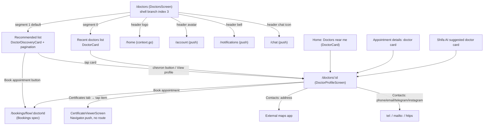
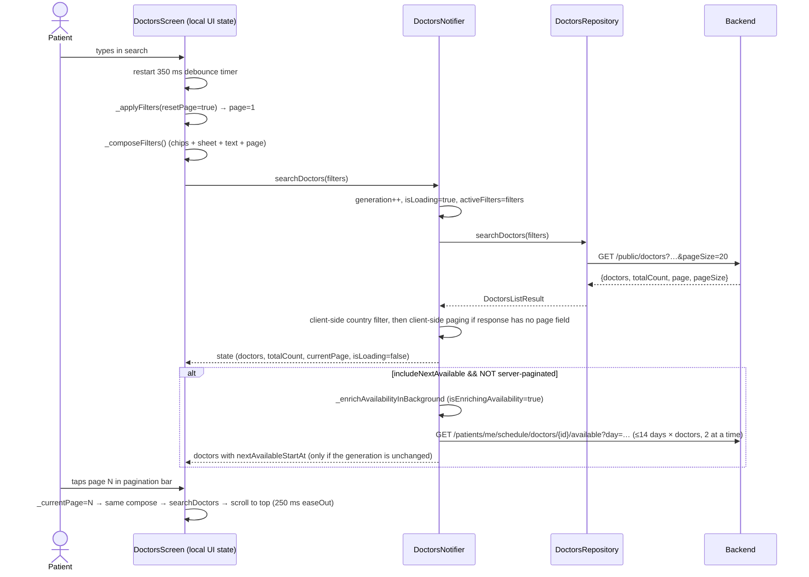
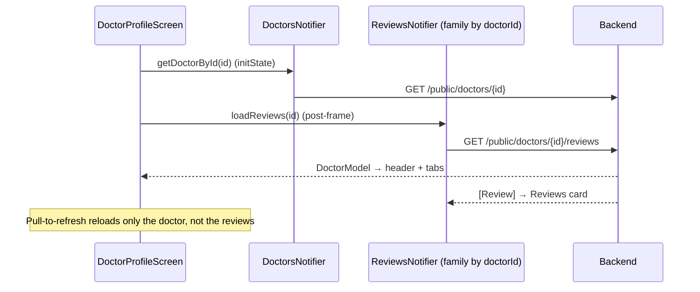

# 07 — Doctors: discovery, profile, reviews, certificates, catalogs

Scope: finding doctors (search, quick-filter chips, a "more filters" sheet, sorting, pagination), the "Recent doctors" tab, the doctor profile screen (About / Services / Certificates / Contacts tabs plus a Reviews card), the in-app certificate viewer, reading reviews, and the client-side catalogs for professions, regions and countries.

Sources (Flutter repo, `lib/` prefix omitted in some tables):

- `lib/features/doctors/data/*`, `lib/features/doctors/providers/*`, `lib/features/doctors/presentation/**`
- `lib/core/models/doctor_model.dart`, `profession_model.dart`, `region_catalog.dart`, `country_catalog.dart`, `review_model.dart`
- `lib/core/widgets/doctor_card.dart`
- Code this feature uses from elsewhere: `lib/core/localization/app_localizations.dart:3620-3665` (profession/region translation, next-slot formatting), `lib/core/utils/image_utils.dart`, `lib/core/utils/location_utils.dart`, `lib/features/bookings/data/schedule_repository.dart`, `lib/app/router.dart`, `lib/app/shell_tab_index_provider.dart`

Anything marked **UNVERIFIED** is inferred and not proven by the Flutter code, usually because it depends on how the backend behaves.

---

## 1. Feature overview and user flows

### 1.1 What the feature does

- **Doctors tab** (bottom-nav index 3, route `/doctors`). It has a two-segment control:
  - **Recent doctors** (index 0): every doctor the patient has had an appointment with. The list comes from the patient's appointments, followed by one profile fetch per doctor. There is no search, no filters and no pagination.
  - **Recommended** (index 1, **the default**): the public doctor search. It has a debounced text search, 8 quick-filter chips, a "More filters" sheet (sort, region, specialty, country, consultation type, availability, price band, minimum rating), server pagination with 20 per page, and a numbered pagination bar.
- **Doctor profile** (`/doctors/:id`) shows the header (photo, name, profession, location, rating), a **Book appointment** CTA, a 4-tab card (About / Services / Certificates / Contacts), and a Reviews card.
- **Certificate viewer** is pushed with an imperative `Navigator.push`, not a GoRouter route. It shows PDFs inline, shows images with pinch-zoom, and falls back to a WebView for anything else.
- **Reviews** are read-only here. Writing a review happens in the bookings feature (`SubmitReviewScreen`), which reuses `reviewsProvider` (see §3.4).
- **Nothing on the doctor profile opens a chat with that doctor.** There is no chat or message button on `DoctorProfileScreen` (`lib/features/doctors/presentation/screens/doctor_profile_screen.dart`, whole file). The Doctors tab header only has the generic chat icon, which pushes the chat list at `/chat` (`doctors_screen.dart:301`).

### 1.2 Navigation map



Other features also link into the profile: Home "Doctors near me" (`lib/features/home/presentation/screens/home_screen.dart:308`), Appointment details (`lib/features/bookings/presentation/screens/appointment_details_screen.dart:566`) and Shifa AI suggestions (`lib/features/copilot/presentation/shifa_ai_screen.dart:227`). All of them call `context.push('/doctors/{id}')`.

### 1.3 Search / filter / paginate flow



### 1.4 Profile flow



---

## 2. Screens and widgets

### 2.1 `DoctorsScreen` — `/doctors`

File: `lib/features/doctors/presentation/screens/doctors_screen.dart`. It is a `ConsumerStatefulWidget`. The route lives in the 4th `StatefulShellBranch` (index 3) of the `StatefulShellRoute.indexedStack` (`lib/app/router.dart:514-531`), so the widget and its local state **stay alive across bottom-tab switches**.

#### Local (widget) state (`doctors_screen.dart:36-56`)

| Field | Initial | Meaning |
|---|---|---|
| `_selectedTab` | `1` | 0 = Recent doctors, 1 = Recommended |
| `_searchController` | empty | search text |
| `_searchDebounce` | null | `Timer`, 350 ms |
| `_chipOnline`, `_chipNearMe`, `_chipToday`, `_chipThisWeek`, `_chipTopRated`, `_chipVerified`, `_chipGermany`, `_chipUzbekistan` | all `false` | quick-filter chips |
| `_nearMeLat`, `_nearMeLon` | null | GPS fix used by "Near me" |
| `_isFetchingLocation` | false | shows a spinner inside the Near-me chip |
| `_sheetFilters` | empty `DoctorFiltersSheetResult` | last applied "More filters" values |
| `_scrollController` | — | used to scroll to top after a page change |
| `_currentPage` | `1` | page requested from the API |

This filter state lives in the widget, not the provider. It survives tab switches because of the indexedStack, but it is **lost when the app process dies**. It is never persisted.

#### Lifecycle

- `initState` → post-frame (`:61-66`), fired without awaiting:
  1. `_applyFilters()` (page reset to 1, then Recommended search)
  2. `doctorsProvider.notifier.loadFilterCatalog()`
  3. `doctorsProvider.notifier.loadMyDoctors()`
  4. `profileProvider.notifier.loadProfile()` (profile feature; provides avatar and fallback lat/lon)
- `build` → `ref.listen(shellTabIndexProvider)` (`:255-259`): when the shell tab **changes to 3** from something else **and** `_selectedTab == 1`, it runs `_applyFilters()`, which **resets to page 1**. This exists because Home and Create Booking call `loadDoctors()` on the same shared provider and overwrite the list (see §5.3). Side effect: coming back to the tab always returns you to page 1. On the very first open, the initState call and this listener probably both fire, giving a double fetch (**UNVERIFIED**, it depends on frame ordering in `lib/app/main_shell.dart:86-89`, which sets the tab index in a post-frame callback).
- `dispose` cancels the debounce timer and disposes the text and scroll controllers.

#### UI, top to bottom (all inside `RefreshIndicator` → `CustomScrollView`)

1. **`AppHeader`** (`:290-303`)
   - title: `findADoctor`
   - subtitle: `doctorsCount(totalCount)` ("{count} verified doctors"), shown only when `totalCount > 0`. It always uses the Recommended total, even when the Recent tab is selected.
   - `showProfile`, `showNotification` and a chat icon; `showBack: false`
   - logo → `context.go('/home')`; avatar → `push('/account')`; bell → `push('/notifications')`; chat → `push('/chat')`
   - The avatar URL is `withCacheBuster(profile.photoUrl, profileState.photoCacheKey)`.
2. **`SegmentedControl`**: labels `[recentDoctors, recommended]`, padding top 16 / bottom 8. Switching segments only calls `setState`. **No fetch happens**, because both lists are already loaded.
3. *(Recommended only)* **Search `TextField`** (`:315-331`)
   - hint `searchDoctorsHint`, search icon prefix, radius-12 outlined, filled with `backgroundSecondary`
   - `textInputAction: search`, but there is no `onSubmitted` handler
   - `onChanged` → `_scheduleSearch`: cancels the previous timer and starts `Timer(350ms, _applyFilters)`
   - The text is **trimmed**; an empty string becomes `null` (param omitted).
4. *(Recommended only)* **`DoctorQuickFilterChips`** (§2.2). Every toggle calls `setState` and then `await _applyFilters()`, which resets to page 1.
5. **Body state**, evaluated for the selected segment:
   - Loading (`isLoadingMyDoctors` for tab 0, `isLoading` for tab 1): centered `CircularProgressIndicator`, padding 32.
   - Error (`errorMyDoctors` / `error` non-null): `EmptyState(icon: error_outline, message: "${error}: ${rawErrorString}", action: ShifaPrimaryButton(retry, hug))`. Retry calls `loadMyDoctors()` on tab 0 and `_applyFilters()` on tab 1. The raw exception text is shown to the user, for example `Exception: Failed to search doctors: DioException…`.
   - Empty list: `EmptyState(icon: medical_services, message: translate('noDoctorsFound'))`.
   - List: a `SliverList` with horizontal inset `ResponsiveLayout.horizontalInset` (16 px on phones; centered to max 840 px on wide screens) and bottom gap `cardSpacing` (12).
     - Tab 0 → `DoctorCard(doctor, distanceText, onTap: push('/doctors/{id}'))`
     - Tab 1 → `DoctorDiscoveryCard(doctor, distanceText, onBook: push('/bookings/flow/{id}'), onProfile: push('/doctors/{id}'))`
6. *(Recommended, not loading, list non-empty)* **`DoctorsPaginationBar`** (§2.5) with `currentPage`, `totalPages`, `totalCount` and `onPageSelected: _goToPage`.
7. *(Recommended, `isEnrichingAvailability && !isLoading`)* a small 20×20 spinner (stroke 2) that shows background availability enrichment is running.
8. Bottom spacer `AppDesignSystem.safeBottomWithNavBar(context)`.

**Pull-to-refresh** (`:281-285`) runs these in sequence: `_applyFilters()` (page reset), then `loadMyDoctors()`, then `loadProfile()`.

#### Distance text (`_distanceText`, `:236-251`)

1. If the server sent `distanceKm`, use it.
2. Otherwise, if patient coordinates exist and the doctor has `latitude`/`longitude`, compute the Haversine distance (`lib/core/utils/location_utils.dart:10-17`, Earth diameter 12742 km).
   - Patient coords = the Near-me GPS fix when `_chipNearMe` is on, otherwise the patient profile `latitude`/`longitude` (`patient_profile_model.dart:14-15`).
3. Format: `< 1 km` → `"${(km*1000).round()} m"`; otherwise `"${km.toStringAsFixed(1)} km"`. The units are hardcoded, not localized.
4. `DoctorCard` shows the distance on the collapsed card. `DoctorDiscoveryCard` shows it only in the **expanded** section.

#### "Near me" toggle (`_toggleNearMe`, `:153-210`)

- If it is already on: turn it off, clear lat/lon, then `_applyFilters()`.
- Otherwise: set `_isFetchingLocation = true`, then:
  1. `Geolocator.isLocationServiceEnabled()`. If false → snackbar `translate('locationServicesDisabled')` and stop.
  2. `checkPermission`. If `denied` → `requestPermission`. If still `denied` or `deniedForever` → snackbar `translate('locationPermissionDenied')` and stop.
  3. `getCurrentPosition(desiredAccuracy: medium)`, with no timeout. On success: chip on, store lat/lon, `_applyFilters()`.
  4. Any exception → snackbar `couldNotGetLocationUsingProfile`. The chip stays off.

#### Pagination (`_goToPage`, `:140-151`)

- Ignored if `page < 1` or `page == _currentPage`.
- Otherwise: set `_currentPage`, run `searchDoctors(filters: _composeFilters())`, then (if attached) `animateTo(0, 250 ms, easeOut)`.
- Page size is fixed at `DoctorsSearchFilters.defaultPageSize = 20` (`doctors_search_filters.dart:24`).
- **Any** filter, chip, search or sheet change resets to page 1.

### 2.2 Filter composition — how UI state becomes API params

`_composeFilters()` (`doctors_screen.dart:82-131`) merges sheet values, chips and text. Precedence:

| API field | Rule (in code order) |
|---|---|
| `search` | trimmed text, or `null` if empty |
| `profession` | `sheet.specialty` (English backend string) |
| `region` | `sheet.region` (canonical viloyat such as `Toshkent shahri`, or a raw foreign city/region string) |
| `country` | `sheet.country`; **overridden** by the Germany chip → `'Germany'`, else the Uzbekistan chip → `'Uzbekistan'` (the two chips exclude each other) |
| `consultationType` | `sheet.consultationType`; if null **and** the Online chip is on → `'online'` |
| `availableWithin` | `sheet.availableWithin`; **overridden** by the Today chip → `'today'`, else the This-week chip → `'week'` (Today and This week exclude each other) |
| `minRating` | `sheet.minRating`; if the Top-rated chip is on and (`minRating == null` or `< 4.5`) → `4.5` |
| `minPriceMinor` / `maxPriceMinor` | from the sheet price band |
| `verifiedOnly` | `true` if the Verified chip is on, else `null` (omitted) |
| `latitude`, `longitude` | only when Near me is on |
| `radiusKm` | `50` when Near me is on |
| `sortBy` | `sheet.sortBy`; **overridden** to `'distance'` when Near me is on with coords; else if Top-rated is on and the sheet sort is null → `'rating'` |
| `includeNextAvailable` | always `true` from this screen |
| `page` | `_currentPage` |
| `pageSize` | `20` |

Chips never reflect sheet state, and the sheet never reflects chips. For example, choosing "Online" in the sheet does not highlight the Online chip. Choosing Turkey in the sheet while the Germany chip is on sends `Germany`.

### 2.3 `DoctorQuickFilterChips`

File: `lib/features/doctors/presentation/widgets/doctor_filter_chips.dart`. It is a horizontally scrolling `Row` (inset = `horizontalInset`) of `FilterChip`s with `showCheckmark: false`, selected color `primary @ 15% alpha` and 8 px spacing. Order:

| # | Label key | State | Behavior |
|---|---|---|---|
| 1 | `filterOnline` | `_chipOnline` | toggle |
| 2 | `filterNearMe` | `_chipNearMe` | location flow (§2.1). Shows a 14×14 spinner inside the chip while fetching |
| 3 | `filterToday` | `_chipToday` | toggle; turning it on clears This week |
| 4 | `filterThisWeek` | `_chipThisWeek` | toggle; turning it on clears Today |
| 5 | `filterTopRated` | `_chipTopRated` | toggle |
| 6 | `filterVerified` | `_chipVerified` | toggle |
| 7 | `countryUzbekistan` | `_chipUzbekistan` | toggle; turning it on clears Germany |
| 8 | `countryGermany` | `_chipGermany` | toggle; turning it on clears Uzbekistan |
| 9 | `moreFilters` (`ActionChip`, `Icons.tune` 18) | — | opens the sheet (§2.4) |

### 2.4 "More filters" sheet — `showDoctorFiltersSheet`

File: `lib/features/doctors/presentation/widgets/doctor_filters_sheet.dart`.

- **Presentation** (`:45-70`):
  - If the window width is `>= 640` → `Dialog` (inset h24/v48, `maxWidth 480`, `maxHeight 85%` of screen height).
  - Otherwise → modal bottom sheet (`isScrollControlled`, `useSafeArea`, drag handle, top radius 16).
- **Inputs:** `regionOptions`, `specialtyOptions` and `initial` (the current `_sheetFilters`).
- **Option sources** (`doctors_screen.dart:212-223`):
  - Region: `state.catalogRegionOptions` if non-empty, else `DoctorsFilterCatalog.regionOptions(currentPageDoctors, countryFilter: sheet.country ?? (germanyChip ? 'Germany' : null))`.
  - Specialty: `state.catalogSpecialtyOptions` if non-empty, else `specialtyOptions(currentPageDoctors)`.
  - How the catalog is built is in §5.2.
- **Output:** `DoctorFiltersSheetResult` (region, specialty, country, consultationType, availableWithin, minRating, minPriceMinor, maxPriceMinor, sortBy). The result is returned **only** when the user taps Apply. Dismissing returns `null` and nothing changes. On Apply the screen stores the result and runs `_applyFilters()` (page 1).
- **Layout:** padding LTRB 16/0/16/(16 + keyboard inset), scrollable. Title `moreFilters` (h2). Then **8 dropdowns** (`DropdownButtonFormField`, radius-12 outlined, filled `backgroundSecondary`, 12 px apart). Each option's first entry is the `null` "all" choice.

| # | Label key | Values (value → label key) |
|---|---|---|
| 1 | `sortBy` | `null`→`sortBy` (the placeholder label repeats the field label), `rating`→`sortByRating`, `distance`→`sortByDistance`, `reviews`→`sortByReviews`, `availability`→`sortByAvailability` |
| 2 | `filterByRegion` | `null`→`allRegions`, then every region option sorted by `UzbekistanRegions.sortKeysForDisplay(options, lang)`, label `translateRegion(value)` |
| 3 | `filterBySpecialty` | `null`→`allSpecialties`, then specialty options sorted by `ProfessionData.sortEnglishKeysForDisplay(options, lang)`, label `translateProfession(value)` |
| 4 | `filterByCountry` | `null`→`allCountries`, `Germany`→`countryGermany`, `Uzbekistan`→`countryUzbekistan`, `Turkey`→`countryTurkey`, `United Arab Emirates`→`countryUae` |
| 5 | `filterConsultationType` | `null`→`allConsultationTypes`, `online`→`consultationOnline`, `in_person`→`consultationInPerson`, `both`→`consultationBoth` |
| 6 | `filterAvailability` | `null`→`allAvailability`, `today`→`availabilityToday`, `tomorrow`→`availabilityTomorrow`, `week`→`availabilityThisWeek` |
| 7 | `filterPrice` (band) | `null`→`allPrices`; `under20`→`priceUnder20` = (min null, **max 2000**); `20to50`→`price20to50` = (**min 2000, max 5000**); `over50`→`priceOver50` = (**min 5000**, max null). Values are minor units. Any other min/max combination shows as "all" (`_priceBandKey`, `:287-309`) |
| 8 | `filterMinRating` | `null`→`allRatings`, `'4.5'`→`4.5+`, `'4.0'`→`4.0+` (the string is parsed to a double) |

- **Buttons:** a row with `ShifaSecondaryButton(clear)` and `ShifaPrimaryButton(applyFilters)`. **Clear** only resets the sheet's local fields to null; you still have to tap **Apply**.
- **Price quirk:** the labels say "$20 / $50", but the params are currency-agnostic minor units (2000 = 20.00 of *whatever* currency the backend compares against). For UZS doctors this means 20 so'm. Backend semantics are **UNVERIFIED**.

### 2.5 `DoctorsPaginationBar`

File: `lib/features/doctors/presentation/widgets/doctors_pagination_bar.dart`.

- Hidden (`SizedBox.shrink`) when `totalPages <= 1`.
- Otherwise it renders a column:
  1. Summary caption `doctorsPageSummary(page, pages, count)` (e.g. "Page 2 of 5 · 100 doctors"), `textSecondary`.
  2. A horizontally scrollable row: `‹` IconButton (tooltip `previousPage`, enabled if `current > 1`), page buttons, `›` (tooltip `nextPage`, enabled if `current < total`). Enabled icons use `primary`; disabled use `textTertiary`.
- **Visible pages** (`_visiblePages`, `:98-112`):
  - If `total <= 7`: all pages 1..total.
  - Else: the set `{1, total, current-1, current, current+1}` clipped to range and sorted, with `…` inserted wherever consecutive numbers differ by more than 1. Example: current=5, total=12 → `1 … 4 5 6 … 12`.
- Page button: 8 px radius, padding h12/v8. The selected page has a `primary @15%` background, w700 primary text and is **not tappable**. Others use w500 `textPrimary`.
- `totalPages` = `ceil(totalCount / pageSize)`, minimum 1 (`doctors_provider.dart:91-97`).

### 2.6 `DoctorDiscoveryCard` (Recommended list)

File: `lib/features/doctors/presentation/widgets/doctor_discovery_card.dart`. It is a `StatefulWidget` with a local `_expanded = false`. It wraps a `BaseCard(padding 12, onTap: null)`, so **the card body itself is not tappable**.

Collapsed (always visible):

1. **Header row**
   - `UserAvatar(name: fullName, photoUrl, radius 26)`. When "verified", a white-circled `Icons.verified` (16, primary) badge sits bottom-right.
   - **"Verified" is a client heuristic: `certificates != null && certificates.isNotEmpty`** (`:81`). The server-side `verifiedOnly` filter is a separate thing.
   - `fullName` (body2 w700, max 2 lines).
   - If `rating != null && reviewCount > 0`: amber star 14, `rating.toStringAsFixed(1)` (caption w600), `" (reviewCount)"`.
   - Below the name: `translateProfession(profession)` (caption, `textSecondary`, 1 line), only when profession is non-empty.
   - Trailing expand/collapse `IconButton` (`expand_more`/`expand_less`, min 44×44).
2. **Location line** (`_locationLine`, `:45-57`): `"city, locationCountry"`, else `city`, else `locationCountry`, else `region`, else hidden. Uses `location_on_outlined` 14, caption `textSecondary`, 1 line.
3. **Mode badges** (pill, radius 999, 12% alpha background, 11 px w600):
   - `consultationOnline` in `Colors.green.shade700` if `effectiveSupportsOnline`
   - `consultationInPerson` in `primary` if `effectiveSupportsInPerson`
4. **Availability + price row**
   - If `nextAvailableStartAt` is non-empty: `event_available` icon + `formatNextAvailableSlot(parsed.toLocal())`. If parsing fails, the raw ISO string is shown.
   - Otherwise: `noUpcomingAvailability` (tertiary).
   - Trailing: `fromPrice(formatPrice(startingPrice))` in bold, if `startingPrice != null`.

Expanded extras (`:245-293`), in order:

- `clinic` (tertiary)
- `"${consultationOnline}: ${formatPrice(onlineMinPriceMinor, minPriceCurrency)}"` when both are set
- `"${consultationInPerson}: ${formatPrice(clinicMinPriceMinor, minPriceCurrency)}"` when both are set
- distance text
- verified row (`verified_user` icon + `verifiedDoctor`)
- `TextButton(viewProfile)` → onProfile

CTA row (always visible): `ShifaPrimaryButton(bookAppointment, fill)` → `onBook`, plus `ShifaSecondaryButton.icon(chevron_right)` → `onProfile`.

Price formatting on this card (`_formatPrice`, `:31-37`): `major = minor / 100`. If `major` is a whole number, use `toStringAsFixed(0)`, else `toStringAsFixed(2)`. The result is `"$value $currency"` with no thousands separator and no currency symbol. Example: `12000000, "UZS"` → `"120000 UZS"`, so the label is "From 120000 UZS".

### 2.7 `DoctorCard` (core widget)

File: `lib/core/widgets/doctor_card.dart`. It is used by the Recent tab and Home "Doctors near me".

- `BaseCard(onTap)` → row:
  - Column: `UserAvatar(radius 24)`. Under it, if `rating != null && reviewCount > 0`: star 12 (amber.shade700), `rating.toStringAsFixed(1)` (11 px w600, amber.shade800), `" (N)"` caption.
  - Expanded column: `fullName` (body2 w600, 1 line). Then `translateProfession(profession)` + `" · clinic"` (clinic appended only if non-empty; the **whole line is shown only if profession is non-empty**). Then the distance text (caption, tertiary).
  - Trailing `chevron_right` (tertiary).

### 2.8 `DoctorProfileScreen` — `/doctors/:id`

File: `lib/features/doctors/presentation/screens/doctor_profile_screen.dart` (1049 lines). It is a `ConsumerStatefulWidget` with `SingleTickerProviderStateMixin`.

- **Route input:** `doctorId`, the path param (`router.dart:520-526`). The route is nested under the doctors shell branch, so it keeps the bottom bar. When it is pushed from another branch (Home, Bookings), GoRouter switches to the doctors branch stack (**UNVERIFIED**; standard go_router 14 behavior).
- **Local state:** `_doctor`, `_isLoading = true`, `_error`, `_tabController(length 4)`.
- **initState:**
  - `_loadDoctor()` → `doctorsProvider.notifier.getDoctorById(id)` → `GET /public/doctors/{id}`. There is no cache; every visit fetches.
  - Post-frame: `reviewsProvider(id).notifier.loadReviews(id)`.
  - `setState` runs after await **without a `mounted` check** (`:56-64`), so popping quickly can throw.
- **AppBar:** back arrow → `context.pop()`. Title is `"${doctors} ${profile}"` (two keys concatenated, e.g. "Doctors Profile").
- **Body states:**
  - loading → centered spinner
  - error → red text `"${error}: $_error"` (raw exception) + `ShifaPrimaryButton(retry, hug)` → `_loadDoctor`
  - `_doctor == null` → text `"${doctors} ${error.toLowerCase()}"`
  - loaded → `RefreshIndicator(onRefresh: _loadDoctor)` → `SingleChildScrollView(padding 16)` → Column

Loaded content, in order:

1. **Avatar**: `CircleAvatar(radius 60)` with `NetworkImage(normalizePhotoUrl(photoUrl) ?? photoUrl)` when `photoUrl != null`. Otherwise the first letter of `firstName` uppercased, or `'D'`, at 40 px. There is no error fallback for a broken image.
2. **Full name**: 24 px bold.
3. **Profession line** (`:131-148`): raw = `profession` if non-blank → else `specializations.join(', ')` → else `clinic`. Displayed via `translateProfession(raw)` (grey, 16, centered). Hidden if empty.
4. **Location line** (`_getHeaderLocationLine`, `:662-677`): `"city, region"` → `city` → `region` → the first comma-separated part of `address`. `Icons.location_on` 18, `#616161`, 15 px w500, 1 line. Hidden if null.
5. **Rating**:
   - If `rating != null`: 5 stars, where star *i* is amber if `i < rating.round()`, else grey (size 20). Then `rating.toStringAsFixed(1)` bold 16. If `reviewCount > 0`, also `"(N ${reviews})"` grey 14.
   - If `rating == null`: `translate('noRatingsYet')` grey.
   - This differs from the cards, which require `reviewCount > 0`.
6. 32 px gap, then **`ShifaPrimaryButton(bookAppointment)`** → `context.push('/bookings/flow/{doctorId}')`.
7. 24 px gap, then **Tab card + Reviews card** (`LayoutBuilder`, `:228-267`):
   - `maxWidth > 600` → side-by-side `Row` of two `Expanded` cards, height **500**.
   - Otherwise stacked: tab card height **400**, 16 gap, reviews card height **400**.
   - Each card scrolls internally.

**Tab card** (`_buildTabCard`): `TabBar(isScrollable, label/indicator color hardcoded #17C3B2, unselected grey)` with tabs `about`, `services`, `certificates`, `contacts`, then an expanded `TabBarView`.

- **About** (`:348-378`): shows `biography` if non-empty, else `furtherInformation`, else `translate('noBiographyAvailable')` centered grey. Text is 14 px.
- **Services** (`:380-501`):
  - If `serviceItems` is non-empty → a 2-column `GridView` (spacing 12/12, aspect 1.25). Each card: `medical_services` icon (#17C3B2, 22), title (2 lines, w600), spacer, price label (#17C3B2 w700):
    - `isFreeConsultation` → `translate('consultationServiceFreeBadge')`
    - no prices → `translate('priceNotSet')`. **This key does not exist in any language**, so the literal text `priceNotSet` is displayed.
    - otherwise the first price → `"${(amountMinor/100).toStringAsFixed(2)} ${currency}"`, always 2 decimals (e.g. `"150000.00 UZS"`).
  - Tapping a service → modal bottom sheet: title 18 w700, description (if non-blank), then **every** price, one per line, in the same 2-decimal format.
  - Else, if the legacy `services: List<String>` is non-empty → one card per string (icon + text 14 w500).
  - Else → `translate('noServicesAvailable')`.
- **Certificates** (`:503-583`):
  - Empty/null → `translate('noCertificatesAvailable')`.
  - Otherwise one card per URL string:
    - **Thumbnail** 72×72 (`_certificateThumbnail`, `:606-640`). The extension comes from the URL path (`_certificatePathExtension`).
      - `jpg/jpeg/png/webp/gif` → `CachedNetworkImage` (cover, radius 8, `memCacheWidth = 72 × devicePixelRatio`, grey placeholder with spinner, error → fallback).
      - Otherwise the fallback tile: `pdf` → `picture_as_pdf` icon red.shade700 on `#FFEBEE`; others → `insert_drive_file_outlined` in #17C3B2 on grey.shade100.
    - Title `translate('certificate')` w600 14.
    - Subtitle = **file label** = URI-decoded last path segment, or the whole URL if there are none (`_certificateFileLabel`, `:585-593`), grey 12, 2 lines.
    - Trailing chevron.
  - Tap → `Navigator.of(context).push(MaterialPageRoute(CertificateViewerScreen(url, title: fileLabel)))`.
  - Certificate URLs are **not** normalized (unlike photos).
- **Contacts** (`:746-966`), in order:
  1. **Address**, if `_getFormattedAddress()` is non-null: `street, city, region` joined with `", "` (trimmed, non-empty parts only), falling back to the legacy `address`. Header `address` (bold 16, #424242). Below it, a tappable tinted box (#17C3B2 at 8% fill, 40% border, radius 12) with a `map` icon, the address (3 lines), an underlined `translate('openInMaps')` and an `open_in_new` icon → `_openMap(address)`.
  2. **Clinic** row (`business` icon) if non-empty. Not tappable.
  3. **Phone** → `tel:{phone}` (only if `canLaunchUrl`).
  4. **Email** → `mailto:{email}`.
  5. **Telegram** → the value as-is if it starts with `http(s)://`; else `@x` → `https://t.me/x`; else `https://t.me/{value}`. Opened in an external app.
  6. **Instagram** → same rule with `https://instagram.com/`.
  7. **Empty message** `translate('noContactInformationAvailable')`, shown when clinic, **legacy `address`**, phone, email, telegram and instagram are all empty. This check ignores street/city/region, so a doctor with only a city shows the address card *and* the "no contact information" message.
- **`_openMap(address)`** (`:701-744`):
  - Android: `geo:{lat},{lng}?q={enc(address)}` (or `geo:0,0?q=…` without coordinates).
  - iOS: `http://maps.apple.com/?ll={lat},{lng}&q=…` (or `?q=…`).
  - If those fail, or on web → `https://www.google.com/maps/search/?api=1&query={lat},{lng}` (or `{enc(address)}`).
  - All via `LaunchMode.externalApplication`. If everything fails → red snackbar `translate('couldNotOpenMapApplication')`.

**Reviews card** (`_buildReviewsCard`, `:309-346`): padding 16, title `reviews` bold 16, then an expanded area:

- loading → spinner
- error → red `"${translate('errorLoadingReviews')}: ${error}"`
- empty → grey `noReviews`
- otherwise a `ListView` (not lazy) of review items

Review item (`_buildReviewItem`, `:968-1048`):

- `CircleAvatar(20)` with `patientPhotoUrl`, or the first letter of `patientName`, or `'A'`
- name, or `translate('anonymous')`, bold 14
- 5 stars (size 14; star *i* amber if `i < rating`)
- date `DateFormat('MMM dd, yyyy').format(DateTime.parse(createdAt))`. This formats in intl's default locale, not the app language (**UNVERIFIED**: no `Intl.defaultLocale` assignment was found in `main.dart`/`app.dart`), and in the parsed zone, with no `toLocal()`.
- comment (14 px) if non-empty
- If `createdAt` fails to parse, the item is **silently hidden**.

The only **refresh** is pull-to-refresh, which reloads the doctor only. Reviews reload only when the screen is recreated.

### 2.9 `CertificateViewerScreen`

File: `lib/features/doctors/presentation/screens/certificate_viewer_screen.dart`. It is imperative (no route). Inputs: `url` and `title`. AppBar shows `title` (1 line, ellipsis).

Algorithm (`_prepare`, `:108-171`):

1. Hint from the URL path extension: `pdf` → PDF; `jpg/jpeg/png/webp/gif` → image; anything else → **WebView immediately**.
2. For a PDF/image hint: `GET url` with the plain `http` package. **No auth header**, **45 s timeout**. A non-2xx status or an empty body is treated as an error.
3. Sniff magic bytes:
   - `%PDF` (25 50 44 46) → PDF
   - `FF D8 FF` → JPEG
   - `89 50 4E 47 0D 0A 1A 0A` → PNG
   - `RIFF….WEBP` (bytes 0-3 = 52 49 46 46, bytes 8-11 = 57 45 42 50) → WebP
   - otherwise use the URL hint (GIF is only detected this way)
4. PDF → `PdfControllerPinch(PdfDocument.openData(bytes), initialPage 1)` shown with `PdfViewPinch`. If opening fails → WebView.
5. Image → `InteractiveViewer(minScale 0.5, maxScale 4.0)` → `Image.memory(fit contain)`. A decode error shows the unsupported view.
6. Any exception → WebView (`JavaScriptMode.unrestricted`, `loadRequest(url)`).

States:

- loading → spinner + `translate('loadingDocument')`
- unsupported → `insert_drive_file` icon 64 grey, `translate('unsupportedDocumentType')`, and `ShifaPrimaryButton(retry)` → `_prepare()` again
- The PDF controller is disposed in `dispose`.

---

## 3. API endpoints

The base URL is `ApiClient.apiBaseUrl` (…`/api`). Paths below exclude `/api`. The Dio client adds `Authorization: Bearer <jwt>` whenever a token exists, **including for `/public/*` calls**. A 401 on `/public/*` does **not** trigger logout (`lib/core/network/api_client.dart:121-131`). Timeouts are 30 s connect and 30 s receive. The general ApiClient contract is covered in the networking spec.

### 3.1 `GET /public/doctors` — search/list

`DoctorsRepository.searchDoctors` (`lib/features/doctors/data/doctors_repository.dart:27-66`).

**Query params** (`DoctorsSearchFilters.toQueryParameters`, `doctors_search_filters.dart:106-129`). Params are only included when they are set. Dio serializes values with `toString()`: doubles like `4.5` / `41.311081`, bools as `true`, ints as-is.

| Param | Type | Sent when | Values produced by this app |
|---|---|---|---|
| `search` | string | non-empty | free text (trimmed) |
| `profession` | string | non-empty | English profession string (Appendix A, or any value seen in doctor data) |
| `clinic` | string | non-empty | *never set by the UI* |
| `region` | string | non-empty | canonical region (Appendix B) or a raw foreign city/region |
| `country` | string | non-empty | `Germany`, `Uzbekistan`, `Turkey`, `United Arab Emirates` |
| `consultationType` | string | non-empty | `online`, `in_person`, `both` |
| `availableWithin` | string | non-empty | `today`, `tomorrow`, `week` |
| `minRating` | double | non-null | `4.5`, `4.0` |
| `minPriceMinor` | int | non-null | `2000`, `5000` |
| `maxPriceMinor` | int | non-null | `2000`, `5000` |
| `verifiedOnly` | bool | only if `true` | `true` |
| `latitude` / `longitude` | double | non-null | GPS fix (Near me) |
| `radiusKm` | double | non-null | `50` |
| `sortBy` | string | non-empty | `rating`, `distance`, `reviews`, `availability` |
| `includeNextAvailable` | bool | only if `true` | `true` (Doctors screen); omitted for `loadDoctors()` |
| `page` | int | **only if `> 1`** | 1-based |
| `pageSize` | int | **always** | `20` |

Example first load from the Doctors screen: `GET /api/public/doctors?includeNextAvailable=true&pageSize=20`.
Home and Create Booking `loadDoctors()`: `GET /api/public/doctors?pageSize=20`.

**Response.** Two shapes are accepted:

```json
// Preferred (server-paginated)
{
  "doctors": [ /* DoctorModel JSON, §4.1 */ ],
  "totalCount": 137,
  "page": 1,
  "pageSize": 20
}
```

```json
// Legacy: bare array → totalCount = array length, page/pageSize = null
[ /* DoctorModel JSON */ ]
```

- A map without a `doctors` list → an empty list with the given `totalCount`.
- Anything else → empty, `totalCount 0`.
- `totalCount`, `page` and `pageSize` are read as `num` → int.

**Post-processing in the notifier** (`doctors_provider.dart:263-316`):

1. `serverPaginated = result.page != null`.
2. **Client-side country filter always runs**: `DoctorsFilterCatalog.applyCountryFilter(doctors, filters.country)` (Appendix C). With server pagination this can leave fewer than 20 rows on a page while `totalCount` stays at the server value, so page counts can be wrong.
3. If **not** server-paginated: `totalCount = filtered.length`, then slice `[(page-1)*pageSize, +pageSize)` client-side.
4. Background availability enrichment (§3.8) runs **only** when `updateActiveFilters && includeNextAvailable && !serverPaginated`. With the current paginated backend it therefore never runs, and the server is expected to populate `nextAvailableStartAt` when `includeNextAvailable=true` (**UNVERIFIED** backend behavior).

**Errors:** any exception is rethrown as `Exception('Failed to search doctors: $e')`. The notifier stores `e.toString()` in `state.error`.

### 3.2 `GET /public/doctors/{doctorId}` — profile

`doctors_repository.dart:69-76`. The response is a single DoctorModel JSON object (§4.1), hard-cast to a Map. On error it throws `Exception('Failed to get doctor: $e')`, and `DoctorsNotifier.getDoctorById` wraps that again as `Exception('Failed to load doctor: Exception: Failed to get doctor: …')` (`doctors_provider.dart:441-453`).

Used by the profile screen, the Recent tab (once per doctor), and the booking flow (`appointment_booking_flow_screen.dart:119`).

### 3.3 `GET /public/doctors/{doctorId}/reviews`

`lib/features/doctors/data/reviews_repository.dart:12-25`. The response is a **bare JSON array** of Review objects (§4.4); a non-list response → `[]`. There is no pagination. On error it throws `Exception('Failed to get reviews: $e')`. Because `ReviewModel.fromJson` hard-casts `rating as int` and `createdAt as String`, a null in either field fails the **whole** list, which then shows the error state.

### 3.4 `POST /public/doctors/{doctorId}/reviews` (write; called from Bookings)

`reviews_repository.dart:28-47`. Body:

```json
{ "rating": 5, "comment": "text or null", "appointmentId": 123 }
```

- `appointmentId` is included only if provided, and is converted with `int.parse` (a non-numeric id throws).
- `comment` is sent as `null` when empty (the caller trims).
- The response is a Review object.

`ReviewsNotifier.createReview` then reloads that doctor's reviews (`reviews_provider.dart:47-65`). Caller: `lib/features/bookings/presentation/screens/submit_review_screen.dart:51`. `hasReviewForAppointment` is a stub that always returns `false` and is unused (`reviews_repository.dart:50-58`).

### 3.5 `GET /public/doctors/{doctorId}/locations` (used by the Bookings flow)

`lib/features/doctors/data/doctor_locations_repository.dart:74-87`. The response is a bare array of `PublicDoctorLocation` (§4.5).

- Entries with `id <= 0` are dropped ("synthesized legacy placeholders").
- **Every error returns `[]`**, so the booking flow is never blocked.
- Consumer: `appointment_booking_flow_screen.dart:76-108`. When booking in person with more than one location, the user must pick a location first. Otherwise the app preselects `isPrimary` or the first location.

### 3.6 `GET /patients/me/appointments` (Recent tab source)

The Bookings repo is called with no params (`doctors_provider.dart:373-437`). The notifier:

1. collects unique non-empty `appointment.doctorId` values, keeping the order of first appearance
2. **sequentially** calls `GET /public/doctors/{id}` for each one (N+1 calls)
3. silently skips doctors that fail (for example, deleted ones)

If there are no ids → an empty list. See the Bookings spec for the appointment shape.

### 3.7 `GET /patients/me/schedule/doctors/{doctorId}/available?day=yyyy-MM-dd[&locationId=]` (enrichment only)

`lib/features/bookings/data/schedule_repository.dart:38-61`. The response is an array of `{startAt, endAt, slotMinutes, locationId?, locationLabel?}`. `startAt` and `endAt` are ISO strings. This is a **patient-authenticated** endpoint, unlike the public list.

### 3.8 Availability enrichment (`DoctorAvailabilityEnricher`)

File: `lib/features/doctors/data/doctor_availability_enricher.dart`.

- **When:** only as a fallback, when the list response is **not** server-paginated (§3.1 step 4). It is triggered in the background (fire-and-forget) after the list is already shown. `state.isEnrichingAvailability = true` shows the small spinner.
- **Targets:** doctors on the current page whose `nextAvailableStartAt` is null or empty. `maxDoctors` = page length.
- **Concurrency:** batches of **2** doctors at a time (`Future.wait` per batch, batches run in sequence).
- **Per doctor (`_findNextSlot`):** for `d = 0..13` (**14-day lookahead**), request `day = today + d` (local date, `yyyy-MM-dd`) **one day at a time in sequence**. For each returned slot, parse `startAt` to local time. On day 0, skip slots that are not after `now`. The first valid slot wins, and the raw `startAt` string is returned. Per-day errors are skipped. Worst case is 14 calls per doctor.
- **Cache:** a process-wide singleton map `doctorId → (slotStartAt, storedAt)` with a **5-minute TTL**, checked lazily on read. Only hits are cached; "no slot found" is **not** cached.
- **Apply:** returns the list with `copyWith(nextAvailableStartAt: …)` for doctors where a slot was found.
- **Stale guard:** the notifier writes the enriched list only if `generation == _fetchGeneration`, meaning no newer fetch started meanwhile (`doctors_provider.dart:333-367`).
- `DoctorAvailabilityEnricher.serverProvidesAvailability()` exists (checks the first 5 doctors) but is **unused**.

### 3.9 Certificate / photo file fetches

- Certificate thumbnails: `CachedNetworkImage(url)`. Certificate viewer: `http.get(url)` with no auth, or a WebView. Both use the raw URL from `certificates[]`.
- Doctor and reviewer photos are normalized with `normalizePhotoUrl` (§4.6).

---

## 4. Data models

### 4.1 `DoctorModel` (`lib/core/models/doctor_model.dart:4-300`)

It is `Equatable`, and all fields are in `props`.

| Field | Type | JSON key(s) read | Default / parse rule |
|---|---|---|---|
| `id` | String | `id` | `toString()`, `''` if null (numeric on the backend, string in the app) |
| `firstName` | String | `firstName` | `''` |
| `lastName` | String | `lastName` | `''` |
| `fullName` | String | `fullName` | fallback `"${firstName} ${lastName}".trim()` |
| `profession` | String? | `profession` | English catalog string; may be compound, e.g. `"Dentist, Pediatric"` |
| `clinic` | String? | `clinic` | |
| `address` | String? | `address` | legacy free-text address |
| `street` | String? | `locationStreetAddress` ?? `street` | |
| `city` | String? | `locationCity` ?? `city` | |
| `region` | String? | `locationRegion` ?? `region` | |
| `latitude` / `longitude` | double? | `latitude` / `longitude` | `num → double` |
| `phone`, `email` | String? | same | |
| `photoUrl` | String? | `photoUrl` | passed through `normalizePhotoUrl` |
| `rating` | double? | **`averageRating`** | `num → double` |
| `reviewCount` | int? | `reviewCount` | `num → int` |
| `specializations` | List<String>? | `specializations` | `List<String>.from` (throws on non-string elements) |
| `furtherInformation` | String? | `furtherInformation` | About-tab fallback |
| `biography` | String? | `biography` | About tab |
| `services` | List<String>? | `services` | legacy services list |
| `serviceItems` | List<DoctorServiceItem>? | `serviceItems` | §4.2 |
| `certificates` | List<String>? | `certificates` | URLs; non-empty ⇒ "verified" badge |
| `telegram`, `instagram` | String? | same | handle, `@handle` or URL |
| `nextAvailableStartAt` | String? | `nextAvailableStartAt` | ISO-8601 instant |
| `recommendationReason` | String? | `recommendationReason` | not used in this feature (Shifa AI) |
| `triggeredBySymptoms` | List<String>? | `triggeredBySymptoms` | not used in this feature (Shifa AI) |
| `locationCountry` | String? | `locationCountry` | free text, e.g. `Germany`, `Uzbekistan` |
| `distanceKm` | double? | `distanceKm` | server distance, used when present |
| `supportsOnline` | bool | `supportsOnline` | `== true`, default false |
| `supportsInPerson` | bool | `supportsInPerson` | `== true`, default false |
| `minPriceMinor` | int? | `minPriceMinor` | cheapest price, minor units |
| `minPriceCurrency` | String? | `minPriceCurrency` | ISO-ish code, e.g. `UZS`, `EUR` (**UNVERIFIED** set of codes) |
| `onlineMinPriceMinor` | int? | `onlineMinPriceMinor` | |
| `clinicMinPriceMinor` | int? | `clinicMinPriceMinor` | |

Not in the model: **years of experience, languages spoken, gender, education**. If the backend returns them, this app ignores them. The display name is just `fullName`, with no title or prefix.

`toJson()` writes `rating` (not `averageRating`) and `street`/`city`/`region` (not the `location*` keys), so the round trip is asymmetric. `copyWith` only allows `nextAvailableStartAt`, `supportsOnline`, `supportsInPerson`, `minPriceMinor`, `minPriceCurrency`, `onlineMinPriceMinor`, `clinicMinPriceMinor`, `locationCountry` and `distanceKm`.

**Derived getters:**

- `effectiveSupportsOnline` = `supportsOnline || serviceItems non-empty` (`:133-134`)
- `effectiveSupportsInPerson` = `supportsInPerson || clinic non-blank || city non-blank || latitude != null` (`:137-141`)
- `startingPrice: (int amountMinor, String currency)?` (`:144-163`):
  1. `(minPriceMinor, minPriceCurrency)` if both are set and the currency is non-empty
  2. otherwise the minimum `amountMinor` across all prices of all **non-free** `serviceItems`, with the currency of that price
  3. otherwise null

  Mixed currencies are compared numerically without conversion.

### 4.2 `DoctorServiceItem` / `DoctorServicePriceItem` (`doctor_model.dart:302-365`)

| Class | Field | JSON | Default |
|---|---|---|---|
| ServiceItem | `id` | `id` | `toString()` or `''` |
| | `title` | `title` | `''` |
| | `description` | `description` | null |
| | `isFreeConsultation` | `isFreeConsultation` | `== true`. When true, video bookings skip payment (see the Bookings/Payments spec) |
| | `prices` | `prices` (array) | `[]` |
| PriceItem | `amountMinor` | `amountMinor` | `num → int`, `0` if missing |
| | `currency` | `currency` | `''` |

### 4.3 Formatting rules (collected in one place)

| What | Where | Rule |
|---|---|---|
| Rating on cards | `doctor_discovery_card.dart:138-149`, `doctor_card.dart:36-50` | shown only if `rating != null && reviewCount > 0`; `toStringAsFixed(1)` + `" (N)"` |
| Rating on profile | `doctor_profile_screen.dart:180-217` | shown if `rating != null`; 5 stars filled `i < rating.round()`; `toStringAsFixed(1)`; `"(N reviews)"` if N > 0; else `noRatingsYet` |
| Review stars | `:1011-1019` | filled `i < review.rating` (int) |
| Card price | `doctor_discovery_card.dart:31-37` | minor/100; no decimals if whole, else 2; `"<v> <CUR>"`; wrapped as `fromPrice` ("From {{price}}") |
| Service price (profile) | `doctor_profile_screen.dart:399,422` | `(minor/100).toStringAsFixed(2) + " " + currency`, always 2 decimals |
| Next slot | `app_localizations.dart:3637-3665` | local time `HH:mm`. Same day → `"{availabilityToday} · HH:mm"`; next day → `"{availabilityTomorrow} · HH:mm"`; else `"{weekdayShort} HH:mm"` with weekday arrays **en** `Mon Tue Wed Thu Fri Sat Sun`, **uz** `dush sesh chor pay jum shan yak`, **ru** `пн вт ср чт пт сб вс`, **de** `Mo Di Mi Do Fr Sa So`. No date is shown, so a slot 8-13 days away looks the same as one this week |
| Distance | `doctors_screen.dart:236-251` | `<1 km` → `"N m"`; else `"X.X km"` |
| Location (card) | `doctor_discovery_card.dart:45-57` | `city, country` → city → country → region |
| Location (profile header) | `doctor_profile_screen.dart:662-677` | `city, region` → city → region → first comma-part of `address` |
| Address (profile contacts) | `:680-698` | `street, city, region` → legacy `address` |
| Avatar initials (`UserAvatar`) | `lib/core/widgets/user_avatar.dart` | first letter of the first and last whitespace-separated words, uppercased; one word → one letter; none → person icon. Grey `#E0E0E0` background, `#607D8B` text |

### 4.4 `ReviewModel` (`lib/core/models/review_model.dart`)

| Field | Type | JSON | Rule |
|---|---|---|---|
| `id` | String | `id` | `toString()` or `''` |
| `patientName` | String | `patientName` | `''` if null or blank; UI then shows `anonymous` |
| `patientPhotoUrl` | String? | `patientPhotoUrl` | `normalizePhotoUrl` |
| `rating` | int | `rating` | **hard cast `as int`**; 1-5 expected |
| `comment` | String? | `comment` | |
| `createdAt` | String | `createdAt` | **hard cast `as String`**, ISO-8601 |

### 4.5 `PublicDoctorLocation` (`doctor_locations_repository.dart:8-66`)

| Field | JSON | Rule |
|---|---|---|
| `id` | `id` | `(num).toInt()`, required; `<= 0` filtered out |
| `label` | `label` | `''` default |
| `clinic`, `address` | same | |
| `latitude`, `longitude` | same | `num → double` |
| `locationCountry`, `locationRegion`, `locationCity`, `locationStreetAddress` | same | |
| `isPrimary` | `isPrimary` | `== true` |

`displaySubtitle` = the non-empty parts `[clinic, (address ?? "city, region, country")]` joined with `" · "`.

### 4.6 Photo URL normalization (`lib/core/utils/image_utils.dart:4-29`)

- Absolute `http(s)` URL → unchanged, except on Android, where host `localhost`/`127.0.0.1` is rewritten to `ApiClient.publicBaseUrl`.
- Relative path → `"${ApiClient.publicBaseUrl}/${path without leading /}"`. **`publicBaseUrl` is hardcoded to `http://localhost:8090` (Android: `http://10.0.2.2:8090`) in every build, production included** (`api_client.dart:42-50`). Relative photo URLs are therefore broken outside local dev. The KMP port should resolve relative URLs against the real API host (**UNVERIFIED** whether production ever returns relative URLs).

### 4.7 Filter value objects

- `DoctorsSearchFilters` (`doctors_search_filters.dart`): the fields in §3.1 plus `includeNextAvailable` (default false), `page` (default 1) and `pageSize` (default 20). It is `Equatable`. `copyWith` has a `clearX` flag per nullable field.
- `DoctorsListResult` (`doctors_repository.dart:7-19`): `doctors`, `totalCount`, `page?`, `pageSize?`.
- `DoctorFiltersSheetResult` (`doctor_filters_sheet.dart:9-31`): `region`, `specialty`, `country`, `consultationType`, `availableWithin`, `minRating`, `minPriceMinor`, `maxPriceMinor`, `sortBy` (all nullable).

---

## 5. State management

### 5.1 `doctorsProvider` — `StateNotifierProvider<DoctorsNotifier, DoctorsState>`

File: `lib/features/doctors/providers/doctors_provider.dart`. It is global and never auto-disposed, and it is **shared by the Doctors tab, Home, Create Booking and the Booking flow**.

`DoctorsState` fields (`:21-87`):

- `doctors` (current Recommended page)
- `myDoctors` (Recent)
- `totalCount`
- `currentPage` (from `filters.page`)
- `pageSize`
- `activeFilters`
- `catalogRegionOptions`, `catalogSpecialtyOptions`
- `isLoading`, `isLoadingMyDoctors`, `isEnrichingAvailability`
- `error`, `errorMyDoctors`
- `searchQuery` (set but never read)

Getter: `totalPages`.

Methods:

| Method | Behavior |
|---|---|
| `searchDoctors({filters})` | `_fetchDoctors(filters ?? activeFilters, updateActiveFilters: true)` |
| `loadDoctors()` | `_fetchDoctors(const DoctorsSearchFilters(), updateActiveFilters: false)`: page 1, 20 items, no filters, `includeNextAvailable=false`. **Overwrites `doctors`/`totalCount`/`currentPage`** |
| `_fetchDoctors` | `++_fetchGeneration`; sets `isLoading`, `currentPage`, `pageSize`, `searchQuery` and (conditionally) `activeFilters`; fetch → §3.1 post-processing |
| `loadFilterCatalog()` | §5.2 |
| `loadMyDoctors()` | §3.6 |
| `getDoctorById(id)` | pass-through fetch, no caching and no state change |

### 5.2 Filter catalog (`loadFilterCatalog`, `:185-209`, and `lib/features/doctors/data/doctors_filter_catalog.dart`)

- Runs once per `DoctorsScreen` init, and fetches **`GET /public/doctors?pageSize=20`**, so options are built from only the **first 20 doctors**.
- `regionOptions(doctors)`:
  1. Start with all 14 canonical Uzbekistan regions (included when `countryFilter` is null or equals `Uzbekistan`, `O'zbekiston` or `UZ`, case-insensitive; the catalog call passes null).
  2. For each doctor: `region` → canonical match, or the raw value.
  3. For each doctor's `city`: if it maps to a canonical region, add that. Otherwise add the raw city **only if the doctor has no region**, which covers international cities such as Berlin.
  4. Sort by display label (`languageCode` null → English labels).
- `specialtyOptions(doctors)` = the distinct trimmed non-empty `profession` strings, sorted by English label.
- On failure: `catalogRegionOptions = canonical 14`, specialty options stay empty. The sheet then falls back to the current page's doctors (§2.4).
- The sheet re-sorts both lists by the **current app language** label every time it opens.

### 5.3 Caching, refresh and persistence

| Aspect | Behavior |
|---|---|
| List cache | The provider keeps the last page in memory. There is no disk cache and no TTL. Leaving and re-entering the Doctors tab always refetches page 1 (listener, §2.1) |
| Shared-state clobbering | Home (`home_screen.dart:88,192`, on init and on every switch back to the Home tab) and Create Booking (`create_booking_screen.dart:26,38,40`) call `loadDoctors()`/`searchDoctors(DoctorsSearchFilters(search: q))` on the **same** provider. That replaces `doctors`, `totalCount` and `currentPage`, and toggles `isLoading`, errors and (for Create Booking search) `activeFilters`. The Doctors tab's re-entry refetch hides this |
| Filters persistence | Chips, sheet values, search text and page live in `DoctorsScreen` widget state. They persist across bottom-tab switches (indexedStack keeps the widget alive), except that the page resets to 1 on re-entry. They are **not** persisted across app restarts |
| Profile | Not cached; fetched on every open |
| Reviews | `reviewsProvider = StateNotifierProvider.family<ReviewsNotifier, ReviewsState, String>` keyed by doctorId (`reviews_provider.dart:68-71`), never disposed. The in-memory list per doctor lives for the app session but is **reloaded on each profile open** |
| Availability | 5-minute in-memory singleton cache (§3.8) |
| Stale responses | `_fetchGeneration` guards **only** the enrichment write. The main list write has **no** stale check, so with fast typing or chip toggling an older, slower response can overwrite a newer one (last response wins) |

### 5.4 `ReviewsState` (`reviews_provider.dart:5-27`)

Fields: `reviews` (list), `isLoading`, `error`. `copyWith` always overwrites `error`, so it resets to null when the argument is omitted. `loadReviews(id)`: loading → fetch → set. `createReview(...)`: POST, then `loadReviews`. Errors are rethrown to the caller.

### 5.5 `copyWith` error-reset gotcha

`DoctorsState.copyWith` assigns `error: error, errorMyDoctors: errorMyDoctors` directly (`:157-159`), so **any** `copyWith` call that doesn't pass them clears **both** errors. The three concurrent init calls (search, catalog, my-doctors) can therefore wipe each other's error. Example: the search fails, then the catalog load succeeds, `error` becomes null, and the user sees "No doctors found" instead of the error with its retry button. A port should keep the two lists' errors independent and only clear them deliberately.

---

## 6. KMP / CMP porting notes

1. **Model the list as a single state holder per screen**, not one shared global. Give Home "nearby doctors" and Create Booking their own flows or use-cases so they cannot overwrite the discovery list. Keep one `DoctorsDiscoveryState(filters, page, items, totalCount, loading, error, enriching)`.
2. **Hoist filter state** (chips, sheet, query, page) into the ViewModel (e.g. `StateFlow<DiscoveryFilters>`) so the "Online"/"Top rated" chip precedence rules in §2.2 live in one pure function `compose(chips, sheet, query, page, gps) → DoctorsSearchFilters`. Unit-test it against the table in §2.2.
3. **Debounce** the query with `debounce(350)` on a `Flow`. Use `flatMapLatest`/`collectLatest` for fetches. That fixes the missing stale-response guard (§5.3) for free.
4. **Query serialization:** omit null or empty params; always send `pageSize=20`; send `page` only when > 1; booleans only when true. Doubles use the default `toString()`.
5. **Response parsing:** accept both `{doctors,totalCount,page,pageSize}` and a bare array. Detect server pagination by `page != null`. Keep the client-side country filter (Appendix C), because the backend may ignore `country` (**UNVERIFIED**).
6. **Enrichment** is only needed for a non-paginated legacy backend. If the backend always paginates, you can skip it; if you keep it: 2 concurrent doctors, 14 sequential days, 5-minute TTL cache of hits only, discard results when a newer fetch starts.
7. **Location:** "Near me" needs the platform location permission flow (Android `ACCESS_COARSE/FINE_LOCATION`, iOS `NSLocationWhenInUseUsageDescription`) with medium accuracy. Distance falls back to the profile's lat/lon.
8. **Certificate viewer:** you need a PDF renderer (Android `PdfRenderer`; iOS `PDFKit`), a zoomable image view, and a WebView fallback. Keep the magic-byte sniffing, the 45 s timeout and the rule of "unknown extension → WebView directly". Consider sending auth headers if certificate URLs ever become protected (the current code sends none).
9. **External intents:** `tel:`, `mailto:`, `https://t.me/…`, `https://instagram.com/…`, Android `geo:` and iOS `http://maps.apple.com/?ll=…&q=…`, with Google Maps HTTPS as the fallback.
10. **Profession and region display** must go through the catalogs in the appendices. The backend stores **English** profession strings and mixed region strings. Only Uzbek has profession/region translations; `en`, `de` and `ru` all show the **English** catalog label (`profession_model.dart:12-17`, `region_catalog.dart:125-131`). A port could add real ru/de labels, but must keep the English value as the filter key sent to the API.
11. **Layout breakpoints** to keep: the filters sheet becomes a dialog at `>= 640 px`; the profile's tab and reviews cards sit side by side at `> 600 px` (500 px tall, else 400 px each, stacked); content max width is 840 px; minimum gutter is 16.
12. **Brand color drift:** the profile screen hardcodes `#17C3B2` for tabs, icons and links, while the design system primary is `#00BBB0`. Pick one on purpose.

### 6.1 Observed quirks and tech debt (reproduce or fix on purpose)

1. The Doctors screen, Home and Create Booking share one list provider. `loadDoctors()` overwrites the discovery page (§5.3).
2. No stale-response guard on the main search (§5.3). `copyWith` wipes both error fields (§5.5).
3. Raw exception strings are shown to users in error states (Doctors list, profile, reviews). This violates the project's error-sanitization rule.
4. The server-paginated list is still client-filtered by country, so pages can be short or empty while `totalCount` and page numbers stay wrong.
5. Catalog options come from only the first 20 doctors (default page size).
6. The "Verified" badge is `certificates.isNotEmpty`, which is not the server's `verifiedOnly` flag.
7. Rating visibility differs between the cards (`reviewCount > 0` required) and the profile (`rating != null` suffices).
8. There are three different price formats (card: 0 or 2 decimals; profile grid and sheet: always 2 decimals; neither has thousands separators). Price-band labels say `$` but send currency-agnostic minor units.
9. `priceNotSet` is missing from all languages (it renders the literal key). Many German keys used here are missing and fall back to English: `noDoctorsFound`, `locationServicesDisabled`, `couldNotGetLocationUsingProfile`, `clear`, `errorLoadingReviews`, `about`, `services`, `certificates`, `contacts`, `noBiographyAvailable`, `consultationServiceFreeBadge`, `noServicesAvailable`, `noCertificatesAvailable`, `certificate`, `couldNotOpenMapApplication`, `openInMaps`, `noContactInformationAvailable`, `loadingDocument`, `unsupportedDocumentType`. Russian `about` = "О приложении" ("About the app"), which is a wrong meaning for a doctor bio tab.
10. The profile title is built by concatenation (`"${doctors} ${profile}"`), which reads oddly in several languages.
11. `setState` runs after await without a `mounted` check (`doctor_profile_screen.dart:56-64`).
12. The "no contact info" check uses the legacy `address` only (§2.8).
13. Review dates use intl's default locale and no `toLocal()`. An unparsable `createdAt` hides the review.
14. `ReviewModel` hard casts: one malformed review fails the whole list.
15. The Recent tab makes N sequential profile fetches with no pagination.
16. `normalizePhotoUrl` resolves relative URLs against `localhost:8090` in all builds (§4.6).
17. The sheet dropdown asserts (debug) or misbehaves if the stored `region`/`specialty` value is not among the current options. Flutter `DropdownButtonFormField` requires the value to be present in its items.
18. Next-slot text shows only a weekday for dates beyond tomorrow, which is ambiguous across two weeks.
19. Unused code: `serverProvidesAvailability`, `hasReviewForAppointment`, `DoctorsState.searchQuery`, `ProfessionData.search`/`getShortDisplayText`, the `clinic` filter param.
20. Double fetch on the first open of the Doctors tab (initState plus the tab listener; **UNVERIFIED**).

---

## 7. Localization keys used by this feature

(Strings are exported separately.) Keys marked ⚠ are missing in `de` (they fall back to `en`); ⛔ is missing in every language.

- **Doctors screen / header:** `findADoctor`, `doctorsCount` (`{{count}}`), `recentDoctors`, `recommended`, `searchDoctorsHint`, `noDoctorsFound`⚠, `error`, `retry`, `locationServicesDisabled`⚠, `locationPermissionDenied`, `couldNotGetLocationUsingProfile`⚠
- **Chips:** `filterOnline`, `filterNearMe`, `filterToday`, `filterThisWeek`, `filterTopRated`, `filterVerified`, `countryUzbekistan`, `countryGermany`, `moreFilters`
- **Filters sheet:**
  - `moreFilters`
  - sort: `sortBy`, `sortByRating`, `sortByDistance`, `sortByReviews`, `sortByAvailability`
  - region / specialty: `filterByRegion`, `allRegions`, `filterBySpecialty`, `allSpecialties`
  - country: `filterByCountry`, `allCountries`, `countryGermany`, `countryUzbekistan`, `countryTurkey`, `countryUae`
  - consultation type: `filterConsultationType`, `allConsultationTypes`, `consultationOnline`, `consultationInPerson`, `consultationBoth`
  - availability: `filterAvailability`, `allAvailability`, `availabilityToday`, `availabilityTomorrow`, `availabilityThisWeek`
  - price: `filterPrice`, `allPrices`, `priceUnder20`, `price20to50`, `priceOver50`
  - rating: `filterMinRating`, `allRatings`
  - buttons: `clear`⚠, `applyFilters`
- **Pagination:** `doctorsPageSummary` (`{{page}}`, `{{pages}}`, `{{count}}`), `previousPage`, `nextPage`
- **Discovery card:** `consultationOnline`, `consultationInPerson`, `noUpcomingAvailability`, `fromPrice` (`{{price}}`), `verifiedDoctor`, `viewProfile`, `bookAppointment`, plus `availabilityToday` and `availabilityTomorrow` (via `formatNextAvailableSlot`)
- **Profile:** `doctors`, `profile`, `error`, `retry`, `noRatingsYet`, `reviews`, `bookAppointment`, `about`⚠, `services`⚠, `certificates`⚠, `contacts`⚠, `noBiographyAvailable`⚠, `consultationServiceFreeBadge`⚠, `priceNotSet`⛔, `noServicesAvailable`⚠, `noCertificatesAvailable`⚠, `certificate`⚠, `address`, `openInMaps`⚠, `couldNotOpenMapApplication`⚠, `noContactInformationAvailable`⚠, `errorLoadingReviews`⚠, `noReviews`, `anonymous`
- **Certificate viewer:** `loadingDocument`⚠, `unsupportedDocumentType`⚠, `retry`
- **Hardcoded (not localized):** weekday short names in `formatNextAvailableSlot` (per language, inside code), `m`/`km` units, `4.5+`/`4.0+` rating labels, `…` ellipsis.

---

## 8. Cross-feature facts other specs must reference

- The booking flow entry is `/bookings/flow/{doctorId}` (optional `?rescheduleId=`). It is reached from the discovery card "Book appointment" and from the profile CTA. The flow itself re-fetches `GET /public/doctors/{id}` and `GET /public/doctors/{id}/locations` (Bookings spec).
- `POST /public/doctors/{id}/reviews` (`{rating:int, comment:string|null, appointmentId:int}`) is sent from `SubmitReviewScreen` at route `/bookings/:id/review` (extra `{doctorId, doctorName}`).
- Home "Doctors near me" uses `DoctorCard` plus `doctorsProvider.loadDoctors()` (first 20 doctors, unfiltered), then filters client-side by radius (`nearbyDoctorsMaxRadiusKm = 50`, `nearbyDoctorsCloseRadiusKm = 15`, `lib/core/utils/location_utils.dart:3-7`); see the Home spec.
- `shellTabIndexProvider`: 0 = home, 1 = bookings, 2 = documents, 3 = doctors (`lib/app/shell_tab_index_provider.dart`).
- `DoctorServiceItem.isFreeConsultation` ⇒ video bookings skip payment (Payments/Bookings spec).
- The patient profile supplies `latitude`/`longitude` (distance fallback) and `photoUrl` + `photoCacheKey` (header avatar), per the Profile spec.

---

## Appendix A — Profession catalog (`lib/core/models/profession_model.dart:33-193`)

- There are **138 entries**, with **no numeric IDs or codes**. The **English string is the identifier**: it is stored on the backend in `doctor.profession` and sent as the `profession` filter.
- Each entry has exactly two labels, English and Uzbek.
- `getDisplayText(lang)` returns Uzbek for `uz`/`uz_UZ` and **English for every other language (en, de, ru)**.
- Categories come from code comments and are not part of the data model.

| # | Category | English (backend key + en/de/ru label) | Uzbek label (uz) | Line |
|---|---|---|---|---|
| 1 | General & Primary Care | `General Practitioner (GP)` | Umumiy amaliyot shifokori | 35 |
| 2 | General & Primary Care | `Family Physician` | Oilaviy shifokor | 36 |
| 3 | General & Primary Care | `Internist (Internal Medicine)` | Terapevt | 37 |
| 4 | General & Primary Care | `Pediatrician` | Pediatr | 38 |
| 5 | General & Primary Care | `Geriatrician` | Geriatr (keksalar shifokori) | 39 |
| 6 | General & Primary Care | `Hospitalist` | Gospitalist | 40 |
| 7 | General & Primary Care | `Adolescent Medicine Specialist` | O'smirlar tibbiyoti shifokori | 41 |
| 8 | General & Primary Care | `Preventive Medicine Specialist` | Profilaktika tibbiyoti shifokori | 42 |
| 9 | Medical (Non-Surgical) Specialties | `Cardiologist` | Kardiolog | 45 |
| 10 | Medical (Non-Surgical) Specialties | `Endocrinologist` | Endokrinolog | 46 |
| 11 | Medical (Non-Surgical) Specialties | `Gastroenterologist` | Gastroenterolog | 47 |
| 12 | Medical (Non-Surgical) Specialties | `Pulmonologist` | Pulmonolog | 48 |
| 13 | Medical (Non-Surgical) Specialties | `Nephrologist` | Nefrolog | 49 |
| 14 | Medical (Non-Surgical) Specialties | `Urologist` | Urolog | 50 |
| 15 | Medical (Non-Surgical) Specialties | `Andrologist` | Androlog | 51 |
| 16 | Medical (Non-Surgical) Specialties | `Hematologist` | Gematolog | 52 |
| 17 | Medical (Non-Surgical) Specialties | `Rheumatologist` | Revmatolog | 53 |
| 18 | Medical (Non-Surgical) Specialties | `Allergist / Immunologist` | Allergolog / Immunolog | 54 |
| 19 | Medical (Non-Surgical) Specialties | `Infectious Disease Specialist` | Infeksionist | 55 |
| 20 | Medical (Non-Surgical) Specialties | `Oncologist` | Onkolog | 56 |
| 21 | Medical (Non-Surgical) Specialties | `Neurologist` | Nevrolog | 57 |
| 22 | Medical (Non-Surgical) Specialties | `Psychiatrist` | Psixiatr | 58 |
| 23 | Medical (Non-Surgical) Specialties | `Dermatologist` | Dermatolog | 59 |
| 24 | Medical (Non-Surgical) Specialties | `Venereologist` | Venerolog | 60 |
| 25 | Medical (Non-Surgical) Specialties | `Phthisiatrician (TB specialist)` | Ftiziatr | 61 |
| 26 | Medical (Non-Surgical) Specialties | `Toxicologist` | Toksikolog | 62 |
| 27 | Medical (Non-Surgical) Specialties | `Sports Medicine Doctor` | Sport shifokori | 63 |
| 28 | Medical (Non-Surgical) Specialties | `Occupational Medicine Specialist` | Mehnat tibbiyoti shifokori | 64 |
| 29 | Medical (Non-Surgical) Specialties | `Hepatologist` | Gepatolog | 65 |
| 30 | Medical (Non-Surgical) Specialties | `Diabetologist` | Diabetolog | 66 |
| 31 | Medical (Non-Surgical) Specialties | `Hematologist-Oncologist` | Gematolog-onkolog | 67 |
| 32 | Medical (Non-Surgical) Specialties | `Interventional Cardiologist` | Interventsion kardiolog | 68 |
| 33 | Medical (Non-Surgical) Specialties | `Cardiac Electrophysiologist` | Aritmolog | 69 |
| 34 | Medical (Non-Surgical) Specialties | `Pain Medicine Specialist` | Og'riq tibbiyoti mutaxassisi | 70 |
| 35 | Medical (Non-Surgical) Specialties | `Addiction Medicine Specialist (Narcologist)` | Narkolog | 71 |
| 36 | Medical (Non-Surgical) Specialties | `Phlebologist` | Flebolog | 72 |
| 37 | Medical (Non-Surgical) Specialties | `Angiologist` | Angiolog | 73 |
| 38 | Medical (Non-Surgical) Specialties | `Sexologist` | Seksolog | 74 |
| 39 | Medical (Non-Surgical) Specialties | `Clinical Pharmacologist` | Klinik farmakolog | 75 |
| 40 | Medical (Non-Surgical) Specialties | `Obesity Medicine Specialist` | Semizlik tibbiyoti mutaxassisi | 76 |
| 41 | Medical (Non-Surgical) Specialties | `Radiation Oncologist` | Radiatsion onkolog | 77 |
| 42 | Mental Health & Behavioral | `Psychotherapist` | Psixoterapevt | 80 |
| 43 | Mental Health & Behavioral | `Clinical Psychologist` | Klinik psixolog | 81 |
| 44 | Mental Health & Behavioral | `Child Psychiatrist` | Bolalar psixiatri | 82 |
| 45 | Diagnostic & Laboratory | `Radiologist` | Radiolog | 85 |
| 46 | Diagnostic & Laboratory | `Ultrasound Doctor (Sonographer)` | UZI shifokori | 86 |
| 47 | Diagnostic & Laboratory | `Pathologist` | Patolog | 87 |
| 48 | Diagnostic & Laboratory | `Laboratory Doctor` | Laboratoriya shifokori | 88 |
| 49 | Diagnostic & Laboratory | `Nuclear Medicine Specialist` | Yadro tibbiyoti shifokori | 89 |
| 50 | Diagnostic & Laboratory | `Functional Diagnostics Doctor` | Funksional diagnostika shifokori | 90 |
| 51 | Diagnostic & Laboratory | `Interventional Radiologist` | Interventsion radiolog | 91 |
| 52 | Surgical Specialties | `General Surgeon` | Umumiy jarroh | 94 |
| 53 | Surgical Specialties | `Cardiothoracic Surgeon` | Yurak-ko'krak jarrohi | 95 |
| 54 | Surgical Specialties | `Neurosurgeon` | Neyroxirurg | 96 |
| 55 | Surgical Specialties | `Orthopedic Surgeon` | Ortoped-jarroh | 97 |
| 56 | Surgical Specialties | `Trauma Surgeon` | Travmatolog | 98 |
| 57 | Surgical Specialties | `Plastic Surgeon` | Plastik jarroh | 99 |
| 58 | Surgical Specialties | `Vascular Surgeon` | Qon tomir jarrohi | 100 |
| 59 | Surgical Specialties | `Pediatric Surgeon` | Bolalar jarrohi | 101 |
| 60 | Surgical Specialties | `Oncologic Surgeon` | Onkojarroh | 102 |
| 61 | Surgical Specialties | `Maxillofacial Surgeon` | Yuz-jag' jarrohi | 103 |
| 62 | Surgical Specialties | `Transplant Surgeon` | Transplantolog | 104 |
| 63 | Surgical Specialties | `Colorectal Surgeon (Proctologist)` | Koloproktolog | 105 |
| 64 | Surgical Specialties | `Thoracic Surgeon` | Torakal jarroh | 106 |
| 65 | Surgical Specialties | `Cardiac Surgeon` | Yurak jarrohi | 107 |
| 66 | Surgical Specialties | `Abdominal Surgeon` | Qorin bo'shlig'i jarrohi | 108 |
| 67 | Surgical Specialties | `Hand Surgeon` | Qo'l jarrohi | 109 |
| 68 | Surgical Specialties | `Spine Surgeon` | Umurtqa pog'onasi jarrohi | 110 |
| 69 | Surgical Specialties | `Foot and Ankle Surgeon` | Oyoq-to'piq jarrohi | 111 |
| 70 | Surgical Specialties | `Bariatric Surgeon` | Bariatrik jarroh | 112 |
| 71 | Surgical Specialties | `Burn Specialist` | Kuyish bo'yicha jarroh | 113 |
| 72 | Surgical Specialties | `Head and Neck Surgeon` | Bosh va bo'yin jarrohi | 114 |
| 73 | Surgical Specialties | `Breast Surgeon` | Ko'krak bezi jarrohi | 115 |
| 74 | Women's & Reproductive Health | `Gynecologist` | Ginekolog | 118 |
| 75 | Women's & Reproductive Health | `Obstetrician` | Akusher | 119 |
| 76 | Women's & Reproductive Health | `Obstetrician-Gynecologist (OB-GYN)` | Akusher-ginekolog | 120 |
| 77 | Women's & Reproductive Health | `Reproductive Medicine Specialist` | Reproduktolog | 121 |
| 78 | Women's & Reproductive Health | `Mammologist` | Mammolog | 122 |
| 79 | Women's & Reproductive Health | `Maternal-Fetal Medicine Specialist` | Perinatolog | 123 |
| 80 | Women's & Reproductive Health | `Gynecologic Oncologist` | Ginekolog-onkolog | 124 |
| 81 | Women's & Reproductive Health | `Urogynecologist` | Uroginekolog | 125 |
| 82 | ENT & Senses | `Ophthalmologist` | Oftalmolog (ko'z shifokori) | 128 |
| 83 | ENT & Senses | `Otolaryngologist (ENT)` | LOR shifokori | 129 |
| 84 | ENT & Senses | `Audiologist` | Audiolog | 130 |
| 85 | ENT & Senses | `Phoniatrician` | Foniatr | 131 |
| 86 | ENT & Senses | `Retina Specialist` | Retina mutaxassisi | 132 |
| 87 | Dental Specialties | `Dentist` | Stomatolog | 135 |
| 88 | Dental Specialties | `Orthodontist` | Ortodont | 136 |
| 89 | Dental Specialties | `Oral Surgeon` | Og'iz bo'shlig'i jarrohi | 137 |
| 90 | Dental Specialties | `Periodontist` | Parodontolog | 138 |
| 91 | Dental Specialties | `Prosthodontist` | Ortopedik stomatolog | 139 |
| 92 | Dental Specialties | `Pediatric Dentist` | Bolalar stomatologi | 140 |
| 93 | Dental Specialties | `Endodontist` | Endodont | 141 |
| 94 | Dental Specialties | `Implantologist` | Implantolog | 142 |
| 95 | Children & Development | `Neonatologist` | Neonatolog | 145 |
| 96 | Children & Development | `Pediatric Neurologist` | Bolalar nevrologi | 146 |
| 97 | Children & Development | `Pediatric Cardiologist` | Bolalar kardiologi | 147 |
| 98 | Children & Development | `Developmental Pediatrician` | Rivojlanish pediatri | 148 |
| 99 | Children & Development | `Speech Therapist` | Logoped | 149 |
| 100 | Children & Development | `Pediatric Endocrinologist` | Bolalar endokrinologi | 150 |
| 101 | Children & Development | `Pediatric Gastroenterologist` | Bolalar gastroenterologi | 151 |
| 102 | Children & Development | `Pediatric Pulmonologist` | Bolalar pulmonologi | 152 |
| 103 | Children & Development | `Pediatric Nephrologist` | Bolalar nefrologi | 153 |
| 104 | Children & Development | `Pediatric Oncologist` | Bolalar onkologi | 154 |
| 105 | Children & Development | `Pediatric Hematologist-Oncologist` | Bolalar gematolog-onkologi | 155 |
| 106 | Children & Development | `Pediatric Urologist` | Bolalar urologi | 156 |
| 107 | Children & Development | `Pediatric Otolaryngologist` | Bolalar LOR shifokori | 157 |
| 108 | Children & Development | `Pediatric Ophthalmologist` | Bolalar oftalmologi | 158 |
| 109 | Children & Development | `Pediatric Orthopedist` | Bolalar ortopedi | 159 |
| 110 | Children & Development | `Pediatric Allergist` | Bolalar allergologi | 160 |
| 111 | Children & Development | `Pediatric Infectious Disease Specialist` | Bolalar infeksionisti | 161 |
| 112 | Children & Development | `Pediatric Dermatologist` | Bolalar dermatologi | 162 |
| 113 | Emergency & Intensive Care | `Emergency Physician` | Shoshilinch tibbiyot shifokori | 165 |
| 114 | Emergency & Intensive Care | `Intensivist (ICU Doctor)` | Reanimatolog | 166 |
| 115 | Emergency & Intensive Care | `Anesthesiologist` | Anesteziolog | 167 |
| 116 | Emergency & Intensive Care | `Anesthesiologist-Resuscitator` | Anesteziolog-reanimatolog | 168 |
| 117 | Emergency & Intensive Care | `Pediatric Emergency Physician` | Bolalar shoshilinch yordam shifokori | 169 |
| 118 | Emergency & Intensive Care | `Pediatric Intensivist` | Bolalar reanimatologi | 170 |
| 119 | Emergency & Intensive Care | `Pediatric Anesthesiologist` | Bolalar anesteziologi | 171 |
| 120 | Emergency & Intensive Care | `Hyperbaric Medicine Specialist` | Giperbarik tibbiyot shifokori | 172 |
| 121 | Other Important Specialties | `Geneticist` | Genetik | 175 |
| 122 | Other Important Specialties | `Epidemiologist` | Epidemiolog | 176 |
| 123 | Other Important Specialties | `Public Health Specialist` | Jamoat salomatligi mutaxassisi | 177 |
| 124 | Other Important Specialties | `Rehabilitation Doctor` | Reabilitolog | 178 |
| 125 | Other Important Specialties | `Physiotherapist` | Fizioterapevt | 179 |
| 126 | Other Important Specialties | `Manual Therapist` | Manual terapevt | 180 |
| 127 | Other Important Specialties | `Nutritionist / Dietitian` | Dietolog | 181 |
| 128 | Other Important Specialties | `Palliative Care Specialist` | Palliativ yordam shifokori | 182 |
| 129 | Other Important Specialties | `Sleep Medicine Specialist` | Uyqu bo'yicha mutaxassis | 183 |
| 130 | Other Important Specialties | `Endoscopist` | Endoskopist | 184 |
| 131 | Other Important Specialties | `Aesthetic Medicine Specialist` | Estetik tibbiyot shifokori | 185 |
| 132 | Other Important Specialties | `Trichologist` | Trikolog | 186 |
| 133 | Other Important Specialties | `Podiatrist` | Podolog | 187 |
| 134 | Other Important Specialties | `Forensic Physician` | Sud-tibbiyot eksperti | 188 |
| 135 | Other Important Specialties | `Wound Care Specialist` | Yara davolash mutaxassisi | 189 |
| 136 | Other Important Specialties | `Epileptologist` | Epileptolog | 190 |
| 137 | Other Important Specialties | `Stroke Neurologist` | Insult mutaxassisi | 191 |
| 138 | Other Important Specialties | `Tropical Medicine Specialist` | Tropik tibbiyot shifokori | 192 |

**Compound aliases** (`:196-203`). These are whole backend strings mapped to a catalog entry:

| Backend value | Resolves to |
|---|---|
| `Dentist, Pediatric` | `Pediatric Dentist` |
| `Dentist, Prosthodontist` | `Prosthodontist` |
| `Oral Surgeon, Dentist` | `Oral Surgeon` |
| `Dentist, Orthodontist` | `Orthodontist` |
| `Dentist, Periodontist` | `Periodontist` |
| `Dentist, Oral Surgeon` | `Oral Surgeon` |

**Part aliases** (`:206-212`). These map comma-separated fragments: `Pediatric`→`Pediatric Dentist`, `Prosthodontist`→`Prosthodontist`, `Orthodontist`→`Orthodontist`, `Periodontist`→`Periodontist`, `Oral Surgeon`→`Oral Surgeon`.

**`ProfessionData.translate(value, lang)`** (`:246-286`):

1. Trim; if empty, return it.
2. `findByEnglishFlexible`: exact English match → compound alias → case-insensitive English match. If found → that entry's `getDisplayText(lang)`.
3. Else, if the value contains `,`: split and trim the parts. For each part: part alias → exact entry; else flexible match; else the raw part. **De-duplicate** labels in order and join with `", "`.
4. Else return the trimmed raw value unchanged.

**Sorting for filter UIs** (`sortEnglishKeysForDisplay`, `:289-300`): sort the English keys by `translate(key, lang).toLowerCase()` using plain code-unit comparison (not locale collation).

---

## Appendix B — Uzbekistan regions (`lib/core/models/region_catalog.dart:27-112`)

There are 14 entries. The **canonical** value is what the app sends as the `region` filter.

| # | Canonical (= Uzbek label) | English label (en/de/ru) | Aliases (case-insensitive exact match) |
|---|---|---|---|
| 1 | `Toshkent shahri` | Tashkent City | `Toshkent`, `Tashkent`, `Tashkent City` |
| 2 | `Toshkent viloyati` | Tashkent Region | `Tashkent Region` |
| 3 | `Andijon viloyati` | Andijan Region | `Andijon`, `Andijan` |
| 4 | `Buxoro viloyati` | Bukhara Region | `Buxoro`, `Bukhara` |
| 5 | `Farg'ona viloyati` | Fergana Region | `Fargona`, `Fergana`, `Farg'ona` |
| 6 | `Jizzax viloyati` | Jizzakh Region | `Jizzax`, `Jizzakh` |
| 7 | `Xorazm viloyati` | Khorezm Region | `Xorazm`, `Khorezm`, `Khiva` |
| 8 | `Namangan viloyati` | Namangan Region | `Namangan` |
| 9 | `Navoiy viloyati` | Navoi Region | `Navoiy`, `Navoi` |
| 10 | `Qashqadaryo viloyati` | Kashkadarya Region | `Qashqadaryo`, `Kashkadarya` |
| 11 | `Samarqand viloyati` | Samarkand Region | `Samarqand`, `Samarkand` |
| 12 | `Sirdaryo viloyati` | Syrdarya Region | `Sirdaryo`, `Syrdarya` |
| 13 | `Surxondaryo viloyati` | Surkhandarya Region | `Surxondaryo`, `Surkhandarya`, `Termiz` |
| 14 | `Qoraqalpog'iston Respublikasi` | Republic of Karakalpakstan | `Karakalpakstan`, `Nukus`, `Qoraqalpog'iston` |

- `matches(value)`: trim and lowercase, then compare for equality with canonical, uzbek, english or any alias. No substring matching.
- `findMatch` returns the first matching entry in list order.
- `displayLabel(value, lang)`: `uz`/`uz_UZ` → uzbek; `ru` → english; others → english. Unknown values are returned unchanged.
- `canonicalFor(value)` = `findMatch(value)?.canonical`.
- `sortKeysForDisplay(keys, lang)` sorts by lowercase display label.
- Non-Uzbek region/city strings from doctor data (e.g. `Berlin`) appear as raw options and are sent raw.
- Note: there are no Russian or German region labels.

---

## Appendix C — Country matching (`lib/core/models/country_catalog.dart`)

This is used by the client-side country filter (`DoctorsFilterCatalog.applyCountryFilter`), which runs after **every** list fetch that has a `country` filter. `_fieldMatches(value, keys)` is true if the trimmed, lowercased value **equals or contains** any key.

- **Germany filter** (the filter lowercased is `germany`, `deutschland` or `de`). A doctor matches if any of these hold:
  - `locationCountry` matches {`germany`, `deutschland`, `de`}
  - `city` matches the German cities {`berlin`, `munich`, `münchen`, `hamburg`, `cologne`, `köln`, `frankfurt`, `stuttgart`, `düsseldorf`, `dortmund`, `essen`, `leipzig`, `bremen`, `dresden`, `hannover`, `nuremberg`, `nürnberg`}
  - `region` matches {`berlin`, `bavaria`, `bayern`}
  - Because `contains` is used, `de` matches any country string containing "de".
- **Uzbekistan filter** (the filter is in {`uzbekistan`, `o'zbekiston`, `ozbekiston`, `uzbekistan republic`, `uz`} or contains `uzbek`). A doctor matches if either holds:
  - `locationCountry` matches that key set, **or**
  - the doctor has **no explicit foreign country**. A foreign country is explicit when the country matches the Germany keys, or the city is a German city, or the country is non-empty and contains none of the UZ keys.
  - So doctors with **no country** count as Uzbekistan.
- **Any other filter** (e.g. `Turkey`, `United Arab Emirates`): match if `locationCountry`, `city` or `region` equals or contains the lowercased filter string.
- Region catalog gating (`DoctorsFilterCatalog.regionOptions`): the UZ region list is included only when the country filter is null or equals (case-insensitive) `Uzbekistan`, `O'zbekiston` or `UZ`.
- UI country options (sheet): `Germany`, `Uzbekistan`, `Turkey`, `United Arab Emirates`. Chips: Uzbekistan, Germany.
