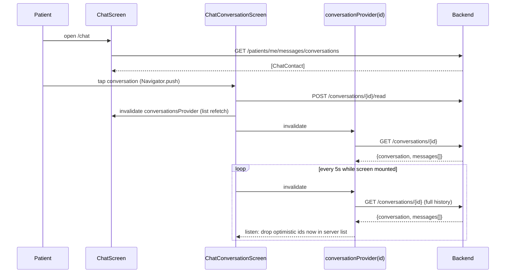
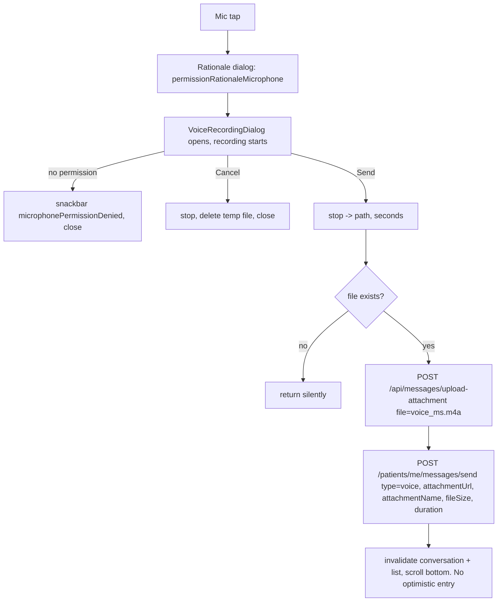

# 08 — Doctor–Patient Chat

Scope: the patient ↔ doctor messaging feature of the Shifa Bemor patient app. It covers the conversation list, the conversation screen, sending text, image and voice messages, the four message bubble types plus system messages, the unread badge, voice recording, uploads and a few helper utilities.

Source root: `lib/features/chat/**`, plus `lib/core/widgets/chat_icon_button.dart`, `lib/core/utils/{image_utils,text_cleaner,voice_file_exists*}.dart` and `lib/core/network/public_backend_config.dart`.

Where the doc says "backend", it means the Spring Boot REST API. `<API>` is the resolved API base, which ends in `/api` (see §1). Anything the client code can't prove is marked **UNVERIFIED**.

---

## 0. TL;DR for the porting team

| Topic | Actual behaviour |
|---|---|
| Transport | Plain REST over HTTPS. **No WebSockets, no SSE, no push-driven refresh inside chat.** |
| Message refresh | Open conversation screen: refetch the **whole** conversation every **5 s** (`Timer.periodic`). |
| Conversation list refresh | Only on screen open, pull-to-refresh, after a send, and after mark-as-read. Not polled. |
| Unread badge | App-wide poll of `GET /patients/me/messages/unread-count` every **10 s**, forever. |
| Pagination | **None.** `GET /conversations/{id}` returns every message. |
| Typing indicator | Widget exists but is **never used**. The backend sends no typing events. |
| Read receipts | Server-provided `status` / `isRead` per message. The client calls `POST …/read` **once** when the conversation opens. |
| What the patient can send | Text, image (camera/gallery, JPEG) and voice (AAC-LC `.m4a`). **The patient cannot send documents.** Documents can only be received. |
| Upload endpoint | `POST <API>/messages/upload-attachment` (multipart field `file`), response `{ "url": "..." }`. **Not under `/patients/me`.** |
| Optimistic UI | The server response of `send` is appended to a per-conversation list until a refetch contains its `id`. Text and image sends only, not voice. |
| Voice transcription in chat | **None.** Transcription and "report incorrect text" exist only in Shifa AI (see `09-shifa-ai-copilot.md`). |
| Link detection | `flutter_linkify` on text and system messages. Links open in an external app. Text is selectable. |

---

## 1. URL resolution and HTTP client

- Every chat REST call goes through `ApiClient` (a Dio wrapper) (`lib/core/network/api_client.dart`).
  - Base URL `ApiClient.apiBaseUrl` (`api_client.dart:13-40`):
    - If `--dart-define=API_BASE_URL=X` is set: strip any trailing `/api`, then append `/api`.
    - Else, in release mode: `https://shifa-doc-backend-mvp-production.up.railway.app/api` (`AppConfig.productionApiBaseUrl`, `lib/core/config/app_config.dart:9-10`).
    - Else (debug): the same production URL. The localhost branches are dead code; all three hard-code production.
  - Default headers: `Content-Type: application/json`, `Accept: application/json`. Connect and receive timeouts are 30 s (`api_client.dart:84-90`).
  - The interceptor adds `Authorization: Bearer <jwt>`. The token comes from secure storage (`StorageService().getAuthToken()`) (`api_client.dart:96-112`).
  - A 401 triggers logout, subject to guards: skipped for `/public/*` and `/auth/*`, skipped if the request carried no token, 10 s grace period after the token was saved, at most one logout per 5 s (`api_client.dart:113-192`). A 403 never logs out.
- `ApiClient.baseUrl` is the same URL **without** `/api` (`api_client.dart:203-206`). The unused `FileUploadService` uses it.
- `ApiClient.publicBaseUrl` is hard-coded to `http://localhost:8090` (`http://10.0.2.2:8090` on Android) (`api_client.dart:42-50`). `normalizePhotoUrl` prefixes **relative** photo URLs with it. **Quirk:** relative photo URLs are therefore broken outside local dev (§9).

---

## 2. API endpoints

Paths below are relative to `<API>`. Every call except `unread-count` wraps errors the same way (`chat_repository.dart:17-26` and siblings): for a `DioException`, the message is `response.data['message']`, then `response.data['error']`, then `e.message`, then a fixed fallback. The result is re-thrown as `Exception(message)`. The UI then runs it through `translateError` / `userFriendlyError` (`lib/core/localization/error_localizations.dart:136,271`).

### 2.1 List conversations
- `GET /patients/me/messages/conversations` (`chat_repository.dart:12-27`)
- Response: a JSON **array** of conversation objects. The code casts it `as List` with no type guard.
```json
[
  {
    "id": 12,
    "participantId": 34,
    "participantName": "Dr. Aziza Karimova",
    "participantPhotoUrl": "https://…/photo.jpg",
    "isDoctorParticipant": true,
    "lastMessage": "See you tomorrow",
    "lastMessageAt": "2026-09-20T10:15:00Z",
    "unreadCount": 2
  }
]
```
- Fallback error: `Failed to fetch conversations`.

### 2.2 Get one conversation with all messages
- `GET /patients/me/messages/conversations/{conversationId}` (`chat_repository.dart:29-43`)
- Response:
```json
{
  "conversation": { /* same shape as 2.1 item */ },
  "messages": [ /* ChatMessage objects, see §3.3 */ ]
}
```
- No pagination and no `since` / `after` parameter. The full history comes back on every 5 s poll.
- Fallback error: `Failed to fetch conversation`.

### 2.3 Send message
- `POST /patients/me/messages/send`, JSON body (`chat_repository.dart:45-80`). Only non-null keys are sent (`:57-67`).

| Key | Type | Notes |
|---|---|---|
| `conversationId` | int | `int.parse(conversationId)`. Present for existing conversations. |
| `recipientDoctorId` | int | `int.parse(...)`. Present **instead of** `conversationId` for a new conversation. |
| `text` | string | Omitted when the composer is empty. |
| `type` | string | `"image"` or `"voice"`. **Omitted for plain text** (the backend presumably defaults to text, **UNVERIFIED**). `"document"` is never sent. |
| `attachmentUrl` | string | URL returned by the upload endpoint. |
| `attachmentName` | string | `chat_<epochMs>.jpg` or `voice_<epochMs>.m4a` |
| `thumbnailUrl` | string | Supported by the repository, **never sent** by the UI. |
| `fileSize` | int | Bytes. Sent for voice only. |
| `duration` | int | Seconds. Sent for voice only. |

Examples:
```json
{ "conversationId": 12, "text": "Hello doctor" }
{ "recipientDoctorId": 34, "text": "Hello, first message" }
{ "conversationId": 12, "text": "optional caption", "type": "image",
  "attachmentUrl": "https://…/uuid.jpg", "attachmentName": "chat_1727350000000.jpg" }
{ "conversationId": 12, "type": "voice", "attachmentUrl": "https://…/uuid.m4a",
  "attachmentName": "voice_1727350000000.m4a", "fileSize": 48213, "duration": 7 }
```
- Response: one ChatMessage object (§3.3), used for the optimistic UI.
- Fallback error: `Failed to send message`.

### 2.4 Mark conversation read
- `POST /patients/me/messages/conversations/{conversationId}/read`, no body (`chat_repository.dart:82-95`). The response is ignored.
- Fallback error: `Failed to mark as read`. The UI swallows it (`chat_conversation_screen.dart:80-87`).

### 2.5 Search users (doctors) to start a chat
- `GET /patients/me/messages/search?q=<query>` (`chat_repository.dart:97-115`)
- Response: array of
```json
{ "id": 34, "name": "Dr. …", "photoUrl": "…", "isDoctor": true, "email": "…", "phone": "…" }
```
- Fallback error: `Failed to search users`.

### 2.6 Unread message count
- `GET /patients/me/messages/unread-count` (`chat_repository.dart:117-125`)
- Response: `{ "count": 3 }`. **Any error returns 0** and nothing is thrown.

### 2.7 Upload attachment (image / voice)
- `POST <API>/messages/upload-attachment`, i.e. `https://…/api/messages/upload-attachment`, `multipart/form-data`.
  - Used via `apiClient.dio.post('/messages/upload-attachment', data: FormData)` for images (`chat_conversation_screen.dart:197-204`) and voice (`:278-285`). Dio sets the multipart content type with a boundary. The Bearer token comes from the interceptor.
  - Parts:
    - `file`: raw bytes. Filename `chat_<epochMs>.jpg` or `voice_<epochMs>.m4a`. No explicit part content type is set, so Dio's default is `application/octet-stream`. **The backend likely infers the type from the file extension (UNVERIFIED).**
    - `thumbnail` (optional): **only** in the unused `FileUploadService`. Filename is `thumb_<fileName>` (`file_upload_service.dart:45-53`, `file_upload_mobile.dart:27-39`).
  - Success: any 2xx. The body must be a JSON object with a non-empty `url` string, else the client throws `No URL in upload response` (`chat_conversation_screen.dart:206-212`).
```json
{ "url": "https://…/chat-attachments/6f1c…e2.jpg" }
```
  - A code comment says the backend gives each upload a unique (UUID) filename. It explains why this endpoint is used instead of `/patients/me/documents`, which overwrote files with the same title (`chat_conversation_screen.dart:195-196`).
- Client-side limits: **no max size, no MIME whitelist, no duration limit** is enforced. Server limits are **UNVERIFIED**.

### 2.8 Public config (shared)
- `GET <AppConfig.apiBaseUrl>/api/public/config`, no auth, 5 s timeout (`public_backend_config.dart:18-50`). Only Shifa AI uses it (`transcriptionFeedbackEnabled`). See `09-shifa-ai-copilot.md` §2.8.

---

## 3. Data models (`lib/features/chat/domain/chat_models.dart`)

The models do not use Equatable and have no `toJson`. All IDs are kept as **String** on the client, via `.toString()` on JSON numbers.

### 3.1 `ChatContact` (conversation list item) (`:3-42`)
| Field | JSON key | Type | Default / rule |
|---|---|---|---|
| id | `id` | String | `.toString()` (a missing key gives `"null"`) |
| name | `participantName` | String | `''` |
| photoUrl | `participantPhotoUrl` | String? | passed through `normalizePhotoUrl` (§8.3) |
| isDoctor | `isDoctorParticipant` | bool | `true` |
| participantId | `participantId` | String | `.toString()` |
| lastMessage | `lastMessage` | String? | — |
| lastActivity | `lastMessageAt` | DateTime? | `DateTime.tryParse` |
| unread | `unreadCount` | int | `0` |
| messages | — | List | always `[]` |

### 3.2 Enums
- `MessageType` (`:44-68`): `text`, `image`, `voice`, `document`, `system`. Parsing is case-insensitive. **Unknown values map to `text`.** Null gives null, and the caller then falls back to `text`.
- `MessageStatus` (`:70-91`): `sending`, `sent`, `delivered`, `read`. **Null and unknown both map to `sent`.** The client never creates `sending` itself; no local pending state exists.
- `SenderRole` (`:93-108`): `doctor`, `patient`. **Null and unknown both map to `doctor`.**

### 3.3 `ChatMessage` (`:141-216`)
Two JSON formats are accepted. The "new" format is detected when `content != null && type != null` (`:168`).

**New format** (`:170-182`):
```json
{
  "id": 991,
  "chatId": 12,
  "senderId": 34,
  "senderRole": "doctor",
  "type": "voice",
  "content": {
    "text": null,
    "fileUrl": "https://…/uuid.m4a",
    "thumbnailUrl": null,
    "fileName": "voice_1727350000000.m4a",
    "fileSize": 48213,
    "duration": 7
  },
  "status": "read",
  "createdAt": "2026-09-20T10:15:00Z",
  "isMine": false,
  "isRead": true
}
```
| Field | JSON key | Type | Default |
|---|---|---|---|
| id | `id` | String | `.toString()` |
| chatId | `chatId` | String | `.toString()` (null gives `"null"`) |
| senderId | `senderId` | String | `.toString()` |
| senderRole | `senderRole` | SenderRole | doctor |
| type | `type` | MessageType | text |
| content | `content` | MessageContent | empty |
| status | `status` | MessageStatus | sent |
| sentAt | `createdAt` | DateTime | **required**: `DateTime.parse`, which throws when the key is missing |
| isMine | `isMine` | bool | false |
| isRead | `isRead` | bool | false |

`MessageContent` (`:110-139`):
| Field | JSON key(s) | Type |
|---|---|---|
| text | `text` | String? |
| fileUrl | `fileUrl`, else `url`, else `attachmentUrl` (`:129`) | String? |
| thumbnailUrl | `thumbnailUrl` | String? |
| fileName | `fileName` | String? |
| fileSize | `fileSize` (num → int) | int? |
| duration | `duration` (num → int, seconds) | int? |

**Legacy format** (`:183-214`), used when `content` or `type` is absent:
```json
{ "id": 5, "conversationId": 12, "senderId": 34, "text": "hi",
  "attachmentUrl": null, "attachmentName": null,
  "createdAt": "…", "isMine": true, "isRead": false }
```
- `chatId` = `conversationId`, else `'0'`. `senderId`, else `'0'`.
- `senderRole` is **always `patient`** (`:202`).
- Type is inferred (`:190-196`): an attachment whose name ends in `.pdf`, `.doc` or `.docx` is `document`; any other attachment is `image`; no attachment is `text`. **A legacy voice message would render as a broken image.**
- `status` = `read` if `isRead == true`, else `sent`.

### 3.4 `UserSearchResult` (`:218-246`)
`id` (toString), `name` (`''`), `photoUrl` (normalized), `isDoctor` (default `true`), `email`, `phone`. Only `id`, `name` and `photoUrl` are used in the UI.

### 3.5 `ConversationWithMessages` (`:248-265`)
`conversation` (a ChatContact parsed from `json['conversation']`) and `messages` (a list parsed from `json['messages']`, `[]` if null).

---

## 4. State management (`lib/features/chat/providers/chat_providers.dart`)

| Provider | Kind | Behaviour |
|---|---|---|
| `chatRepositoryProvider` | `Provider<ChatRepository>` | `chat_repository.dart:128-131` |
| `conversationsProvider` | `FutureProvider<List<ChatContact>>` | One-shot fetch. Re-run via `ref.invalidate` (`:5-8`) |
| `conversationProvider(id)` | `FutureProvider.family<ConversationWithMessages, String>` | If `id` is empty or starts with `new_`, returns an **empty local conversation without calling the API** (`:13-27`). Else fetches §2.2. |
| `optimisticMessagesProvider(id)` | `StateProvider.family<List<ChatMessage>, String>` | Per-conversation list of server-echoed sent messages (`:33-34`) |
| `userSearchProvider(query)` | `FutureProvider.family<List<UserSearchResult>, String>` | Returns `[]` for a blank query. Otherwise calls §2.5 (`:36-40`) |
| `unreadCountProvider` | `StreamProvider<int>` | `while(true) { yield await getUnreadCount(); delay 10s }`. Errors yield 0 (`:42-53`) |

None of these use `autoDispose`. Family entries (every search query typed, every conversation opened) stay cached for the app's lifetime. The unread poll starts the first time `ChatIconButton` is built and **never stops**, even after logout.

---

## 5. Screens and flows

### 5.1 Entry points
- Route `/chat` (`AppRoutes.chat`, `lib/app/router.dart:152`) is registered in the non-persistent `ShellRoute`, so the bottom bar stays visible (`router.dart:562-565`). It is also in the auth whitelist (`router.dart:94-116`).
- `ChatIconButton` sits in `AppHeader` (`lib/core/widgets/app_header.dart:87`). The Home, Bookings, Doctors and Documents screens pass `onChatTap: () => context.push(AppRoutes.chat)` (e.g. `home_screen.dart:227`).
- Notification taps (`new_message`, `chat_message`, `NEW_MESSAGE`, `CHAT_MESSAGE`) do `context.go('/chat', extra: {'chatId': …})` (`notification_tap_handler.dart:90-92,127-129,206-213,304-308`, `notification_details_sheet.dart:140-141`). **Quirk:** the `/chat` builder is `const ChatScreen()` and ignores `state.extra`, so the tap lands on the **list**, not the conversation.

### 5.2 `ChatIconButton` (`lib/core/widgets/chat_icon_button.dart`)
- `Icons.chat_bubble_outline`, white by default (`iconColor`).
- It watches `unreadCountProvider`. If the count is > 0, it shows a red (`Colors.redAccent`) pill badge at top/right offset 6, radius 10, min width 16, 10sp bold white text. Counts above 9 show as `9+` (`:17-19,28-49`).

### 5.3 Conversation list — `ChatScreen` (`chat_screen.dart`)
- AppBar title is `l10n.chat`. The back arrow does `Navigator.pop` (`:96-102`).
- On init, after the first frame: `ref.invalidate(conversationsProvider)` forces a fresh fetch (`:22-28`).
- Search field (hint `searchDoctors`, search icon, 12 dp radius) (`:105-122`). **No debounce:** every keystroke creates a new `userSearchProvider(query)` and calls the API.
  - Non-empty query shows search results (`:133-162`): a ListTile per user with an avatar (`NetworkImage` or initials), the name, subtitle `l10n.doctor` (always, whatever `isDoctor` says) and a trailing chat icon. Tapping calls `_startConversation`. An empty result shows `noDoctorsAvailable`; an error shows `"${l10n.error}: $err"`.
- The conversation list (`:164-207`) uses a `RefreshIndicator`, which invalidates on pull. It is a `ListView.separated` with dividers and bottom padding `AppDesignSystem.safeBottomWithNavBar`.
  - Each row has an avatar (photo or initials, §5.6), the participant name, and the last message as the subtitle.
  - Subtitle rules (`:70-74`): null or empty shows `noMessages`. The literal (case-insensitive, trimmed) `"photo"` shows the localized `photo`. Anything else shows raw.
  - Trailing: when `unread > 0`, a teal (`#17C3B2`) circle with radius 10 and the count at 10sp (`:188-197`).
  - Tapping calls `_openConversation`.
  - An empty list shows `noConversations`.
- `_startConversation(user)` (`:36-55`) **refetches the conversation list** and looks for `participantId == user.id`. If found, it opens that conversation; otherwise it opens a new conversation (`conversationId: null`, `recipientDoctorId: user.id`). On error it shows the snackbar `"${failedToStartChat}: ${translateError(...)}"`.
- Navigation to the conversation uses an imperative `Navigator.push(MaterialPageRoute)`, not GoRouter (`:57-87`). It lands on the shell's nested navigator, so the bottom bar likely stays visible (**UNVERIFIED** visually).

### 5.4 Conversation — `ChatConversationScreen` (`chat_conversation_screen.dart`)
Constructor (`:26-40`): `conversationId?` (null means new), `participantName`, `participantPhotoUrl?`, `recipientDoctorId?` (needed when new).

`_effectiveConversationId` = `conversationId ?? 'new_${recipientDoctorId ?? ''}'` (`:73-74`). This is the family key for both providers.

Lifecycle (`:53-71`):
1. After the first frame: `_markAsRead()` (skipped for `new_*`). It calls §2.4, then invalidates `conversationsProvider`, then `_refreshConversation()`.
2. `Timer.periodic(5 s)` → `ref.invalidate(conversationProvider(id))`, a full refetch.
3. `dispose` cancels the timer and disposes the controllers.

Rendering (`:339-464`):
- AppBar shows an avatar (radius 16, `normalizePhotoUrl(photo)` or initials) and the name (ellipsis).
- Body uses `conversationAsync.when`. Riverpod keeps the previous data while refetching, so polling doesn't flash a spinner.
  - Loading shows a centered spinner. Error shows `"${l10n.error}: ${userFriendlyError(...)}"` with no retry button, but the 5 s poll retries on its own.
  - Data:
    - Reconciliation (`:369-375`): `ref.listen` on the conversation provider removes from the optimistic list every message whose `id` appears in the fetched `messages`.
    - Merge (`:376-381`): `[...server, ...optimistic not in server ids]`, sorted **ascending by `sentAt`**.
    - `ListView.builder` (not reversed), padding 12. It has a `RefreshIndicator`.
    - **Quirk:** no initial auto-scroll to the bottom. The list opens at the oldest message. Auto-scroll only happens after the patient sends (`animateTo(maxScrollExtent + 80)`, 250 ms, easeOut).
- Composer (`:398-452`), inside a SafeArea, padding (8,8,8,12):
  - Camera button (`Icons.photo_camera`, teal `#17C3B2`). While `_isUploadingImage` it becomes a 20 dp spinner and is disabled.
  - Mic button (`Icons.mic`, tooltip `recordVoice`). While `_isUploadingVoice` it shows a spinner and is disabled.
  - TextField: 1–4 lines, `TextInputAction.send`, and `onSubmitted` sends. Hint `typeMessage`, fill `grey.shade100`, radius 24.
  - Send button (`Icons.send`, teal). Disabled while any upload runs. **There is no in-flight guard for text, so a double tap sends twice.**

### 5.5 Message bubble dispatch (`:480-531`)
`brand = #17C3B2` is hard-coded, not `AppDesignSystem.primary`.

| type | Widget |
|---|---|
| text | `TextMessageBubble` |
| image | `ImageMessageBubble` |
| voice | `VoiceMessageBubble` |
| document | `DocumentMessageBubble` |
| system | Centered, italic, 12sp, `grey.shade600`, in a `SelectionArea` + `Linkify`. Links are `blue.shade700` and underlined. |

Shared bubble conventions (all four bubble widgets):
- Outer margin: horizontal 8, vertical 4. Column alignment is **end** if `isMine`, else **start**.
- Sender label above bubbles that are **not mine**: `l10n.doctor` or `l10n.patient` based on `senderRole`, not the person's name. 11sp, w500, `grey.shade600`, padding left 4, bottom 2.
- Bubble colour: mine = brand teal with white text; theirs = `grey.shade200` with `black87` text.
- Corner radii: 16/16 on top. At the bottom, mine = 16 left and 4 right; theirs = 4 left and 16 right.
- Time is `HH:mm` from `sentAt.hour` / `.minute`. **No `.toLocal()`.** If the backend sends UTC with `Z`, the time shows in UTC (**quirk**; the backend's timestamp format is **UNVERIFIED**).
- Status icon, shown only for mine:
  - `sending`: 12 dp spinner (stroke 1.5, white70)
  - `sent`: `Icons.check` 14 white70
  - `delivered`: `Icons.done_all` 14 white70
  - `read`: `Icons.done_all` 14 `blue.shade300`

#### 5.5.1 Text (`widgets/text_message_bubble.dart`)
- Declared max width is 520, but the ListView passes tight constraints, so it is effectively full width. The bubble itself shrinks to its content. Padding is (12, 10).
- Wrapped in a `SelectionArea`, so text can be copied (`:90`).
- `Linkify` (`:95-110`) uses the package's default linkifiers (URLs and emails). Text is 15sp, line height 1.4. Links keep the text colour and add an underline (decoration colour white70 on mine, `blue.shade700` on theirs).
- Tapping a link: `Uri.tryParse`, then `canLaunchUrl`, then `launchUrl(mode: externalApplication)` (`:24-29`). Other `LinkifyOptions` are package defaults (**UNVERIFIED**: e.g. `humanize`).
- The timestamp row sits under the text; the time is a `SelectableText`.

#### 5.5.2 Image (`widgets/image_message_bubble.dart`)
- URL = `content.fileUrl ?? content.thumbnailUrl`. If both are null the bubble is `SizedBox.shrink()` (`:54-57`). The URL is **not** passed through `normalizePhotoUrl`.
- `CachedNetworkImage`, fixed **280×280**, `BoxFit.cover` (`:99-118`). Placeholder: `grey.shade300` box with a spinner. Error: `Icons.broken_image`. The cache is the `flutter_cache_manager` default (library default is 30-day stale period and 200 objects, **UNVERIFIED** for the version in use). No auth headers are sent, so URLs must be publicly readable.
- Overlay at bottom-right (8,8): a `black54` pill with the time (11sp white) and the status icon.
- **The `content.text` caption is not rendered.** Image sends can carry composer text (§6.2), and that text is silently invisible in the image bubble.
- Tapping pushes `_FullScreenImageViewer` (`:157-188`): black Scaffold and AppBar with a white back icon, `InteractiveViewer` (minScale 0.5, maxScale 4.0), `BoxFit.contain`. **No save, share or download.**

#### 5.5.3 Voice (`widgets/voice_message_bubble.dart`)
- Each bubble owns one `AudioPlayer` (audioplayers). Several bubbles can play at the same time (**quirk**).
- Play/pause `IconButton`:
  - If playing, `pause()`.
  - Else if position is 0, `play(UrlSource(fileUrl))`, streaming directly from the URL. Otherwise `resume()` (`:91-104`).
- On completion: `isPlaying = false`, position resets to 0.
- `LinearProgressIndicator` (3 dp, radius 2) with value `position.inSeconds / duration.inSeconds`, whole seconds only (`:169-180`).
- Two labels below it: position `mm:ss` on the left, duration `mm:ss` on the right. Duration is `content.duration` seconds if present, else the duration the player reports (`:109-111`).
- The time and status sit to the right. Max width is 280.
- Recording format is covered in §6.3.

#### 5.5.4 Document (`widgets/document_message_bubble.dart`)
- Receive-only in practice: the patient app never sends `type: document`.
- Card: an icon tile (8 dp padding, radius 8, white24 on mine, `grey.shade300` on theirs), then the file name (14sp w600, 2 lines, ellipsis), then the size, then time and status.
- Name = `content.fileName ?? translate('document')` (`:100`).
- Size format (`:19-24`): `< 1024` → `"N B"`; `< 1 MiB` → `"x.x KB"`; else `"x.x MB"`.
- Icon by extension (`:50-67`): `pdf` → `picture_as_pdf`; `doc`/`docx` → `description`; `jpg`/`jpeg`/`png`/`gif` → `image`; anything else → `insert_drive_file`.
- Tapping (only if `fileUrl != null`) → `canLaunchUrlString`, then `launchUrlString(externalApplication)`. The browser or OS viewer handles viewing and downloading; there is no in-app PDF viewer here (`:69-93`). Failure shows a red snackbar `cannotOpenDocumentUrl`. **That key is missing from all four languages, so users see the raw key string** (§10). An exception shows `"${errorOpeningDocument}: $e"`.

#### 5.5.5 Typing indicator (`widgets/typing_indicator.dart`), **UNUSED**
If you need parity for a future feature: a grey bubble (bottom-left radius 4) with three 8 dp grey dots. Each dot animates opacity 0.3 → 1.0 over 600 ms, easeInOut, repeating in reverse, with start delays of 0, 200 and 400 ms. It reads `"<Doctor|Patient> ${isTyping}..."` in italic 12sp. Nothing instantiates it, and the backend has no typing API.

### 5.6 Initials helper (used in list and app bar)
Split the trimmed name on whitespace. Empty gives `?`. One part gives its first letter, uppercased. Otherwise, the first letter of the first part plus the first letter of the last part, uppercased (`chat_screen.dart:209-214`, `chat_conversation_screen.dart:466-471`).

---

## 6. Sending flows

### 6.1 Text (`chat_conversation_screen.dart:89-124`)
1. `text = composer.trim()`. If it is empty and there is no image, return.
2. `isNewConversation = widget.conversationId == null || id.startsWith('new_')`.
3. `sendMessage(conversationId | recipientDoctorId, text?, type: imageUrl != null ? 'image' : null, attachmentUrl, attachmentName)`.
4. On success:
   - Clear the composer.
   - Append the returned message to `optimisticMessagesProvider(id)`.
   - Invalidate the conversation and the list.
   - Scroll to the bottom.
5. On error: snackbar `"${failedToSend}: ${userFriendlyError}"`. **The composer is not cleared**, so the user can retry.

### 6.2 Image (`:126-236`)
1. Require `profileProvider.profile.id` to be non-empty; else show the snackbar `"${profile} ${error.toLowerCase()}"` (`:128-134`).
2. Bottom sheet (top radius 20) with two teal-icon rows: `takePhoto` (camera) and `chooseFromGallery` (gallery) (`:137-160`).
3. **Camera only:** `showPermissionRationale(rationaleKey: 'permissionRationaleCamera')` (`:164-170`). This is a non-dismissible dialog titled `permissionNeeded` with a single `continueButton` (Apple guideline 5.1.1(iv)) (`lib/core/utils/permission_rationale.dart:6-31`). It is skipped if the key has no translation.
4. `appLockTemporaryDisableProvider.disable()` suppresses the PIN/biometric lock while the OS picker is in front (`lib/core/services/app_lock_provider.dart:26`). It is re-enabled in `finally`.
5. `ImagePicker().pickImage(source, imageQuality: 85)`. The plugin re-encodes at quality 85. There is no max width or height. Cancelling returns silently.
6. Read the bytes and name the file `chat_<epochMs>.jpg`. The name is always `.jpg`, even if the picker returned PNG/HEIC (**UNVERIFIED** whether `image_picker` always outputs JPEG with `imageQuality`).
7. Upload via §2.7, then `_sendMessage(imageUrl: url, imageName: fileName)`. **Any text in the composer is sent as the image caption and then cleared.**
8. Upload errors show the snackbar `"${failedToUploadImage}: …"`.
- `ImageCompressionService` (≥500 KB → JPEG q85, min 1920×1920, output `<path>_compressed.jpg`) (`services/image_compression_io.dart:6-33`) exists but is **not called** anywhere (§9).

### 6.3 Voice (`:238-337` and `widgets/voice_recording_dialog.dart`)
1. `showPermissionRationale('permissionRationaleMicrophone')`.
2. `showDialog(barrierDismissible: false)` with `VoiceRecordingDialog`. The dialog starts recording immediately in `initState`.
3. Recording (`voice_recording_dialog.dart:44-87`):
   - `AudioRecorder.hasPermission()` triggers the OS mic prompt. If denied: red snackbar `microphonePermissionDenied`, then `onCancel` (the dialog closes).
   - Path: `<getTemporaryDirectory()>/voice_<epochMs>.m4a`.
   - `RecordConfig(encoder: AudioEncoder.aacLc, bitRate: 32000, sampleRate: 16000, numChannels: 1)`: **AAC-LC in an MPEG-4 (.m4a) container, 32 kbps, 16 kHz, mono.**
   - A 1 s `Timer.periodic` increments `_duration` in whole seconds (`:89-95`).
   - Any exception: red snackbar `errorRecordingVoice`, then `onCancel`.
4. Dialog UI (`:118-198`), radius 16, padding 24:
   - An 80 dp `red.shade50` circle with a 40 dp `red.shade700` mic icon.
   - Title `voiceMessage` (18sp w600).
   - Timer `mm:ss` (24sp bold, theme primary).
   - Hint `slideLeftToCancel`. **There is no gesture:** `_slideOffset` and `_shouldCancel` are never changed, so `slideUpToCancel` never appears.
   - Buttons: `TextButton(cancel)` stops, deletes the file and calls `onCancel`. `FilledButton.icon(send, sendVoice)` stops and calls `onRecordingComplete(path, seconds)` (`:103-116`).
   - **No max duration and no min duration.** A 0 s recording can be sent.
5. `_sendVoiceMessage(path, seconds)` (`:257-337`):
   - Disable the app lock and set `_isUploadingVoice`.
   - On non-web, `voiceFileExists(path)`. A missing file returns silently.
   - Read the bytes; `fileSize = bytes.length`. The upload name is a **new** `voice_<epochMs>.m4a`.
   - Snackbar `uploadingFile`, upload (§2.7), hide the snackbar.
   - `sendMessage(type: 'voice', attachmentUrl, attachmentName, fileSize, duration)`, then invalidate and scroll.
   - **The response is NOT added to the optimistic list** (unlike text and image). The message appears on the next refetch.
   - Errors: red snackbar `"${errorRecordingVoice}: …"`.
   - **The temp recording file is never deleted after a send.**

### 6.4 New conversation (first message)
The patient opens a doctor with no existing chat. Now `conversationId = null` and the key is `new_<doctorId>`.

- `conversationProvider('new_…')` returns an empty conversation locally and makes no API call.
- The first send carries `recipientDoctorId`; the backend creates the conversation (**UNVERIFIED**: find-or-create semantics).
- **Quirk (significant):** the screen never switches to the real `chatId` returned by the send.
  - Later polls keep resolving `new_…`, which is always empty. Only optimistic messages stay visible, and they are never pruned.
  - Voice messages never appear (they have no optimistic entry).
  - Doctor replies stay invisible until the user goes back and reopens the chat from the list.
  - Subsequent sends keep using `recipientDoctorId`.
  - A port should switch to `sentMessage.chatId` after the first send.

---

## 7. Sequence diagrams

### 7.1 Open conversation and polling


### 7.2 Send image (text is the same without the upload step)
```mermaid
sequenceDiagram
  participant U as Patient
  participant C as ConversationScreen
  participant OS as ImagePicker
  participant API as Backend
  U->>C: tap camera icon
  C->>U: sheet: Take photo / Gallery
  opt camera
    C->>U: permission rationale dialog (Continue)
  end
  C->>C: appLock.disable()
  C->>OS: pickImage(imageQuality 85)
  OS-->>C: XFile
  C->>API: POST /api/messages/upload-attachment (multipart file=chat_<ms>.jpg)
  API-->>C: {url}
  C->>API: POST /patients/me/messages/send {conversationId|recipientDoctorId, type:"image", attachmentUrl, attachmentName, text?}
  API-->>C: ChatMessage
  C->>C: optimistic += message; invalidate conversation + list; scroll bottom
  C->>C: appLock.enable()
```

### 7.3 Voice message


---

## 8. Helper utilities

### 8.1 `FileUploadService` (`services/file_upload_service.dart`, `file_upload_mobile.dart`, `file_upload_stub.dart`), **UNUSED**
- `uploadFile(file: File, fileName, thumbnailPath?)` (mobile) and `uploadFileBytes(bytes, fileName, thumbnailBytes?)`. Both use `package:http` `MultipartRequest('POST', '${apiClient.baseUrl}/api/messages/upload-attachment')` with a manual `Authorization: Bearer`.
- Parts are `file` and optional `thumbnail` (`thumb_<fileName>`). A 2xx returns `json['url']`.
- On web, `uploadFile` throws `UnsupportedError`.
- Errors are wrapped as `Exception('Error uploading file: …')`; the bytes variant uses `AppLogger.safeApiFailureMessage(status, body)`.
- It confirms the same endpoint and response contract as the Dio path.

### 8.2 `ImageCompressionService`, **UNUSED**
On web it returns the input unchanged. Elsewhere: files < 500 KB are returned untouched. Larger files are compressed with `FlutterImageCompress.compressAndGetFile(quality 85, minWidth 1920, minHeight 1920)` to `<path>_compressed.jpg`. On any failure it returns the original.

### 8.3 `normalizePhotoUrl` / `withCacheBuster` (`lib/core/utils/image_utils.dart`)
- `normalizePhotoUrl(url)` (`:4-29`):
  - Null or blank gives null.
  - Absolute `http(s)`: returned as is, except on Android, where host `localhost` / `127.0.0.1` is rewritten to the scheme, host and port of `publicBaseUrl` (`10.0.2.2:8090`).
  - Relative: `"$publicBaseUrl/<path without leading />"`. **This is hard-coded to localhost:8090, so relative URLs break in production (tech debt).**
- `withCacheBuster(url, cacheKey)` (`:31-44`): normalizes, then when `cacheKey` is non-null and non-zero sets query `v=<cacheKey>`.
- Chat applies `normalizePhotoUrl` only to **avatars**. Attachment URLs (`content.fileUrl`) are used raw.

### 8.4 `voiceFileExists(path)` (`lib/core/utils/voice_file_exists*.dart`)
On IO platforms it returns `File(path).exists()`. On web it always returns `true`.

### 8.5 `deletePathIfExists(path)` (`lib/core/utils/file_delete*.dart`)
On IO platforms it deletes the file if present. On web it does nothing.

### 8.6 `TextCleaner.cleanText` (`lib/core/utils/text_cleaner.dart`), **UNUSED**
Meant for "malformed OpenAI text". Algorithm, in order:
1. Regex `\b(?:\w\s)+\w\b`: remove spaces inside runs of single characters separated by spaces (`"H e l l o"` → `"Hello"`).
2. `([.!?,;:])(?=\w)`: insert a space after punctuation that is directly followed by a word character.
3. Collapse `\s+` to one space.
4. Trim.

Note: step 1 also merges legitimate one-letter words (e.g. `"a b c"`). Nothing calls it. Chat has no AI text, and Shifa AI does not use it either.

### 8.7 `PublicBackendConfig` (`lib/core/network/public_backend_config.dart`)
- Static memoized `GET ${AppConfig.apiBaseUrl}/api/public/config` (no auth, 5 s timeout).
- Concurrency: if a fetch is already running, poll every 80 ms up to 20 times (≈1.6 s) (`:22-27`).
- Network errors are cached as `{}`. `clearCache()` exists for tests.
- `transcriptionFeedbackEnabled()` returns true iff the value is `true` or `"true"` (`:53-57`). Only Shifa AI uses it.
- **Quirks:**
  - It uses the raw `AppConfig.apiBaseUrl` dart-define, not `ApiClient.apiBaseUrl`. With no `API_BASE_URL` (the default release build) it returns `{}` immediately, so the feature is **always off**.
  - If the define already ends in `/api`, the URL becomes `/api/api/public/config`.

---

## 9. Observed quirks and tech debt (keep or fix consciously)

1. **New-conversation screen never picks up the real conversation** (§6.4).
2. The conversation list opens at the **oldest** message; there is no initial scroll to the bottom.
3. Timestamps are not converted with `.toLocal()`.
4. The image caption (`content.text`) is not rendered, but image sends include composer text.
5. Voice sends are not optimistic; text and image sends are.
6. Text send has no double-tap guard.
7. There is no search debounce, and every query is cached forever (family without autoDispose).
8. `markAsRead` runs only on open. Messages that arrive while the screen is open are not marked read by the client (whether GET marks them read server-side is **UNVERIFIED**). The unread badge updates only on the next 10 s poll.
9. The unread-count poll runs forever, including after logout and in the background. Errors silently show 0.
10. Notification `extra: {chatId}` is ignored by the `/chat` route.
11. Brand colour `#17C3B2` is hard-coded in chat instead of `AppDesignSystem.primary #00BBB0`.
12. `normalizePhotoUrl` relative-URL base is hard-coded to localhost:8090. Attachment URLs are used raw, and images, audio and documents are fetched **without auth headers**.
13. Legacy-format voice/other attachments are misclassified as `image`. The legacy path forces `senderRole = patient`.
14. The recorder UI says "slide left to cancel", but no gesture exists. There is no max or min recording length, and temp `.m4a` files are never deleted after a send.
15. Several voice bubbles can play at once (one `AudioPlayer` each).
16. Dead code: `FileUploadService`, `ImageCompressionService`, `TextCleaner`, `TypingIndicator`, `MessageStatus.sending`, the `thumbnailUrl` send parameter.
17. Error extraction does `e.response?.data?['message']`. If the error body is a plain String, this throws a `TypeError` instead of a friendly message.
18. The patient can receive `document` messages but has no UI to send documents.
19. Missing translation `cannotOpenDocumentUrl` (§10). The `?? 'Cannot open document'` fallback never fires because `translate()` returns the key itself.

---

## 10. Localization keys used

`translate(key)` falls back to the current locale, then `en`, then the key itself (`lib/core/localization/app_localizations.dart:3614-3618`). The strings themselves are exported separately under `docs/kmp-spec/strings/*.json`.

| Key | Where | Notes |
|---|---|---|
| `chat` | list AppBar | |
| `searchDoctors` | search hint | |
| `noDoctorsAvailable` | empty search | |
| `doctor`, `patient` | sender labels, search subtitle, typing indicator | |
| `error` | error texts | |
| `noConversations` | empty list | |
| `failedToStartChat` | snackbar | missing in `de` |
| `noMessages` | list subtitle | missing in `de` |
| `photo` | list subtitle | missing in `de` |
| `failedToSend` | snackbar | missing in `de` |
| `profile` | image-send precondition snackbar | |
| `takePhoto`, `chooseFromGallery` | image source sheet | missing in `de` |
| `permissionNeeded`, `continueButton` | rationale dialog | |
| `permissionRationaleCamera`, `permissionRationaleMicrophone` | rationale body | |
| `failedToUploadImage` | snackbar | missing in `de` |
| `uploadingFile` | voice upload snackbar | missing in `de` |
| `errorRecordingVoice` | recorder and voice upload errors | missing in `de` |
| `microphonePermissionDenied` | recorder | |
| `recordVoice` | mic tooltip | missing in `de` |
| `typeMessage` | composer hint | |
| `voiceMessage`, `slideLeftToCancel`, `slideUpToCancel`, `sendVoice`, `cancel` | recorder dialog | first four missing in `de` |
| `document` | document bubble fallback name | missing in `de` |
| `cannotOpenDocumentUrl` | document open failure | **missing in ALL languages** |
| `errorOpeningDocument` | document open exception | missing in `de` |
| `isTyping` | typing indicator (unused) | missing in `de` |
| Error-translation keys | via `translateError` / `userFriendlyError` (`error_localizations.dart`) | e.g. `errorSomethingWentWrong`; see errors doc |

---

## 11. Permissions

| Permission | Trigger | Platform declaration |
|---|---|---|
| Camera | "Take photo". Rationale dialog first, then the OS prompt via image_picker. | iOS `NSCameraUsageDescription` ("…for video consultations"); Android `CAMERA` |
| Microphone | Mic button. Rationale dialog, then `AudioRecorder.hasPermission()`. | iOS `NSMicrophoneUsageDescription` ("…for video consultations"); Android `RECORD_AUDIO` |
| Photos | Gallery. No rationale dialog; image_picker uses the system photo picker. | iOS `NSPhotoLibraryUsageDescription` ("…to set your profile picture") |
| Files | Not used by chat (no document send). | — |

The iOS usage strings don't mention chat; consider updating them in the port.

---

## 12. KMP / Compose Multiplatform porting notes

- **Networking (Ktor):**
  - Use a shared `HttpClient` with the `Auth` bearer plugin (or a header interceptor) and `ContentNegotiation` (kotlinx.serialization, `ignoreUnknownKeys = true`, `coerceInputValues = true`).
  - Replicate the 401 logout rules from §1. Keep IDs as `String` in the domain, but send `conversationId` and `recipientDoctorId` as JSON **numbers**.
- **Multipart upload:**
  ```kotlin
  client.submitFormWithBinaryData(
    url = "$apiBase/messages/upload-attachment",
    formData = formData {
      append("file", bytes, Headers.build {
        append(HttpHeaders.ContentDisposition, "filename=\"$fileName\"")
        append(HttpHeaders.ContentType, "image/jpeg") // or "audio/mp4"; Flutter sends octet-stream
      })
    })
  // parse {"url": String}
  ```
  Keep the `chat_<ms>.jpg` / `voice_<ms>.m4a` naming: the backend may rely on the extension.
- **Polling:** use a screen-scoped ViewModel coroutine, `while (isActive) { refresh(); delay(5_000) }`. Unread count needs an app-scoped `StateFlow` polled every 10 s. Recommended improvement: start and stop it with auth state and app foreground (`Lifecycle`).
- **Models:** use `@Serializable` DTOs for both message formats. Write a custom deserializer, or parse to `JsonObject` and branch on `content != null && type != null`. Enums need a lenient fallback (unknown → `TEXT`, `SENT`, `DOCTOR`).
- **Optimistic list:** keep a per-conversation `MutableStateFlow<List<ChatMessage>>`. Merge it with the server list, dedupe by `id`, sort by `sentAt`.
- **Audio recording (expect/actual `VoiceRecorder`):**
  - Android: `MediaRecorder` with `setAudioSource(MIC)`, `setOutputFormat(MPEG_4)`, `setAudioEncoder(AAC)`, `setAudioEncodingBitRate(32000)`, `setAudioSamplingRate(16000)`, `setAudioChannels(1)`, and a `.m4a` file in `cacheDir`.
  - iOS: `AVAudioRecorder` with `AVFormatIDKey = kAudioFormatMPEG4AAC`, `AVSampleRateKey = 16000`, `AVNumberOfChannelsKey = 1`, `AVEncoderBitRateKey = 32000`, a `.m4a` path in `NSTemporaryDirectory()`, and `AVAudioSession` category `.playAndRecord` / `.record`.
  - Duration: count whole seconds (floor).
- **Audio playback (expect/actual `VoicePlayer`):** Android Media3 ExoPlayer or `MediaPlayer` with a URL; iOS `AVPlayer(URL)`. Expose position and duration flows. Consider one global player so only one clip plays at a time (fixes quirk 15).
- **Images:** Coil 3 `AsyncImage` for 280×280 crop bubbles and avatars (Coil's disk cache replaces `cached_network_image`). For full screen, use a zoomable composable (e.g. Telephoto / `zoomable`, scale 0.5–4×).
- **Pickers:** FileKit or Peekaboo (KMP) for gallery and camera. Otherwise: Android `PickVisualMedia` and `TakePicture` with a `FileProvider`; iOS `PHPickerViewController` and `UIImagePickerController(.camera)`. Re-encode to JPEG at quality 85 (Android `Bitmap.compress(JPEG, 85)`, iOS `UIImageJPEGRepresentation(img, 0.85)`) to match `imageQuality: 85`.
- **Permissions:** moko-permissions or Calf. Show the non-dismissible rationale dialog (single "Continue" button) before the OS prompt for camera and mic.
- **App lock:** replicate the "temporarily disable app lock" flag around picker and recorder activities. Otherwise returning from the system picker triggers the PIN screen.
- **Links and selection:** `SelectionContainer` plus `AnnotatedString` with `LinkAnnotation.Url` (Compose 1.7+). Detect URLs and emails with regex. Open with `LocalUriHandler.current.openUri` (external).
- **Documents:** `LocalUriHandler.openUri(fileUrl)`, or expect/actual (Android `Intent.ACTION_VIEW`, iOS `UIApplication.openURL`).
- **Timestamps:** parse with `kotlinx.datetime.Instant.parse`. Decide deliberately whether to convert to local time (Flutter doesn't; quirk 3).
