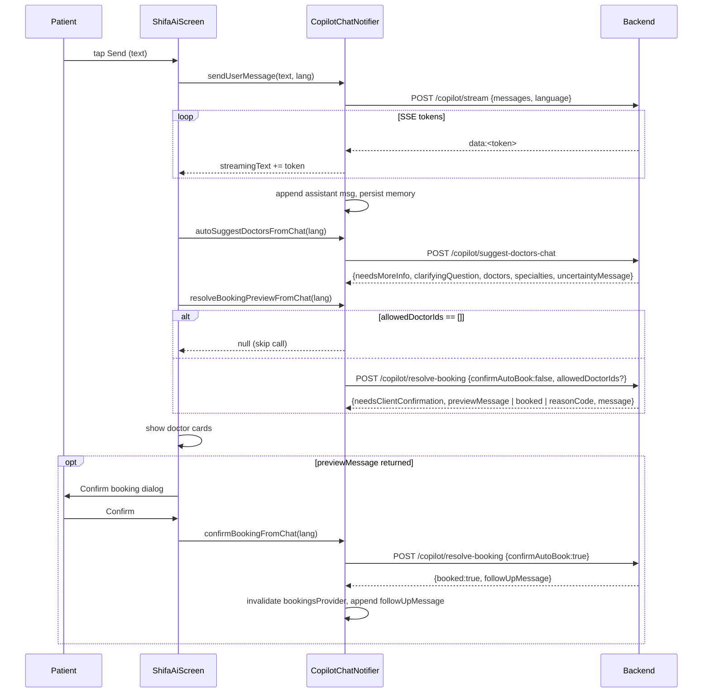
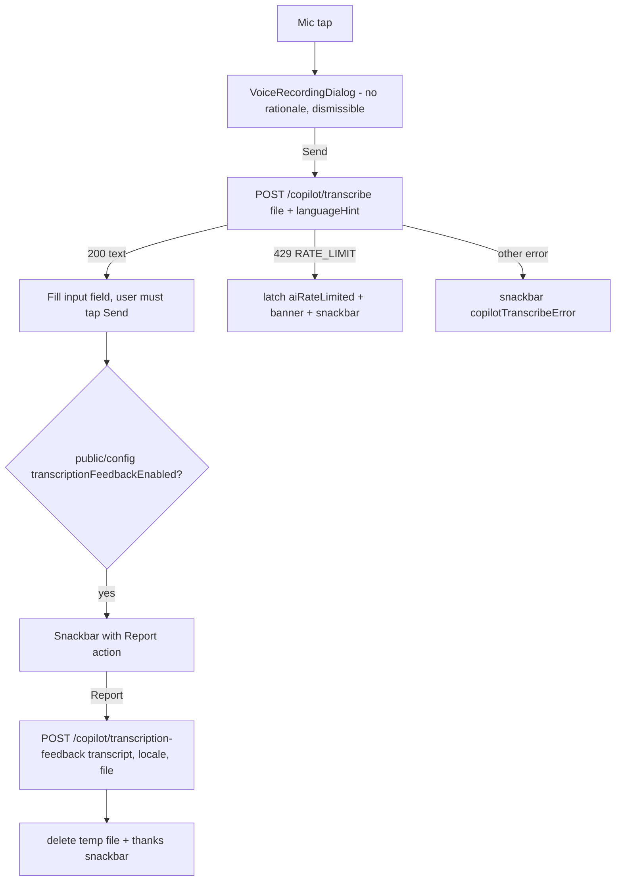

# 09 — Shifa AI Co-pilot

Scope: the "Shifa AI" in-app assistant, a PREMIUM-only feature. It covers:
- streaming LLM chat (SSE)
- chat-driven doctor suggestions
- booking from chat, in two steps: preview, then confirm
- manual "auto-book" of the nearest slot
- voice-to-text (Whisper) with optional "report incorrect transcript" feedback
- local memory persistence
- rate-limit handling
- subscription gating
- the animated centre nav FAB that opens the screen

Sources:
- `lib/features/copilot/**`
- `lib/app/shifa_ai_nav_fab.dart`, `lib/app/persistent_bottom_bar.dart`, `lib/app/router.dart`
- `lib/core/subscription/patient_subscription.dart`, `lib/state/subscription/patient_subscription_provider.dart`
- `lib/core/network/public_backend_config.dart`
- the shared `VoiceRecordingDialog` (`lib/features/chat/presentation/widgets/voice_recording_dialog.dart`, spec in `08-chat.md` §6.3)

Anything the client code can't prove is marked **UNVERIFIED**.

---

## 0. TL;DR

| Topic | Actual behaviour |
|---|---|
| What it does | Symptom and health Q&A chat. After each patient message it also asks the server for matching doctors and whether a booking can be made from the conversation. |
| System prompt | **None on the client.** The client sends only `{role, content}` turns plus `language`. Prompts, safety rules and model choice live on the backend (**UNVERIFIED** content). No `system` role is ever sent. |
| Transport | Raw `package:http`, **not** the Dio `ApiClient`. Manual Bearer header. **No timeout, no 401 → logout handling, no cancellation.** |
| Streaming | `POST …/copilot/stream`, parsed with a hand-written SSE parser. The leading space after `data:` is **preserved**. |
| Calls per send | Up to **3 sequential** backend calls: `stream`, then `suggest-doctors-chat`, then `resolve-booking` (preview). A 4th, `resolve-booking` confirm, runs if the user accepts. |
| Memory | SharedPreferences keys `copilot_messages_v1`, `copilot_summary_v1`, `copilot_structured_state_v1`. **Survives logout** (privacy bug). |
| Gating | Backend feature `PATIENT_SHIFA_AI` (tier PREMIUM). PRO users don't see the FAB, the router bounces them, and the screen bounces them. |
| Entry point | Only the centre FAB in the bottom bar: `context.push('/shifa-ai')`. |
| Rate limit | HTTP 429 or SSE `error` event with `code: RATE_LIMIT`. Shows a hard-coded English banner and latches the input disabled until the banner is dismissed. |

---

## 1. URL resolution and headers

- Base: `ApiClient.apiBaseUrl`, which ends in `/api` (`lib/core/network/api_client.dart:13-40`).
  - It is `API_BASE_URL` (dart-define) with `/api` normalized. Without it, release and debug alike use `https://shifa-doc-backend-mvp-production.up.railway.app/api`.
  - Every copilot URL is `${ApiClient.apiBaseUrl}/patients/me/copilot/<op>`.
- JSON calls get headers from `_authHeaders` (`copilot_api.dart:29-36`):
  ```
  Authorization: Bearer <jwt>        (omitted if no token stored)
  Content-Type: application/json
  Accept: text/event-stream          (stream endpoint only)
  ```
- The token comes from `StorageService().getAuthToken()` (secure storage).
- Multipart calls (`transcribe`, `transcription-feedback`) set only `Authorization`. `http.MultipartRequest` sets the `multipart/form-data; boundary=…` content type.
- **No request timeout** on any copilot call. A 401 is treated as a generic error; it does **not** trigger the app-wide logout, which exists only in the Dio interceptor.

### 1.1 Shared error mapping (`copilot_api.dart:38-67`)
`_rejectCopilotUnlessOk(response, fallback)` is used by `transcribe`, `transcription-feedback`, `resolve-booking` and `suggest-doctors-chat`:
- `200`: OK. **Any other 2xx counts as an error.**
- `429`: throws `CopilotStreamException(code, message)`.
  - `code` = body `code`, else `'RATE_LIMIT'`.
  - `message` = body `message`, else `error`, else `detail`, else the fallback.
- Anything else: `Exception(message)`, using the same message chain.

`CopilotStreamException(code, message)`: `toString()` returns `message` (`:10-18`).

Known `code` values handled by the client: `RATE_LIMIT`. Others (e.g. safety) are shown raw as `message`. Backend code list is **UNVERIFIED**; a code comment mentions "safety, rate limit, etc." (`:9`).

---

## 2. Endpoints

Every body below is JSON unless marked multipart. `ChatTurn` = `{"role": "user" | "assistant", "content": String}`.

`language` is the backend `OutputLanguage` enum name: `"EN" | "RU" | "UZ"`. It is derived from the **profile** language, not the app UI locale (`shifa_ai_screen.dart:22-27`):
```dart
String copilotBackendLanguage(String? profileLanguage) {
  final l = (profileLanguage ?? 'en').toLowerCase();
  if (l.startsWith('ru')) return 'RU';
  if (l.startsWith('uz')) return 'UZ';
  return 'EN';          // includes 'de'
}
```
`profile.language` comes from `GET /patients/me/profile` (`patient_profile_model.dart:12,65`).

### 2.1 Stream chat: `POST /patients/me/copilot/stream`
`copilot_api.dart:70-153`

Request:
```json
{
  "messages": [
    {"role": "user", "content": "I have had a headache for 3 days"},
    {"role": "assistant", "content": "…"},
    {"role": "user", "content": "Also nausea"}
  ],
  "language": "EN"
}
```
- `messages` is the **entire** local history (up to what memory holds), including the new user turn (`copilot_chat_provider.dart:220-222`). There is no truncation or summarization; `contextSummary` is never sent.

Success: `200`, body `text/event-stream`. Parsing algorithm (reproduce exactly):
```
buffer = ""; event = ""; dataLines = []
for each UTF-8 decoded chunk:
  buffer += chunk
  while buffer contains '\n':
    line = buffer[0 until first '\n']; buffer = rest
    if line ends with '\r': drop the '\r'
    if line == "":                                  # event boundary
      name = event; data = join(dataLines, "\n"); reset event/dataLines
      if name == "error" and data.trim() != "":
        try json = parse(data.trimLeft())
            throw CopilotStreamException(json.code ?? "UNKNOWN", json.message ?? "Unknown error")
        on non-JSON: throw CopilotStreamException("UNKNOWN", data)
      if data != "": emit token(data)               # ANY other event name, incl. unnamed
      continue
    if line startsWith "event:": event = line.substring(6).trim()
    elif line startsWith "data:": dataLines += line.substring(5)   # NOTE: leading space kept
    # "id:", "retry:", ":comment" lines are ignored
at EOF: if dataLines not empty and join != "": emit token(join)
```
- Tokens are concatenated **verbatim** into the assistant text (`copilot_chat_provider.dart:227-231`). Because the space after `data:` is kept, the server presumably emits `data:<token>` with no separator space, which is Spring `SseEmitter`'s format. Tokens then carry their own spaces (**UNVERIFIED**, but required for correct text).
- Multi-line tokens arrive as several `data:` lines and are re-joined with `\n`.
- The final message is `buffer.trim()`.
- Named non-error events (e.g. a possible `done` / `[DONE]` sentinel) would be **appended into the text**. The server's event names are **UNVERIFIED**; check against the backend before porting.
- **Do not use a spec-compliant SSE client** (e.g. Ktor `sse {}` / OkHttp-EventSource): those strip one leading space and handle `id/retry`, which changes the output.

Non-200 before the stream starts: read the body, then throw `CopilotStreamException(code ?? 'UNKNOWN', message ?? 'Co-pilot failed: HTTP <status>')`. A 429 is treated the same way; its code should be `RATE_LIMIT`.

Example stream (illustrative):
```
data:Head
data:aches lasting

data: 3 days

event:error
data:{"code":"RATE_LIMIT","message":"Daily limit reached"}

```

### 2.2 Suggest doctors from chat: `POST /patients/me/copilot/suggest-doctors-chat`
`copilot_api.dart:281-312`. Code comment: "LLM-routed doctor suggestions ranked by rating, next slot, and distance."

Request: `{ "messages": [ChatTurn…], "language": "EN" }`

Response (`200`):
```json
{
  "needsMoreInfo": false,
  "clarifyingQuestion": null,
  "specialties": ["Neurologist"],
  "doctors": [ /* DoctorModel JSON, see §3.3 */ ],
  "confidenceScore": 0.82,
  "uncertaintyMessage": null,
  "diagnostics": { }
}
```
Parsed into `CopilotSuggestFromChatResult` (`:315-333`):

| Field | JSON | Type | Rule |
|---|---|---|---|
| needsMoreInfo | `needsMoreInfo` | bool | `== true` |
| clarifyingQuestion | `clarifyingQuestion` | String? | trimmed; blank becomes null |
| specialties | `specialties` | List<String> | `[]` if null; elements `.toString()` |
| doctors | `doctors` | List<DoctorModel> | `[]` if null |
| confidenceScore | `confidenceScore` | double? | **parsed but unused** |
| uncertaintyMessage | `uncertaintyMessage` | String? | shown as an assistant bubble if non-blank |
| diagnostics | `diagnostics` | Map | `{}` if not a map; **unused** |

The body must be a JSON object; a non-object throws a TypeError.

### 2.3 Resolve booking from chat: `POST /patients/me/copilot/resolve-booking`
`copilot_api.dart:239-259`. Code comment: "LLM-based: infer from chat if patient authorized auto-book; server books if valid."

Request:
```json
{
  "messages": [ChatTurn…],
  "language": "EN",
  "confirmAutoBook": false,
  "allowedDoctorIds": [34, 51]
}
```
- `allowedDoctorIds` is **omitted** when doctor suggestions were never loaded (`lastSuggestedDoctorIds == null`). When present it holds the int-parsed ids of the latest suggestions; ids that don't parse are dropped (`copilot_chat_provider.dart:199-204`).
- In preview mode (`confirmAutoBook: false`) the client **skips the call** if the list is present but empty (`:331-333`).

Response fields read by the client (the full shape is **UNVERIFIED**):

| Key | Type | Used when |
|---|---|---|
| `needsClientConfirmation` | bool | preview: if `true` and `previewMessage` is non-blank, show the confirm dialog |
| `previewMessage` | String | preview dialog body (server-localized) |
| `booked` | bool | `true` means booked (confirm mode) or nothing to do |
| `followUpMessage` | String | confirm mode, booked: appended as an assistant message |
| `reasonCode` | String | failure: selects the clarifying question (§5.3) |
| `message` | String | failure: shown in the red error banner |

Example preview response:
```json
{ "needsClientConfirmation": true, "booked": false,
  "previewMessage": "Book Dr. Karimova, video, Tue 1 Oct ~10:00?" }
```
Example failure:
```json
{ "booked": false, "reasonCode": "TIME_MISSING", "message": "Preferred time is missing" }
```
Known `reasonCode` values (from the client switch, `copilot_chat_provider.dart:160-182`):
- `DOCTOR_MISSING`
- `DOCTOR_NOT_IN_SUGGESTED_LIST`
- `DOCTOR_NOT_FOUND`
- `NO_SUGGESTED_DOCTORS`
- `TIME_MISSING`
- `INVALID_PREFERRED_TIME`
- `PREFERRED_TIME_IN_PAST`
- `VISIT_TYPE_MISSING`
- anything else, which gets the generic question

What the server returns when the chat has **no booking intent** is **UNVERIFIED**. If it returns `booked:false` with any or no reasonCode, the client appends a clarifying booking question after **every** message. See quirk Q6.

### 2.4 Auto-book nearest slot: `POST /patients/me/copilot/book-appointment`
`copilot_api.dart:202-236`. Code comment: "Books the nearest available slot to [preferredStartUtc] on the server (requires consent)."

Request:
```json
{
  "doctorId": 34,
  "preferredStartAt": "2026-09-27T06:00:00.000Z",
  "isVideo": false,
  "reason": "Booked via Shifa AI",
  "consentConfirmed": true
}
```
- `doctorId` is `int.parse(doctor.id)`, which throws a FormatException if the id isn't numeric.
- `preferredStartAt`: local wall time converted to UTC, as a Dart ISO-8601 string with milliseconds and `Z`.
- `reason` is the **localized** string `copilotBookedViaAiReason`.

Response: `200` returns a JSON object. **The client ignores it**: it doesn't show the actual booked slot and only shows a generic success snackbar. Shape is **UNVERIFIED**.

Errors: non-200 throws `Exception(message ?? error ?? detail ?? 'Booking failed: HTTP <n>')`. **A 429 is not special-cased here.**

### 2.5 Transcribe audio: `POST /patients/me/copilot/transcribe` (multipart)
`copilot_api.dart:155-173`

| Part | Kind | Value |
|---|---|---|
| `file` | file | the `.m4a` recording (AAC-LC 32 kbps, 16 kHz, mono; see `08-chat.md` §6.3). `MultipartFile.fromPath` sets filename = basename (`voice_<ms>.m4a`) and content type `application/octet-stream`. |
| `languageHint` | text | `uz` / `ru` / `en`, from `profile.language` prefix (`shifa_ai_screen.dart:266-271`). Comment: "forwarded to Whisper". |

Response: `{ "text": "transcribed text" }`, returned trimmed; a missing `text` gives `''`. Errors go through §1.1 (429 means `RATE_LIMIT`). There is no client file-size or duration limit.

### 2.6 Transcription feedback (QA): `POST /patients/me/copilot/transcription-feedback` (multipart)
`copilot_api.dart:175-200`

| Part | Kind | Value |
|---|---|---|
| `transcript` | text | the **original** transcript returned by §2.5, not the user's edited text |
| `locale` | text | the same `uz` / `ru` / `en` hint |
| `file` | file | optional. The original recording, omitted if the path is empty or starts with `blob:` (web) |

Response: `200`, body ignored. Errors go through §1.1.

This endpoint is only reachable when §2.8 enables it.

### 2.7 Suggest doctors from free text: `POST /patients/me/copilot/suggest-doctors`, **UNUSED by the UI**
`copilot_api.dart:261-277`
- Request: `{"symptomsText": "…"}`. Response: a JSON **array** of DoctorModel.
- Non-200 throws `Exception`; 429 is not special-cased.
- Wrapped by `fetchSuggestedDoctors` / `autoSuggestDoctorsFromChatText` in the provider (`copilot_chat_provider.dart:360-383`). Nothing calls them. Port only if needed.

### 2.8 Public config: `GET <AppConfig.apiBaseUrl>/api/public/config` (no auth)
`lib/core/network/public_backend_config.dart`
- 5 s timeout. The result is cached statically per process. Concurrent callers wait 80 ms × up to 20 times. On error the result is `{}`.
- Only field used: `transcriptionFeedbackEnabled`, where `true` or `"true"` enables the feedback snackbar (`:53-57`).
- **Quirk:** it is built from the raw `AppConfig.apiBaseUrl` dart-define, not `ApiClient.apiBaseUrl`. With no `API_BASE_URL` (a plain release build) the URL is empty, the config is `{}`, and **feedback is always off**. A define that already ends in `/api` yields `/api/api/public/config`. Fix in the port by using the resolved API base.

---

## 3. Data models

### 3.1 `CopilotMessage` (`copilot_chat_provider.dart:8-13`)
`role: String` (`"user"` / `"assistant"`) and `content: String`. No id, no timestamp.

### 3.2 `CopilotChatState` (`copilot_chat_provider.dart:15-81`)
| Field | Type | Default | Meaning |
|---|---|---|---|
| messages | List<CopilotMessage> | `[]` | Transcript, oldest first |
| streamingText | String? | null | Assistant text accumulated during the stream |
| isSending | bool | false | True only while the **stream** call runs |
| isThinking | bool | false | Same lifetime as isSending |
| isAnalyzingSymptoms | bool | false | True during `suggest-doctors-chat` |
| isFindingDoctors | bool | false | Same as above |
| lastError | String? | null | Red banner text |
| aiRateLimited | bool | false | Latch that disables input |
| contextSummary | String | `''` | Last 6 user turns joined with `' | '`. Persisted, **never sent** |
| memorySymptoms | List<String> | `[]` | Lexicon hits (§5.2). Persisted, **never sent or shown** |
| memorySuspectedConditions | List<String> | `[]` | Union of `specialties`. Persisted, **never sent or shown** |
| memoryBookingDecisions | List<String> | `[]` | `booked` / `booking_failed:<code>` log. Persisted, **never sent or shown** |
| lastSuggestedDoctorIds | List<String>? | null | null = never loaded; `[]` = none found or needs more info. **Not persisted** |

`copyWith` flags:
- `clearStreaming` sets `streamingText` to null.
- `clearError` sets `lastError` to null **and** `aiRateLimited` to false.
- Nullable fields can't otherwise be set back to null.

### 3.3 DoctorModel fields used by suggestion cards (`lib/core/models/doctor_model.dart:165-210`)
| Field | JSON key | Used for |
|---|---|---|
| id | `id` (toString) | profile route, booking, `allowedDoctorIds` |
| fullName | `fullName`, else `"firstName lastName"` | card title, auto-book sheet title |
| profession | `profession` | subtitle, shown **raw** (not translated through the profession catalogue) |
| rating | `averageRating` (num→double) | star value and confidence label |
| photoUrl | `photoUrl`, via `normalizePhotoUrl` | avatar (`NetworkImage`, not cached) |
| recommendationReason | `recommendationReason` | reason text (max 4 lines) |
| nextAvailableStartAt | `nextAvailableStartAt` (ISO string) | "Next slot:" line, converted with `.toLocal()` |
| triggeredBySymptoms, distanceKm, supportsOnline, supportsInPerson, price fields | various | parsed, **not displayed** in the copilot |

See the doctors spec for the full DoctorModel.

---

## 4. Local memory (`lib/features/copilot/data/copilot_memory_store.dart`)

Stored in SharedPreferences (Android: `FlutterSharedPreferences` XML, iOS: NSUserDefaults). **Not encrypted, and it holds health data.**

| Key | Value |
|---|---|
| `copilot_messages_v1` | JSON array `[{"role":"user","content":"…"}, …]` |
| `copilot_summary_v1` | plain string |
| `copilot_structured_state_v1` | JSON `{"symptoms":[…],"suspectedConditions":[…],"bookingDecisions":[…]}` |

- **save** (`:10-19`) writes all three keys. `_persistMemory` passes `messages.take(60)`, the **first** 60 messages (`copilot_chat_provider.dart:115-129`). **Bug:** after 60 messages, newer turns are not persisted; the intent was clearly the *last* 60.
- **load** (`:21-40`):
  - Entries with an empty `role` or a blank `content` are dropped. A message decode error gives `[]`.
  - **The structured-state decode is outside the try**, so corrupt JSON throws. The exception escapes `_hydrateMemory` as an unhandled async error, and the state stays empty.
- **clear** (`:42-47`) removes all three keys. It is called only by "Clear chat".
- Hydration (`copilot_chat_provider.dart:97-113`) runs from the notifier constructor, the first time `copilotChatProvider` is read (i.e. first screen open).
  - It is async. If the user sends before it completes, hydration **overwrites** `messages`. Unlikely, but possible.
  - It skips when both messages and structured state are empty.
- The provider is global and has no autoDispose, so in-memory state survives leaving the screen. `_suggestedDoctors` (the cards) is **widget-local** and is lost when the screen is left.
- **Logout does not clear it.** `AuthNotifier.logout` (`lib/features/auth/providers/auth_provider.dart:198-218`) neither clears these keys nor invalidates `copilotChatProvider`. The next account on the device sees the previous user's AI conversation. **Fix in the port:** clear on logout and scope the data per user id.

---

## 5. State machine and flows

### 5.1 Send pipeline (`shifa_ai_screen.dart:49-96`, `copilot_chat_provider.dart:207-273`)
1. Guards: the trimmed text is non-empty, `!aiRateLimited`, and in the provider `!isSending`. The text field is cleared immediately.
2. `sendUserMessage(text, lang)`:
   - Append the user turn. Set `clearStreaming`, `clearError` (which also resets `aiRateLimited`), `isSending = isThinking = true`.
   - POST `stream` with the full history. For each token, `streamingText += token`.
   - Done: append the assistant turn `buffer.trim()`. **It is appended even if empty**; an empty bubble renders and is filtered on the next load. Then `clearStreaming`, flags false, rebuild `contextSummary`, merge lexicon symptoms from the user text, persist.
   - `CopilotStreamException`: `RATE_LIMIT` sets lastError to `kDailyAiRateLimitMessage` and `aiRateLimited = true`. Any other code sets lastError to `e.message`. **The user turn stays in history with no reply and is not persisted** until the next successful persist.
   - Other exception: lastError = `e.toString()` (e.g. `"ClientException: …"`, raw).
3. `autoSuggestDoctorsFromChat(lang)` (§5.2) **always** runs next, even after a stream failure or rate limit.
4. `resolveBookingPreviewFromChat(lang)` (§5.3) runs next. **No loading indicator** is shown for this call.
5. `setState(_suggestedDoctors = result)`: the cards are replaced, and cleared if the result is empty. Scroll to the bottom (200 ms, easeOut).
6. If a preview string came back: an AlertDialog shows the preview and the explainer, with Cancel / Confirm. On Confirm, `confirmBookingFromChat(lang)` (§5.4) runs, then the view scrolls.



### 5.2 Doctor suggestions (`copilot_chat_provider.dart:388-453`)
- Returns `[]` immediately if there is no user turn.
- Sets `isAnalyzingSymptoms = isFindingDoctors = true`, which shows the "Thinking…" row.
- Response handling:
  1. A non-blank `uncertaintyMessage` is appended as an assistant turn (deduplicated only against the **last** message).
  2. `needsMoreInfo == true`: `lastSuggestedDoctorIds = []`. The `clarifyingQuestion` is appended unless the last message already equals it. Flags reset, persist, return `[]`.
  3. Otherwise: `lastSuggestedDoctorIds = doctors.ids`, `memorySuspectedConditions ∪= specialties`, flags reset, persist, return the doctors.
- Errors: `RATE_LIMIT` latches (as in §5.1), otherwise lastError is set. Flags reset, return `[]`.
- Symptom lexicon, used only for local memory (`:138-145`):
  ```
  chest pain, headache, fever, cough, nausea, vomit, rash, fatigue, dizziness,
  back pain, stomach pain, shortness of breath
  ```
  It matches as a case-insensitive substring, in **English only**.
- `_rebuildSummary` (`:131-136`): the last ≤6 non-blank user turns joined with `' | '`, whitespace collapsed. If there are none, the previous summary is kept.

**"Suggest doctors" button** (`shifa_ai_screen.dart:144-191`), a manual trigger:
- Blocked when rate-limited.
- If there are no user turns **and** the field is empty, it shows the snackbar `copilotInputHint` and stops. If text is typed but not sent, it proceeds, but the provider returns `[]` because the typed text is never used.
- Shows the button spinner, calls `autoSuggestDoctorsFromChat`, and replaces the cards.
- If the result is empty, `lastSuggestedDoctorIds == []`, and the last message is **not** an assistant turn ending in `?`: append the localized `copilotNoProviderOnPlatform` as an assistant turn and persist.
- It does **not** call resolve-booking.

### 5.3 Booking preview (`copilot_chat_provider.dart:328-358`)
- Skip (return null) if there are no messages, or `allowedDoctorIds` is present but empty.
- POST `resolve-booking` with `confirmAutoBook: false`.
  - `needsClientConfirmation == true` and a non-blank `previewMessage`: return the preview.
  - Else if `booked != true`: `_handleResolveFailure`.
  - Else: nothing.
- **All exceptions are swallowed, including RATE_LIMIT.**

`_handleResolveFailure(res, lang)` (`:185-196`):
- If the backend `message` is non-blank, set it as `lastError`, shown in the red banner.
- Append the localized clarifying question for `reasonCode` (deduplicated against the last message).
- Add `booking_failed:<code>` to `memoryBookingDecisions` and persist.

Clarifying questions, **hard-coded verbatim** (`:157-183`). Language match is `language.toUpperCase()` == `RU` / `UZ`, else EN:

| reasonCode | EN | RU | UZ |
|---|---|---|---|
| `DOCTOR_MISSING`, `DOCTOR_NOT_IN_SUGGESTED_LIST`, `DOCTOR_NOT_FOUND`, `NO_SUGGESTED_DOCTORS` | Please confirm which doctor from the suggested list you want to book with. | Уточните, пожалуйста, какого врача из списка вы выбираете? | Iltimos, ro'yxatdan qaysi shifokorni tanlayotganingizni aniqlashtiring. |
| `TIME_MISSING`, `INVALID_PREFERRED_TIME`, `PREFERRED_TIME_IN_PAST` | Please share a future preferred date and time for the appointment. | Укажите, пожалуйста, удобные будущие дату и время для записи. | Iltimos, qabul uchun kelajakdagi sana va vaqtni ayting. |
| `VISIT_TYPE_MISSING` | Do you prefer a video consultation or an in-person clinic visit? | Вы предпочитаете видео-консультацию или очный визит в клинику? | Video qabulni xohlaysizmi yoki klinikaga borib ko'rinishni? |
| *(default, incl. empty)* | To continue booking, please confirm doctor, preferred date/time, and visit type. | Чтобы продолжить запись, уточните врача, дату/время и формат визита. | Band qilishni davom ettirish uchun shifokor, sana/vaqt va qabul turini aniqlashtiring. |

### 5.4 Booking confirm (`copilot_chat_provider.dart:290-326`)
- POST `resolve-booking` with `confirmAutoBook: true` and the same `allowedDoctorIds` rule.
- `booked == true`: `ref.invalidate(bookingsProvider)` refreshes the Bookings tab. If `followUpMessage` is non-empty, append it as an assistant turn, record `booked`, and persist. Return.
- Else: `_handleResolveFailure`.
- `CopilotStreamException`: RATE_LIMIT latches, otherwise lastError. Other exceptions: lastError = `toString()`.

### 5.5 Quick follow-up chips (`shifa_ai_screen.dart:247-256, 670-698`)
They are computed from the **last** message, and only if it is an assistant turn. The match is a case-insensitive substring and **English only**, so it never triggers for RU/UZ:
- Text contains `video consultation`, `in-person` or `visit type`: chips `Video consultation`, `In-person visit`.
- Else, text contains `date and time` or `future preferred`: chips `Tomorrow morning`, `Tomorrow afternoon`, `This weekend`.

The chip labels are hard-coded English, not localized. Tapping a chip sets the field text and calls `_onSend()`. Chips are disabled while `inputBlocked`.

### 5.6 Manual booking and auto-book from a suggestion card
- **Profile:** `context.push('/doctors/<id>')` (`shifa_ai_screen.dart:227`).
- **Choose slot (manual):** confirm dialog (`copilotBookingTitle` / `copilotContinueToBooking`, Cancel / `confirm`), then `context.push('/bookings/flow/<doctorId>')` (`:349-365`). This enters the standard booking flow; see the bookings spec.
- **Auto-book** (`_showAutoBookSheet`, `:367-505`): a modal bottom sheet (`isScrollControlled`), padding 20/16 plus the keyboard inset. Contents:
  - Title `doctor.fullName` (h2). Explainer `copilotAutoBookExplainer` (caption, secondary).
  - `copilotPreferredDate`: `showDatePicker(initial: chosen, first: now, last: now + 365 d)`, displayed as `DateFormat.yMMMd()`.
  - `copilotPreferredTime`: `showTimePicker`, displayed as `MaterialLocalizations.formatTimeOfDay`.
  - Default `chosen` = today at `now.hour + 1:00`; Dart rolls hour 24 over to the next day.
  - `SwitchListTile` `videoConsultation`, default **false** (in-person).
  - `CheckboxListTile` `copilotConsentAutoBook`, default false. **The submit button stays disabled until it is ticked.**
  - `FilledButton` `copilotAutoBookSubmit` (spinner while loading) calls `bookCopilotAppointment(doctorId, local.toUtc(), isVideo, reason: l10n.copilotBookedViaAiReason, consentConfirmed: true)`.
    - Success: `invalidate(bookingsProvider)`, close the sheet, snackbar `copilotBookedSuccess`.
    - Error: snackbar `e.toString()`, which carries the `"Exception: "` prefix.
  - **No validation** that a time chosen for today is in the future; the server must handle that.
  - This path does **not** add anything to the AI transcript or memory.

### 5.7 Voice input (`shifa_ai_screen.dart:258-347`)
1. Mic button (disabled while `inputBlocked`). Opens `VoiceRecordingDialog` via `showDialog` with the **default `barrierDismissible: true`**.
   - Unlike chat, there is **no permission-rationale dialog**; the OS prompt appears directly.
   - Tapping outside the dialog disposes the recorder and orphans the temp file.
2. On send: close the dialog, then `transcribeAudio(path, languageHint)`. The recorded duration is ignored.
3. The transcript **replaces** the text field content, with the cursor at the end. **It is not auto-sent**; the user reviews it and taps Send. There is no in-UI marker that the text came from voice.
4. If the transcript is non-blank and `PublicBackendConfig.transcriptionFeedbackEnabled()`:
   - Show the snackbar `copilotTranscriptReportHint` with action `copilotTranscriptReportAction`.
   - Action: `reportTranscriptionFeedback(transcript: original, locale: hint, audioFilePath)`.
     - Success: snackbar `copilotTranscriptReportThanks`, then delete the temp file (non-web).
     - Error: snackbar `"${error}: $e"`.
   - Config errors are ignored.
5. Errors:
   - `RATE_LIMIT`: `notifyAiRateLimitedFromAuxiliaryFlow()` sets the banner and latch, plus a snackbar with `kDailyAiRateLimitMessage`.
   - Other `CopilotStreamException`: `"${copilotTranscribeError}: ${e.message}"`.
   - Other exceptions: `"${copilotTranscribeError}: $e"`.
6. **The temp `.m4a` is deleted only after a successful feedback report.** Otherwise it stays in the temp dir.



### 5.8 Clear chat (`shifa_ai_screen.dart:109-142`)
- Disabled while `isSending`.
- No-op if there are no messages, no cards and no streaming text.
- Confirm dialog (`copilotClearChatTitle` / `copilotClearChatMessage`, Cancel / `copilotClearChatConfirm`).
- On confirm: clear the field, run `clearConversation()` (removes the prefs keys and resets the state to a fresh `CopilotChatState`, which also clears the rate-limit latch), clear the cards, `jumpTo(0)`.
- No server call; the server keeps no conversation state (**UNVERIFIED**).

### 5.9 Rate limit and errors
- `kDailyAiRateLimitMessage` = `"You've reached your daily Shifa AI limit. Try again tomorrow."` is **hard-coded English**, not localized (`copilot_chat_provider.dart:85-86`).
- Where the latch is set: stream (§5.1), suggest (§5.2), confirm (§5.4), transcribe (§5.7). The preview (§5.3) swallows it; `book-appointment` and `suggest-doctors` never produce it.
- Effect: `inputBlocked` disables the text field, send, mic, the suggest button and the chips. `_onSend` and `_onSuggestDoctors` also early-return.
- **Unlatch:** tapping ✕ on the banner (`clearError`), "Clear chat", or an app restart (the latch is not persisted; hydration sets it false). The next send also clears it, but input is blocked. So the "daily" limit is enforced **only by the server**.
- lastError strings are shown **raw**: backend messages, or Dart `toString()` such as `"Exception: …"` or `"ClientException with SocketException…"`. They do not go through `translateError`.

---

## 6. UI spec: `ShifaAiScreen` (`shifa_ai_screen.dart:507-749`)

The route `/shifa-ai` is inside the non-persistent `ShellRoute` (`router.dart:566-569`), so the persistent bottom bar stays visible and the FAB is drawn "active".

Layout, top to bottom:
1. **AppBar**:
   - Background `AppDesignSystem.primary` `#00BBB0`, white foreground, title `shifaAiTitle`.
   - Leading back arrow does `context.pop()`. On a deep link with an empty stack this may throw (**UNVERIFIED**).
   - Action `Icons.delete_outline`, tooltip `copilotClearChat`, disabled while sending.
2. **Transcript**:
   - A `ListView` (not builder) with padding `screenPaddingH` (16) and background `AppDesignSystem.background`.
   - Message bubble:
     - Alignment: user right, assistant left. Margin bottom 12, padding 14×10, max width 85 % of the screen, radius 12.
     - Colour: user `primary` at alpha 0.12; assistant `Colors.grey.shade200`.
     - Text: plain `Text`, `AppDesignSystem.body1` in `textPrimary`. **No markdown rendering, no link detection, not selectable.** Server markdown (`**bold**`, lists) shows literally; check backend output (**UNVERIFIED**).
   - Streaming bubble: the same as an assistant bubble, showing `streamingText`, while non-empty.
   - Doctor suggestions bubble (only when `_suggestedDoctors` is non-empty), always rendered **after** all messages:
     - Left-aligned, max width 92 %, `grey.shade200`, radius 12, padding 12/10.
     - Header `copilotSuggestedDoctors` (caption, w700).
     - Then one `_DoctorSuggestionCard` per doctor with 8 dp gaps.
3. **Thinking row**, shown when `isThinking || isAnalyzingSymptoms || isFindingDoctors`: a 12 dp primary spinner (stroke 1.5) plus `copilotThinking` (caption, secondary). It sits under the list, not inside it.
4. **Error banner**, when `lastError != null`: `red.shade50`, radius 8, padding 12, text `red.shade900`, ✕ button calls `clearError()`.
5. **Disclaimer** `shifaAiDisclaimer`: centred caption in `textTertiary`, padding 16/4.
6. **Composer** (SafeArea bottom, padding 12,0,12,12):
   - `TextButton.icon(Icons.medical_services_outlined 20, copilotSuggestDoctors)`, which shows a 16 dp spinner while loading.
   - Quick chips row (height 36, horizontal scroll, `OutlinedButton`s, 8 dp gap).
   - Input row:
     - `IconButton(Icons.mic)`, tooltip `recordVoice`.
     - TextField: 1–4 lines, `enabled: !inputBlocked`, hint `copilotInputHint`, fill `grey.shade100`, radius 12, no border, `onSubmitted` sends.
     - 8 dp gap, then a circular `FilledButton` (padding 12) with `Icons.send`, or a 22 dp white spinner while `isSending`.

Auto-scroll: `ref.listen` scrolls to the bottom whenever the message count or `streamingText` changes, and after send and suggest. On first open it does not scroll to the bottom automatically unless the state changes.

`_DoctorSuggestionCard` (`:752-918`):
- Container: white, radius 10, `Colors.black12` border, padding 10.
- Header row:
  - `CircleAvatar(r 22)`: `NetworkImage(withCacheBuster(photoUrl, null))`, or `Icons.person` 22.
  - Column: `fullName` (body1 w600, max 2 lines), then `profession` (caption, secondary, 1 line) if non-blank.
  - Trailing, if a rating exists: ★ (amber, 14) plus `rating.toStringAsFixed(1)` (caption w600).
- `recommendationReason` (caption, secondary, line height 1.3, max 4 lines).
- If `nextAvailableStartAt` exists: `Icons.event_available` 14 plus `"$copilotNextSlot ${DateFormat('EEE, d MMM, HH:mm').format(local)}"`. The `DateFormat` uses the default Intl locale. An unparseable value shows raw.
- If a rating exists: `"$copilotConfidence ${High|Medium|Low}"`, where **High ≥ 4.5, Medium ≥ 3.8, else Low**. This is based on the **doctor rating**, not on the server `confidenceScore`.
- `Divider(height 14)`, then a `Wrap` of three compact `TextButton`s (font 12, padding 6×2): `copilotViewProfile`, `copilotBookManual`, `copilotAutoBook`.

---

## 7. Gating and entry point

### 7.1 Subscription model (`lib/core/subscription/patient_subscription.dart`)
- `PatientTier { pro, premium }`. `PatientFeature { shifaAi }` maps to the backend name `PATIENT_SHIFA_AI`, with minimum tier `premium`.
- `parsePatientTier(raw)`: `"PRO"` → pro, `"PREMIUM"` → premium, anything else or missing → **premium** (fail-open) (`:50-59`).
- The data comes from `GET /patients/me/profile`: `subscriptionTier` (string) and `features` (string array) (`patient_profile_model.dart:28,31,76,77`).

### 7.2 Where the gate is checked
| Place | Logic | Source |
|---|---|---|
| `patientFeatureProvider(shifaAi)` | If `profile.features` is non-empty: `features.contains('PATIENT_SHIFA_AI')`. Else `tierAllows(parseTier(subscriptionTier))`. A null profile gives true. | `patient_subscription_provider.dart:17-29` |
| Bottom bar | The FAB and its 74 dp gap render only if the provider is true. Otherwise it is a plain 4-tab bar. | `persistent_bottom_bar.dart:113-116,155,176-188` |
| Router redirect | For `/shifa-ai[/…]` when authenticated with a loaded profile: `tierAllows(parseTier(subscriptionTier))`, **tier only, ignores `features`**. False redirects to `/home`. | `router.dart:267-281` |
| Screen | If the provider is false: an empty Scaffold, then `context.go('/home')` on the next frame. | `shifa_ai_screen.dart:510-519` |

**Inconsistency:** if an admin revokes `PATIENT_SHIFA_AI` via `features` while the tier is still PREMIUM, the router lets the user through and the screen bounces them. If `features` grants it to a PRO tier, the router blocks. A port should use one predicate everywhere, the provider's. The backend must also enforce it.

### 7.3 Nav FAB (`lib/app/shifa_ai_nav_fab.dart`, `persistent_bottom_bar.dart`)
- The only entry point to the screen. No home card or deep link uses it; `shifaAiCardSubtitle` is defined but unused.
- Placement:
  - Bar height 56. FAB `size = 74`. The stack height is `56 + 37 + bottomInset`.
  - The FAB centre is positioned at `bottom: bottomInset + 56 − 37`, so it sits half above the bar.
  - A 74 dp spacer splits the 4 tabs 2|2 (`persistent_bottom_bar.dart:65-68,116,155,176-188`).
- `onPressed`: `context.push('/shifa-ai')`, so a repeated tap pushes again (duplicates are possible).
- `active` = the current path is `/shifa-ai` or `/shifa-ai/…`. When active, no tab is highlighted (index −1) (`:26-31`).
- Visuals:
  - **Pulse:** `AnimationController` 4200 ms, `repeat(reverse: true)`, curve `easeInOutSine`. Scale `1 + 0.012·pulse`.
  - **Press:** 130 ms, `easeOutCubic`. `forward` on tap down, `reverse` on tap and tap cancel. Scale ×`(1 − 0.048·press)`.
  - **Glow:** opacity `clamp((0.11 + 0.07·pulse) · (active ? 1.18 : 1) · (1 + 0.5·press), 0.07, 0.32)`. Blur `16 + 5.5·pulse + 11·press`; outer blur `26 + 7·pulse + 13·press`.
  - Layers, bottom to top, inside an `OverflowBox` of `s + 12`:
    1. **Halo** (`s + 10`): radial gradient `primaryAi` α0 → α0.11. Shadows `primaryLight` α(glow·0.52) blur outer spread −3, and `primaryAi` α(glow·0.44) blur spread −1.
    2. **Glass ring** (`s + 7`): 2 dp border `lerp(primaryAi, primaryLight, .35)` α0.48; shadow `secondaryLight` α0.35 blur 8 spread −1.
    3. **Disc** (`s`): radial gradient, centre (−0.2, −0.26), radius 1.02. Colours `[primaryDark, lerp(primaryDark, primaryAi, .42), primaryAi, lerp(primaryAi, primaryLight, .5), lerp(primaryLight, secondaryLight, .55)]`, stops `[0, .22, .46, .72, 1]`. Shadows black α0.06 blur 14 offset (0, 6), and `primaryDark` α0.09 blur 10 offset (0, 3).
    4. **Inner highlight:** radial, centre (−0.35, −0.45), radius 0.92, white α0.2 → α0 at stop 0.55.
    5. **Icon:** SVG `assets/branding/Shifa AI Icon.svg`, tinted white (srcIn), padding `s·0.182`.
  - Ink: circular, splash white α0.22, highlight white α0.07. Semantics: button, label `"Shifa AI"` (hard-coded).
  - Colours (`app_design_system.dart:26-31`): `primaryDark #129B8A`, `primaryAi #26BAA4`, `primaryLight #59C2BC`, `secondaryLight #CCF1EF`.

---

## 8. KMP / Compose Multiplatform porting notes

- **HTTP:** use one Ktor `HttpClient` for the whole app (unlike Flutter, which uses a separate `http` client here). That gives the same bearer/401 policy as the rest of the app, plus explicit timeouts: `HttpTimeout` with `requestTimeoutMillis = INFINITE` for the stream but a `socketTimeoutMillis`, and ~30–60 s for the others (Whisper can be slow).
- **SSE (must match §2.1 exactly):**
  ```kotlin
  client.preparePost("$api/patients/me/copilot/stream") {
      contentType(ContentType.Application.Json); accept(ContentType.Text.EventStream)
      setBody(StreamRequest(messages, language))
  }.execute { resp ->
      if (resp.status != HttpStatusCode.OK) throw parseCopilotError(resp.bodyAsText(), resp.status)
      val ch = resp.bodyAsChannel()
      var event = ""; val data = mutableListOf<String>()
      while (true) {
          val raw = ch.readUTF8Line() ?: break          // strips \n and \r\n
          if (raw.isEmpty()) {
              val d = data.joinToString("\n"); val name = event; event = ""; data.clear()
              if (name == "error" && d.isNotBlank()) throw parseSseError(d)   // {code,message} or UNKNOWN
              if (d.isNotEmpty()) emit(d)
          } else if (raw.startsWith("event:")) event = raw.substring(6).trim()
          else if (raw.startsWith("data:")) data += raw.substring(5)   // keep leading space
      }
      data.joinToString("\n").takeIf { it.isNotEmpty() }?.let { emit(it) }
  }
  ```
  Expose it as a `Flow<String>` and collect it in the ViewModel with `viewModelScope`. Add cancellation on leaving the screen or Clear chat; the Flutter app lacks this.
- **Errors:** `sealed class CopilotError { RateLimit; Coded(code, message); Http(status, message) }`. Treat 429 **and** `code == "RATE_LIMIT"` in SSE as rate limit. Localize the rate-limit text (the Flutter one is English only).
- **Multipart:** `submitFormWithBinaryData`. For transcribe: `append("file", bytes, filename = "voice_<ms>.m4a", ContentType "audio/mp4")` plus `append("languageHint", "uz|ru|en")`. For feedback: `transcript`, `locale`, and optional `file`.
- **Audio recording:** reuse the chat `expect class VoiceRecorder` (AAC-LC, 32 kbps, 16 kHz, mono, `.m4a`). Delete the temp file after transcription completes (the Flutter app leaks it) unless it's kept for a pending feedback report.
- **Memory:** multiplatform-settings or DataStore Preferences (KMP) with the same three keys and JSON (kotlinx.serialization). Recommended fixes:
  - persist the **last** 60 turns (`takeLast(60)`)
  - key by user id, or clear on logout
  - consider encrypted storage (health data)
  - wrap every decode in try/catch
- **State:** one `CopilotViewModel` with a `StateFlow<CopilotUiState>` mirroring §3.2. Move `suggestedDoctors` into the state so it survives navigation. Keep the send pipeline order (stream → suggest → preview → optional confirm dialog). Consider running suggest and preview only when the stream succeeds.
- **Gating:** one `canUseShifaAi(profile)` function (features list first, then tier fallback) used by the nav bar, the navigation guard and the screen.
- **FAB:** Compose `rememberInfiniteTransition` (4200 ms, `EaseInOutSine`, `RepeatMode.Reverse`) for the pulse. `Animatable` for the press. `Modifier.graphicsLayer { scaleX/scaleY }`, `drawBehind` with `Brush.radialGradient` for halo, disc and highlight. Shadow glow via `Modifier.shadow` / `drawIntoCanvas` with blur mask filters. Icon via Compose Resources SVG, or a converted vector drawable, tinted white.
- **Dates:** kotlinx-datetime. `preferredStartAt` = `LocalDateTime.toInstant(TimeZone.currentSystemDefault()).toString()`. Format the next slot as `EEE, d MMM, HH:mm` in the device time zone.
- **Images:** Coil 3 `AsyncImage` for doctor avatars (Flutter uses an uncached `NetworkImage` here).
- **Text:** consider a markdown renderer (e.g. `multiplatform-markdown-renderer`) and `SelectionContainer`, if the backend emits markdown (**UNVERIFIED**).

---

## 9. Quirks and tech debt

1. **Q1 Privacy:** copilot memory (SharedPreferences) and in-memory provider state survive logout and account switching.
2. **Q2** `take(60)` persists the *first* 60 messages; newer turns are lost on restart.
3. **Q3** The full, unbounded history is sent on every call (stream, suggest, resolve). Token costs grow, and the summary and structured memory are never sent.
4. **Q4** Every send costs three LLM calls, sequentially. The suggest and preview calls run even after a stream failure or rate limit.
5. **Q5** The stream has no timeout or cancellation, and the raw `http` client bypasses the Dio 401 → logout flow.
6. **Q6** The preview's `_handleResolveFailure` can append a generic "To continue booking…" question after ordinary health questions, if the backend returns `booked:false` for no intent (**UNVERIFIED**). It also sets the backend `message` as the red error banner.
7. **Q7** Rate-limit text, quick-chip labels and matching, and the symptom lexicon are hard-coded **English**.
8. **Q8** "Confidence" is derived from the doctor rating, and the server `confidenceScore` is ignored. `diagnostics` is ignored.
9. **Q9** The `book-appointment` response (the actual booked slot) is ignored. A 429 from it isn't recognized.
10. **Q10** Profession is shown raw (not localized via the profession catalogue). Avatars use `NetworkImage` (no disk cache).
11. **Q11** Voice dialog: no rationale dialog, dismissible by tapping outside (orphaned recording), the temp file is kept unless the user reports feedback. Feedback sends the original transcript, not the user's edit.
12. **Q12** `PublicBackendConfig` uses the raw dart-define, so transcription feedback is effectively always **off** in default builds.
13. **Q13** The router gate checks tier only, while the FAB and screen check the features list first (§7.2). A missing tier defaults to PREMIUM (fail-open).
14. **Q14** An empty assistant reply is appended as an empty bubble. A failed stream leaves an unanswered user turn in history (it is sent again on the next request).
15. **Q15** Error banner strings are raw exception text (`Exception: …`) and are not localized.
16. **Q16** Doctor cards are widget-local: they are lost on navigation and replaced (or cleared) after every send.
17. **Q17** The FAB uses `context.push`, so repeated taps can stack duplicate `/shifa-ai` routes.
18. **Q18** Dead code: `suggestDoctors`, `fetchSuggestedDoctors`, `autoSuggestDoctorsFromChatText`, `CopilotSuggestFromChatResult.confidenceScore/diagnostics`, l10n `shifaAiCardSubtitle`, `copilotNoSuggestedDoctors`, `copilotBookWithDoctor`.
19. **Q19** No tests exist for the copilot.

---

## 10. Localization keys used

`l10n.translate(key)` falls back to the locale, then `en`, then the key itself (`app_localizations.dart:3614-3618`). The strings are exported separately. Every copilot key below exists in en, de, uz and ru unless noted.

| Key | Where |
|---|---|
| `shifaAiTitle` | AppBar |
| `shifaAiDisclaimer` | disclaimer line |
| `copilotInputHint` | field hint; also the snackbar when "Suggest doctors" has no input |
| `copilotSuggestDoctors` | suggest button |
| `copilotSuggestedDoctors` | suggestion bubble header |
| `copilotViewProfile`, `copilotBookManual`, `copilotAutoBook` | card buttons |
| `copilotNextSlot`, `copilotConfidence`, `copilotConfidenceHigh`, `copilotConfidenceMedium`, `copilotConfidenceLow` | card labels |
| `copilotNoProviderOnPlatform` | assistant message when no doctors match |
| `copilotBookingTitle`, `copilotContinueToBooking` | manual-booking confirm dialog |
| `copilotAutoBookExplainer`, `copilotPreferredDate`, `copilotPreferredTime`, `copilotConsentAutoBook`, `copilotAutoBookSubmit`, `copilotBookedSuccess`, `copilotBookedViaAiReason` | auto-book sheet (the last one is sent to the API as `reason`) |
| `copilotConfirmBookFromChatTitle`, `copilotConfirmBookFromChatExplainer` | chat-booking preview dialog |
| `copilotTranscribeError`, `copilotTranscriptReportHint`, `copilotTranscriptReportAction`, `copilotTranscriptReportThanks` | voice flow |
| `copilotThinking` | progress row |
| `copilotClearChat`, `copilotClearChatTitle`, `copilotClearChatMessage`, `copilotClearChatConfirm` | clear chat |
| `confirm` | dialogs (**missing in `de`**, falls back to en) |
| `videoConsultation` | auto-book switch (**missing in `de`**) |
| `cancel`, `error`, `recordVoice` | shared (`recordVoice` missing in `de`) |
| Recorder dialog keys | see `08-chat.md` §10 (`voiceMessage`, `slideLeftToCancel`, `sendVoice`, `microphonePermissionDenied`, `errorRecordingVoice`) |

Defined but unused: `shifaAiCardSubtitle`, `copilotNoSuggestedDoctors`, `copilotBookWithDoctor`.
Not localized (hard-coded): `kDailyAiRateLimitMessage`, the chip labels, the clarifying questions (EN/RU/UZ hard-coded; DE users get EN), and the FAB semantics label "Shifa AI".
