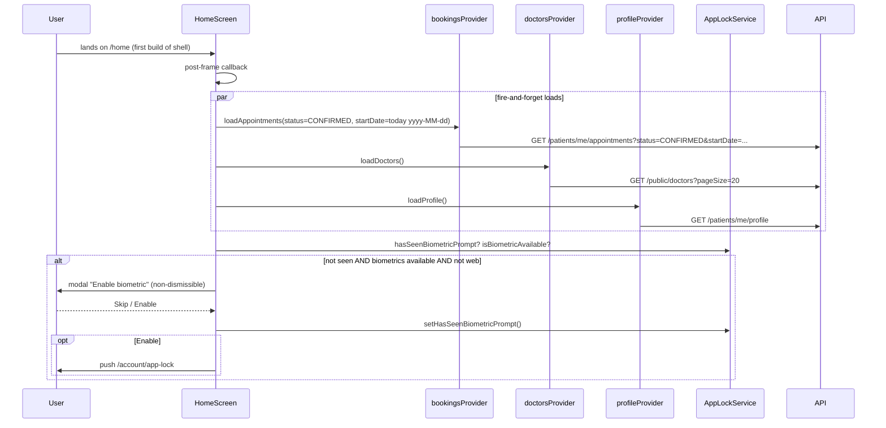
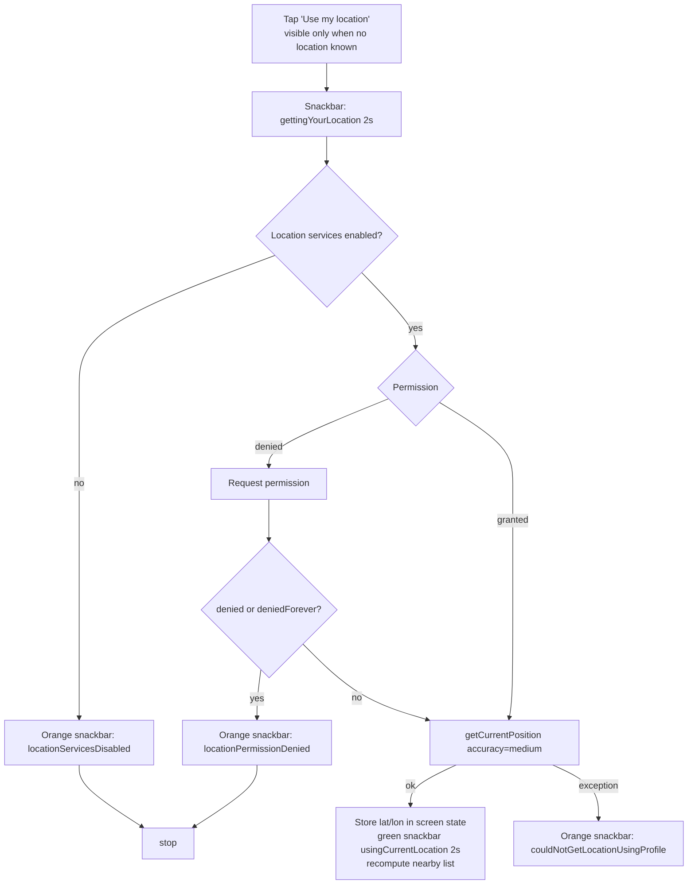
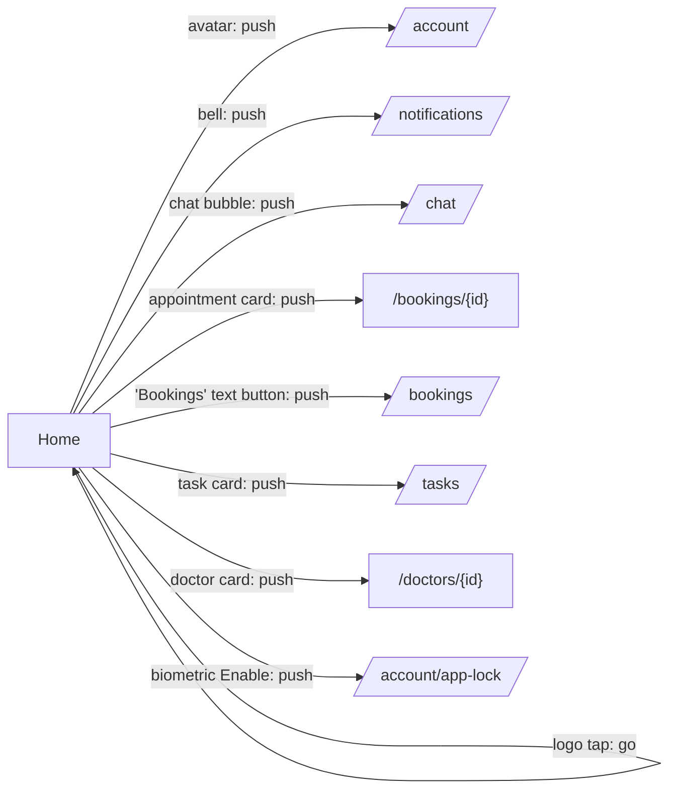

# 10 — Home Dashboard

Spec for rebuilding the Shifa Bemor patient **Home** tab in Kotlin Multiplatform + Compose Multiplatform.
Source of truth: Flutter app `lib/features/home/**` plus the shared widgets and providers it uses.
The home feature has **no data layer of its own**. Everything it shows comes from other features' state (Bookings, Doctors, Profile) and from header badge providers (Notifications, Chat).

Legend: `file:line` = Flutter source reference. **UNVERIFIED** = not provable from the client code.

---

## 1. Overview

| Item | Value |
|---|---|
| Route | `/home` (`AppRoutes.home`, `lib/app/router.dart:147`) |
| Screen | `HomeScreen` (`lib/features/home/presentation/screens/home_screen.dart:26`) |
| Shell | Branch 0 of `StatefulShellRoute.indexedStack` (`lib/app/router.dart:371-381`). Wrapped in `AppLockWrapper(MainShell)` with a persistent bottom nav. State survives tab switches because the screen is created once per shell lifetime. |
| Default landing | Auth redirects send authenticated users to `/home` (`lib/app/router.dart:254,259,264,278`). |
| Own data layer | None. Reads `bookingsProvider`, `doctorsProvider`, `profileProvider`, `appLockServiceProvider`, `shellTabIndexProvider`, and (through header buttons) `unreadNotificationsCountProvider` and `unreadCountProvider`. |

Vertical layout, all inside one pull-to-refresh scroll view (`home_screen.dart:208-319`):

1. **Header** (`AppHeader`): greeting, logo, notification/chat/profile buttons
2. **Upcoming appointments**: up to 3 cards
3. **My Tasks**: one static entry card to the Remote Care Tasks list
4. **Doctors near me**: up to 3 doctors within 50 km
5. Bottom spacer = bottom-nav height (80) + system bottom inset (`AppDesignSystem.safeBottomWithNavBar`, `lib/core/theme/app_design_system.dart:20-23`)

---

## 2. User flows

### 2.1 First display and data load



### 2.2 "Use my location" for Doctors near me



### 2.3 Navigation map



---

## 3. Screen spec: `HomeScreen`

### 3.1 Inputs and local state

No route params. Local state (`home_screen.dart:34-36`):

| Field | Type | Meaning |
|---|---|---|
| `_nearbyLocationLat/Lon` | `Double?` | Device position fetched this session via "Use my location". It is **not persisted** and **not sent to the backend**. It is lost when the screen is disposed. |
| `_isFetchingLocation` | `Boolean` | Disables the location button and shows a 14 px spinner inside it. |

### 3.2 Lifecycle and refresh triggers

| Trigger | What reloads | Source |
|---|---|---|
| First frame (`initState` post-frame) | appointments + doctors + profile (all three), then the biometric prompt check | `home_screen.dart:38-45, 81-90` |
| Pull-to-refresh | Same three loads. `onRefresh` calls `_loadData()` **without awaiting**, so the refresh indicator disappears immediately while the loads continue. | `home_screen.dart:210-213` |
| Switching back to the Home tab (`shellTabIndexProvider` goes from non-0 to 0) | **Only doctors** (`loadDoctors()`). Appointments and profile are *not* reloaded. | `home_screen.dart:190-194` |
| Returning from a pushed screen | Nothing. Shared providers may have changed underneath (see §6). | — |

`shellTabIndexProvider` is a `StateProvider<int>` (0=home, 1=bookings, 2=documents, 3=doctors, `lib/app/shell_tab_index_provider.dart:3-4`). `MainShell` writes it in a post-frame callback on every build (`lib/app/main_shell.dart:86-89`).

`_loadData()` (`home_screen.dart:81-90`):
```
startDate = format(now_local, "yyyy-MM-dd")
bookings.loadAppointments(status = "CONFIRMED", startDate = startDate)
doctors.loadDoctors()
profile.loadProfile()
```

### 3.3 Header (`AppHeader`, `lib/core/widgets/app_header.dart`)

Home instantiates it at `home_screen.dart:218-228`:

| Prop | Home value |
|---|---|
| `title` | Greeting (below) |
| `subtitle` | none |
| `showProfile` | `true` |
| `showNotification` | `true` |
| `showBack` | `false`, so the logo is shown instead of a back arrow |
| `onLogoTap` | `context.go('/home')` |
| `onProfileTap` | `context.push('/account')` |
| `profilePhotoUrl` | `withCacheBuster(profile.photoUrl, profileState.photoCacheKey)` (§3.3.1) |
| `onNotificationTap` | `context.push('/notifications')` |
| `onChatTap` | `context.push('/chat')` |

**There is no language toggle in the header or anywhere on Home.** `LanguageMiniToggle` is used only on the login screen (`lib/features/auth/presentation/screens/login_screen.dart:120`).

Layout (`app_header.dart:38-140`):
- Container height = `140 + statusBarInset`. Background `primary #00BBB0`. Bottom-left and bottom-right corner radius 24. Inner padding LTRB = 16, 8, 16, 16 (inside SafeArea top).
- Column with `spaceBetween`:
  - **Top row** (`spaceBetween`):
    - Left: 28×28 logo image (`Assets.shifaLogoPng`, corner radius 6). Tap calls `onLogoTap`.
    - Right: `[NotificationIconButton] 4dp [ChatIconButton] 4dp [Avatar IconButton]`.
  - **Bottom**: title text, white, 24 sp, w600, line height 1.25. Optional subtitle is white at 90% opacity, 14 sp (not used on Home).
- Avatar: `CircleAvatar` radius 16, background white at 20% opacity. Shows `NetworkImage(url)` when the URL is non-empty, otherwise a white `person_outline` icon (18). There is no error fallback for a broken URL.

**Badge buttons** (`lib/core/widgets/notification_icon_button.dart`, `lib/core/widgets/chat_icon_button.dart`), identical visuals:
- White `IconButton`: `notifications_outlined` or `chat_bubble_outline`.
- If `unread > 0`: a red (`Colors.redAccent`) pill at top-right offset (6, 6), padding 5×2, radius 10, min width 16. Text is white, 10 sp, bold. Shows `"9+"` when > 9, otherwise the number.
- Notification count: `unreadNotificationsCountProvider`, a one-shot `FutureProvider<int>` that calls `GET /notifications/unread/count`. It is invalidated by the notifications feature (e.g. after `markAsRead`) (`lib/features/notifications/providers/notifications_provider.dart:60-63, 77-81`). Loading or error shows 0.
- Chat count: `unreadCountProvider`, a `StreamProvider<int>` polling `GET /patients/me/messages/unread-count` every **10 s** forever. Errors yield 0 (`lib/features/chat/providers/chat_providers.dart:42-53`). See the Chat and Notifications specs for response shapes.

#### 3.3.1 Greeting and avatar URL
- Greeting (`home_screen.dart:92-99`): if `profile.fullName` is null or empty, show `"{hello}, {patient}"`. Otherwise show `"{hello}, {firstToken}"`, where `firstToken` = `fullName.trim()` split on whitespace, first element. Example: `"Hello, Aziz"`.
- `withCacheBuster(url, cacheKey)` (`lib/core/utils/image_utils.dart:31-44`): normalizes the URL (below). If `cacheKey` is non-zero, it adds or overwrites the query param `v=<cacheKey>`. `ProfileNotifier.loadProfile` sets `photoCacheKey = now.millis` whenever `photoUrl` differs from the previous value (`lib/features/profile/providers/profile_provider.dart:41-52`).
- `normalizePhotoUrl` (`image_utils.dart:4-29`): absolute `http(s)` URLs are kept. On Android, a `localhost`/`127.0.0.1` host is rewritten to `ApiClient.publicBaseUrl`. Relative paths are prefixed with `ApiClient.publicBaseUrl`, which is **hard-coded to `http://localhost:8090` (`http://10.0.2.2:8090` on Android)** (`lib/core/network/api_client.dart:42-50`). Relative photo URLs are therefore broken against production. Do not port this constant; see the Profile spec.

### 3.4 Section: Upcoming appointments (`home_screen.dart:239-267`)

- Title: `SectionTitle(upcomingAppointments)`. Style `h2`, 8 dp bottom spacing (`lib/core/widgets/section_title.dart`).
- Data: `bookingsProvider.appointments` (a `List<AppointmentModel>`) after
  `GET /patients/me/appointments?status=CONFIRMED&startDate=<yyyy-MM-dd local today>` (`lib/features/bookings/data/bookings_repository.dart:14-38`). The response must be a JSON array; anything else becomes `[]`. Full model: Bookings spec.
- Client-side processing (`home_screen.dart:101-114`):
  1. For each appointment, parse `startAt` with `parseAppointmentDateTime`. That function strips a trailing `[Zone/Id]` suffix, parses ISO-8601, and converts to local time (`lib/core/utils/date_utils.dart:4-9`). Items that fail to parse are **silently skipped**.
  2. Keep only items where `start > now`.
  3. Sort ascending by start.
  4. Render the first **3**.
- States:
  | Condition (checked in order) | UI |
  |---|---|
  | `bookingsState.isLoading` | Centered `CircularProgressIndicator`, padding 24 |
  | filtered list empty | `EmptyState(icon=event_available, message=noUpcomingAppointments, action=TextButton("bookings" label, primary color) → push /bookings)` |
  | else | Up to 3 `AppointmentCard`s, 12 dp gap. Tap → `push("/bookings/{id}")`. If more than 3 upcoming: an extra `TextButton(bookings)` (top padding 4) → `push("/bookings")` |
  - **Errors are ignored.** `bookingsState.error` is never read, so an API failure looks like "no upcoming appointments".
- `EmptyState` (`lib/core/widgets/empty_state.dart`): vertical padding 32 and horizontal padding 16. Icon 56 in `textTertiary #9CA3AF`, 16 dp gap, then message `body2` in `textSecondary #6B7280`, centered. When an action is present: 20 dp gap, then the action.
- `AppointmentCard` (`lib/core/widgets/appointment_card.dart`, owned by the Bookings spec). Summary: `BaseCard` with a 48 dp doctor avatar and optional star rating `x.x (n)` under the avatar. Next come the doctor name (or `unknownDoctor`) and a status icon badge: confirmed = blue `check_circle`, pending = orange `schedule`, cancelled = red `cancel`, completed = green `check_circle_outline`. Below that: `translateProfession(profession) · clinic`, then a clock row `HH:mm, dd MMM`, then an optional one-line reason. If `paymentStatus == "PENDING"` it also shows a `paymentPendingBadge` and a `payNow` button. **Home passes no `onPayNow`, so that button is rendered disabled** (`appointment_card.dart:131-158`; `home_screen.dart:254-257`). Cancelled cards are greyed out and not tappable.

### 3.5 Section: My Tasks (`home_screen.dart:268-275`)

- Title: `SectionTitle(myTasks)`.
- One static `RemoteCareTaskCard` (`lib/core/widgets/remote_care_task_card.dart`):
  - `title = remoteCareTasks`, `subtitle = viewAndCompleteAssignedTasks`, `trailingLabel = viewTasks`.
  - Tap → `push("/tasks")`.
- **No data is fetched.** There is no count, due badge, or preview of tasks.
- Visuals: `BaseCard` (radius 16, padding 16, 1 px border, card shadow) with background `primary` at 8% opacity. Row: 10 dp-padded square (radius 12, primary fill) holding a white `task_alt` icon (22). 12 dp gap. Column with title (`body2` w600, max 2 lines) and subtitle (`caption` `textSecondary`, max 2 lines). Trailing label (`caption` w600 primary), 4 dp, `chevron_right` (20, `textTertiary`). If `trailingLabel` is null the widget falls back to `translate('view')`.

### 3.6 Section: Doctors near me (`home_screen.dart:276-311`)

- Title: `SectionTitle(doctorsNearMe, trailing = …)`. The trailing button is shown **only when no location is known** (`!hasLocation`): `TextButton.icon(icon=my_location 16 primary | 14 dp spinner while fetching, label=useMyLocation caption)`. It is disabled while fetching.
- Data: `doctorsProvider.doctors` after `loadDoctors()`, which calls `GET /public/doctors` with query `{pageSize: 20}` only. There is **no lat/lon/radius**, so filtering is fully client-side (`lib/features/doctors/providers/doctors_provider.dart:227-229`; `lib/features/doctors/data/doctors_search_filters.dart` `toQueryParameters`; `lib/features/doctors/data/doctors_repository.dart:27-66`).
  - Response is either `{doctors:[...], totalCount, page?, pageSize?}` or a bare array. If `page` is absent (not server-paginated), the provider **slices the first 20 client-side**. Either way Home sees at most one page of 20 doctors. Full model: Doctors spec.
- Patient position (`home_screen.dart:203-206`): `lat = deviceLat ?? profile.latitude`, `lon = deviceLon ?? profile.longitude`. `hasLocation = lat != null && lon != null`.
- Filter (`home_screen.dart:116-132`, `lib/core/utils/location_utils.dart`):
  - No location → empty list, so no doctors are shown.
  - Keep doctors with non-null `latitude`/`longitude` and Haversine distance **≤ 50.0 km** (`nearbyDoctorsMaxRadiusKm`). Sort ascending by distance and take **3**.
  - Haversine as implemented: `p=π/180; a = 0.5 − cos((lat2−lat1)p)/2 + cos(lat1 p)·cos(lat2 p)·(1−cos((lon2−lon1)p))/2; km = 12742·asin(√a)`.
  - `nearbyDoctorsCloseRadiusKm = 15.0` is declared but **unused**.
- Distance label (`home_screen.dart:134-138`): if km < 1, show `"<round(km*1000)> m"`, otherwise `"<km, 1 decimal> km"`. The units `m`/`km` are hard-coded and not localized.
- States:
  | Condition | UI |
  |---|---|
  | `doctorsState.isLoading` | Centered spinner, padding 24 |
  | nearby list empty | `EmptyState(icon=medical_services, message = hasLocation ? noDoctorsInCloseDistance : noDoctorsAvailable)`, no action |
  | else | Up to 3 `DoctorCard`s (12 dp gap), each with `distanceText`. Tap → `push("/doctors/{id}")` |
  - Errors are ignored and fall through to the empty state.
- `DoctorCard` (`lib/core/widgets/doctor_card.dart`): `BaseCard` with a 48 dp avatar and optional rating under it. Then the name, `translateProfession(profession) · clinic`, the distance (caption, tertiary), and a trailing chevron.

### 3.7 Biometric onboarding prompt (`home_screen.dart:47-79`)

- Skipped on web.
- Conditions: `!hasSeenBiometricPrompt()` AND `isBiometricAvailable()`.
  - Seen flag: secure storage key `app_lock_seen_biometric_prompt == "true"` (`lib/core/services/app_lock_service.dart:19, 157-165`). Android uses the dedicated prefs file `shifa_app_lock_prefs` with `resetOnError=false`.
  - Availability = `canCheckBiometrics && isDeviceSupported()`. Exceptions count as false (`app_lock_service.dart:58-66`).
- Dialog: `barrierDismissible=false`.
  - Title `enableBiometricForAppSecurity`, body `enableBiometricPrompt`.
  - Actions: `TextButton(skipBiometric)` → "skip", `FilledButton(enableBiometric)` → "enable".
- After either choice the flag is set to true. If "enable" was chosen: `push("/account/app-lock")`.
- Because Home is created once per shell, the check runs once per app session until the flag is set.

---

## 4. API endpoints consumed by Home

Home owns none. It calls these through other features:

| Method | Path (prefix `/api` added by client) | Query | Owner spec | Home usage |
|---|---|---|---|---|
| GET | `/patients/me/appointments` | `status=CONFIRMED`, `startDate=yyyy-MM-dd` | Bookings | Upcoming list |
| GET | `/public/doctors` | `pageSize=20` | Doctors | Nearby list |
| GET | `/patients/me/profile` | — | Profile | Greeting, avatar, fallback lat/lon (`fullName`, `photoUrl`, `latitude`, `longitude`, `id`) |
| GET | `/notifications/unread/count` | — | Notifications | Bell badge |
| GET | `/patients/me/messages/unread-count` | — (10 s poll) | Chat | Chat badge |

All requests carry `Authorization: Bearer <token>`. 401 handling, grace period and timeouts are described in the Networking/Core spec.

---

## 5. State management summary

| Provider | Type | Shared with | Notes |
|---|---|---|---|
| `bookingsProvider` | `StateNotifier<BookingsState{appointments,isLoading,error}>` | **Bookings tab**, booking flow | Single global list. Home overwrites it with the CONFIRMED+from-today query. The Bookings tab overwrites it with all statuses from today (upcoming tab) or with no filter (past tab) (`lib/features/bookings/presentation/screens/bookings_screen.dart:43-59`). `bookAppointment` and `cancelAppointment` reload it unfiltered (`bookings_provider.dart:94,105`). |
| `doctorsProvider` | `StateNotifier<DoctorsState>` | **Doctors tab**, create booking | Home's `loadDoctors()` resets to the unfiltered page 1. The Doctors tab's `_applyFilters` on tab re-entry replaces `doctors` with a filtered page (`lib/features/doctors/presentation/screens/doctors_screen.dart:255-259`). |
| `profileProvider` | `StateNotifier<ProfileState{profile,isLoading,error,photoCacheKey}>` | Everywhere | A 401 is swallowed without setting an error. |
| `shellTabIndexProvider` | `StateProvider<Int>` | MainShell, Doctors | Tab re-entry detection. |

KMP recommendation: give Home its **own** `HomeViewModel` state (upcoming appointments, nearby doctors) instead of sharing mutable lists with the Bookings and Doctors tabs. Keep the same queries, and refresh on tab re-selection if desired.

---

## 6. Observed quirks and tech debt (preserve or fix consciously)

1. **Shared list pollution.** Home and the Bookings tab share one appointments list and Home and the Doctors tab share one doctors list, so whichever loaded last wins. After visiting Bookings, Home may show non-CONFIRMED upcoming items. After Home refreshes, the Bookings "Upcoming" tab may show CONFIRMED only. After Doctors-tab filtering, Home's "near me" is computed from the filtered page.
2. **Nearby is limited to page 1 of 20 doctors.** It is not a real geo query, so closer doctors on later pages are never shown. The backend supports `latitude`/`longitude`/`radiusKm`/`sortBy` query params (`doctors_search_filters.dart` `toQueryParameters`). A port could use them. Backend semantics are **UNVERIFIED**.
3. Pull-to-refresh does not await the loads, so the indicator vanishes instantly.
4. Load errors in all three sections are silently rendered as empty states.
5. The "Use my location" button is hidden whenever the profile has coordinates, so a user with a saved address cannot switch to device GPS from Home. The device location is session-only.
6. The `payNow` button inside home appointment cards is visible but disabled (no handler).
7. Distance units are hard-coded (`m`, `km`).
8. Hard-coded `publicBaseUrl` (`localhost:8090`) breaks relative avatar URLs.
9. Hard-coded English fallbacks (`'Enable'`, `'My Tasks'`, …) are dead code because `translate()` never returns null. It falls back to English, then to the raw key (`lib/core/localization/app_localizations.dart:3614-3618`).
10. The `de` locale map lacks many Home keys (e.g. biometric and location strings, `myTasks`, `remoteCareTasks`, `view`), so German shows English.

---

## 7. KMP / CMP porting notes

- **Scroll and refresh**: a `LazyColumn` inside Material3 `PullToRefreshBox`. Header as the first item, not sticky. Await all three loads in `onRefresh` (improvement).
- **Location** (expect/actual): Android uses `FusedLocationProviderClient.getCurrentLocation(PRIORITY_BALANCED_POWER_ACCURACY)` plus `LocationManager.isLocationEnabled`. iOS uses `CLLocationManager` with `requestWhenInUseAuthorization`, `kCLLocationAccuracyHundredMeters`. Alternatively moko-geo or compass-geolocation. Permissions: Android `ACCESS_FINE_LOCATION`/`ACCESS_COARSE_LOCATION` (already in `android/app/src/main/AndroidManifest.xml:11-12`). iOS needs `NSLocationWhenInUseUsageDescription` (`ios/Runner/Info.plist:76`). Put the Haversine function in `commonMain`.
- **Biometric availability** (expect/actual): Android `BiometricManager.canAuthenticate(BIOMETRIC_STRONG or BIOMETRIC_WEAK) == BIOMETRIC_SUCCESS`. iOS `LAContext().canEvaluatePolicy(.deviceOwnerAuthenticationWithBiometrics)`. Store the "seen" flag in secure storage (EncryptedSharedPreferences/Keychain) under `app_lock_seen_biometric_prompt`.
- **Tab re-selection**: expose the selected bottom-nav index as a `StateFlow<Int>` and reload doctors on the transition to 0.
- **Badges**: the notification count is a one-shot fetch that is refreshed on invalidation. The chat count is a 10 s polling flow (`flow { while(true){ emit(runCatching{get()}.getOrDefault(0)); delay(10_000) } }`), cancelled when the app stops, which is an improvement over Flutter's never-ending loop.
- **Image loading**: Coil 3 (multiplatform) `AsyncImage` for the avatar. Add the `v=` cache-buster query exactly as described.
- **Dates**: kotlinx-datetime. `startDate` query = `Clock.System.todayIn(TimeZone.currentSystemDefault()).toString()` (ISO `yyyy-MM-dd`). Parse `startAt` with `Instant.parse` after stripping a `[Zone]` suffix.

---

## 8. l10n keys used (strings exported separately)

HomeScreen: `hello`, `patient`, `enableBiometricForAppSecurity`, `enableBiometricPrompt`, `skipBiometric`, `enableBiometric`, `gettingYourLocation`, `locationServicesDisabled`, `locationPermissionDenied`, `usingCurrentLocation`, `couldNotGetLocationUsingProfile`, `upcomingAppointments`, `noUpcomingAppointments`, `bookings`, `myTasks`, `remoteCareTasks`, `viewAndCompleteAssignedTasks`, `viewTasks`, `doctorsNearMe`, `useMyLocation`, `noDoctorsInCloseDistance`, `noDoctorsAvailable`.
Child widgets: `view` (RemoteCareTaskCard fallback); `unknownDoctor`, `paymentPendingBadge`, `payNow` (AppointmentCard). Profession labels via `translateProfession` (see the Doctors spec).
