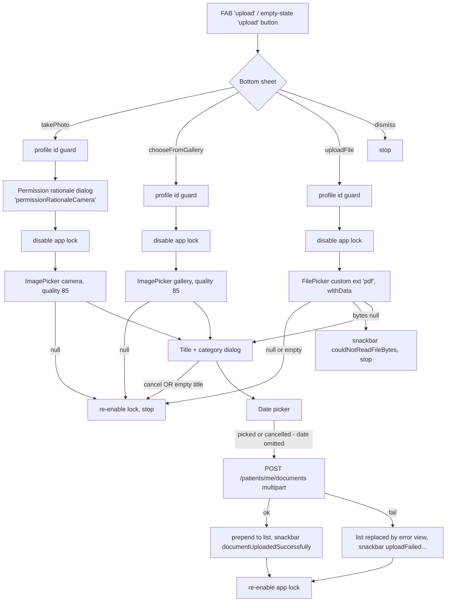
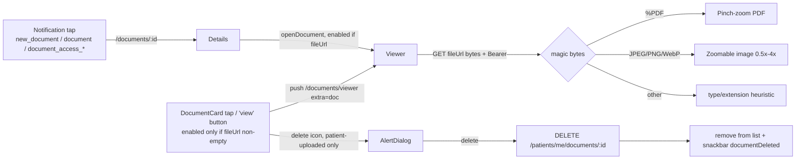

# 11 — Documents (medical records)

Spec for rebuilding the patient **Documents** tab in Kotlin Multiplatform + Compose Multiplatform. It covers listing, searching, uploading (camera, gallery, PDF), category tagging, the in-app viewer, the details screen and delete.

Source files:
- `lib/features/documents/data/documents_repository.dart`
- `lib/features/documents/domain/document_category.dart`
- `lib/features/documents/providers/documents_provider.dart`
- `lib/features/documents/presentation/screens/documents_screen.dart`
- `lib/features/documents/presentation/screens/document_details_screen.dart`
- `lib/features/documents/presentation/screens/document_viewer_screen.dart`
- `lib/core/models/document_model.dart`
- `lib/core/widgets/document_card.dart`

Legend: `file:line` = Flutter source reference. **UNVERIFIED** = not provable from the client code.

---

## 1. Overview

| Item | Value |
|---|---|
| Tab | Branch 2 of the persistent `StatefulShellRoute.indexedStack` (tab state is preserved) (`lib/app/router.dart:488-512`) |
| Routes | `/documents` → `DocumentsScreen`; `/documents/viewer` (extra = `DocumentModel`) → `DocumentViewerScreen`; `/documents/:id` → `DocumentDetailsScreen` (`lib/app/router.dart:149,162-163,491-510`) |
| Route order | `viewer` is declared **before** `:id`, so the literal `viewer` is never treated as an id. Keep this order, or use distinct paths, in the port. |
| Viewer without extra | Falls back to rendering `DocumentsScreen` (`router.dart:497-500`). |
| Auth whitelist | Prefix `/documents` (`router.dart:108`) |
| Features | List all patient docs (uploaded by the patient **and** by doctors); client-side title search; upload photo/gallery image/PDF with title + optional category + optional date; view PDF/images in-app with auth; delete patient-uploaded docs. |
| Not implemented | Category **filter** UI (category is a display tag only), real download/save, share, offline cache, file size limits, image compression. |

---

## 2. User flows

### 2.1 List load

```mermaid
sequenceDiagram
    participant S as DocumentsScreen
    participant P as profileProvider
    participant D as documentsProvider
    S->>P: loadProfile() (post-frame, initState)
    P->>API: GET /patients/me/profile
    P-->>S: ProfileState changes (ref.listen)
    alt profile.id non-empty AND != _loadedPatientId
        S->>D: loadDocuments()
        D->>API: GET /patients/me/documents
        API-->>D: [DocumentModel...]
    end
    Note over S: Pull-to-refresh = await loadProfile(); await loadDocuments()
```

Documents load **only after** the profile id is known and has changed (`documents_screen.dart:35-40, 65-71`). If the profile was already loaded with the same id before this screen was created, the listener still fires once, because `loadProfile()` emits new states (isLoading true, then false). `_loadedPatientId` starts as null, so the first emission with an id triggers the load.

### 2.2 Upload



### 2.3 View, details, delete



---

## 3. Screens

### 3.1 `DocumentsScreen` (`/documents`)

No inputs. Local state: `_searchController`, `_searchQuery` (trimmed and lowercased), `_loadedPatientId` (`documents_screen.dart:30-47`).

**Layout** (`CustomScrollView` inside `RefreshIndicator`, `documents_screen.dart:78-204`):
1. `AppHeader(title=documents, showProfile, showNotification, showBack=false)` with the same callbacks as Home: logo → `go /home`, avatar → `push /account`, bell → `push /notifications`, chat → `push /chat`. The photo URL gets a cache-buster (see `10-home.md` §3.3).
2. Search `TextField`, padding LTRB 16, 16, 16, 8. Hint `searchDocuments`, prefix `search` icon, outlined border radius 12, filled `backgroundSecondary`. Filtering is live: `doc.title.lowercase().contains(query)` (`documents_screen.dart:73-76`). Only the title is searched.
3. Body state (checked in order):
   | Condition | UI |
   |---|---|
   | `documentsState.isLoading` | Spinner, padding 32. This also covers **an upload in progress**, because upload sets `isLoading=true`. |
   | `documentsState.error != null` | `EmptyState(error_outline, "{error}: {rawErrorString}", action=ShifaPrimaryButton(retry, hug))`. Retry calls `loadDocuments()` only if the profile id is non-empty. **The raw exception text is shown** (e.g. `Exception: Failed to load documents`), unsanitized (`documents_screen.dart:129-145`). |
   | filtered list empty | `EmptyState(folder_open, noDocumentsFound, TextButton.icon(upload icon 18, label upload) → upload sheet)`. The same message is shown when a search has no matches. |
   | else | List of `DocumentCard`s, horizontal padding 16, 12 dp gap |
4. Bottom spacer: `safeBottomWithNavBar` (80 + inset).
5. **FAB**: `FloatingActionButton.extended(label=upload, icon=upload, bg=primary, heroTag="documents_fab")`, position `centerFloat` (`documents_screen.dart:196-203`).

**Per-card values** (`documents_screen.dart:163-183`):
- `formattedDate = _formatDate(doc.date)`: empty stays `""`. Otherwise `DateTime.parse` then `dd.MM.yyyy`. On parse failure the raw string is shown (`documents_screen.dart:207-215`). Timezone: `DateTime.parse` of a date-only or offset-less string is local; a string with `Z` or an offset is UTC and **not** converted to local before formatting.
- `uploaderLabel`: `creatorLabel == null` → `""`, `"Doctor"` → `addedByDoctor`, `"Patient"` → `addedByYou`, any other value (e.g. `"Unknown"`) → the raw value, not localized.
- `onView` → `_openInAppViewer`, a no-op if `fileUrl` is null or empty; otherwise `push("/documents/viewer", extra=doc)`.
- `onDelete` is set only when `doc.isUploadedByPatient` (`creatorLabel == "Patient"`).

**Delete** (`documents_screen.dart:222-255`):
- `AlertDialog(title=delete, content=deleteDocumentConfirmation, actions=[TextButton cancel → false, TextButton delete → true])`. Both are plain TextButtons; there is no destructive styling. Dismissible.
- On confirm: `documentsNotifier.deleteDocument(id)`, then snackbar `documentDeleted`. On error: snackbar `userFriendlyError(l10n, e)`. There is no loading indicator during the delete.

**Upload options sheet** (`documents_screen.dart:257-302`): modal bottom sheet, top corner radius 20, `SafeArea`, three `ListTile`s with icon color hard-coded `#17C3B2` (note: this differs from the primary `#00BBB0`):
| Tile | Icon | Label key | Action |
|---|---|---|---|
| camera | `camera_alt` | `takePhoto` | `_uploadFromCamera` |
| gallery | `photo_library` | `chooseFromGallery` | `_uploadFromGallery` |
| file | `insert_drive_file` | `uploadFile` | `_uploadDocument` (PDF) |

**Common upload guard**: if `profile.id` is null or empty, show the snackbar `"{profile} {error.lowercase()}"` and stop (`documents_screen.dart:306-312, 377-383, 444-450`). The id is not sent to the API; the endpoint is `/me`.

**Camera** (`documents_screen.dart:304-373`):
1. `showPermissionRationale(rationaleKey="permissionRationaleCamera")` (`lib/core/utils/permission_rationale.dart:6-31`). It is a non-dismissible dialog: title `permissionNeeded`, body = the rationale text, and one `FilledButton(continueButton)`. It is **skipped entirely if the key has no translation** (`translate` returns the key). It is shown on every camera upload, not only the first time. Apple guideline 5.1.1(iv): no cancel option.
2. `appLockTemporaryDisableProvider.disable()` (§6.3).
3. `ImagePicker.pickImage(source=camera, imageQuality=85)`. There is no maxWidth/maxHeight. Null (cancelled) → re-enable the lock and stop.
4. `readAsBytes()`.
5. Title/category dialog, prefilled from `"photo_<epochMs>.jpg"`. After extension stripping the title becomes `photo_<epochMs>`.
6. Date picker (§3.1.2).
7. `uploadDocument(fileBytes, fileName="{title}.jpg", title, date?, category?)`. The file name is built from the user-typed title (it may contain spaces or unicode; no sanitization). The `.jpg` extension is always used, whatever the actual picker output format is (**UNVERIFIED**: whether image_picker re-encodes HEIC to JPEG at quality 85 on iOS).
8. Success → snackbar `documentUploadedSuccessfully`. Failure → snackbar `uploadFailed` (**no detail**, unlike gallery and file).
9. `finally` → re-enable the app lock.

**Gallery** (`documents_screen.dart:375-440`): same as camera without the rationale, using `ImageSource.gallery` and quality 85. Failure snackbar: `"{uploadFailed}: {userFriendlyError(e)}"`.

**File (PDF)** (`documents_screen.dart:442-515`):
- `FilePicker.pickFiles(type=custom, allowedExtensions=["pdf"], withData=true)`. **Only PDF**, single file.
- The app lock is disabled before the picker opens. Note that the re-enable happens only in the `finally` of the upload `try`. If the user cancels the title dialog, the lock is re-enabled explicitly (L476-478).
- `bytes == null` → snackbar `couldNotReadFileBytes`.
- `fileName = file.name` (original name). The title is prefilled with the name minus `.pdf`.
- Success/failure snackbars are the same as gallery.

#### 3.1.1 Title + category dialog (`documents_screen.dart:519-615`)
- `AlertDialog(title=documentTitle)`, content scrollable:
  - `TextField` prefilled with the file name after two case-insensitive regex strips: `\.pdf$` then `\.(jpg|jpeg|png|gif|webp)$`. Hint `enterDocumentTitle`. No max length.
  - Label `documentCategoryLabel` (w600), then helper `documentCategoryHint` (12 sp, grey 600).
  - `DropdownButtonFormField<DocumentCategory>`: outlined, dense, expanded. Hint `documentCategorySelect`. Items are all 22 categories (§5.2) in the listed order. Each item shows a 16 dp icon in `Colors.teal`, 8 dp, then the ellipsized label. **No "none" item**: once a category is picked it cannot be cleared except by cancelling.
- Actions: `TextButton(cancel)` → `null`; `TextButton(save)` → `{title: text.trim(), category: selected?.code}`.
- Validation: **none in the dialog**. An empty trimmed title makes the caller silently abort the upload (no message).
- Barrier dismissible (acts as cancel).

#### 3.1.2 Date picker (`documents_screen.dart:617-625`)
- Material `showDatePicker(initialDate=today, firstDate=Jan 1 of (year-20), lastDate=Jan 1 of (year+1))`. Future dates up to Jan 1 of next year are allowed.
- There is no title or help text customization.
- Cancel → `date` is omitted from the request. **The upload still proceeds.** The backend presumably defaults to the upload time (**UNVERIFIED**).
- Sent as `yyyy-MM-dd`.

### 3.2 `DocumentDetailsScreen` (`/documents/:id`)

Entry: notification deep links only (§7.2). Input: `documentId: String` from the path (`router.dart:504-509`).
- It looks up the doc in `documentsProvider.documents` by `id` (string compare) (`document_details_screen.dart:29, 84-90`). There is no single-document endpoint.
- If the doc is not found, the load has not yet been requested, and `profileState.profile != null`, it calls `loadDocuments()` once (post-frame) (`document_details_screen.dart:31-36`). **If the profile isn't loaded yet, nothing loads.** This screen never calls `loadProfile()` itself. It normally works because Home or MainShell has already loaded the profile. There is no retry except pull-to-refresh.
- UI (`document_details_screen.dart:38-81`):
  - `AppBar(leading back arrow → Navigator.pop, title = doc?.title ?? document)`.
  - `RefreshIndicator` (→ `loadDocuments()`) around a padded (16) `SingleChildScrollView`:
    - `Card` (padding 16): `information` (bold 16), 12 dp gap, then `"{date}: {dd.MM.yyyy or raw}"`.
    - 24 dp gap, then `ShifaPrimaryButton(label=openDocument, icon=visibility)`. Enabled iff `doc.fileUrl` is non-empty; it pushes `/documents/viewer` with extra = doc.
- **There is no loading, not-found or error UI.** While loading, or if the doc is missing, the screen shows the title `document`, an empty date and a disabled button.

### 3.3 `DocumentViewerScreen` (`/documents/viewer`, extra `DocumentModel`)

State: `_bytes`, `_error`, `_loading=true`, `_pdfController`, `_resolvedViewerType` (`document_viewer_screen.dart:27-32`).

**Load** (`document_viewer_screen.dart:106-158`, called from `initState` and Retry):
1. `fileUrl` empty → `_error = "No document URL"` (hard-coded English). This is never shown in practice, because the URL heuristic already says `unsupported` (see below).
2. `repo.getDocumentBytes(fileUrl)` → full-body GET into memory (§4.4).
3. `resolved = typeFromBytes(data)`. If that is `unsupported`, the URL/type heuristic is used instead.
4. If pdf: `PdfControllerPinch(document = PdfDocument.openData(data), initialPage = 1)`.
5. Error → `_error = translateError(l10n, e.toString())`, `_resolvedViewerType = null`.

**Type detection**:
- From bytes (`document_viewer_screen.dart:67-104`). Returns `unsupported` if `len < 12`.
  | Format | Signature |
  |---|---|
  | PDF | `25 50 44 46` (`%PDF`) at offset 0 |
  | JPEG | `FF D8 FF` |
  | PNG | `89 50 4E 47 0D 0A 1A 0A` |
  | WebP | `52 49 46 46` (`RIFF`) at 0 **and** `57 45 42 50` (`WEBP`) at 8-11 |
- From URL/type (`document_viewer_screen.dart:54-65`): `effective = document.type.lowercase()` if non-empty; otherwise the extension of the URL path, with the query stripped at the first `?`. `"pdf"` → pdf; `jpg|jpeg|png|webp` → image; anything else → unsupported. **This expects `type` to be a bare extension.** A MIME value like `application/pdf` makes it return `unsupported` (see quirks).

**Render** (`document_viewer_screen.dart:173-282`). `viewerType = _resolvedViewerType ?? typeFromUrl()`, then branches are evaluated in this order:
1. `viewerType == unsupported` → centered `insert_drive_file` icon (64, grey 400) + `unsupportedDocumentType` (grey 700, 16 sp). **This is evaluated before the loading and error checks.**
2. `_loading` → spinner + `loadingDocument`.
3. `_error != null` → `error_outline` (64, red 300) + the error text (red 700) + `ShifaPrimaryButton(retry, hug)` → reload.
4. pdf → `PdfViewPinch(controller)`: pinch-zoom, vertical page scroll.
5. image → `InteractiveViewer(minScale 0.5, maxScale 4.0)` → `Image.memory(fit=contain, errorBuilder=broken_image 64)`.

**AppBar**: back arrow (`context.pop()`), title = `document.title` (ellipsized). Action `IconButton(download, tooltip=download)` is shown only when bytes are loaded and the type is supported. **The download is a stub**: it only shows the snackbar `downloadStarted`. Nothing is saved (`document_viewer_screen.dart:160-171`). There is no share action.

The PDF controller is disposed in `dispose()`. Bytes are released with the screen; there is no cache.

---

## 4. API endpoints

All paths are relative to `<base>/api`. Every request goes through the shared `ApiClient` Dio instance: `Authorization: Bearer <token>` is added by the request interceptor to **every** request, including absolute file URLs (`lib/core/network/api_client.dart:96-111`). Connect and receive timeouts are 30 s (`api_client.dart:85-86`).

### 4.1 List documents
`GET /patients/me/documents` (`documents_repository.dart:36-51`)
- Response: **JSON array** of document objects. It is cast with `as List` (a Map response throws, leading to the error state).
```json
[
  {
    "id": 412,
    "patientId": 77,
    "title": "Blood panel March",
    "date": "2026-03-14",
    "createdAt": "2026-03-14T09:21:07",
    "fileUrl": "https://files.example/patients/77/abc.pdf",
    "type": "pdf",
    "doctorId": 12,
    "doctorName": "Dr. Karimov",
    "creatorLabel": "Doctor",
    "category": "BLOOD_TEST",
    "isSharedWithTeam": true
  }
]
```
Values are illustrative. The key set is what the parser reads. The `type` value format (extension vs MIME) is **UNVERIFIED**; whether `fileUrl` is absolute, relative or presigned is **UNVERIFIED**.
- Errors: `DioException` → `Exception(message ?? error ?? stringBody ?? e.message ?? "Failed to load documents")` (`documents_repository.dart:112-122`) → `state.error = e.toString()` (keeps the `Exception: ` prefix).

### 4.2 Upload document
`POST /patients/me/documents`, `multipart/form-data` (`documents_repository.dart:58-94`)

| Part | Type | Required | Value |
|---|---|---|---|
| `file` | file | yes | `MultipartFile.fromBytes(bytes, filename=fileName)`. **No explicit part Content-Type** is set, so the part is sent as `application/octet-stream` by Dio default (**UNVERIFIED** how the backend derives `type`). |
| `title` | text | yes | Trimmed user title (non-empty) |
| `date` | text | no | `yyyy-MM-dd`. Omitted when the picker was cancelled |
| `isChatAttachment` | text | yes | Always the string `"false"` from this app (the repository supports `true`, but no caller passes it) |
| `category` | text | no | One of the §5.2 codes, or `PRE_APPOINTMENT` from the booking flow. Omitted when null or empty |

Example (curl-equivalent):
```
POST /api/patients/me/documents
Authorization: Bearer <jwt>
Content-Type: multipart/form-data; boundary=...

file=@"Blood panel.pdf"; title="Blood panel"; date="2026-03-14"; isChatAttachment="false"; category="BLOOD_TEST"
```
- The request goes via `_apiClient.dio.post` directly, not `uploadFile()`. The base header `Content-Type: application/json` is replaced by Dio with the multipart boundary for `FormData` (Dio 5 behaviour).
- Response: **a single document object** (same shape as §4.1), parsed as `DocumentModel` and prepended to the list.
- Client limits: **none**. No size cap, no count cap (except the booking flow: max 5, see §7.1), no compression beyond image_picker `imageQuality: 85`. Server-side limits are **UNVERIFIED**. The 30 s timeout applies to the whole request (large files on slow networks may time out).
- Errors: `Exception(message ?? error ?? stringBody ?? e.message ?? "Failed to upload document")`.

### 4.3 Delete document
`DELETE /patients/me/documents/{id}` (`documents_repository.dart:97-110`)
- No body. The response body is ignored. The backend only allows deleting documents the current patient uploaded (repository comment L96). The client shows the delete icon only for `creatorLabel == "Patient"`.
- Errors: `Exception(... ?? "Failed to delete document")` → rethrown to the screen → `userFriendlyError` snackbar.

### 4.4 Fetch file bytes
`GET {fileUrl}` (`documents_repository.dart:15-33`)
- `dio.get<List<int>>(url, responseType=bytes)`. With an absolute URL, Dio ignores `baseUrl`. With a relative `fileUrl`, it would resolve against `<base>/api/` (**UNVERIFIED** whether the backend ever returns relative URLs).
- The Bearer header is always attached, even to third-party or S3 hosts. **UNVERIFIED** whether storage presigned URLs tolerate an extra `Authorization` header (S3 rejects presigned requests that also carry `Authorization`).
- Empty body → `Exception("Empty response")`. `DioException` → `Exception(stringBody ?? e.message ?? "Failed to load document")`.
- **401 on this request can trigger global logout.** The 401 handler exempts only paths starting with `/public/` or `/auth/`, and an absolute URL never matches (`api_client.dart:123-126`).

---

## 5. Data models

### 5.1 `DocumentModel` (`lib/core/models/document_model.dart`)
Equatable over all fields.

| Field | JSON key(s) | Type | Default / parsing | UI use |
|---|---|---|---|---|
| `id` | `id` | String | `id?.toString() ?? ""` (the backend sends a number or string) | route param, delete, lookup |
| `patientId` | `patientId` | String | `toString() ?? ""` | not shown |
| `title` | `title` | String | `?? ""` | card title (blank → `document`), viewer/details title, search |
| `date` | `date`, fallback `createdAt` | String | `date ?? createdAt ?? ""` (L42) | `dd.MM.yyyy` |
| `fileUrl` | `fileUrl`, fallback `url` | String? | `(fileUrl ?? url)` | view enable, bytes fetch, icon heuristic |
| `type` | `type` | String? | — | card icon (substring `pdf`/`image`), viewer heuristic (exact `pdf`/`jpg`/...) |
| `doctorId` | `doctorId` | String? | `toString()` | not shown |
| `doctorName` | `doctorName` | String? | — | **not shown** |
| `creatorLabel` | `creatorLabel` | String? | expected values `"Doctor"`, `"Patient"`, `"Unknown"` (L12) | uploader label + delete permission |
| `category` | `category` | String? | code, §5.2 | card chip (known codes only) |
| `isSharedWithTeam` | `isSharedWithTeam` | Boolean | `?? false` | **not shown** |

Derived: `isUploadedByPatient = creatorLabel == "Patient"` (L70). `toJson()` writes the same keys (used only in tests).
Tests: `test/document_model_test.dart` (the date/createdAt fallback and parsing) and `test/documents_notifier_test.dart` (load, upload and delete state transitions).

### 5.2 `DocumentCategory` (`lib/features/documents/domain/document_category.dart`)
Codes must match backend enum `PatientDocumentCategory.code` (comment L10-11). The category is a **tag only**: patient uploads are visible to all the patient's doctors regardless of category (L4-8, repository L55-57).

| # | Code | Material icon | Label key |
|---|---|---|---|
| 1 | `BLOOD_TEST` | bloodtype | `documentCategory_BLOOD_TEST` |
| 2 | `URINE_TEST` | science | `documentCategory_URINE_TEST` |
| 3 | `STOOL_TEST` | science | `documentCategory_STOOL_TEST` |
| 4 | `LAB_RESULT` | biotech | `documentCategory_LAB_RESULT` |
| 5 | `MRI` | medical_services | `documentCategory_MRI` |
| 6 | `CT_SCAN` | medical_services | `documentCategory_CT_SCAN` |
| 7 | `XRAY` | medical_information | `documentCategory_XRAY` |
| 8 | `ULTRASOUND` | monitor_heart | `documentCategory_ULTRASOUND` |
| 9 | `MAMMOGRAPHY` | medical_services | `documentCategory_MAMMOGRAPHY` |
| 10 | `ECG` | monitor_heart | `documentCategory_ECG` |
| 11 | `EEG` | psychology | `documentCategory_EEG` |
| 12 | `ENDOSCOPY` | medical_information | `documentCategory_ENDOSCOPY` |
| 13 | `BIOPSY` | biotech | `documentCategory_BIOPSY` |
| 14 | `PATHOLOGY` | biotech | `documentCategory_PATHOLOGY` |
| 15 | `IMAGING_OTHER` | image | `documentCategory_IMAGING_OTHER` |
| 16 | `PRESCRIPTION` | medication | `documentCategory_PRESCRIPTION` |
| 17 | `VACCINATION_RECORD` | vaccines | `documentCategory_VACCINATION_RECORD` |
| 18 | `DISCHARGE_SUMMARY` | local_hospital | `documentCategory_DISCHARGE_SUMMARY` |
| 19 | `REFERRAL` | assignment | `documentCategory_REFERRAL` |
| 20 | `HOSPITAL_REPORT` | local_hospital | `documentCategory_HOSPITAL_REPORT` |
| 21 | `ALLERGY_REPORT` | warning_amber | `documentCategory_ALLERGY_REPORT` |
| 22 | `OTHER_MEDICAL` | folder_shared | `documentCategory_OTHER_MEDICAL` |

- Additional wire value **`PRE_APPOINTMENT`**: sent by the booking flow (`appointment_booking_flow_screen.dart:794`). It is not in the list, so `findPatientCategory` returns null and no chip is shown. It cannot be chosen in the upload dialog. The key `documentCategory_PRE_APPOINTMENT` does not exist in any locale.
- `label()` falls back to a humanized code (`BLOOD_TEST` → `Blood Test`) only when the translation is null or empty (L22-29). Because `translate()` returns the key itself when a translation is missing, **the humanized fallback never runs**; a missing key shows the raw `documentCategory_X`. The port should implement the humanized fallback properly.
- `findPatientCategory(code)` → exact, case-sensitive match or null (L57-63). Unknown or legacy codes show no chip.
- Server-side list of accepted codes (beyond these 22 + PRE_APPOINTMENT) is **UNVERIFIED**.

### 5.3 `DocumentCard` rendering (`lib/core/widgets/document_card.dart`)
`BaseCard` (radius 16, padding 16, border, shadow). Tap = `onView`, only if `fileUrl` is non-empty (L43).
- Leading 48×48 box, `primary` at 10% opacity, radius 12, icon 26 primary. Icon rule (L26-32), on lowercased `type` and `fileUrl`:
  1. `type` contains `pdf` OR url ends with `.pdf` → `picture_as_pdf`
  2. `type` contains `image` OR url **contains** `image` OR ends with `.jpg`/`.jpeg`/`.png` → `image`
  3. else → `description`
  (Query strings defeat the `endsWith` checks.)
- Column: title (`body2` w600, max 2 lines), 4 dp, then a `Wrap(spacing 6)` of the date (`caption`) and, for a known category, a chip (padding 6×2, primary 12% bg, radius 4, 10 dp icon + label caption 10 sp primary). Optional uploader label (`caption`, `textTertiary`, 1 line, top 2).
- Trailing: `IconButton(delete_outline, 22, textTertiary, tooltip delete)` if `onDelete`, then `TextButton(view)` in primary, padding 12×8, disabled without a URL.

---

## 6. State management

### 6.1 `documentsProvider`: `StateNotifierProvider<DocumentsNotifier, DocumentsState>` (`documents_provider.dart`)
`DocumentsState { documents: List<DocumentModel> = [], isLoading = false, error: String? }`. `copyWith` **always resets `error` to the passed value (null when omitted)** (L16-26).

| Method | State transitions | Notes |
|---|---|---|
| `loadDocuments()` | `isLoading=true, error=null` → success `documents=list, isLoading=false`; failure `isLoading=false, error=e.toString()` | Old documents are kept on failure, but the UI shows the error view instead of the list |
| `uploadDocument(...)` | `isLoading=true, error=null` → success `documents=[new, ...old]`; failure `error=e.toString()` + **rethrow** | During upload the whole list becomes a spinner. After a failure the list is replaced by the error EmptyState until the next successful load (quirk) |
| `deleteDocument(id)` | no loading; success → filter out `id`; failure → rethrow (state untouched) | Any successful `copyWith` also clears a stale `error` |

- Global singleton (no autoDispose). It is shared with the booking flow, so PRE_APPOINTMENT uploads made there appear at the top of the Documents list immediately.
- There is **no caching** beyond the in-memory list: no disk cache, no ETag, no file cache. Every viewer open re-downloads the file.
- Invalidation triggers: profile id change (first load), pull-to-refresh, retry button, details screen (once, if the doc is missing). A push notification about a new document does **not** refresh the list automatically; the details screen does, and only when the id isn't already present.

### 6.2 `documentsRepositoryProvider`: `Provider` wrapping the shared `ApiClient` (`documents_repository.dart:125-128`).

### 6.3 App lock suspension during pickers
`appLockTemporaryDisableProvider` (`StateNotifierProvider<…, bool>`, `lib/core/services/app_lock_provider.dart:26, 73-85`). `disable()` sets it true and `enable()` sets it false. While true, the lifecycle lock does not engage when the app goes to background or resumes (`lib/core/services/lock_manager.dart:67`, `lib/core/widgets/app_lock_lifecycle_layer.dart:64`). Without this, opening the system camera or picker (which backgrounds the app) would show the PIN/biometric lock on return. Every picker path must re-enable the lock on **all** exits (cancel, error, success).

---

## 7. Cross-feature integration

### 7.1 Booking flow pre-appointment attachments
`lib/features/bookings/presentation/screens/appointment_booking_flow_screen.dart:55, 736-800`:
- FilePicker with `allowedExtensions: ['pdf']` (L765), multiple files. Max **5** docs per booking (`_maxBookingDocs`, L55, checked at L747 and L780).
- Each file is uploaded via `documentsProvider.uploadDocument(title=file.name, category="PRE_APPOINTMENT")` (L790-794). Removal calls `documentsProvider.deleteDocument` (L739).
- How those doc ids attach to the appointment is owned by the Bookings spec.

### 7.2 Notification deep links (`lib/features/notifications/services/notification_tap_handler.dart`)
- Push payload (L28-38, 80-89): `type` in `new_document` / `document` → `/documents/{entityId ?? appointmentId ?? documentId ?? chatId}`, else `/documents/{documentId|document_id}`. `document_access_approved|rejected` → the same, falling back to `/documents`. The generic rule: any payload with `documentId` and a type not containing `ACCESS` → `/documents/{documentId}` (L126-128).
- In-app notification item (L231-236): `DOCUMENT_ACCESS_APPROVED|REJECTED` → `/documents/{documentId}` or `/documents`. Document access *requests* return null (handled in the notifications screen; see the Notifications spec).

### 7.3 Chat
Chat attachments do **not** use this repository (`isChatAttachment` is always false here). See the Chat spec.

---

## 8. Quirks and tech debt

1. **No category filter** despite categories existing. Only title search is available.
2. The viewer's pre-load heuristic can show **"unsupported" while loading**, and **instead of the error view on failure**, whenever `type` is non-empty and not exactly `pdf/jpg/jpeg/png/webp` (e.g. a MIME string such as `application/pdf`), or when the URL has no recognizable extension (`document_viewer_screen.dart:176, 202`). After a successful load, magic bytes win.
3. The download button is a stub (snackbar only). There is no share or save; `path_provider` is in pubspec but unused here.
4. **The Bearer token is sent to arbitrary file hosts.** A 401 from the file host logs the user out (absolute URL paths bypass the `/public/` and `/auth/` exemption).
5. The whole file is loaded into memory and there is a 30 s receive timeout, so large scans can fail on slow links.
6. Upload failure replaces the list with the error view. Upload in progress hides the list behind a spinner.
7. The error view shows the unsanitized `Exception: …` text (violates the project rule to sanitize).
8. An empty title silently aborts the upload. The category can't be cleared once chosen. The date picker cancel still uploads without a date.
9. The camera failure snackbar lacks detail, while gallery and file failures include it (inconsistent).
10. The camera filename is `"{title}.jpg"`, unsanitized.
11. There are no client-side size or type limits for images (gallery may return HEIC/PNG/GIF, which is uploaded as `.jpg`). The PDF picker is limited to `pdf` only. `ImageCompressionService` is not used here.
12. `doctorName` and `isSharedWithTeam` are parsed but never displayed.
13. The details screen has no loading or not-found state and never loads the profile itself.
14. The icon color in the upload sheet is hard-coded `#17C3B2` ≠ primary `#00BBB0`. The dropdown icon color is `Colors.teal`.
15. `DateTime.parse` of UTC strings is not converted to local, so the date may show off by one near midnight.
16. The `documentCategory_*` humanized fallback is dead because `translate()` never returns null. `documentCategory_PRE_APPOINTMENT` is missing in all locales.

---

## 9. KMP / CMP porting notes

- **Architecture**: `DocumentsRepository` (Ktor) + `DocumentsViewModel` (`StateFlow<DocumentsUiState>`) in `commonMain`. Consider separating `isUploading` from `isLoading` and `uploadError` from `loadError` to fix quirk 6.
- **HTTP (Ktor)**:
  - List: `client.get("patients/me/documents").body<List<DocumentDto>>()`.
  - Upload: `submitFormWithBinaryData(url, formData { append("file", bytes, Headers.build { append(HttpHeaders.ContentDisposition, "filename=\"$name\""); append(HttpHeaders.ContentType, mime) }); append("title", title); date?.let { append("date", it) }; append("isChatAttachment", "false"); category?.let { append("category", it) } })`. Setting a real part `Content-Type` (`application/pdf`, `image/jpeg`) is recommended. It is a behaviour change, so coordinate with the backend (**UNVERIFIED** server reliance on the part type).
  - Bytes: `client.get(fileUrl).readRawBytes()`. Decide deliberately whether to attach the auth header for non-API hosts (only attach when the host equals the API host). Do not trigger logout on 401 from non-API hosts.
  - Use a longer timeout for uploads and downloads than for API calls (the Flutter app uses 30 s for everything).
- **DTO**: `@Serializable data class DocumentDto(val id: JsonPrimitive? …)`. `id`, `patientId` and `doctorId` may be numbers or strings, so use a lenient serializer that converts to String. Keep the fallbacks `date ?: createdAt ?: ""` and `fileUrl ?: url`.
- **Pickers** (expect/actual):
  - Camera: Android `ActivityResultContracts.TakePicture` (needs a FileProvider URI) + the `CAMERA` permission (`AndroidManifest.xml` already declares it). iOS `UIImagePickerController(sourceType=.camera)`, `NSCameraUsageDescription` (Info.plist). Re-encode to JPEG at quality 85 (Android `Bitmap.compress(JPEG, 85)`, iOS `UIImage.jpegData(compressionQuality: 0.85)`) to match `imageQuality: 85`.
  - Gallery: Android `PickVisualMedia(ImageOnly)` (no permission needed on API 33+). iOS `PHPickerViewController` (`NSPhotoLibraryUsageDescription` is present in Info.plist). Libraries: Peekaboo or FileKit (`FileKit.pickFile(type = Image)`) cover both.
  - PDF: Android `ActivityResultContracts.OpenDocument(arrayOf("application/pdf"))` + `contentResolver.openInputStream`. iOS `UIDocumentPickerViewController(forOpeningContentTypes: [.pdf], asCopy: true)`. FileKit `PickerType.File(listOf("pdf"))`.
  - Wrap every picker call in `appLock.suspend { … }` (try/finally) to replicate `appLockTemporaryDisableProvider`.
  - Show the camera rationale dialog before the system prompt (Apple 5.1.1(iv): single Continue button, no cancel).
- **PDF rendering** (expect/actual):
  - Android: `android.graphics.pdf.PdfRenderer` over a temp file or `ParcelFileDescriptor`. Render pages to bitmaps in a `LazyColumn` with zoom (`Modifier.transformable`/`graphicsLayer`).
  - iOS: `PDFKit.PDFView` via `UIKitView`, with `PDFDocument(data: NSData)`. It has native pinch-zoom and scroll.
  - Initial page is 1.
- **Image viewer**: decode bytes (Coil 3 `AsyncImage(model = bytes)` or `decodeToImageBitmap()`), zoom range 0.5×–4×, `ContentScale.Fit`, broken-image fallback.
- **Type sniffing**: port the magic-byte function to `commonMain` verbatim (§3.3), and treat MIME `type` values too (`application/pdf`, `image/*`). The URL heuristic should run **only** after a failed sniff, not before load.
- **Download/share** (if implementing beyond parity): Android `MediaStore.Downloads` (API 29+) or `ACTION_CREATE_DOCUMENT`, and `Intent.ACTION_SEND` with a FileProvider. iOS `UIActivityViewController` with a temp file URL.
- **Date picker**: Material3 `DatePickerDialog` with `yearRange = (now.year-20)..(now.year+1)` and `selectableDates` ≤ Jan 1 of next year, formatted as `yyyy-MM-dd` with kotlinx-datetime.
- **Search**: filter in-memory on each keystroke, using a case-insensitive `contains` on the title.

---

## 10. l10n keys used

DocumentsScreen: `documents`, `searchDocuments`, `error`, `retry`, `noDocumentsFound`, `upload`, `addedByDoctor`, `addedByYou`, `delete`, `deleteDocumentConfirmation`, `cancel`, `documentDeleted`, `takePhoto`, `chooseFromGallery`, `uploadFile`, `profile`, `permissionRationaleCamera`, `permissionNeeded`, `continueButton`, `documentUploadedSuccessfully`, `uploadFailed`, `couldNotReadFileBytes`, `documentTitle`, `enterDocumentTitle`, `documentCategoryLabel`, `documentCategoryHint`, `documentCategorySelect`, `save`, plus the 22 `documentCategory_<CODE>` keys (§5.2). Error text comes from `userFriendlyError` (see the Core/Errors spec).
DocumentCard: `document`, `delete`, `view`, `documentCategory_<CODE>`.
DocumentDetailsScreen: `document`, `information`, `date`, `openDocument`.
DocumentViewerScreen: `download`, `downloadStarted`, `unsupportedDocumentType`, `loadingDocument`, `retry`. Error text comes from `translateError`.
Missing everywhere: `documentCategory_PRE_APPOINTMENT`.
