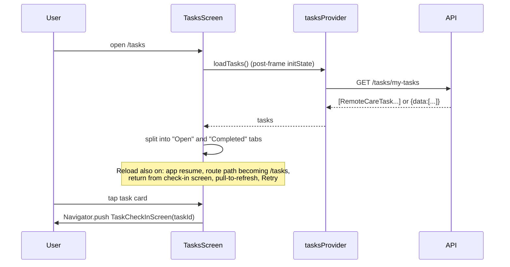
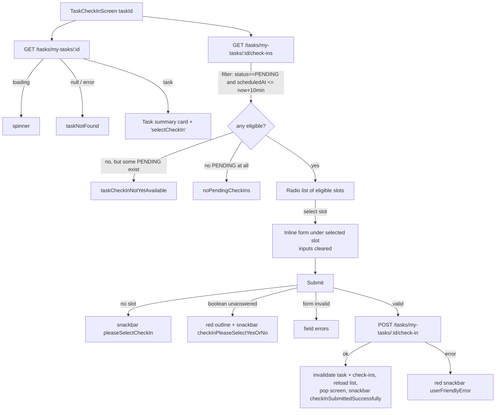

# 12 — Remote Care Tasks (check-ins)

Spec for rebuilding the patient **Remote Care Tasks** feature in Kotlin Multiplatform + Compose Multiplatform. A doctor assigns a patient tasks (vitals, exercise, medication, other). The backend generates scheduled check-in slots, and the patient submits a value (numeric, text or yes/no) plus optional notes for each slot.

Source files:
- `lib/core/models/task_model.dart`
- `lib/features/tasks/data/tasks_repository.dart`
- `lib/features/tasks/providers/tasks_provider.dart`
- `lib/features/tasks/presentation/screens/tasks_screen.dart`
- `lib/features/tasks/presentation/screens/task_check_in_screen.dart`
- `lib/core/widgets/remote_care_task_card.dart` (the Home entry card, see `10-home.md` §3.5)

Legend: `file:line` = Flutter source reference. **UNVERIFIED** = not provable from the client code.

---

## 1. Overview

| Item | Value |
|---|---|
| Routes | `/tasks` → `TasksScreen`; `/tasks/:id/check-in` → `TaskCheckInScreen(taskId:int)` (`lib/app/router.dart:155-156, 574-588`) |
| Shell | Non-persistent `ShellRoute` (persistent bottom bar + app lock) alongside account/chat/notifications (`router.dart:534-590`). The screen state is rebuilt on each visit. |
| Invalid id | `/tasks/abc/check-in` → `int.tryParse` fails → renders `TasksScreen` (`router.dart:580-584`) |
| Auth whitelist | Prefix `/tasks` (`router.dart:114`) |
| Entry points | Home "My Tasks" card → `push /tasks`. Notification taps → `/tasks` or `/tasks/{taskId}/check-in` (§7). |
| Two navigation mechanisms | From the list, the check-in screen is opened with **`Navigator.push(MaterialPageRoute)`**, not GoRouter (`tasks_screen.dart:176-186`). From notifications it is opened via the GoRouter path. |
| Not implemented | Task-level status display, schedule display (times of day, end date, duration), check-in history (completed or missed values), local reminders, server-side status filter. |

---

## 2. User flows

### 2.1 List



### 2.2 Check-in



---

## 3. Screens

### 3.1 `TasksScreen` (`/tasks`)

`ConsumerStatefulWidget` with `SingleTickerProviderStateMixin` + `WidgetsBindingObserver` (`tasks_screen.dart:13-66`).

**Reload triggers** (all call `tasksProvider.loadTasks()` with no status):
| Trigger | Source |
|---|---|
| First frame | `tasks_screen.dart:29` |
| App lifecycle `resumed` | `tasks_screen.dart:38-43` |
| `didChangeDependencies` when the GoRouter path is `/tasks` and differs from the last seen list path (e.g. back from the `/tasks/25/check-in` deep link) | `tasks_screen.dart:45-59` |
| Return from the `Navigator.push`ed check-in screen | `tasks_screen.dart:183-185` |
| Pull-to-refresh (awaited) | `tasks_screen.dart:159-162` |
| Error banner "Retry" | `tasks_screen.dart:129-132` |

**AppBar** (`tasks_screen.dart:92-106`): background = theme primary (`#00BBB0`), foreground white, title `myTasks`. There is no back button customization (the default back arrow appears when pushed). The bottom `TabBar` has a white indicator, white/white70 labels, and tabs `[openTasks, completed]`.

**Tab membership** (`tasks_screen.dart:75-89`):
| Tab | Rule |
|---|---|
| Open (`openTasks`) | `status != COMPLETED && status != CANCELLED`, which includes `DRAFT`, `ACTIVE` **and `EXPIRED`** |
| Completed (`completed`) | `status == COMPLETED` **or** (`status == EXPIRED` and `progress.pendingCheckIns == 0` and `progress.totalCheckIns > 0`) |

Expired tasks with no pending check-ins therefore appear **in both tabs** (quirk). Cancelled tasks never appear; the backend already excludes them (`tasks_provider.dart:40`). List order is the API order; there is no client sort.

**Body states** (`tasks_screen.dart:107-147`):
| Condition | UI |
|---|---|
| `isLoading && tasks.isEmpty` | Full-screen centered spinner (no tabs content) |
| otherwise | Column of optional error banner + `TabBarView` |
| `errorMessage != null` | Banner: `orange.shade50` background, padding 16×8, `warning_amber` icon (orange 800), text = generic `error` (**the actual message is not shown**), `TextButton(retry)` |
| tab list empty | Centered `noTasksFound` text. **There is no RefreshIndicator on the empty state**, so the user cannot pull to refresh an empty tab (quirk). |
| tab list non-empty | `RefreshIndicator` + `ListView.builder`, padding 16 on L/R/T and `16 + safeBottomWithNavBar` at the bottom |

A reload with existing data keeps the old list visible; there is no spinner overlay.

**`_TaskCard`** (`tasks_screen.dart:194-338`): Material `Card` (bottom margin 12) → `InkWell` (radius 12) → padding 16:
1. Row: `taskName` (18 sp bold, expanded) + category chip (padding 8×4, primary at 20% bg, radius 8, text = localized category **UPPERCASED**, primary, 12 sp bold).
   - Category mapping: `VITAL` → `taskCategoryVital`, `EXERCISE` → `taskCategoryExercise`, `MEDICATION` → `taskCategoryMedication`, `OTHER` → `taskCategoryOther`.
2. If `description != null`: 8 dp, then the description (grey 700, 14 sp, unlimited lines).
3. 12 dp. If `progress != null`: `LinearProgressIndicator(value = completed/total or 0; track grey 200; primary)` + 12 dp + `"{completed}/{total}"` (grey 700, 12 sp bold), then 8 dp.
4. Row: `calendar_today` 16 (grey 600), 4 dp, then:
   - `startDate > now` → `"{starts}: {MMM dd, yyyy}"` + 8 dp + an orange badge `upcoming` (orange 100 bg, radius 4, padding 6×2, orange 800, 10 sp bold).
   - else → `"{started}: {MMM dd, yyyy}"`.
   - The date format uses the **current app locale** (`DateFormat('MMM dd, yyyy', locale)`, L221-222).
5. Tap → `Navigator.push(TaskCheckInScreen(taskId))`, then `loadTasks()` on return.

The card is shown and tappable for every status, including DRAFT, EXPIRED and COMPLETED. **Task `status` itself is never rendered.**

### 3.2 `TaskCheckInScreen` (`/tasks/:id/check-in`)

Input: `taskId: Int`. Local state (`task_check_in_screen.dart:20-29`): `_formKey`, controllers for numeric, text and notes, `_booleanValue: Boolean?`, `_isSubmitting`, `_selectedCheckIn: TaskCheckIn?`, `_highlightBooleanRequired`.

Data: `taskByIdProvider(taskId)` and `taskCheckInsProvider(taskId)` load **in parallel** (both watched in `build`, L296-297).

**AppBar**: primary background, white foreground, title `taskCheckIn` (L301-305).

**Task-level states** (`task_check_in_screen.dart:306-313`):
| State | UI |
|---|---|
| loading | centered spinner |
| error | `"{error}: {e}"`. **Unreachable**, because the provider catches everything and returns null |
| `null` (404, network error or parse error) | centered `taskNotFound` |
| task | Content below, in a `RefreshIndicator` (invalidates both providers, **not awaited**) around a `SingleChildScrollView` with padding 16 |

**Content** (`task_check_in_screen.dart:325-433`):
1. Summary `Card` (padding 16): `taskName` (20 sp bold); optional description (grey 700); if progress is present, 16 dp then the progress bar + `"{completed}/{total}"` (bold).
2. 24 dp, heading `selectCheckIn` (18 sp bold, grey 800), 12 dp.
3. Check-ins (`checkInsAsync`):
   - loading → spinner (padding 32).
   - error → `"{error}: {e}"`. **Unreachable**, because the provider returns `[]` on error, which then shows `noPendingCheckIns`.
   - data → eligibility filter (L389-394):
     - `eligible = checkIns.filter { status == PENDING && isWithinAllowedCheckInWindow(now) }`
     - `anyPending = checkIns.any { status == PENDING }`
     - `eligible` empty → centered text (padding 32): `anyPending ? taskCheckInNotYetAvailable : noPendingCheckIns`.
     - else → for each eligible slot, in API order: a slot card, followed by the inline form **directly under the selected slot**.
   - `now` is captured at build time, so a slot becomes eligible only on the next rebuild (pull-to-refresh or another state change). There is no timer.

**Slot card** (`task_check_in_screen.dart:121-159`): `Card` (bottom margin 8), background primary at 10% when selected. Inside is a `RadioListTile<TaskCheckIn>`:
- title = `scheduledDate` formatted `MMM dd, yyyy`. **No locale is passed**, so Intl uses its default locale, which the app never sets (**UNVERIFIED** effective locale; likely `en_US`).
- subtitle = `scheduledTime` formatted `HH:mm` (only if present).
- Selecting a slot sets `_selectedCheckIn` and **clears** the numeric, text and notes fields, `_booleanValue`, and the boolean highlight.

**Inline value form** (`task_check_in_screen.dart:161-290`): padding L/R 8, bottom 16. An `AnimatedContainer` (200 ms) with padding 12, radius 12, fill `surfaceContainerHighest` at 35% opacity. Border: 2 px `colorScheme.error` when a boolean is required but unanswered, otherwise transparent. It wraps a `Form(_formKey)`:

| Element | Shown when | Spec |
|---|---|---|
| Heading | always | `inputLabel.trim()` empty → `checkInEnterGenericValue`; else `checkInEnterLabeledValue` with `{label}` replaced (18 sp bold grey 800) |
| Numeric field | `inputType == NUMERIC` | `TextFormField`, outlined. `labelText = inputLabel ?? checkInEnterGenericValue`. `hintText = exampleValue` ("e.g., 120/80"). `keyboardType = TextInputType.number` (**no decimal flag**, so iOS shows a digits-only pad with no `.`). Validator: null or empty → `checkInValueRequired`; `double.tryParse(value) == null` → `checkInValueInvalidNumber`. |
| Text field | `inputType == TEXT` | `TextFormField`, outlined, `maxLines 3`, label as above. Validator: null or empty (**not trimmed**) → `checkInValueRequired`. No max length. |
| Yes/No | `inputType == BOOLEAN` | Two `RadioListTile<bool>`s: `yes` (true), `no` (false). There is no default selection. |
| Notes | `notesRequired || notesLabel != null` | `TextFormField`, outlined, `maxLines 3`. `labelText = notesLabel ?? additionalNotesOptional`, `hintText = additionalNotesOptional` (says "optional" even when required). Validator only if `notesRequired`: null or empty (not trimmed) → `checkInNotesRequired`. |
| Submit | always | 20 dp, then `ShifaPrimaryButton(label=submitCheckIn, isLoading=_isSubmitting)`, disabled while submitting |

**Submit algorithm** (`task_check_in_screen.dart:47-119`):
1. `_selectedCheckIn == null` → snackbar `pleaseSelectCheckIn`, stop. (This is effectively unreachable because the button only exists after a selection.)
2. If BOOLEAN and `_booleanValue == null` → set the highlight (red outline) + snackbar `checkInPleaseSelectYesOrNo`, stop. Otherwise clear the highlight.
3. `_formKey.validate()`. If invalid, stop (inline errors).
4. `_isSubmitting = true`.
5. `POST /tasks/my-tasks/{taskId}/check-in` with:
   - `checkInId = selected.id`
   - `numericValue = double.tryParse(numericText)` if NUMERIC
   - `textValue = textText.trim()` if TEXT
   - `booleanValue` if BOOLEAN
   - `notes = notesText.trim()` or null when that is empty (**sent for any input type if the user typed notes**)
6. Success:
   - `invalidate(taskByIdProvider(taskId))` and `invalidate(taskCheckInsProvider(taskId))`
   - `tasksProvider.loadTasks()` (not awaited)
   - `Navigator.pop(context)`, then snackbar `checkInSubmittedSuccessfully` (shown on the previous screen's messenger)
7. Failure: red snackbar `userFriendlyError(l10n, e)`. Known backend messages map to keys via `error_localizations.dart:90-93`:
   - `"Boolean value required"` → `checkInPleaseSelectYesOrNo`
   - `"Numeric value required"` → `checkInValueRequired`
   - `"Text value required"` → `checkInValueRequired`
8. `finally`: `_isSubmitting = false`.

After a success the user returns to the previous screen; the check-in screen does not stay open. When opened via a deep link, `Navigator.pop` pops the GoRouter page, returning to `/tasks` (the parent route) (**UNVERIFIED** for cold-start deep links where `/tasks` may not be in the stack).

---

## 4. API endpoints

All paths are relative to `<base>/api`, with a Bearer token, 30 s timeouts, and the global 401 logout rules (see the Core/Networking spec). JSON bodies.

### 4.1 List my tasks
`GET /tasks/my-tasks` (`tasks_repository.dart:12-50`)
- Query: optional `status` = UPPERCASE `TaskStatus` (`DRAFT|ACTIVE|COMPLETED|EXPIRED|CANCELLED`). **The app never sends it** (`loadTasks()` is always called without a status).
- Backend behaviour: returns all patient-visible tasks and excludes CANCELLED (provider comment `tasks_provider.dart:40`; **UNVERIFIED** server-side).
- Response: either a JSON array or an envelope `{ "data": [ ... ] }`. Anything else → `Exception("Unexpected tasks response shape")`.
- Items that aren't objects are skipped. **Items that fail to parse are skipped silently** (e.g. a missing or invalid `startDate` or `createdAt`) (L33-40).
- Example item:
```json
{
  "id": 25,
  "taskName": "Measure blood pressure",
  "description": "Sit for 5 minutes before measuring.",
  "category": "VITAL",
  "status": "ACTIVE",
  "timesPerDay": 2,
  "morningTime": "08:00:00",
  "afternoonTime": null,
  "eveningTime": "20:00:00",
  "startDate": "2026-09-20",
  "endDate": "2026-10-04",
  "durationDays": 14,
  "inputType": "NUMERIC",
  "inputLabel": "Systolic (mmHg)",
  "notesRequired": false,
  "notesLabel": "How do you feel?",
  "createdAt": "2026-09-19T14:03:11",
  "progress": {
    "totalCheckIns": 28,
    "completedCheckIns": 9,
    "pendingCheckIns": 17,
    "missedCheckIns": 2
  }
}
```
Values are illustrative; the key names are what the parser reads. The exact date/time string formats the server emits are **UNVERIFIED**. The parser accepts anything Dart `DateTime.parse` accepts, plus `HH:mm[:ss]` for times.
- Errors: every failure is wrapped as `Exception("Failed to load tasks: <inner>")`, which goes to `state.errorMessage`. The UI shows only the generic `error`.

### 4.2 Get one task
`GET /tasks/my-tasks/{taskId}` (`tasks_repository.dart:52-62`)
- Response: a single task object (same shape as §4.1).
- Errors → `Exception("Failed to load task: …")`. The provider maps any error to `null`, so the UI shows `taskNotFound`.

### 4.3 List check-ins of a task
`GET /tasks/my-tasks/{taskId}/check-ins` (`tasks_repository.dart:64-77`)
- Response: **JSON array** (no envelope support). All slots are returned, whatever their status (**UNVERIFIED**, inferred from the client filtering on PENDING).
```json
[
  {
    "id": 9012,
    "scheduledDate": "2026-09-26",
    "scheduledTime": "08:00:00",
    "status": "PENDING",
    "numericValue": null,
    "textValue": null,
    "booleanValue": null,
    "notes": null,
    "completedAt": null
  }
]
```
- **One bad item fails the whole list.** Unlike tasks, check-ins aren't parsed per item, and `status` must be a non-null string (a null status throws). The provider then returns `[]`, so the UI says `noPendingCheckIns`.

### 4.4 Submit check-in
`POST /tasks/my-tasks/{taskId}/check-in` (`tasks_repository.dart:79-106`)
- Body: null fields are **omitted**, not sent as null:
```json
{ "checkInId": 9012, "numericValue": 128.0, "notes": "Slight headache" }
```
```json
{ "checkInId": 9013, "textValue": "Walked 30 minutes" }
```
```json
{ "checkInId": 9014, "booleanValue": true }
```
- `numericValue` is a JSON number (a Dart double, so `128` is sent as `128.0`).
- Response body: **ignored**. Any 2xx counts as success.
- Errors: `DioException` → a short message is taken from `body.message` (a string under 300 chars, trimmed) or from a string body under 300 chars. Otherwise `"Failed to submit check-in: <httpStatus>"`. Other exceptions → `"Failed to submit check-in: <e>"`. The screen passes the message through `userFriendlyError`.
- Server-side validations known from the client error map: `Boolean value required`, `Numeric value required`, `Text value required` (`error_localizations.dart:90-93`). Other server rules (window enforcement, duplicate submission, notes required) are **UNVERIFIED**.

---

## 5. Data models (`lib/core/models/task_model.dart`)

Plain classes (not Equatable). There is no `toJson`.

### 5.1 Enums (wire values are UPPERCASE, matched case-insensitively)
| Enum | Values | Parse default (null/unknown) | UI mapping |
|---|---|---|---|
| `TaskCategory` | `VITAL`, `EXERCISE`, `MEDICATION`, `OTHER` | `OTHER` (L105-112) | Chip `taskCategoryVital` / `taskCategoryExercise` / `taskCategoryMedication` / `taskCategoryOther`, uppercased |
| `TaskStatus` | `DRAFT`, `ACTIVE`, `COMPLETED`, `EXPIRED`, `CANCELLED` | `ACTIVE` (L96-103) | Tab membership only (§3.1); never displayed |
| `TaskInputType` | `NUMERIC`, `TEXT`, `BOOLEAN` | `TEXT` (L114-121) | Which input the check-in form renders |
| `CheckInStatus` | `PENDING`, `COMPLETED`, `MISSED` | `PENDING` for unknown; **null throws** (L237-240) | Only PENDING slots are selectable |

### 5.2 `RemoteCareTask` (L31-146)
| Field | JSON key | Type | Default / parse | Used in UI |
|---|---|---|---|---|
| `id` | `id` | Int | int, num→int, or `int.parse(string)`. **Required** (throws) | routing, providers |
| `taskName` | `taskName` | String | `?? ""` | card and summary title |
| `description` | `description` | String? | — | card, summary |
| `category` | `category` | TaskCategory | §5.1 | chip |
| `status` | `status` | TaskStatus | §5.1 | tab split |
| `timesPerDay` | `timesPerDay` | Int | `?? 1` | **unused** |
| `morningTime` / `afternoonTime` / `eveningTime` | same | TimeOfDay? | `"HH:mm[:ss]"` → hour and minute; fewer than 2 parts → null; non-numeric throws | **unused** |
| `startDate` | `startDate` | DateTime | **required string**, `DateTime.parse`; otherwise the item is skipped | "Starts/Started" line, `upcoming` badge |
| `endDate` | `endDate` | DateTime? | parse if non-null | **unused** |
| `durationDays` | `durationDays` | Int? | — | **unused** |
| `inputType` | `inputType` | TaskInputType | §5.1 | form |
| `inputLabel` | `inputLabel` | String? | — | form heading and field label |
| `notesRequired` | `notesRequired` | Boolean | `?? false` | notes field + validation |
| `notesLabel` | `notesLabel` | String? | — | notes field visibility and label |
| `createdAt` | `createdAt` | DateTime | **required string**; otherwise the item is skipped | **unused** |
| `progress` | `progress` | TaskProgress? | object or null | progress bar, completed-tab rule |

### 5.3 `TaskProgress` (L148-174)
`totalCheckIns`, `completedCheckIns`, `pendingCheckIns`, `missedCheckIns`: Int, each `?? 0`. `completionPercentage = total == 0 ? 0.0 : completed / total` (range 0..1). `missedCheckIns` is never displayed.

### 5.4 `TaskCheckIn` (L176-252)
| Field | JSON key | Type | Parse |
|---|---|---|---|
| `id` | `id` | Int | as §5.2 |
| `scheduledDate` | `scheduledDate` | DateTime | **required** `DateTime.parse` |
| `scheduledTime` | `scheduledTime` | TimeOfDay? | `"HH:mm[:ss]"` |
| `status` | `status` | CheckInStatus | **required non-null string** |
| `numericValue` | `numericValue` | Double? | num → double |
| `textValue` | `textValue` | String? | — |
| `booleanValue` | `booleanValue` | Boolean? | — |
| `notes` | `notes` | String? | — |
| `completedAt` | `completedAt` | DateTime? | parse if non-null |

Derived:
- `scheduledAt = LocalDateTime(scheduledDate.y/m/d, scheduledTime?.h ?: 0, scheduledTime?.m ?: 0)`, built as a **device-local** wall-clock time from the date's y/m/d components (L188-194).
- `isWithinAllowedCheckInWindow(now) = !scheduledAt.isAfter(now + 10 min)` (L197-200). The patient may submit any PENDING slot that is in the past (no lower bound, so overdue PENDING slots stay submittable) or that starts within the next 10 minutes. The en string for `taskCheckInNotYetAvailable` explains this 10-minute rule.
- The **timezone of server dates and times is UNVERIFIED**. The client assumes they are in the device's local wall clock.

Values of completed check-ins (`numericValue`, `textValue`, `booleanValue`, `notes`, `completedAt`) are parsed but **never shown**.

---

## 6. State management (`lib/features/tasks/providers/tasks_provider.dart`)

| Provider | Type | Behaviour |
|---|---|---|
| `tasksRepositoryProvider` | `Provider<TasksRepository>` | Uses `ref.read(apiClientProvider)` (L60-62) |
| `tasksProvider` | `StateNotifierProvider<TasksController, TasksLoadState>` | `TasksLoadState { tasks = [], isLoading = false, errorMessage: String? }`. `copyWith(clearError)` preserves `errorMessage` unless `clearError` is true or a new one is given (L19-30). `loadTasks({status})`: `isLoading=true, clearError` → success replaces the whole state `{tasks, isLoading=false}` → failure `isLoading=false, errorMessage=e.toString()`, keeping the old tasks (L41-57). |
| `taskByIdProvider` | `FutureProvider.family<RemoteCareTask?, Int>` | Any error → `null` (L69-77) |
| `taskCheckInsProvider` | `FutureProvider.family<List<TaskCheckIn>, Int>` | Any error → `[]` (L79-87) |

- There is **no autoDispose**. Family results stay cached per task id for the app session. Reopening the same task shows the cached task and check-ins (possibly stale) until invalidated. Invalidation happens only on check-in pull-to-refresh and after a successful submit. So a slot that entered the 10-minute window, or a new doctor edit, isn't visible until the user pulls to refresh.
- The list is refreshed aggressively (§3.1 triggers). There is no polling.
- The home card does not read task state.

---

## 7. Cross-feature: notification deep links

`lib/features/notifications/services/notification_tap_handler.dart`:
- Push payload (`getTargetPathFromPayload`, L28-38, 90-99): `taskId` from `data.taskId` or `data.task_id` (int). Types `task_assigned`, `task_reminder` and `task_cancelled` → `/tasks/{taskId}/check-in` if a taskId is present, else `/tasks`. `task_completed` → `/tasks`. Fallback: any type containing `TASK` → the same rule (L130-133, `_isTaskType` L172-173).
- In-app notification list item (L253-256): `TASK_COMPLETED` → `/tasks`; other `TASK*` types → `/tasks/{taskId}/check-in` or `/tasks`.
- `task_cancelled` deep-links into the check-in screen of a cancelled task. The backend's single-task endpoint may still return it (then the user sees no pending check-ins) or 404 (then `taskNotFound`) (**UNVERIFIED**).
- Push payload shape and notification types: see the Notifications spec.

---

## 8. Quirks and tech debt

1. Expired tasks with 0 pending (and total > 0) show in **both** Open and Completed tabs. DRAFT tasks show in Open.
2. The error banner shows only the generic `error` text. The empty tab can't be pulled to refresh.
3. `noTasksFound` exists **only in the uz locale**, so en, ru and de display the literal `noTasksFound`. The de map lacks most task keys and falls back to en.
4. Task and check-in fetch errors are swallowed into `taskNotFound` or `noPendingCheckIns`, with no retry button (pull-to-refresh only). Both `error:` branches in the screen are dead code.
5. One malformed check-in (e.g. null status) hides **all** check-ins.
6. The numeric field uses `TextInputType.number` without a decimal flag, but parses a double. The hint `"e.g., 120/80"` suggests a blood-pressure format that **fails** validation (`/`). A comma decimal (`36,6`, common in uz/ru/de) fails too.
7. The text and notes "required" validators don't trim, so whitespace-only input passes. The submitted text is then `""` (the backend may answer `Text value required`), and whitespace-only notes are sent as null.
8. `RadioListTile.groupValue` compares object identity (`TaskCheckIn` has no `==`). After a pull-to-refresh the selected slot's form stays open (id comparison) but its radio shows unselected.
9. The check-in slot date format ignores the app locale; the list screen respects it.
10. The eligibility window is computed at build time with no timer.
11. Family providers are never auto-disposed, so data can be stale on reopen.
12. Schedule fields (`timesPerDay`, `morning/afternoon/eveningTime`, `endDate`, `durationDays`), `createdAt`, task status, missed counts and check-in history are parsed but unused.
13. Two navigation mechanisms (an imperative `Navigator.push` from the list, a GoRouter path from notifications) lead to different back-stack semantics.
14. `debugPrint` logs task payload counts and errors (no PII beyond ids).
15. Hard-coded English fallbacks (`?? 'e.g., 120/80'`, etc.) are dead code because `translate()` never returns null.

---

## 9. KMP / CMP porting notes

- **commonMain**: `TasksRepository` (Ktor), `TasksViewModel` (`StateFlow<TasksUiState>`) and `TaskCheckInViewModel(taskId)` holding `task`, `checkIns`, `selectedCheckInId`, form fields and `isSubmitting`. Scope the check-in VM to the screen so there is no stale family cache (or add an explicit refresh-on-enter).
- **DTOs**: `@Serializable` with enums using `@SerialName("VITAL")` etc., plus a lenient decoder that falls back to the defaults in §5.1 (`coerceInputValues` + custom enum serializers with an `UNKNOWN` fallback). Parse list items individually and skip failures, to match the tasks behaviour. Consider doing the same for check-ins (an improvement).
  - Dates: `LocalDate.parse` for `startDate`, `endDate` and `scheduledDate`, but accept full date-times too (Dart `DateTime.parse` does). Use `LocalTime.parse` for `HH:mm[:ss]`. `createdAt` and `completedAt` may be `LocalDateTime` or `Instant` (**UNVERIFIED**, so support both).
  - Response envelope: accept both `[...]` and `{"data":[...]}` for `/tasks/my-tasks`.
- **Eligibility**: `scheduledAt = LocalDateTime(date, time ?: 00:00)` in `TimeZone.currentSystemDefault()`. Eligible iff `status == PENDING && scheduledAt <= now + 10.minutes`. Optionally re-evaluate every minute with a ticker flow (an improvement over Flutter).
- **Submit body**: `@Serializable data class CheckInRequest(val checkInId: Long, val numericValue: Double? = null, val textValue: String? = null, val booleanValue: Boolean? = null, val notes: String? = null)` with `explicitNulls = false`, so null keys are omitted exactly like Flutter.
- **Numeric input**: `KeyboardOptions(keyboardType = KeyboardType.Decimal)`. Normalize `,` to `.` before `toDoubleOrNull()` (an improvement). Keep the error keys `checkInValueRequired` and `checkInValueInvalidNumber`.
- **Tabs**: Material3 `PrimaryTabRow` + `HorizontalPager` (2 pages). Wrap each page, including the empty state, in `PullToRefreshBox`.
- **Lifecycle reload**: `LifecycleEventEffect(Lifecycle.Event.ON_RESUME) { vm.load() }` (androidx lifecycle-compose, which is multiplatform) replaces both `WidgetsBindingObserver` and the route-path check. Also reload when the check-in screen returns a result.
- **Navigation**: a single typed route `TaskCheckIn(taskId: Long)` for both list taps and deep links. On success, pop and show the snackbar on the list screen via a result or event channel.
- No platform-specific APIs are needed for this feature (no expect/actual), apart from the shared app-lock and navigation infrastructure.

---

## 10. l10n keys used

TasksScreen: `myTasks`, `openTasks`, `completed`, `error`, `retry`, `noTasksFound` (uz only), `taskCategoryVital`, `taskCategoryExercise`, `taskCategoryMedication`, `taskCategoryOther`, `starts`, `started`, `upcoming`.
TaskCheckInScreen: `taskCheckIn`, `error`, `taskNotFound`, `selectCheckIn`, `taskCheckInNotYetAvailable`, `noPendingCheckIns`, `checkInEnterGenericValue`, `checkInEnterLabeledValue` (placeholder `{label}`), `exampleValue`, `checkInValueRequired`, `checkInValueInvalidNumber`, `yes`, `no`, `additionalNotesOptional`, `checkInNotesRequired`, `submitCheckIn`, `pleaseSelectCheckIn`, `checkInPleaseSelectYesOrNo`, `checkInSubmittedSuccessfully`. Error text comes from `userFriendlyError`, including the three backend-message mappings in §4.4.
Home entry card: `myTasks`, `remoteCareTasks`, `viewAndCompleteAssignedTasks`, `viewTasks` (see `10-home.md`).
