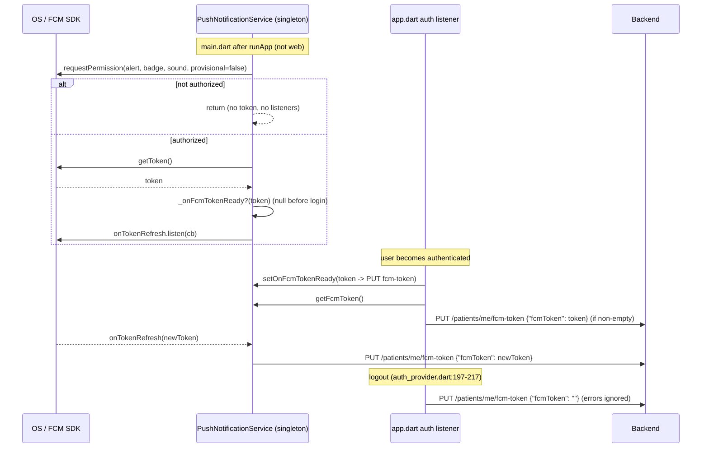
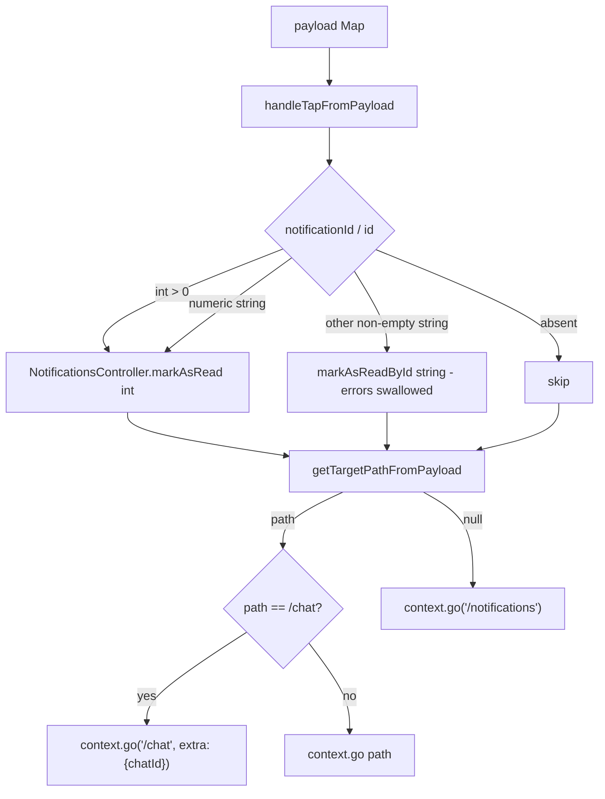
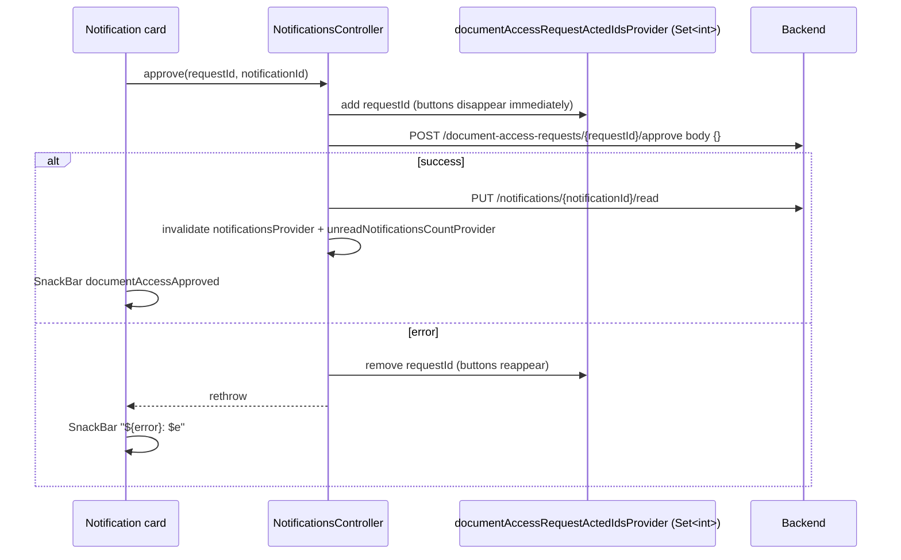

# 13 — Notifications (in-app inbox, FCM push, local reminders)

> Target: KMP + Compose Multiplatform rebuild of the Flutter "Shifa Bemor" patient app.
> Source of truth: the Flutter code at the cited `lib/...:line` locations. Anything not confirmed in code is marked **UNVERIFIED**.
> A stale snapshot of the Spring Boot backend lives in `bin/main/com/shifa/**` (compiled-source copy, last touched Apr 2026). This doc cites it where it clarifies server behaviour. It is older than the production backend: types/fields added later (treatment plans, installments, chat, AI summary, payments) are missing from it.

---

## 1. Overview

The notification system has five parts:

| # | Part | Where | Status |
|---|------|-------|--------|
| 1 | **Server inbox**: list, unread count, mark read, mark all read, approve/reject document-access requests | `lib/features/notifications/**` | Live |
| 2 | **FCM push**: permission, token, foreground/background/terminated delivery, tap routing | `lib/core/services/push_notification_service.dart`, `lib/main.dart`, `lib/app/app.dart`, `lib/app/main_shell.dart` | Live (mobile only) |
| 3 | **Local scheduled reminders**: "video call can be joined" and visit-summary checklist reminders | `lib/core/services/local_notification_service.dart` | Live, triggered from Bookings screens |
| 4 | **Polling service**: 30 s poll that shows an in-app dialog and a tray notification | `lib/core/services/notification_polling_service.dart` | **Dead code**. `startPolling` is never called (`lib/app/app.dart:82-83`, comment "polling disabled") |
| 5 | **Web push**: browser `Notification` API plus a service worker | `lib/core/services/push_notification_web*.dart`, `web/firebase-messaging-sw.js` | **Never initialized**. `main.dart` only initializes push when not on web (`lib/main.dart:62-68`) |

The app does **not** delete notifications. There is no delete endpoint or delete UI anywhere (`lib/features/notifications/data/notifications_repository.dart` has no delete method; the backend snapshot `bin/main/com/shifa/web/NotificationController.kt` has none either).

The unread badge is a one-shot `FutureProvider`. It is **not** polled and **not** refreshed when a push arrives (see §7).

---

## 2. Component map

```
main.dart
 ├─ FirebaseMessaging.onBackgroundMessage(_firebaseMessagingBackgroundHandler)  (:17-21, :49)  → only init Firebase + log
 └─ PushNotificationService().initialize()  (unawaited, after runApp, not web)  (:62-68)
       ├─ requestPermission (alert/badge/sound)         → system prompt AT APP LAUNCH (before login)
       ├─ init FlutterLocalNotificationsPlugin (icon @mipmap/ic_launcher)
       ├─ getToken → _onFcmTokenReady ; onTokenRefresh → _onFcmTokenReady
       ├─ onMessage → _handleForegroundMessage → localized local notification (channel shifa_patient_channel)
       ├─ onMessageOpenedApp → _deliverPayload
       └─ getInitialMessage → stored as pending

app.dart (auth listener)
 ├─ authenticated: setOnFcmTokenReady(PUT /patients/me/fcm-token) + upload current token now   (:95-116)
 └─ unauthenticated: NotificationPollingService.clearShownNotifications()                       (:122)

main_shell.dart (mounted only inside StatefulShellRoute: Home/Bookings/Documents/Doctors tabs)
 ├─ PushNotificationService.setOnNotificationTap → pendingNotificationTapProvider    (:32-45)
 ├─ processPendingInitialMessage()                                                   (:32-45)
 ├─ LocalNotificationService.setOnNotificationTap → pendingNotificationTapProvider   (:48-57)
 └─ ref.listen(pendingNotificationTapProvider) → NotificationTapHandler.handleTapFromPayload → clear (:59-75)

AppHeader → NotificationIconButton (badge) → context.push('/notifications')
NotificationsScreen (/notifications) → NotificationDetailsSheet → context.go(targetRoute)
```

---

## 3. User flows

### 3.1 FCM token lifecycle



- Token upload happens only when the user is authenticated and `Firebase.apps` is non-empty (`lib/app/app.dart:95-116`).
- Race: `initialize()` is not awaited. If auth resolves before `getToken()` returns, `getFcmToken()` is null, and the token is only uploaded later via the `_onFcmTokenReady` callback, which is set at the same time. Both paths lead to the upload.
- Logout clears the server token by sending `""`. The backend stores `null` for a blank token (`bin/main/com/shifa/web/PatientController.kt:127-136`). The local FCM token is **not** deleted (`deleteToken` is never called).

### 3.2 Push delivery by app state

```mermaid
flowchart TD
    A[FCM message: notification{title,body} + data{...}] --> B{App state}
    B -->|Foreground| C[onMessage -> _handleForegroundMessage]
    C --> D{data.notificationId or data.id in _readNotificationIds?}
    D -->|yes| E[drop]
    D -->|no| F[localizedPushText -> localized title/body]
    F --> G[show local notification on channel shifa_patient_channel, payload=jsonEncode data]
    B -->|Background| H[OS tray shows backend title/body - NOT localized]
    H -->|user taps| I[onMessageOpenedApp -> _deliverPayload]
    B -->|Terminated| J[OS tray shows backend title/body]
    J -->|user taps, app cold starts| K[getInitialMessage stored as pending]
    K --> L[MainShell mounts -> processPendingInitialMessage -> _deliverPayload]
    G -->|user taps| M[onDidReceiveNotificationResponse -> jsonDecode payload -> _deliverPayload]
    I --> N[_deliverPayload: remember id in read set; call tap callback or store pending]
    L --> N
    M --> N
    N --> O[pendingNotificationTapProvider = data]
    O --> P[MainShell ref.listen -> NotificationTapHandler.handleTapFromPayload]
    P --> Q[mark read on server] --> R[context.go target route, or /notifications]
```

- The background isolate handler does nothing useful. It only initializes Firebase and logs (`lib/main.dart:17-21`). The tray entry in background/terminated state is drawn by the OS from the FCM `notification` block. The backend always sends one (`bin/main/com/shifa/service/FcmService.kt:49-57`), so that text is the **backend's English title/body, not localized**.
- On Android there is no `com.google.firebase.messaging.default_notification_channel_id` meta-data in the manifest. Background pushes therefore land on the FCM fallback channel ("Miscellaneous") with the launcher icon, not on `shifa_patient_channel`.
- **Gap**: a *local* notification tapped while the app is terminated is not routed, because `getNotificationAppLaunchDetails()` is never called (verified by grep: no usages in `lib/`).

### 3.3 Tap handling (push or local)



Source: `lib/features/notifications/services/notification_tap_handler.dart:178-220`.

### 3.4 Inbox interaction

```mermaid
flowchart TD
    A[Bell icon in AppHeader] -->|context.push| B[/notifications]
    B -->|initState| C[controller.refresh: invalidate list + count]
    B --> D{filter chip}
    D --> E[grouped list by date, newest first]
    E -->|tap card| F{unread and id>0?}
    F -->|yes| G[markAsRead best-effort]
    F --> H[open NotificationDetailsSheet]
    G --> H
    H -->|primary action| I[pop sheet, context.go route]
    H -->|Close| B
    E -->|Approve / Reject on DOCUMENT_ACCESS_REQUEST| J[optimistic acted set + POST approve/reject + markAsRead]
    B -->|done_all| K[PUT read-all + snackbar]
    B -->|settings icon| L["context.push('/account')"]
```

### 3.5 Document access request approve/reject



Source: `lib/features/notifications/providers/notifications_provider.dart:72-139`. Reject is identical, with `/reject` and snackbar `documentAccessRejected`.

---

## 4. Screens and widgets

### 4.1 NotificationsScreen

- **Route**: `/notifications` (`AppRoutes.notifications`, `lib/app/router.dart:130-178`). It sits under the plain `ShellRoute` with `PersistentBottomBar` (`lib/app/router.dart:535-591`). This shell is **not** the state-preserving `StatefulShellRoute`, so the screen rebuilds each visit.
- **Inputs**: none.
- **File**: `lib/features/notifications/presentation/screens/notifications_screen.dart`.

| Area | Behaviour | Source |
|------|-----------|--------|
| Init | `NotificationsController.refresh()` in `initState`, which invalidates the list and count | `:29` |
| AppBar back | `Navigator.canPop` → pop, else `context.go('/home')` | `:45-55` |
| Title | `notifications`, or `"notifications (N)"` when unread > 0 | `:58` |
| Action 1 | `Icons.done_all`, tooltip `markAllAsRead` → `markAllAsRead()` → SnackBar `allNotificationsMarkedAsRead` | `:78-91` |
| Action 2 | `Icons.settings`, tooltip `notificationSettings` → `context.push('/account')`. No dedicated notification settings screen exists | `:92-96` |
| Filter chips | `all` / `appointments` / `documents` / `tasks` (labels `notificationFilterAll/Appointments/Documents/Tasks`) | `:103-133` |
| List | Grouped by date section (`today` / `yesterday` / `MMM d`), items newest first, `RefreshIndicator` pull-to-refresh | `:263-282` |
| Loading | Centered spinner | `:192-225` |
| Error | Text `errorLoadingNotifications`, then the **raw exception string**, then a `retry` button (refresh) | `:192-225` |
| Empty | Icon + `noNotifications` / `notificationEmptyBody`. With a filter active: `notificationEmptyFilter` / `notificationEmptyFilterHint` | `:572-617` |

**Filter predicates** (`lib/features/notifications/presentation/notification_ui_helpers.dart:78-97`), matched on `type.toUpperCase()`:

- `appointments`: type contains `APPOINTMENT`
- `documents`: type contains `DOCUMENT` **or** `SIGNATURE`
- `tasks`: type contains `TASK`
- `all`: everything

**Card** (`notifications_screen.dart:322-570`):

- Leading circle icon; colour and icon come from `styleForNotificationType` (table in §6).
- Title is localized (§6), max 2 lines, bold if unread. Message is localized, max 3 lines. Time uses `formatNotificationTime`.
- Unread cards get a blue dot and a lightly tinted background.
- **Approve/Reject buttons** show when all of these hold:
  - `isDocumentAccessRequest`, meaning type `DOCUMENT_ACCESS_REQUEST` and `documentAccessRequestId != null`
  - `documentAccessRequestStatus` is null or `pending`
  - `documentAccessRequestId` is not in `documentAccessRequestActedIdsProvider`
- Labels are `approve` / `reject`. Result snackbars: `documentAccessApproved` / `documentAccessRejected`, or `"${error}: $e"`.
- **Resolved badge**: shown when the status is `approved` or `rejected`, using the approved/rejected wording.
- **Tap** (`:245-261`): if unread and `id > 0`, call `markAsRead(id)` (best effort, not awaited for navigation), then open `NotificationDetailsSheet`. The card itself never navigates.

**Time formatting** (`notification_ui_helpers.dart:6-34`):

| Age | Output |
|-----|--------|
| < 1 min | `justNow` |
| < 60 min | `minuteAgo` (1) or `minutesAgo` with `%s` replaced by N |
| same calendar day | `HH:mm` |
| yesterday | `timeYesterday` with `{time}` = `HH:mm`. Fallback: `"${yesterday} HH:mm"` |
| older | `MMM d • HH:mm` (intl, current locale) |

Section labels come from `dateSectionLabel` (`:37-48`): `today`, `yesterday`, else `MMM d`.

### 4.2 NotificationDetailsSheet

`lib/features/notifications/presentation/widgets/notification_details_sheet.dart`. It is a modal bottom sheet:

- Drag handle, type icon, localized title, and the line `"<formatNotificationTime> • yyyy-MM-dd HH:mm"`.
- The localized message sits in a scroll area with max height 280 (`:26-37`).
- Buttons:
  - `close` always.
  - A primary action when both `NotificationTapHandler.getTargetLocation(n)` and the action label are non-null. The action pops the sheet, then calls `context.go(route)`. For `/chat` it passes `extra: {'chatId': n.chatId}`.

Action label resolution (`:154-203`), first match wins:

| Condition on type (uppercased) | Label key |
|---|---|
| `TREATMENT_PLAN_*` or `INSTALLMENT_*` | `notificationActionOpenTreatmentPlan` |
| `CONSULTATION_PAYMENT_*` | `notificationActionOpenPayment` |
| `SIGNATURE_REQUESTED` | `notificationActionOpenForm` |
| `PROPHYLAXIS_REMINDER` | `notificationActionOpenBookings` |
| contains `APPOINTMENT` | `notificationActionOpenAppointment` |
| `NEW_DOCUMENT`, `DOCUMENT` | `notificationActionViewDocument` |
| `NEW_MESSAGE`, `CHAT_MESSAGE` | `notificationActionOpenChat` |
| contains `TASK` | `notificationActionOpenTask` |
| `DOCUMENT_ACCESS_APPROVED`, `DOCUMENT_ACCESS_REJECTED` | `notificationActionViewDocument` |
| `AI_VISIT_SUMMARY_READY` / `AI_SCRIBE_READY` | `notificationActionViewSummary` |
| otherwise | `notificationActionOpenDetails` |

The button is only shown if a route also exists. `getTargetLocation` checks rules in this order (`notification_tap_handler.dart:223-278`):

1. access request → null
2. access approved/rejected → documents
3. treatment plan/installment with a plan id
4. prophylaxis → `/bookings`
5. `TREATMENT_PLAN_PAYMENT_REMINDER`
6. signature with a form id
7. tasks
8. AI summary with an appointmentId
9. consultation payment with an appointmentId
10. signature → `/bookings/{appointmentId}`, or null
11. title contains "signature" + appointmentId
12. appointment type + appointmentId
13. any appointmentId without documentId → `/bookings/{appointmentId}`
14. documentId → `/documents/{documentId}`
15. chat with chatId → `/chat`
16. null `DOCUMENT_ACCESS_REQUEST` has route `null`, so it shows no action.

### 4.3 NotificationIconButton (badge)

`lib/core/widgets/notification_icon_button.dart:17-50`, used in `AppHeader` (`lib/core/widgets/app_header.dart:85`):

- Bell icon, white by default.
- Watches `unreadNotificationsCountProvider`. A red badge shows the count, or `9+` when the count is above 9; the badge is hidden at 0 and while loading or on error.
- Tap is supplied by the host screen. Home, Bookings, Doctors and Documents all call `context.push('/notifications')`.

### 4.4 In-app "new notification" dialog (dead)

`lib/app/main_shell.dart:77-147` listens to `pendingNotificationDialogProvider`. That provider is only set by the dead polling service, so the dialog never appears in production:

- Buttons: `close` and `view`.
- `view` → `NotificationTapHandler.handleTap`. For a document-access request it goes to `/notifications`.

The port can skip it.

---

## 5. API endpoints

All paths are relative to `ApiClient` base `…/api` (production `https://shifa-doc-backend-mvp-production.up.railway.app/api`). The JWT bearer is added automatically.

Repository: `lib/features/notifications/data/notifications_repository.dart`. Every method wraps failures as `Exception('Failed to <action>: $e')`, so the raw Dio text reaches the UI error state.

| # | Method + path | Request | Response | Client handling | Source |
|---|---|---|---|---|---|
| 1 | `GET /notifications` | none | JSON array of notification objects (§6.1), newest first (server sorts by `createdAt desc`) | Non-list → `[]`. Each item goes through `NotificationModel.fromJson` | `:10-22` |
| 2 | `GET /notifications/unread/count` | none | `{"count": 3}` | Missing/invalid → `0` | `:25-32` |
| 3 | `PUT /notifications/{id}/read` | none | empty (200) | `markAsRead(int)` and `markAsReadById(String)` hit the same path | `:35-50` |
| 4 | `PUT /notifications/read-all` | none | empty (200) | | `:53-59` |
| 5 | `POST /document-access-requests/{requestId}/approve` | `{}` | ignored | | `:62-77` |
| 6 | `POST /document-access-requests/{requestId}/reject` | `{}` | ignored | | `:62-77` |
| 7 | `PUT /patients/me/fcm-token` | `{"fcmToken": "<FCM registration token>"}` or `{"fcmToken": ""}` to clear | 204 | Called from `app.dart` and logout | `:81-87` |

Server-side (stale snapshot, `bin/main/com/shifa/web/NotificationController.kt`):

- Mark read on a notification that isn't yours → **403** "Notification does not belong to you". An unknown id → **404**.
- The ApiClient does not log out on 403.
- The list DTO also carries `patientName`, `documentTitle` and `requestingDoctorName` for access requests (`:38-52`). The Flutter client **ignores** these and re-parses the English `message` text instead (§6.3). The port should prefer these fields when present.

Example `GET /notifications` item, using the keys the client reads:

```json
{
  "id": 1234,
  "title": "Appointment reminder",
  "message": "Your appointment with Dr. X is tomorrow at 10:00",
  "type": "APPOINTMENT_REMINDER",
  "appointmentId": 55,
  "patientFormId": null,
  "documentAccessRequestId": null,
  "documentAccessRequestStatus": null,
  "taskId": null,
  "treatmentPlanId": null,
  "documentId": null,
  "chatId": null,
  "doctorName": "Dr. X",
  "data": { "appointmentId": 55 },
  "createdAt": "2026-08-01T09:00:00Z",
  "readAt": null
}
```

---

## 6. Data models

### 6.1 NotificationModel

File: `lib/core/models/notification_model.dart`. The class extends Equatable.

| Field | Type | JSON keys read by `fromJson` (first non-null wins) | Default / notes |
|---|---|---|---|
| `id` | int | `id` | **required** (hard cast; a null id crashes the parse of the whole list) |
| `title` | String | `title` | **required** (hard cast) |
| `message` | String | `message` | **required** (hard cast) |
| `type` | String | `type` | **required**. Kept as sent (enum name); comparisons uppercase it |
| `appointmentId` | int? | `appointmentId`, `appointment_id`, `data.appointmentId`, `data.appointment_id` | int, num or numeric string accepted (`_optionalInt`) |
| `patientFormId` | int? | `patientFormId`, `patient_form_id`, `data.*` same | used for the signature flow |
| `documentAccessRequestId` | int? | `documentAccessRequestId`, `document_access_request_id` | top level only |
| `documentAccessRequestStatus` | String? | `documentAccessRequestStatus`, `document_access_request_status` | top level only. Values `PENDING` / `APPROVED` / `REJECTED` (server enum name); compared case-insensitively |
| `taskId` | int? | `taskId`, `task_id`, `data.*` | |
| `treatmentPlanId` | int? | `treatmentPlanId`, `treatment_plan_id`, `data.*` | |
| `documentId` | String? | `documentId`, `document_id`, `data.*` (toString) | kept as a String |
| `chatId` | String? | `chatId`, `chat_id`, `data.*` (toString) | |
| `doctorName` | String? | `doctorName`, `doctor_name`, `data.*` | fills `{doctorName}` in the signature message |
| `createdAt` | DateTime | `createdAt` | **required**, `DateTime.parse` (ISO-8601, server sends `Instant.toString()` e.g. `2026-08-01T09:00:00.123Z`) |
| `readAt` | DateTime? | `readAt` | null means unread |

Parsing lines: `fromJson` at `:59-93`, `toJson` at `:171-189` (camelCase keys, dates as ISO strings).

Derived getters:

- `isRead` = `readAt != null`.
- `isDocumentAccessRequest` = `type == 'DOCUMENT_ACCESS_REQUEST' && documentAccessRequestId != null`.
- `isDocumentAccessRequestPending` = status null or `'pending'` (case-insensitive) (`:50-57`).

### 6.2 FCM data payload

The backend builds this (stale snapshot, `bin/main/com/shifa/service/FcmService.kt:71-96`). All values are strings:

```json
{
  "notification": { "title": "<backend title>", "body": "<backend message>" },
  "data": {
    "id": "1234",
    "title": "<backend title>",
    "message": "<backend message>",
    "type": "APPOINTMENT_REMINDER",
    "createdAt": "2026-08-01T09:00:00Z",
    "appointmentId": "55",
    "documentAccessRequestId": "77",
    "taskId": "9"
  }
}
```

`appointmentId`, `documentAccessRequestId` and `taskId` are only present when set. `extraData` can add more keys, but no caller in the snapshot passes any.

The client also accepts a newer "standardized" form, through `NotificationModel.fromFcmData` (`:105-152`) and `NotificationTapHandler`. Keys the client reads from push/local payloads:

| Key | Meaning |
|---|---|
| `notificationId` or `id` | Server notification id, used for mark-read, the dedupe set and the local notification id |
| `type` | Type string. Uppercased with `-` → `_`. Default `GENERAL` |
| `entityId` | Generic target id, mapped by type (below) |
| `appointmentId` / `appointment_id` | |
| `patientFormId` / `patient_form_id` | |
| `documentId` / `document_id` | |
| `chatId` / `chat_id` | |
| `taskId` / `task_id` | |
| `treatmentPlanId` / `treatment_plan_id` | |
| `documentAccessRequestId` / `document_access_request_id` | |
| `doctorName` / `doctor_name` | |
| `title`, `message` | Backend text, used as the fallback |
| `createdAt` / `created_at` | Default: now |
| `route` | Explicit in-app path. Last-resort routing target (local reminders use it) |

`entityId` mapping in `fromFcmData`, first match wins:

1. Type contains `APPOINTMENT` → `appointmentId`
2. Type is `TREATMENT_PLAN*` or `INSTALLMENT_*` → `treatmentPlanId`
3. Type contains `DOCUMENT` but not `ACCESS`, or the raw type contains "document" (this also catches `DOCUMENT_ACCESS_*`) → `documentId`
4. Type contains `MESSAGE`/`CHAT` → `chatId`
5. Type contains `TASK` → `taskId`

### 6.3 Type catalogue: localization, style, routing

The client knows the types below. The stale backend enum only has `APPOINTMENT_CANCELLED, APPOINTMENT_CHANGED, APPOINTMENT_REMINDER, APPOINTMENT_ASSIGNED, SIGNATURE_REQUESTED, TASK_REMINDER, TASK_COMPLETED, DOCUMENT_ACCESS_REQUEST, DOCUMENT_ACCESS_APPROVED, DOCUMENT_ACCESS_REJECTED, TASK_ASSIGNED, TASK_CANCELLED, GENERAL` (`bin/main/com/shifa/domain/Notification.kt:46-60`). All other types are sent by the newer production backend, so they are **UNVERIFIED** against the server but handled by the client.

Title and message keys come from `NotificationLocalization.getTitleForType` / `getMessage` (`lib/features/notifications/utils/notification_localization.dart:14-87`, `:122-197`). The **Push route** column shows `getTargetPathFromPayload(data)`, used for push and local taps (`notification_tap_handler.dart:29-141`). The **Sheet route** column shows `getTargetLocation(model)`, used by the details sheet (`:223-278`).

| Type(s) | Title key | Message key | Push route (id = `entityId ?? appointmentId ?? documentId ?? chatId`) | Sheet route |
|---|---|---|---|---|
| `APPOINTMENT_CANCELLED`, `APPOINTMENT_CANCELLED_BY_PATIENT` | `appointmentCancelledTitle` | `notificationMessageCancelled` | `/bookings/{id}` | `/bookings/{appointmentId}` |
| `APPOINTMENT_CHANGED`, `APPOINTMENT_RESCHEDULED_BY_PATIENT` | `appointmentChangedTitle` | `notificationMessageChanged` | `/bookings/{id}` | `/bookings/{appointmentId}` |
| `APPOINTMENT_REMINDER`, `APPOINTMENT_UPCOMING`, `APPOINTMENT_SOON`, `APPOINTMENT_CLOSE` | `appointmentReminderTitle` | `notificationMessageReminder` | `/bookings/{id}` | `/bookings/{appointmentId}` |
| `APPOINTMENT_SCHEDULED`, `NEW_APPOINTMENT`, `APPOINTMENT_ASSIGNED`, `APPOINTMENT_BOOKED_BY_PATIENT` | `newAppointmentScheduledTitle` | `notificationMessageScheduled` | `/bookings/{id}`. `appointment_scheduled`/`appointment_confirmed` hit the switch; the others hit the uppercase fallback (type contains `APPOINTMENT`) | `/bookings/{appointmentId}` |
| `SIGNATURE_REQUESTED` | `signatureRequestedTitle` | `signatureRequestedMessage` (`{doctorName}`, fallback `doctor`) | `/bookings/sign-form/{patientFormId}`, else `/bookings/{id}` | `/bookings/sign-form/{patientFormId}`, else `/bookings/{appointmentId}` |
| `CONSULTATION_PAYMENT_REMINDER` | `consultationPaymentReminderTitle` | `consultationPaymentReminderMessage` | `/bookings/{id}/pay` | `/bookings/{appointmentId}/pay` |
| `CONSULTATION_PAYMENT_DUE_24H` / `_DUE_6H` / `_DUE_1H` | `consultationPaymentReminderTitle` | `consultationPaymentDue24hMessage` / `…Due6hMessage` / `…Due1hMessage` | `/bookings/{id}/pay` | `/bookings/{appointmentId}/pay` |
| `DOCUMENT_ACCESS_REQUEST` | `documentAccessRequestTitle` | `documentAccessRequestMessage` (`{requesterName}`, `{fileName}`, `{patientName}` parsed from the backend English text `X requested access to "Y" for Z.`; raw message if parsing fails; `:200-228`) | no specific rule → `data.route` or `/notifications` | `null` (no action; approve/reject inline) |
| `DOCUMENT_ACCESS_APPROVED` / `DOCUMENT_ACCESS_REJECTED` | `documentAccessApprovedTitle` / `documentAccessRejectedTitle` | `documentAccessApprovedMessage` / `documentAccessRejectedMessage` | `/documents/{id}`, else `/documents` | `/documents/{documentId}`, else `/documents` |
| `INSTALLMENT_DUE_SOON` / `_DUE_TODAY` / `_OVERDUE` / `INSTALLMENT_SCHEDULE_CREATED` | `notificationInstallment{DueSoon,DueToday,Overdue,ScheduleCreated}Title` | `…Message` | `/bookings/treatment-plan/{treatmentPlanId}` | same, if a plan id exists |
| `TREATMENT_PLAN_PAYMENT_REMINDER` | `treatmentPlanPaymentReminderTitle` | `treatmentPlanPaymentReminderMessage` | plan route, else `/bookings` | plan route, else `/bookings` |
| `TREATMENT_PLAN_UPDATED` | `treatmentPlanUpdatedTitle` | `treatmentPlanUpdatedMessage` | `/bookings/treatment-plan/{treatmentPlanId}` | same |
| `PROPHYLAXIS_REMINDER` | `prophylaxisReminderTitle` | `prophylaxisReminderMessage` | `/bookings` | `/bookings` |
| `AI_VISIT_SUMMARY_READY`, `AI_SCRIBE_READY` | `visitSummaryReadyTitle` | `visitSummaryReadyMessage` | `AI_VISIT_SUMMARY_READY` → `/bookings/{id}/visit-summary`. `AI_SCRIBE_READY` has **no push rule**: it falls through to `/documents/{documentId}` (if present), then `data.route`, then `/notifications` | `/bookings/{appointmentId}/visit-summary` |
| `CHAT_MESSAGE`, `NEW_MESSAGE` | `chatNewMessageTitle` | `chatNewMessageMessage` | `/chat` with `extra {chatId}` (the chat conversation is not opened directly; see the Chat doc for how `extra.chatId` is consumed) | `/chat` (if chatId) |
| `TASK_ASSIGNED`, `TASK_REMINDER`, `TASK_CANCELLED` | `task{Assigned,Reminder,Cancelled}Title` | `…Message` | `/tasks/{taskId}/check-in`, else `/tasks` | same |
| `TASK_COMPLETED` | `taskCompletedTitle` | `taskCompletedMessage` | `/tasks` | `/tasks` |
| `NEW_DOCUMENT`, `DOCUMENT` | `newDocumentTitle` | `newDocumentMessage` | `/documents/{id}` | `/documents/{documentId}` |
| anything else (`GENERAL`, …) | backend `title` (or `defaultNotificationTitle` if empty). If the backend title contains "signature", the signature keys are used instead | backend `message` | `data.route` (a `/` is prepended if missing), else `/notifications` | `/bookings/{appointmentId}` if appointmentId and no documentId; `/documents/{documentId}` if documentId; else null |
| local `video_join_ready` | (set by caller) | (set by caller) | `data.route` = `/bookings/{id}/video` | n/a |
| local `visit_summary_checklist_reminder` | (set by caller) | checklist item | `data.route` = `/bookings/{id}/visit-summary` | n/a |

Routing notes:

- `getTargetPathFromPayload` lowercases the type and runs a `switch` of exact matches. If nothing returns, it runs fallbacks in this order (`:102-133`):
  1. `SIGNATURE_REQUESTED` + `patientFormId` → sign-form
  2. `AI_VISIT_SUMMARY_READY` → visit-summary
  3. consultation payment → `/pay`
  4. `TREATMENT_PLAN*`/installment + plan id → plan
  5. `PROPHYLAXIS_REMINDER` → `/bookings`
  6. type contains `APPOINTMENT` or is `SIGNATURE_REQUESTED`, with an id → `/bookings/{appointmentId ?? id}`
  7. `documentId` and type without `ACCESS` → `/documents/{documentId}`
  8. `NEW_MESSAGE`/`CHAT_MESSAGE` with chatId or entityId → `/chat`
  9. type contains `TASK` → check-in or `/tasks`
  10. `data['route']` (a `/` is prepended if missing)
  11. `null`, which the caller turns into `/notifications`
- The generic `id` is `entityId ?? appointmentId ?? documentId ?? chatId`. Quirk: a `DOCUMENT_ACCESS_APPROVED` push that carries `appointmentId` but no `entityId` would route to `/documents/{appointmentId}`.
- `consultation_payment_*` wins over the generic appointment rule.
- The target routes belong to other features: Bookings (`/bookings/:id`, `/pay`, `/visit-summary`, `/video`, `/sign-form/:formId`, `/treatment-plan/:planId`), Documents (`/documents/:id`), Tasks (`/tasks/:id/check-in`) and Chat (`/chat`). See their docs.

**Icon/colour** (`notification_ui_helpers.dart:51-75`):

| Match | Colour | Material icon |
|---|---|---|
| `APPOINTMENT_CANCELLED` | `0xFFC62828` | `event_busy` |
| other types containing `APPOINTMENT` | `0xFF1976D2` | `calendar_today` |
| `SIGNATURE_REQUESTED` | `0xFF6A1B9A` | `draw` |
| `DOCUMENT_ACCESS_REQUEST` | `0xFF00897B` | `lock_open` |
| `TASK_ASSIGNED`, `TASK_REMINDER` | `0xFFF9A825` | `assignment` |
| `TASK_CANCELLED` | `0xFF616161` | `cancel` |
| default | `0xFF616161` | `notifications` |

### 6.4 Template placeholders

| Key | Placeholders | English sample |
|---|---|---|
| `signatureRequestedMessage` | `{doctorName}` | "{doctorName} is requesting your signature for the appointment summary." |
| `documentAccessRequestMessage` | `{requesterName}`, `{fileName}`, `{patientName}` | "{requesterName} requested access to {fileName} for {patientName}." |
| `minutesAgo` | `%s` | "%s minutes ago" |
| `timeYesterday` | `{time}` | "Yesterday {time}" |

The other message keys are static sentences; they do not interpolate appointment data. Full strings in all four languages are in the strings export (`docs/kmp-spec/strings/`).

---

## 7. State management (Riverpod)

File: `lib/features/notifications/providers/notifications_provider.dart`.

| Provider | Kind | Purpose | Source |
|---|---|---|---|
| `notificationsRepositoryProvider` | Provider | Repository(ApiClient) | `:46` |
| `localNotificationServiceProvider` | Provider | `LocalNotificationService()` singleton | `:51` |
| `notificationsProvider` | FutureProvider<List<NotificationModel>> | Inbox list. Cached until invalidated. **No polling** | `:55-58` |
| `unreadNotificationsCountProvider` | FutureProvider<int> | Badge count. Cached until invalidated. **No polling** | `:60-63` |
| `documentAccessRequestActedIdsProvider` | StateProvider<Set<int>> | Optimistic hide of approve/reject buttons | `:70` |
| `pendingNotificationTapProvider` | StateNotifier<Map?> | Bridge from push/local callbacks to the router | `:29-44` |
| `pendingNotificationDialogProvider` | StateNotifier<NotificationModel?> | In-app dialog (dead) | `:11-26` |
| `notificationsControllerProvider` | Provider<NotificationsController> | Imperative actions | `:72-139` |

`NotificationsController`:

- `markAsRead(int id)`: API call, invalidate list and count, then `LocalNotificationService.cancelNotification(id)`. This removes the tray entry, since the tray id equals the server id.
- `markAsReadById(String)`: same API call; **errors are swallowed**.
- `markAllAsRead()`: API call, then invalidate both.
- `refresh()`: invalidate both.
- `approve` / `reject`: see §3.5.

**When the badge refreshes**: only on `NotificationsScreen` init, pull-to-refresh, mark read, mark all, approve/reject, and tap handling. A foreground push does **not** refresh it, and neither does app resume or re-login. On logout the providers are not reset, but they are account-agnostic FutureProviders, so a new user's first visit to the inbox refetches. The badge may still show the previous user's count until then. **UNVERIFIED** whether any global invalidation on logout resets them; none was found in `auth_provider.dart:197-217`.

---

## 8. Local notifications

### 8.1 Channels

| Channel id | Name | Description | Importance | Created by | Source |
|---|---|---|---|---|---|
| `shifa_patient_channel` | `l10n.notificationChannelName` ("Shifa Patient Notifications") | `l10n.notificationChannelDescription` ("Notifications for messages, appointments, and tasks") | high / priority high | Foreground FCM display | `lib/core/services/push_notification_service.dart:156-174` |
| `appointments_channel` | "Appointment Notifications" (hardcoded English) | "Notifications for appointment updates" (hardcoded English) | high / priority high | Scheduled reminders | `lib/core/services/local_notification_service.dart:96-99, 153-156, 205-208` |

iOS details are `presentAlert/Badge/Sound = true`. Android init icon is `@mipmap/ic_launcher` (`push_notification_service.dart:195`).

Channel names are localized once per language. `PushNotificationService` caches the `NotificationDetails` per language. `setLanguage` calls `refreshLocalizationCache()` (`lib/core/providers/language_provider.dart:106-123`), and the cache is warmed from SharedPreferences `app_language` (default `en`) at init. Android channel names are fixed at first creation, so a later language change does not rename an existing channel (**UNVERIFIED**; this is Android platform behaviour).

### 8.2 Foreground push → local notification

- **ID**: `int(data.notificationId ?? data.id)`. If missing or 0, use `now_ms % 100000`. The result is clamped to `1..0x7FFFFFFF` (`push_notification_service.dart:268-287`).
- **Payload**: `jsonEncode(data)`.
- **Dedupe**: `_readNotificationIds` (max 128, FIFO eviction) holds ids the user already *tapped* this process lifetime (`:60-63, :116-138`). It only prevents re-showing a banner for an already-opened notification. It is not a general duplicate filter, and it is not persisted.
- On iOS the app does not call `setForegroundNotificationPresentationOptions`, so FCM does not show its own banner in foreground; the app's local notification is the only one. Android behaves the same for foreground. There is no double banner.
- **UNVERIFIED**: whether local notifications actually display in the iOS foreground. `ios/Runner/AppDelegate.swift` does not set `UNUserNotificationCenter.current().delegate`; the flutter_local_notifications docs recommend setting it.

### 8.3 Scheduled reminders (owned by the Bookings doc, listed here for the platform layer)

| Method | Trigger | Notification id | Title / body | Payload | Caller |
|---|---|---|---|---|---|
| `scheduleVideoJoinReminder` | appointment start − 5 min. Skipped if in the past (`:146-147`) | `800000 + (appointmentId.hashCode % 100000).abs()` | caller-provided: `videoCallYouCanJoinNow` as both title and body | `{"route":"/bookings/{id}/video","type":"video_join_ready","appointmentId":"{id}"}` | `lib/features/bookings/presentation/screens/appointment_details_screen.dart:225` |
| `scheduleChecklistReminder` | user-picked date/time (default now + 1 h) | `(appointmentId.hashCode ^ item.hashCode).abs() % (0x7FFFFFFF-1) + 1` | title `visitSummaryChecklistReminderTitle`, body = checklist item text | `{"route":"/bookings/{id}/visit-summary","type":"visit_summary_checklist_reminder","appointmentId":"{id}","item":"…"}` | `lib/features/bookings/presentation/screens/visit_summary_screen.dart:123` |

- Both use `zonedSchedule` with `AndroidScheduleMode.inexactAllowWhileIdle`, so no exact-alarm permission is needed and delivery may drift by minutes. The timezone comes from `FlutterTimezone.getLocalTimezone()`, falling back to `tz.local` (`:20-30`).
- `LocalNotificationService.initialize()` runs lazily on first schedule. It calls Android 13 `requestNotificationsPermission()` and iOS `requestPermissions` (`:34-76`).
- Dart `String.hashCode` is not stable across runs or platforms. The port should use a deterministic hash, e.g. the numeric appointment id.
- `cancelNotification(id)` / `cancelAllNotifications()` exist. Nothing cancels a video reminder when an appointment is cancelled (**UNVERIFIED**; no caller found).

---

## 9. Polling service (dead, documented for completeness)

`lib/core/services/notification_polling_service.dart`:

- `startPolling(interval = 30s)` fetches the list and filters unread ids not yet in SharedPreferences `shown_notification_ids` (a JSON int list, pruned when it exceeds 100).
- For new items it sets `pendingNotificationDialogProvider` to the first one, shows tray notifications, and persists the ids.
- Tray payload keys: `notificationId, type, entityId, appointmentId, documentId, chatId, taskId`.
- `clearShownNotifications()` is still called on logout (`lib/app/app.dart:122`), but **`startPolling` has no callers**.

**Port recommendation**: drop it. If an in-app refresh is wanted, poll `GET /notifications/unread/count` while the app is foregrounded, and refresh the badge on push receipt.

---

## 10. Platform configuration

**Android**:

- `android/app/src/main/AndroidManifest.xml` has `POST_NOTIFICATIONS`. The app label is "Shifa Bemor"; `MainActivity` is `singleTop` (a plain `FlutterActivity`).
- Missing meta-data:
  - no `default_notification_channel_id`
  - no `default_notification_icon`
  - no `default_notification_color`
- Package: `applicationId` / namespace `com.shifa.patientapp`, minSdk 24, `com.google.gms.google-services` plugin, `google-services.json` in `android/app/` (do not copy; obtain from the Firebase console).

**iOS**:

- Bundle id `uz.shifa.patient`. `Runner.entitlements` sets `aps-environment = development`; **release builds need `production`** (check the signing/provisioning setup).
- `Info.plist` `UIBackgroundModes` = `fetch`, `remote-notification`.
- `AppDelegate.swift` is the plain Flutter template: no notification-center delegate, no explicit APNs registration code (firebase_messaging swizzling handles it; **UNVERIFIED** that `FirebaseAppDelegateProxyEnabled` isn't disabled).
- `GoogleService-Info.plist`: do not copy.

**Web**:

- `web/firebase-messaging-sw.js` configures Firebase project `shifa-doctor-staging`. Background `showNotification` uses fallback title "Shifa Bemor". The config values are not reproduced here.
- `push_notification_web.dart` uses the browser Notification API with icon `/icons/Icon-192.png`; clicking focuses the window.
- None of this is initialized, because `main.dart` skips push on web.

**Permission timing**: the OS prompt fires at **app launch**, before login and without any rationale screen (`lib/main.dart:62-68` → `initialize()` → `requestPermission`). If the user denies, `initialize()` returns early: no token, no `onMessage` listener, no tap listeners. **Even later-granted permission is not picked up until the next cold start.**

---

## 11. KMP / CMP porting notes

1. **Push SDK**: use native FCM on Android (`FirebaseMessagingService`) and FCM or APNs on iOS through the Firebase iOS SDK. Wrap them in `expect/actual PushPlatform` with `requestPermission()`, `token(): Flow<String>`, `foregroundMessages(): Flow<Map<String,String>>`, `openedMessages(): Flow<Map<String,String>>` and `initialMessage()`. GitLive `firebase-messaging` is an alternative, but its iOS support is thin; prefer native plus a thin bridge.
2. **Keep the wire format**: `PUT /patients/me/fcm-token {"fcmToken": "..."}` on login and on token refresh, and `""` on logout. Do the logout call **before** clearing the JWT.
3. **Permission UX**: move the prompt after login, or behind a rationale. Re-check authorization on resume, and register listeners regardless of the permission result so that later grants work.
4. **Channels**: create `shifa_patient_channel` (and a reminder channel) at app start, and set `default_notification_channel_id` in the manifest so background pushes land in it. Give the reminder channel localized names.
5. **Background localization**: the tray text in background/terminated state is the backend's English. To localize it, the backend must send data-only messages (Android) plus `mutable-content` with a Notification Service Extension (iOS), or send localized text by the user's `language`. This needs backend coordination; otherwise keep the current behaviour.
6. **Tap routing**: implement `resolvePushRoute(data): String?` and `resolveInboxRoute(model): String?` as pure common-code functions mirroring the §6.3 table, with unit tests. Buffer taps until the navigation host and auth are ready. This replaces `pendingNotificationTapProvider`. The port must also handle a *local* notification tapped from the terminated state (Android intent extras, iOS `UNNotificationResponse`), which the Flutter app misses.
7. **Inbox state**: use one `NotificationsStore` (StateFlow) holding `items`, `unreadCount`, `filter`, `loading`, `error` and `actedAccessRequestIds`. Refresh the count on push receipt and on app resume.
8. **Mark read on tap**: call the API, then cancel the tray notification whose id equals the server id. Keep tray id = server id for this.
9. **Scheduled reminders**: use Android `AlarmManager.setAndAllowWhileIdle` or WorkManager, and iOS `UNCalendarNotificationTrigger`/`UNTimeIntervalNotificationTrigger`. Use deterministic ids, e.g. `800000 + appointmentId`.
10. **Time formatting**: use kotlinx-datetime with a locale-aware formatter for `MMM d • HH:mm`.
11. **Access-request text**: prefer the DTO fields `requestingDoctorName`, `documentTitle` and `patientName` over parsing the English message.
12. **Web**: out of scope unless required. The current web build has no working push.

---

## 12. Quirks and tech debt

1. **Dead polling and dialog**: `NotificationPollingService.startPolling` has no callers, so the `pendingNotificationDialogProvider` dialog in `MainShell` never fires (`lib/app/app.dart:82-83`, `lib/app/main_shell.dart:77-147`).
2. **No delete** anywhere (neither API nor UI), even though the task scope mentioned it.
3. **Stale badge**: count is a cached FutureProvider, refreshed only by the inbox screen and notification actions (§7).
4. **Permission requested before login** with no rationale; a denial disables all push handling until the next cold start (§10).
5. **Background pushes are not localized** and use the FCM fallback channel on Android (no default channel meta-data).
6. **Local-notification taps from terminated state are lost**: `getNotificationAppLaunchDetails` is never used.
7. **Plugin double init**: `PushNotificationService` and `LocalNotificationService` each call `FlutterLocalNotificationsPlugin.initialize` on the same plugin singleton. The last call wins `onDidReceiveNotificationResponse`. Both handlers end in `pendingNotificationTapProvider`, but the Local one skips `_deliverPayload`, so the read-id dedupe set isn't updated.
8. **MainShell scope**: the tap listener lives in `MainShell`, which is only mounted for the Home/Bookings/Documents/Doctors tabs (StatefulShellRoute). If a push is opened while the user is on `/account`, `/chat`, `/notifications` or `/tasks`, the callback may reference a disposed `ref` → **UNVERIFIED** whether the tap is dropped or throws.
9. **Hard casts in `fromJson`**: a single item with null `title`/`message`/`type`/`createdAt` makes the whole list fail. The port should skip bad items instead.
10. **Error UI shows raw exception text** (`Exception: Failed to load notifications: DioException …`).
11. **`markAsReadById` swallows errors**; `markAsRead` errors in the card tap are ignored (best effort).
12. **Settings icon** in the inbox opens `/account`; no notification preferences exist.
13. **`appointments_channel`** name and description are hardcoded English.
14. **`String.hashCode`-based local ids** are not stable across runs, so scheduled reminders cannot be reliably cancelled by recomputing the id.
15. **iOS `aps-environment=development`** in the checked-in entitlements.
16. **`subscribeToTopic` / `unsubscribeFromTopic`** are defined but unused.
17. **Backend enum drift**: the client handles about 20 more types than the (stale) backend enum. Production types are **UNVERIFIED**; confirm the list with the backend team.

---

## 13. l10n keys used

Inbox, sheet, dialog and badge:
`notifications`, `markAllAsRead`, `allNotificationsMarkedAsRead`, `notificationSettings`, `notificationFilterAll`, `notificationFilterAppointments`, `notificationFilterDocuments`, `notificationFilterTasks`, `errorLoadingNotifications`, `retry`, `noNotifications`, `notificationEmptyBody`, `notificationEmptyFilter`, `notificationEmptyFilterHint`, `approve`, `reject`, `documentAccessApproved`, `documentAccessRejected`, `error`, `close`, `view`, `back`, `today`, `yesterday`, `justNow`, `minuteAgo`, `minutesAgo`, `timeYesterday`, `notificationCannotOpen`, `notificationActionOpenAppointment`, `notificationActionOpenBookings`, `notificationActionOpenChat`, `notificationActionOpenDetails`, `notificationActionOpenForm`, `notificationActionOpenPayment`, `notificationActionOpenTask`, `notificationActionOpenTreatmentPlan`, `notificationActionViewDocument`, `notificationActionViewSummary`.

Type titles and messages:
`defaultNotificationTitle`, `pushNewNotification`, `doctor`, `appointmentCancelledTitle`, `appointmentChangedTitle`, `appointmentReminderTitle`, `newAppointmentScheduledTitle`, `notificationMessageCancelled`, `notificationMessageChanged`, `notificationMessageReminder`, `notificationMessageScheduled`, `signatureRequestedTitle`, `signatureRequestedMessage`, `consultationPaymentReminderTitle`, `consultationPaymentReminderMessage`, `consultationPaymentDue24hMessage`, `consultationPaymentDue6hMessage`, `consultationPaymentDue1hMessage`, `documentAccessRequestTitle`, `documentAccessRequestMessage`, `documentAccessApprovedTitle`, `documentAccessApprovedMessage`, `documentAccessRejectedTitle`, `documentAccessRejectedMessage`, `notificationInstallmentDueSoonTitle`, `notificationInstallmentDueSoonMessage`, `notificationInstallmentDueTodayTitle`, `notificationInstallmentDueTodayMessage`, `notificationInstallmentOverdueTitle`, `notificationInstallmentOverdueMessage`, `notificationInstallmentScheduleCreatedTitle`, `notificationInstallmentScheduleCreatedMessage`, `visitSummaryReadyTitle`, `visitSummaryReadyMessage`, `chatNewMessageTitle`, `chatNewMessageMessage`, `taskAssignedTitle`, `taskAssignedMessage`, `taskReminderTitle`, `taskReminderMessage`, `taskCancelledTitle`, `taskCancelledMessage`, `taskCompletedTitle`, `taskCompletedMessage`, `prophylaxisReminderTitle`, `prophylaxisReminderMessage`, `treatmentPlanPaymentReminderTitle`, `treatmentPlanPaymentReminderMessage`, `treatmentPlanUpdatedTitle`, `treatmentPlanUpdatedMessage`, `newDocumentTitle`, `newDocumentMessage`.

Platform:
`notificationChannelName`, `notificationChannelDescription`.

Used by Bookings callers of local reminders:
`videoCallYouCanJoinNow`, `visitSummaryChecklistReminderTitle`, `visitSummaryReminderCreated`.
