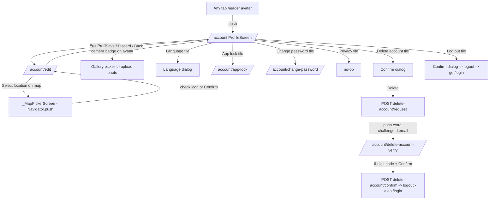
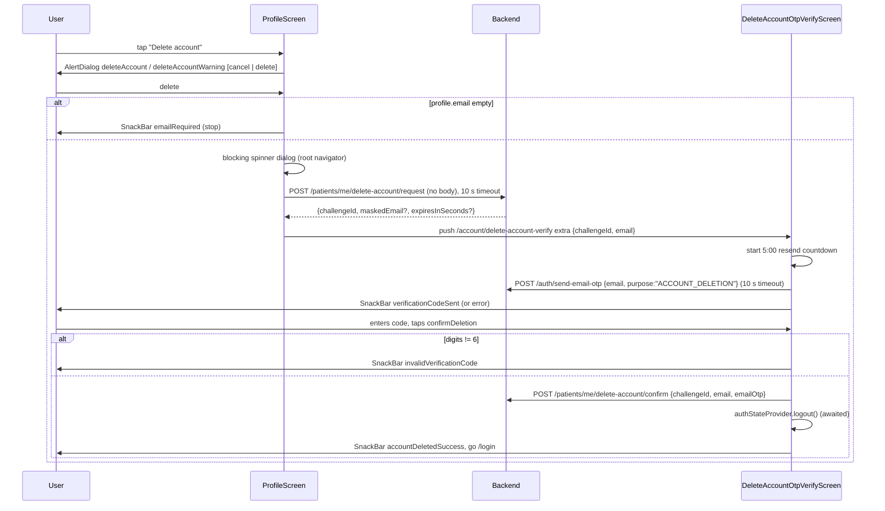
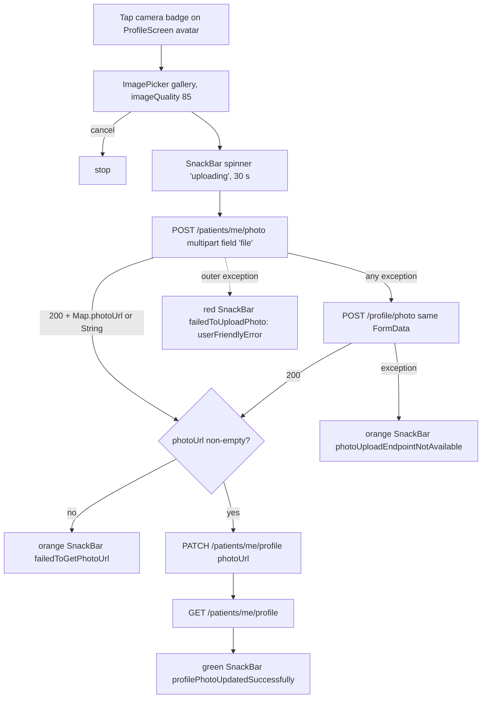
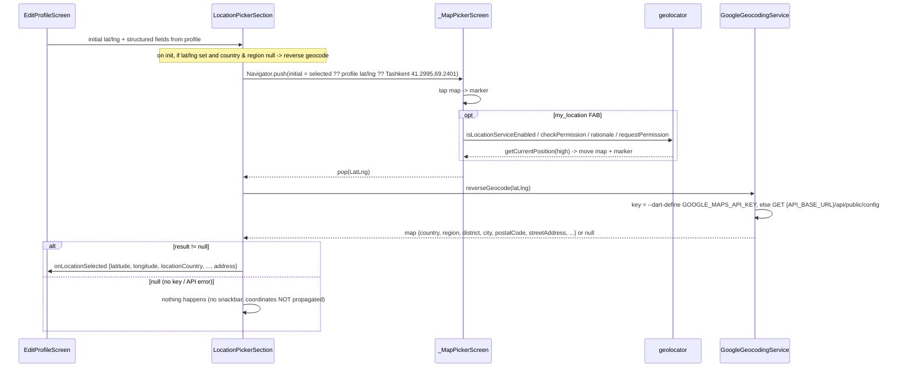

# 14 — Profile & Account (profile, edit, avatar, location, language, delete account, logout)

> Target: KMP + Compose Multiplatform rebuild of the Flutter "Shifa Bemor" patient app.
> Source of truth: the Flutter code at the cited `lib/...:line` locations. Anything not confirmed in code is marked **UNVERIFIED**.
> Backend references to `bin/main/com/shifa/**` point at a **stale** compiled-source snapshot of the Spring Boot backend (Apr 2026) checked into this repo. It predates the delete-account and photo-upload endpoints, so treat it as a hint, not a contract.

---

## 1. Overview

The "Account" area is reached from the avatar in every tab header (`onProfileTap: () => context.push('/account')`), at `lib/features/home/presentation/screens/home_screen.dart:224`, `bookings_screen.dart:176`, `doctors_screen.dart:298` and `documents_screen.dart:94`. The notifications screen's settings icon also opens it (`notifications_screen.dart:93`).

| Screen | Route | File |
|---|---|---|
| Profile (menu) | `/account` | `lib/features/profile/presentation/screens/profile_screen.dart` (705 lines) |
| Edit profile | `/account/edit` | `lib/features/profile/presentation/screens/edit_profile_screen.dart` (396 lines) |
| Map picker (sub-screen) | none. Pushed with `Navigator.push`, not GoRouter | `lib/features/profile/presentation/location_picker_widget.dart` (`_MapPickerScreen`) |
| Delete account OTP | `/account/delete-account-verify` (top-level, **no bottom bar**) | `lib/features/profile/presentation/screens/delete_account_otp_verify_screen.dart` (191 lines) |
| Change password | `/account/change-password` | owned by the **Auth** doc |
| App lock settings | `/account/app-lock` | owned by the **Navigation / App lock** doc |

- Routes are defined in `lib/app/router.dart:130-178` (`AppRoutes`) and `:535-591`. `/account` and its children sit under a plain `ShellRoute` with `PersistentBottomBar`. That shell is not the state-preserving `StatefulShellRoute`, so the screens rebuild on each visit.
- `/account` and `/account/delete-account-verify` are in the allowed-prefix whitelist (`lib/app/router.dart:94-116`).

Shared state is the global `profileProvider` (`lib/features/profile/providers/profile_provider.dart`). Many other features read it:

- Home, Bookings, Doctors and Documents headers read the photo and name.
- Documents and Chat use `profile.id` as patientId.
- The Shifa AI tier gate uses `subscriptionTier`/`features`, and Shifa AI uses `language`.

---

## 2. User flows

### 2.1 Navigation map



### 2.2 Delete account (email OTP)



### 2.3 Avatar upload



### 2.4 Location picking



---

## 3. Screens

### 3.1 ProfileScreen — `/account`

**Inputs**: none. **Init**: `loadProfile()` in a post-frame callback (`profile_screen.dart:28-35`).

**Side effect listener** (`:43-54`): when `profile.language` changes to a non-empty value, it calls `languageProvider.setLanguage(AppLanguage.fromCode(code))`. An unknown code maps to **English** (`fromCode` default). So the server's `language` field drives the app locale whenever the profile is (re)loaded here.

**AppBar**: back arrow → `context.pop()`; title `profile` (`:60-66`).

**Body states** (`:67-95`):

| State | UI |
|---|---|
| `isLoading == true` | Full-screen spinner. This covers any `updateProfile` call too, e.g. the language change, so the whole page flashes to a spinner |
| `error != null` | Red error icon, text `"${error}: <raw error string>"`, primary button `retry` → `loadProfile()` |
| otherwise | `RefreshIndicator` (pull → `loadProfile`) over a scroll column |

**Content** (top to bottom):

1. **Profile card** (`:199-304`). The card has elevation 0, radius 12 and a grey-200 border. Contents:
   - `CircleAvatar` radius 36, background `0xFF17C3B2`. The image is `NetworkImage(withCacheBuster(photoUrl, photoCacheKey))`. With no photo, a white `person_rounded` icon shows.
   - A camera badge (radius 14, same teal, `camera_alt_rounded` 16) at the bottom-right → `_uploadPhoto()` (§5.3).
   - Text column: `fullName` (18 bold; `noName` if the profile is null), then `phone`, `email` and `address`, each shown only when non-empty.
2. **Edit Profile** secondary button (`editProfile`) → `context.push('/account/edit')`.
3. **Section `settingsTitle`**: a card of `ListTile`s with a grey icon and a chevron.
   - `language`, icon `language_rounded`, subtitle = current `AppLanguage.displayName` → language dialog (§3.1.1)
   - `appLock`, icon `lock_outline_rounded` → `context.push('/account/app-lock')`
   - `changePassword`, icon `lock_reset_rounded` → `context.push('/account/change-password')`
   - `privacy`, icon `policy_rounded` → **`onTap: () {}` (no-op)**
4. **Section `accountTitle`**: red icon, text and chevron.
   - `deleteAccount`, icon `delete_outline_rounded` → delete dialog (§3.1.3)
   - `logOut`, icon `logout_rounded` → logout dialog (§3.1.2)
5. `AppVersionFooter(padding: EdgeInsets.fromLTRB(8, 32, 8, 16))` (`:189`).

#### 3.1.1 Language dialog (`:401-466`)

- Title `selectLanguage`. It lists `RadioListTile` rows for `AppLanguage.values` in this order: **English, Deutsch, O'zbek, Русский** (display names are not translated). The current language is selected.
- On select:
  1. `await languageProvider.setLanguage(value)`
  2. `await profileProvider.updateProfile(language: value.code)`, i.e. `PATCH /patients/me/profile {"language":"uz"}`. Errors are only logged.
  3. Pop the dialog.
  4. Green SnackBar `languageChanged(displayName)`, 2 s.
- A `cancel` text button closes the dialog.

#### 3.1.2 Logout dialog (`:374-399`)

- Title `logOut`, body `signOutConfirm`, buttons `cancel` and `logOut` (red).
- Confirm pops, then calls `authStateProvider.notifier.logout()` **without awaiting**, then immediately `context.go('/login')`.
- Logout steps (`lib/features/auth/providers/auth_provider.dart:197-217`; the Auth doc owns this):
  1. `PUT /patients/me/fcm-token {"fcmToken":""}` (errors ignored)
  2. Clear the app-lock PIN and disable the lock
  3. Repository logout, which clears the token from secure storage
  4. `AuthState.initial()`
- `app.dart:122` then calls `notificationPollingServiceProvider.clearShownNotifications()`. `profileProvider` is **not** reset on logout (**UNVERIFIED** that nothing else resets it). The next user's first screen calls `loadProfile()`, which overwrites it.

#### 3.1.3 Delete-account dialog (`:624-704`)

- Title `deleteAccount`, body `deleteAccountWarning`, buttons `cancel` and `delete` (red text).
- On `delete`:
  1. Read `profile.email?.trim()`. If it's empty, show SnackBar `emailRequired` and stop. **Phone-only accounts cannot delete their account.**
  2. Show a blocking `CircularProgressIndicator` dialog on the root navigator (not dismissible).
  3. `requestDeletion()` with a 10 s timeout. On timeout it throws `Exception(l10n.requestTimeout)`.
  4. On success, close the spinner, then `push('/account/delete-account-verify', extra: {'challengeId': id, 'email': email})`.
  5. On error, close the spinner and show SnackBar `userFriendlyError(l10n, e)` (the mapper lives in `lib/core/localization/error_localizations.dart:271`; the Core doc owns it).
- The response fields `maskedEmail` and `expiresInSeconds` are parsed but **not used** in the UI.

### 3.2 EditProfileScreen — `/account/edit`

**Inputs**: none. It reads the already-loaded `profileProvider.profile` in a post-frame callback (`:44-88`) and does **not** fetch. If the profile is null, the fields stay empty.

**Field initialisation** (`:53-88`):

| Field | Initial value |
|---|---|
| firstName | `fullName.split(' ').first` |
| lastName | `fullName.split(' ').sublist(1).join(' ')` |
| birthDate | `DateTime.parse(profile.birthDate)`, shown as `dd.MM.yyyy`. If parsing fails, the raw string is shown |
| address | `profile.address` |
| language | `profile.language` (raw code, e.g. `uz`) |
| phone | `profile.phone` (E.164) |
| gender | `profile.gender` |
| photo | `profile.photoUrl` |
| lat/lng and 6 structured location fields | from the profile |

**UI** (a scrolling column with 16 dp padding; `:206-396`):

1. **Avatar**: `CircleAvatar` radius 60, teal background. `NetworkImage` is used only if the URL starts with `http`, otherwise a white person icon shows. A camera button (radius 20) → `_pickImage` (`:115-133`) opens the gallery, stores the **local file path** in `_selectedPhotoUrl`, and shows SnackBar `imageUploadComingSoon`. No upload happens. See Quirk Q1.
2. **Full name**: read-only, 24 bold, shown for reference (`:262-266`).
3. **firstName** `TextFormField` (label `firstName`, words capitalisation). **No validator.**
4. **lastName** `TextFormField` (label `lastName`, words capitalisation). **No validator.**
5. **Phone**: `PhoneInputField` (§3.4), label `phoneNumber`. Validator: if non-empty and total digits (dial code + national) < 10 → `invalidPhone` (`:289-300`).
6. **birthDate**: read-only `TextFormField` with a calendar suffix icon. Tap → `showDatePicker` with range `1900-01-01 … today`; initial = the saved date, or `now − 18×365 days`. Displayed as `dd.MM.yyyy` (`:100-113`, `:303-312`).
7. **gender**: `DropdownButtonFormField` with values `Male`, `Female`, `Other` (labels `male` / `female` / `other`). There is no "unset" option. If the saved value is not one of these three exact strings, Flutter asserts (**UNVERIFIED** runtime behaviour in release: the dropdown fails the "exactly one item with value" assertion in debug).
8. **address**: `TextFormField`, maxLines 2 (the legacy free-text address). It is overwritten with the formatted address when a map location is picked.
9. **LocationPickerSection** (§3.3).
10. **language**: plain `TextFormField` (label `language`) where the user can type anything. See Quirk Q4.
11. **Discard**: `ShifaSecondaryButton(destructive)` labelled `discardChanges` → `context.pop()`. Disabled while saving.
12. **Save**: `ShifaPrimaryButton` labelled `saveChanges`, `isLoading: _isSaving`.

The AppBar back arrow is disabled while saving. The title is `editProfile`. The body spinner shows only when `isLoading && profile == null`.

**Save** (`:135-204`):

1. `formKey.validate()`. Only the phone rule can fail.
2. Call `updateProfile(...)` with:
   - firstName, lastName, phone, address, language: trimmed, or `null` if empty. `null` means the key is omitted from the PATCH.
   - birthDate: `yyyy-MM-dd`, or null if never set.
   - gender: the selected value, or null.
   - photoUrl: `_selectedPhotoUrl`. This is **always sent** when the profile had a photo, and can be a local path after `_pickImage`.
   - latitude/longitude and the 6 `location*` fields: current values (null → omitted).
   - There is no `timeZone`.
3. On success: green SnackBar `profileUpdatedSuccessfully`, then `context.pop()`.
4. On error: red SnackBar `"${failedToUpdateProfile}: $e"` with the raw exception text.

Because `photoUrl != null` is almost always true, every save bumps `photoCacheKey`, which forces all avatars to re-download.

Clearing a field is impossible. An empty field becomes `null`, which is omitted, so the server keeps the old value.

### 3.3 LocationPickerSection and _MapPickerScreen

File `lib/features/profile/presentation/location_picker_widget.dart` (632 lines).

**LocationPickerSection** (a Card, elevation 2):

- Header: `location_on` icon (primary colour) and the text `location`.
- Primary button `selectLocationOnMap`. It shows loading while reverse geocoding and opens `_MapPickerScreen` (`:221-241`). The initial camera position is chosen in this order:
  1. the current selection
  2. the widget's lat/lng (from the profile)
  3. **Tashkent `LatLng(41.2995, 69.2401)`**
- On a `LatLng` result, it waits 50 ms and then calls `_reverseGeocode()` (`:161-216`).
- Read-only fields, each shown only when non-empty: `country`, `region`, `district`, `city`, `postalCode`.
- Editable `streetAddress` field (hint `enterStreetAddress`, helper `streetAddressHelper`). Every edit re-emits `onLocationSelected` with the updated street.
- On init, if lat/lng exist and both `locationCountry` and `locationRegion` are null, it reverse-geocodes automatically.
- When `reverseGeocode` returns non-null, it fills the fields and emits the `onLocationSelected` map:

```json
{
  "latitude": 41.2995,
  "longitude": 69.2401,
  "locationCountry": "Uzbekistan",
  "locationRegion": "Tashkent",
  "locationDistrict": "Yunusobod District",
  "locationCity": "Tashkent",
  "locationPostalCode": "100000",
  "locationStreetAddress": "12 Amir Temur Avenue",
  "address": "12 Amir Temur Avenue, Tashkent, Yunusobod District, Tashkent"
}
```

- `address` is built by `_formatAddress` as `street, city, district (if != city), region`, joined with `, `. Country is omitted (`:125-158`). EditProfileScreen copies `address` into its address field.
- **If the result is null** (no API key, non-OK status, HTTP error), nothing is emitted and **no message is shown**. The chosen coordinates are silently lost.
- A thrown exception shows an orange SnackBar `couldNotGetAddressDetails` (3 s). In practice `reverseGeocode` catches everything and returns null, so this path is rare.

**_MapPickerScreen**:

- **Map**: `flutter_map`. `TileLayer` url `https://tile.openstreetmap.org/{z}/{x}/{y}.png`, `userAgentPackageName: 'com.shifa.patient'`, initial zoom 15. There is no attribution widget in the file (grep finds no `attribution`); the OSM tile policy requires one.
- Tapping the map sets a red `location_on` marker (40 px).
- AppBar check icon → `pop(selected LatLng)`.
- **FAB** `my_location` (top-right, tooltip `getCurrentLocation`):
  1. `Geolocator.isLocationServiceEnabled()`. If false → SnackBar `locationServicesDisabled`.
  2. `checkPermission()`. If `denied`, first show `showPermissionRationale(rationaleKey: 'permissionRationaleLocation')`, then `requestPermission()`. If it is still denied → `locationPermissionDenied`.
  3. `deniedForever` → `locationPermissionDeniedForever`. There is no "open settings" action.
  4. `getCurrentPosition(desiredAccuracy: LocationAccuracy.high)` → move the map and set the marker.
  5. Any exception → `errorGettingCurrentLocation`.
- **Bottom card**: `selectedLocation`, then `latitude: <6 decimals>` and `longitude: <6 decimals>`, and a confirm button (`confirm`) → pop with the LatLng.

**Permission rationale** (`lib/core/utils/permission_rationale.dart:6-31`): a non-dismissible `AlertDialog` with title `permissionNeeded`, content = the translated rationale, and a single `continueButton`. It deliberately has no cancel option, per Apple guideline 5.1.1(iv). The dialog is skipped if the key has no translation.

### 3.4 PhoneInputField (shared widget, also used by Auth)

`lib/core/widgets/phone_input_field.dart` (205 lines) is a `country_code_picker` dropdown (flags) plus a phone-keyboard `TextFormField`. The hint is `901234567` and the prefix is a phone icon.

- `fullPhone` = `dialCode + digits(national)`. The default dial code is `+998` (UZ) (`:115-121`).
- `parseFullPhone` (`:36-53`) tries dial-code lengths 4, 3, 2, 1 and accepts the first one starting with 1-9. **Bug**: that is always length 4, so `+998901234567` splits into dial `+9989` and national `01234567`.
  - The concatenated value still round-trips.
  - `_dialCodeToCountryCode('+9989')` falls back to `UZ`, so the picker shows `+998` while the text field shows `01234567` (the leading 9 is missing).
  - The port should parse with libphonenumber, or match known dial codes longest-first.
- The validator receives `null` if the national part is empty, else `fullPhone`.

### 3.5 DeleteAccountOtpVerifyScreen — `/account/delete-account-verify`

- **Inputs** (`state.extra` Map): `challengeId` (String, required, non-empty) and `email` (String, required, non-empty). If either is missing or wrong, the route renders **`LoginScreen`** instead (`lib/app/router.dart:353-368`).
- **Init** (`:39-44`):
  - Start a 300 s countdown (`_resendCooldownSeconds = 5*60`).
  - Immediately `_sendCode()` → `POST /auth/send-email-otp {"email": "...", "purpose": "ACCOUNT_DELETION"}` with a 10 s timeout. Success → SnackBar `verificationCodeSent`; error → `userFriendlyError`.
- **UI**:
  - AppBar `deleteAccountVerifyTitle`.
  - Text `deleteAccountOtpSubtitle`.
  - Numeric `TextField` (label `verificationCode`, maxLength 6).
  - Destructive primary button `confirmDeletion` (loading state).
  - `TextButton`: `resendCode` when the countdown hits 0, else `resendCodeIn` with `{{time}}` replaced by `mm:ss`. Resend restarts the timer and calls `_sendCode()`.
- **Confirm** (`:98-138`):
  1. Strip non-digits. If the length is not 6 → SnackBar `invalidVerificationCode`.
  2. Otherwise `POST /patients/me/delete-account/confirm` with a 10 s timeout.
  3. Then `await authStateProvider.logout()` (§3.1.2), SnackBar `accountDeletedSuccess`, and `context.go('/login')`.
  4. Error → SnackBar `userFriendlyError`.
- The challenge's `expiresInSeconds` is ignored. The cooldown is hardcoded at 5 minutes.
- Two emails may be sent: `delete-account/request` may itself email a code, and the screen also calls `send-email-otp`. **UNVERIFIED** which one the backend actually uses for verification; the confirm call sends both `challengeId` and `emailOtp`.

### 3.6 Small shared widgets in scope

| Widget | File | Behaviour |
|---|---|---|
| `UserAvatar(name, photoUrl, radius=20)` | `lib/core/widgets/user_avatar.dart:4-74` | Normalises the URL (`normalizePhotoUrl`) and shows it in `ClipOval` with `Image.network`, decoded at the diameter size. While loading or on error it falls back to a grey `0xFFE0E0E0` circle with initials (first letter of the first and last word, uppercase; one word → one letter) in `0xFF607D8B`, font `radius*0.75` w600. With no name it shows a `person` icon. **Not used on the profile screens**; it is used by doctor and appointment cards |
| `LanguageMiniToggle` | `lib/core/widgets/language_mini_toggle.dart:7-89` | Pill (white, radius 999, black12 border, soft shadow) showing the current code uppercase (`EN`), plus a teal `0xFF17C3B2` chevron. Tap → `showMenu` listing `EN/DE/UZ/RU` → `languageProvider.setLanguage`. **Does not PATCH the backend.** Used only on the login screen (`login_screen.dart:120`) |
| `AppVersionFooter(padding)` | `lib/core/widgets/app_version_footer.dart:6-63` | `"${AppConfig.appDisplayName} ${version} (${AppConfig.releaseDateLabel})"`, e.g. `Shifa Bemor 1.1.9 (5 Aug 2026)`. The version comes from `package_info_plus`; `—` if blank; on failure the version is omitted. The text is grey-600, 12 sp, centered. A 14 dp placeholder shows while loading. Used on Profile and Login. `appDisplayName = 'Shifa Bemor'`, `releaseDateLabel = '5 Aug 2026'` (`lib/core/config/app_config.dart:42-46`) are hardcoded constants |

---

## 4. API endpoints

The base is `ApiClient.apiBaseUrl`. Resolution order (`lib/core/network/api_client.dart:13-40`):

1. `--dart-define=API_BASE_URL` (a trailing `/api` is stripped, then `/api` is appended)
2. release builds: `https://shifa-doc-backend-mvp-production.up.railway.app/api`
3. debug builds: also production (the debug default is hardcoded to the same URL)

JWT bearer auth is added automatically.

### 4.1 `GET /patients/me/profile`

- Source: `lib/features/profile/data/profile_repository.dart:13-27`.
- Response: a `PatientProfileModel` JSON object (§6.1):

```json
{
  "id": 42,
  "fullName": "Aziz Karimov",
  "phone": "+998901234567",
  "email": "aziz@example.com",
  "address": "12 Amir Temur Avenue, Tashkent",
  "birthDate": "1990-05-17",
  "gender": "Male",
  "language": "uz",
  "photoUrl": "https://…/photos/42.jpg",
  "latitude": 41.2995,
  "longitude": 69.2401,
  "locationCountry": "Uzbekistan",
  "locationRegion": "Tashkent",
  "locationDistrict": "Yunusobod District",
  "locationCity": "Tashkent",
  "locationPostalCode": "100000",
  "locationStreetAddress": "12 Amir Temur Avenue",
  "timeZone": "Asia/Tashkent",
  "subscriptionTier": "PREMIUM",
  "features": ["PATIENT_SHIFA_AI"]
}
```

- `subscriptionTier` and `features` are consumed by `lib/state/subscription/patient_subscription_provider.dart:11-27` and the router gate `lib/app/router.dart:267-281` (PRO → redirect to `/home`; PREMIUM allowed). Tiers are only `PRO`/`PREMIUM`; a missing or unknown tier parses as **PREMIUM** (`lib/core/subscription/patient_subscription.dart:48-56`). Backend feature name for Shifa AI is `PATIENT_SHIFA_AI` (`:24-25`). When `features` is non-empty it wins over the tier (`patient_subscription_provider.dart:17-29`); the router gate uses only the tier. See the Shifa AI / subscription doc.
- `gender` is not in the stale backend DTO (`bin/main/com/shifa/web/PatientController.kt:59-78`); production may return it (**UNVERIFIED**).
- Errors: a `DioException` becomes `Exception(response.data['message'] ?? response.data['error'] ?? e.message ?? 'Failed to get profile')`. A non-Dio failure becomes `Exception('Failed to get profile: $e')`.

### 4.2 `PATCH /patients/me/profile`

- Source: `profile_repository.dart:30-85`.
- Request: **only non-null keys are sent**. Possible keys:

```json
{
  "firstName": "Aziz",
  "lastName": "Karimov",
  "birthDate": "1990-05-17",
  "gender": "Male",
  "phone": "+998901234567",
  "address": "12 Amir Temur Avenue, Tashkent",
  "language": "uz",
  "photoUrl": "https://…/photos/42.jpg",
  "latitude": 41.2995,
  "longitude": 69.2401,
  "locationCountry": "Uzbekistan",
  "locationRegion": "Tashkent",
  "locationDistrict": "Yunusobod District",
  "locationCity": "Tashkent",
  "locationPostalCode": "100000",
  "locationStreetAddress": "12 Amir Temur Avenue",
  "timeZone": "Asia/Tashkent"
}
```

- Response: the full updated profile, same shape as GET.
- Errors are wrapped the same way as GET, with default `'Failed to update profile'`.
- Callers:
  - EditProfile save (§3.2)
  - avatar upload `{photoUrl}`
  - language dialog `{language}`
  - `syncTimeZoneFromDevice` `{timeZone}` (§7)
- Stale-snapshot server semantics (`PatientController.kt:165-212`), **UNVERIFIED against production**:
  - `fullName` is only updated when **both** `firstName` and `lastName` are present (as `"first last".trim()`).
  - `gender` is accepted but not persisted, and `phone` is not in the request DTO (ignored).
  - A blank `timeZone` clears the zone.
  - The port should send both names together and confirm the phone/gender handling with the backend.

### 4.3 `POST /patients/me/photo` (fallback `POST /profile/photo`)

- Source: `profile_screen.dart:468-622`. It is called **directly from the widget** via `apiClient.dio`, not via a repository. This is a deviation from the architecture rules.
- Request: `multipart/form-data` with one field `file` = image bytes, filename = the picked file's name. The content-type isn't set explicitly.
- Response: `200` with `{"photoUrl": "<url>"}` or a bare string URL. Any other status or shape → `photoUrl = null` → "failed to get photo URL".
- After success the client additionally PATCHes `{photoUrl}` and re-GETs the profile.
- The fallback reuses the **same `FormData` instance**. Dio 5 refuses to re-send a finalized FormData, so the fallback most likely always fails with a client-side error (**UNVERIFIED** at runtime). Neither endpoint exists in the stale snapshot.
- There is no client-side compression beyond `imageQuality: 85`, and no size limit.

### 4.4 `POST /patients/me/delete-account/request`

- Source: `lib/features/profile/data/account_deletion_repository.dart:33-55`.
- Request: no body.
- Response: `{"challengeId": "…", "maskedEmail": "a***@example.com", "expiresInSeconds": 300}`.
  - `challengeId` is required; an empty value throws `Exception('Invalid response from server')`.
  - `maskedEmail` is optional.
  - `expiresInSeconds` defaults to 300.
- Errors: `AuthErrorSanitizer.sanitize(statusCode, data ?? e.message, 'Failed to request account deletion')` → `Exception(msg)`.

### 4.5 `POST /auth/send-email-otp`

- Owned by the Auth doc; used here.
- Source: `lib/features/auth/data/auth_repository.dart:482-496`.
- Request: `{"email": "<trimmed>", "purpose": "ACCOUNT_DELETION"}`.
- Errors: sanitized, default `'Failed to send verification code'`.

### 4.6 `POST /patients/me/delete-account/confirm`

- Source: `account_deletion_repository.dart:57-85`.
- Request: `{"challengeId": "…", "email": "aziz@example.com", "emailOtp": "123456"}`.
- Response: ignored (any 2xx).
- Errors: sanitized, default `'Failed to delete account'`.

### 4.7 `GET {API_BASE_URL}/api/public/config` (Google key bootstrap)

- Source: `lib/core/services/google_geocoding_service.dart:20-58`.
- Called with the plain `http` package, not ApiClient: no auth, 5 s timeout.
- **Only attempted when `--dart-define=API_BASE_URL` is set** (`AppConfig.apiBaseUrl`, which is empty by default).
- Response: `{"googleMapsApiKey": "<key>"}`. The key is cached in a static field for the process lifetime.
- Server: `bin/main/com/shifa/web/ConfigController.kt`.
- Quirk: if the define already ends in `/api`, the URL becomes `/api/api/public/config`.

### 4.8 Google Geocoding API (third party)

- Base `https://maps.googleapis.com/maps/api/geocode/json` (`google_geocoding_service.dart:60`).
- **Reverse** (used): `GET ?latlng={lat},{lng}&key={KEY}&language=en` (`:63-103`).
  - It succeeds only when HTTP is 200, `status == "OK"` and `results` is non-empty. It parses `results[0]`; everything else returns `null`.
- **Forward** (`geocode(address)`, `:106-146`): defined but **unused**. Returns `{latitude, longitude, formattedAddress, addressComponents}`.
- **Parse** (`:150-219`): for each `address_components` entry, the first matching type wins:
  - `street_number`
  - `route`
  - `sublocality` or `sublocality_level_1` → district
  - `locality` → city
  - `administrative_area_level_1` → region
  - `administrative_area_level_2` (kept, unused)
  - `country`
  - `postal_code`
- The returned map:

| Key | Value |
|---|---|
| `country` | country, or `''` |
| `region` | `administrative_area_level_1`, or `''` |
| `district` | `sublocality`, or `''` |
| `city` | `locality`, or `''` |
| `postalCode` | postal code, or `''` |
| `streetAddress` | `"{street_number} {route}"` trimmed, else `route`, else `''` |
| `formattedAddress` | `formatted_address` |
| raw parts | `streetNumber`, `route`, `sublocality`, `locality`, `administrativeAreaLevel1`, `administrativeAreaLevel2` |

- Results are always in **English** (`language=en`), regardless of the app language.
- **Key source**:
  1. `--dart-define=GOOGLE_MAPS_API_KEY` (`lib/core/config/app_config.dart:52-55`, default empty)
  2. the backend `/api/public/config` (only if `API_BASE_URL` is defined)
- The store build workflows (`.github/workflows/ios_testflight.yml:187-188`, `google_play_deploy.yml:235-236`) pass only `ENVIRONMENT` and `FLAVOR`. **Store builds therefore have no key**, so reverse geocoding returns null and picked map locations are silently dropped (**UNVERIFIED on device, but follows from the code**). Do not copy keys from any config file into the port; obtain them from the backend/ops team.
- The debug log prints the full request URL, including the key (`:80`). That is a secret leak into device logs in debug builds.

**The `geocoding` package** (`pubspec.yaml:91`, `geocoding: ^3.0.0`) is a declared dependency but is **imported nowhere in `lib/`** (grep for `package:geocoding` returns nothing). **There is no platform-geocoder fallback.** The task brief's "Google geocoding vs geocoding-package fallback" does not exist in code.

**Region/country catalogs** (`lib/core/models/region_catalog.dart`, `country_catalog.dart`) are **not used by the profile feature**. They are used by the Doctors filters (`lib/features/doctors/data/doctors_filter_catalog.dart`, `doctor_filters_sheet.dart`, `doctors_provider.dart`) and imported by `app_localizations.dart`. The profile stores free-text English names from Google (`locationRegion: "Tashkent"` etc.). Any matching of profile region to catalog is done by the Doctors feature; see that doc. `lib/core/utils/location_utils.dart` (Haversine `distanceKm`, `nearbyDoctorsMaxRadiusKm = 50`, `nearbyDoctorsCloseRadiusKm = 15`) is also a Doctors/Home concern that consumes `profile.latitude/longitude`.

---

## 5. Data models

### 5.1 PatientProfileModel

File: `lib/core/models/patient_profile_model.dart`. The class is `Equatable`; `copyWith` and `props` cover all fields.

| Field | Type | JSON key | Default | Notes |
|---|---|---|---|---|
| `id` | String? | `id` | null | `json['id']?.toString()` (the server sends a Long) |
| `fullName` | String | `fullName` | `''` | The only non-null field |
| `phone` | String? | `phone` | null | E.164, e.g. `+998901234567` |
| `email` | String? | `email` | null | Required for account deletion |
| `address` | String? | `address` | null | Legacy free-text address |
| `birthDate` | String? | `birthDate` | null | `yyyy-MM-dd` (a string, not a DateTime) |
| `gender` | String? | `gender` | null | Client writes `Male` / `Female` / `Other` |
| `language` | String? | `language` | null | `en` / `de` / `uz` / `ru` expected, but it's free text (Q4) |
| `photoUrl` | String? | `photoUrl` | null | Run through `normalizePhotoUrl` on parse (§5.2) |
| `latitude` | double? | `latitude` | null | `num → double` |
| `longitude` | double? | `longitude` | null | |
| `locationCountry` | String? | `locationCountry` | null | From Google, English |
| `locationRegion` | String? | `locationRegion` | null | Google `administrative_area_level_1` |
| `locationDistrict` | String? | `locationDistrict` | null | Google `sublocality` |
| `locationCity` | String? | `locationCity` | null | Google `locality` |
| `locationPostalCode` | String? | `locationPostalCode` | null | |
| `locationStreetAddress` | String? | `locationStreetAddress` | null | User-editable |
| `timeZone` | String? | `timeZone` | null | IANA, e.g. `Asia/Tashkent` |
| `subscriptionTier` | String? | `subscriptionTier` | null | `"PRO"` or `"PREMIUM"` |
| `features` | List<String> | `features` | `[]` | Granted feature names |

Parsing is at `:56-82` and `toJson` at `:84-107`, which uses the same keys.

### 5.2 Photo URL helpers (`lib/core/utils/image_utils.dart`)

- `normalizePhotoUrl(url)` (`:4-29`):
  - null or blank → null.
  - Absolute `http(s)` URL: kept as is, except on Android where host `localhost`/`127.0.0.1` is swapped for `ApiClient.publicBaseUrl`'s scheme, host and port.
  - Relative URL: `"${ApiClient.publicBaseUrl}/${path without leading /}"`.
- `ApiClient.publicBaseUrl` is **hardcoded** to `http://localhost:8090` (Android `http://10.0.2.2:8090`) (`lib/core/network/api_client.dart:42-50`). **Relative photo URLs from the production backend therefore resolve to localhost and break.** The production backend normalizes to absolute URLs server-side (`profileMapper.normalizePhotoUrl` in the snapshot), which is presumably why this works (**UNVERIFIED**).
- `withCacheBuster(url, cacheKey)` (`:31-44`): normalizes, then sets the query param `v=<cacheKey>` unless the key is null or 0.

### 5.3 DeleteAccountRequestResult

`account_deletion_repository.dart:8-26`:

| Field | Type | JSON key | Default |
|---|---|---|---|
| `challengeId` | String | `challengeId` | `''` (an empty value is rejected) |
| `maskedEmail` | String? | `maskedEmail` | null |
| `expiresInSeconds` | int | `expiresInSeconds` | 300 |

### 5.4 AppLanguage (`lib/core/providers/language_provider.dart`)

| Enum | code | displayName |
|---|---|---|
| `english` | `en` | English |
| `german` | `de` | Deutsch |
| `uzbek` | `uz` | O'zbek |
| `russian` | `ru` | Русский |

- `fromCode` returns english for unknown codes.
- `fromSystemLocale` maps `de`/`uz`/`ru` and uses English otherwise.

---

## 6. State management

### 6.1 profileProvider

`StateNotifierProvider<ProfileNotifier, ProfileState>` (`lib/features/profile/providers/profile_provider.dart:144`). It is global and never auto-disposed.

`ProfileState` fields (`:8-34`):

- `profile: PatientProfileModel?`
- `isLoading = false`
- `error: String?`
- `photoCacheKey = 0`

Note that `copyWith` **always resets `error` to the passed value**, so it becomes null when the argument is omitted.

| Method | Behaviour | Source |
|---|---|---|
| `loadProfile()` | Sets `isLoading=true`, then GET. `photoCacheKey = now ms` if `photoUrl` changed, else unchanged. Errors → `error = e.toString()` (e.g. `"Exception: …"`) | `:41-64` |
| `updateProfile(...17 optional fields)` | Sets `isLoading=true`, then PATCH and replaces the profile. `photoCacheKey` bumps whenever the `photoUrl` **argument** is non-null. Errors → sets `error` and **rethrows** | `:66-126` |
| `syncTimeZoneFromDevice()` | `FlutterTimezone.getLocalTimezone()`. Skipped if empty or equal to `profile.timeZone`. Otherwise PATCH `{timeZone}` and replace the profile. All errors ignored. No loading flag | `:130-141` |

- The `if (e is DioException && statusCode == 401)` branches (`:55-58`, `:116-119`) are **dead code**, because the repository always wraps errors in a plain `Exception`.
- `updateProfile` failures leave `error` set. If the user then goes back to ProfileScreen, it shows the error state until reload.

### 6.2 languageProvider

`StateNotifierProvider<LanguageNotifier, LanguageState{language, locale}>`:

- **Startup**: read SharedPreferences `app_language`.
  - If absent, detect the system locale and **persist it**.
  - Then `PushNotificationService().refreshLocalizationCache()`.
- **`setLanguage(lang)`**: persist `app_language`, update the state, refresh the push localization cache. The `updateBackend` flag is unused.
- **Backend sync**: only the ProfileScreen dialog PATCHes the backend. The reverse direction (server → app) happens through the ProfileScreen listener (§3.1).

### 6.3 Timezone sync (cross-feature)

`lib/app/app.dart:50` and `:88` call `profileProvider.notifier.syncTimeZoneFromDevice()` when auth becomes authenticated and on every app resume. If the profile hasn't loaded yet, `state.profile?.timeZone` is null, so it **always PATCHes once** per cold start. The backend uses `timeZone` for reminder scheduling (**UNVERIFIED**).

---

## 7. Validation summary

| Field | Rule | Where |
|---|---|---|
| phone (edit) | optional. If present, total digits (incl. dial code) ≥ 10, else `invalidPhone` | `edit_profile_screen.dart:293-299` |
| birthDate | chosen via picker, 1900-01-01 … today; no manual entry | `:100-113` |
| firstName / lastName / address / language | none (trimmed; empty → omitted) | `:152-177` |
| gender | one of `Male`/`Female`/`Other` | `:314-326` |
| street address | none | location picker |
| delete OTP | exactly 6 digits after stripping non-digits | `delete_account_otp_verify_screen.dart:100-106` |
| delete account precondition | profile email non-empty | `profile_screen.dart:643-650` |

---

## 8. Platform configuration relevant here

- **Android** (`android/app/src/main/AndroidManifest.xml`): `ACCESS_FINE_LOCATION`, `ACCESS_COARSE_LOCATION`, `CAMERA` (unused by profile, which only uses the gallery). image_picker on Android 13+ uses the Photo Picker, so no storage permission is needed.
- **iOS** (`ios/Runner/Info.plist`): `NSLocationWhenInUseUsageDescription` and `NSLocationAlwaysAndWhenInUseUsageDescription` ("We use your location to show doctors near you and for your profile address"), and `NSPhotoLibraryUsageDescription`.
- **Packages**:

| Package | Version |
|---|---|
| `image_picker` | ^1.0.7 |
| `geolocator` | ^12.0.0 |
| `flutter_map` | ^7.0.2 |
| `latlong2` | ^0.9.1 |
| `http` | ^1.2.0 (geocoding) |
| `geocoding` | ^3.0.0 (unused) |
| `country_code_picker` | |
| `flutter_timezone` | |
| `package_info_plus` | ^9 |

---

## 9. KMP / CMP porting notes

1. **ProfileRepository** in common code (Ktor): `getProfile()`, `patchProfile(PatchProfileRequest)` with `explicitNulls = false` so that only set keys are sent, `uploadPhoto(bytes, filename)`, `requestDeletion()`, `confirmDeletion()`. Move the photo upload out of the UI.
2. **ProfileStore**: a singleton `StateFlow<ProfileState>`, shared app-wide (headers, documents, chat, subscription gate). Use separate `isRefreshing` and `isSaving` flags so a PATCH doesn't blank the whole profile page.
3. **Language**: persist `app_language` (the same key helps migration if you read the old prefs; otherwise irrelevant). Apply the locale through your own `LocalAppLocale` CompositionLocal, since CMP has no runtime locale switch built in. PATCH `{language}` to the backend when changed from the Profile dialog. Only accept `en|de|uz|ru` from the server, and **do not** let an unknown server value force English.
4. **Edit form**:
   - Replace the free-text language field with a picker, or drop it.
   - Use a real image upload flow (or remove the button); never send local paths.
   - Allow clearing fields if the backend supports explicit nulls.
   - Validate names (non-empty, since the backend needs both).
5. **Photo picking**:
   - Android: `PickVisualMedia` (Photo Picker).
   - iOS: `PHPickerViewController`.
   - Wrap both in `expect/actual`, or use a CMP library such as Peekaboo or FileKit. Compress to JPEG about 85 before upload.
6. **Maps**:
   - Option A: MapLibre Compose (OSM raster tiles, cross-platform).
   - Option B: `osmdroid` on Android plus `MKMapView` on iOS behind `expect/actual`.
   - Option C: Google Maps Compose on Android plus Google Maps iOS SDK.
   - Keep the Tashkent default and zoom 15. Add OSM attribution if you use OSM tiles, and set a proper User-Agent.
7. **Current location**: Android Fused Location Provider; iOS `CLLocationManager` (when-in-use). Show the rationale dialog before the system prompt, as the app does now. Add "Open settings" for denied-forever.
8. **Reverse geocoding**:
   - Keep the Google Geocoding REST call (Ktor), fetching the key from `GET /api/public/config` at runtime. Never embed it.
   - Or use platform geocoders (Android `Geocoder`, iOS `CLGeocoder`) as a fallback, since the Flutter app has none.
   - **Emit the coordinates even when geocoding fails**, instead of dropping them.
   - Consider passing the app language instead of `en`.
9. **Phone field**: use libphonenumber (Android) or PhoneNumberKit (iOS), or a KMP port such as `libphonenumber-kotlin`, for parsing. Default the region to UZ.
10. **Delete account**:
    - Keep the 3-call sequence: request → send-email-otp → confirm. Confirm with the backend whether `send-email-otp` is still needed after `request`.
    - Use `expiresInSeconds` for the countdown instead of the hardcoded 300 s.
    - After success, run the same logout routine as §3.1.2, and await it.
11. **Logout**: await the FCM-token clear and the token wipe before navigating. Reset `ProfileStore` and every other user-scoped store.
12. **Timezone sync**: on login and on each resume, compare `TimeZone.currentSystemDefault().id` (kotlinx-datetime) with `profile.timeZone`, and wait for the profile to load before comparing to avoid a redundant PATCH.
13. **Version footer**: Android `PackageManager` / iOS `CFBundleShortVersionString`, plus the constant release label (current: `Shifa Bemor`, `5 Aug 2026`).

---

## 10. Quirks and tech debt

- **Q1 — Edit-profile photo sends a local path.** `_pickImage` stores `XFile.path` in `_selectedPhotoUrl`, which is sent as `photoUrl` on save (`edit_profile_screen.dart:115-133, :168`). The server then stores a device file path. Only the ProfileScreen camera badge really uploads.
- **Q2 — Photo upload fallback reuses a finalized FormData** (Dio 5), so the `/profile/photo` fallback likely always fails. Upload code lives in the widget, bypassing the repository.
- **Q3 — Every edit-profile save re-sends `photoUrl`** (the normalized, absolute URL), bumping the cache key and possibly rewriting the stored URL with its absolute form.
- **Q4 — Language is a free-text field in Edit Profile.** Arbitrary text is PATCHed; on the next ProfileScreen load the listener maps unknown codes to **English** and switches the whole app to English.
- **Q5 — Map selection silently lost without a Google key** (store builds pass no `GOOGLE_MAPS_API_KEY` / `API_BASE_URL`). There is no fallback geocoder, even though the `geocoding` package is declared.
- **Q6 — Debug log prints the Google URL with the API key** (`google_geocoding_service.dart:80`).
- **Q7 — `publicBaseUrl` hardcoded to localhost:8090**, so relative photo URLs break outside local dev.
- **Q8 — Privacy tile is a no-op** (`onTap: () {}`).
- **Q9 — Logout is not awaited** before `go('/login')` on the Profile screen (the delete flow does await).
- **Q10 — Phone parsing heuristic always takes a 4-digit dial code** (`phone_input_field.dart:36-53`), so the national number displays without its first digit.
- **Q11 — Name split** on the first space: multi-word first names end up in lastName. The backend (snapshot) only updates `fullName` when both parts are sent; a single-word name cannot be saved.
- **Q12 — Dead 401 handling** in `ProfileNotifier`.
- **Q13 — ProfileScreen shows a full-page spinner during any `updateProfile`**, including the language change.
- **Q14 — Raw exception text** is shown in the error state and in the update-failure snackbar (`"Exception: …"`).
- **Q15 — Gender dropdown** crashes or asserts if the stored gender isn't exactly `Male`/`Female`/`Other` (**UNVERIFIED** severity in release).
- **Q16 — Deletion needs an email**; phone-only users get `emailRequired` with no alternative path.
- **Q17 — `expiresInSeconds` / `maskedEmail` ignored**; OTP resend cooldown is a hardcoded 5 min, and two OTP emails may be triggered.
- **Q18 — `LanguageMiniToggle` (login) does not sync to the backend**; the profile dialog does. After login, the ProfileScreen listener may flip the app back to the server's language.
- **Q19 — Reverse geocoding always uses `language=en`**, so the stored region/city names are English regardless of UI language.
- **Q20 — Location picker uses `Navigator.push`, not GoRouter**, so it is not deep-linkable. That's fine for the port.
- **Q21 — No OSM attribution** on the map (none in `location_picker_widget.dart`).
- **Q22 — `timeZone` sync PATCHes on every cold start** before the profile is loaded.

---

## 11. l10n keys used

ProfileScreen and dialogs:
`profile`, `error`, `retry`, `noName`, `editProfile`, `settingsTitle`, `language`, `selectLanguage`, `languageChanged` (function with a display-name argument), `cancel`, `appLock`, `changePassword`, `privacy`, `accountTitle`, `deleteAccount`, `deleteAccountWarning`, `delete`, `emailRequired`, `requestTimeout`, `logOut`, `signOutConfirm`, `uploading`, `photoUploadEndpointNotAvailable`, `profilePhotoUpdatedSuccessfully`, `failedToGetPhotoUrl`, `failedToUploadPhoto`.

EditProfileScreen:
`editProfile`, `firstName`, `lastName`, `phoneNumber`, `invalidPhone`, `birthDate`, `gender`, `male`, `female`, `other`, `address`, `language`, `discardChanges`, `saveChanges`, `profileUpdatedSuccessfully`, `failedToUpdateProfile`, `imageUploadComingSoon`.

Location picker:
`location`, `selectLocationOnMap`, `country`, `region`, `district`, `city`, `postalCode`, `streetAddress`, `enterStreetAddress`, `streetAddressHelper`, `couldNotGetAddressDetails`, `getCurrentLocation`, `locationServicesDisabled`, `locationPermissionDenied`, `locationPermissionDeniedForever`, `errorGettingCurrentLocation`, `selectedLocation`, `latitude`, `longitude`, `confirm`, `permissionRationaleLocation`, `permissionNeeded`, `continueButton`.

Delete-account OTP screen:
`deleteAccountVerifyTitle`, `deleteAccountOtpSubtitle`, `verificationCode`, `confirmDeletion`, `resendCode`, `resendCodeIn` (placeholder `{{time}}` = `mm:ss`), `verificationCodeSent`, `invalidVerificationCode`, `accountDeletedSuccess`, `emailRequired`, `requestTimeout`.

Plus the `userFriendlyError` mapping keys (Core doc), e.g. `errorSomethingWentWrong`, `errorConnectionTimedOut`, `errorNetworkConnection`.

`AppVersionFooter`, `LanguageMiniToggle` and `UserAvatar` use no l10n keys. Their display text is constants and language display names.
