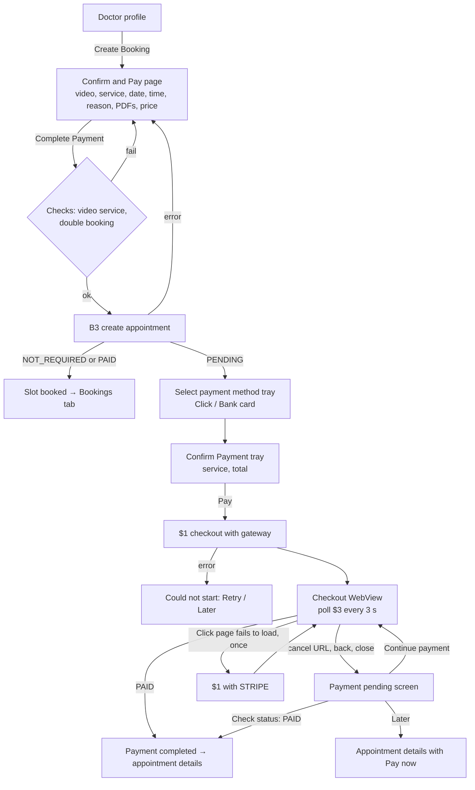
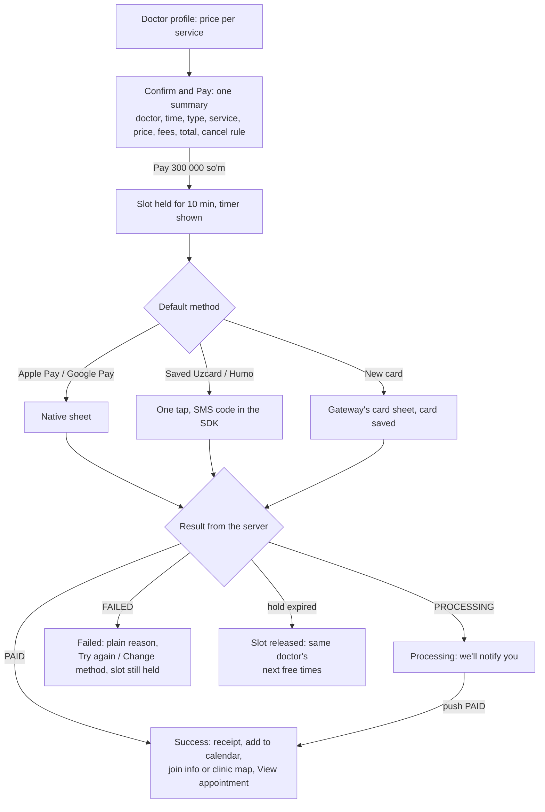

# Payment flow

> Superseded for consultations (2026-10-20): the backend now holds the slot while the patient pays. The app follows [MOBILE_BOOKING_PAYMENT.md](MOBILE_BOOKING_PAYMENT.md); see BOOK-04 in implemented/README.md and implemented/bookings.md. This file still describes treatment plans (BOOK-11).

The plan for BOOK-04 (consultation payment) and BOOK-11 (treatment plans): what we can build on today's backend (Flow A), and the payment flow that would be best for patients (Flow B), with what it needs.

Every flow is drawn in [payment-flow-diagrams.md](payment-flow-diagrams.md).

Sources:
- Spec: `kmp-spec/06-bookings-payments-video.md` §3.1–3.4, §4.3, §5.2, §5.9, §7, §11; `kmp-spec/15-api-reference.md` §3.5 ($1–$3); `kmp-spec/13-notifications.md` (payment pushes).
- Figma (file `B7f95gNrRt8HYYzlGZdk9N`, User Flow): `1772:17301`, `1772:17500`, `1773:18076`, `1773:18395`.
- The app today: `docs/implemented/bookings.md`.

## 1. What we have to work with

### 1.1 Backend (today)

- **The booking is created first.** B3 `POST /patients/me/appointments` returns the appointment with `paymentStatus`:
  - `NOT_REQUIRED` (the default) or `PAID`: nothing to pay.
  - `PENDING`: payment is due. The appointment already exists on the server.
  - The appointment also carries `paymentAmountMinor` and `paymentCurrency`. Flutter parsed them but never showed them.
- **$1** `POST /payments/consultation/checkout` takes `{appointmentId, gateway?}` and returns `{paymentId, checkoutUrl, gateway}`.
  - With no `gateway`, the server picks one: Click for UZS (unverified).
  - `gateway: "STRIPE"` forces Stripe.
- **$3** `GET /payments/{paymentId}` returns `{status}`. Only `PAID` is known; the other values are unverified (15 §6.4).
- **$2** `POST /payments/treatment-plan/checkout` takes `{treatmentPlanId, installmentItemId?}`. It's UZS only, with no Stripe fallback.
- **The checkout is a hosted page** (Click or Stripe). The app never sees card data. When done, the page redirects to `…/api/payments/checkout/success` or `…/cancel`. The app catches those URLs in a WebView, so this needs a WebView: a Custom Tab can't catch them.
- **Pushes:**
  - `CONSULTATION_PAYMENT_REMINDER` and `_DUE_24H` / `_6H` / `_1H` open the pay flow.
  - `TREATMENT_PLAN_*` and `INSTALLMENT_*` open the treatment plan.
- **Video:** V1 refuses the call token while a consultation is unpaid ("Payment is required before joining…").
- **Prices:**
  - Each service in `serviceItems[]` has `prices[] {amountMinor, currency}` and an `isFreeConsultation` flag.
  - Doctors have `onlineMinPriceMinor` and `clinicMinPriceMinor` ("from" prices).
- **Not in the API:**
  - saved cards, Apple Pay / Google Pay, taxes or fees;
  - receipts, refunds, payment history;
  - a FAILED / EXPIRED payment state;
  - holding a slot while the patient pays;
  - a payment deadline.
  - Whether unpaid bookings are cancelled automatically is unverified (06 §11.4).

### 1.2 Figma

Four frames come after Create Booking. There are no success, processing, failed, pay-later or receipt frames.

| Frame | What it shows |
|---|---|
| `1772:17301` Confirm and Pay | The Create Booking page, retitled "Confirm and Pay", with a "Complete Payment" button |
| `1772:17500` Select payment method | A tray with "Google Pay" and "Mastercard" rows, each with the price (300000.00 UZS) and a chevron. Button "View Appointment" |
| `1773:18076` Confirm Payment | A tray with the chosen method, then Service Name 300000.00, Tax 15000.00, Total 31500.00 UZS. Button "Pay". The total is a typo for 315000.00 |
| `1773:18395` Add New Debit Card | A tray with Cardholder Name, Card Number, Expire Date, CVV. Button "Add Card" |

### 1.3 Figma against the backend

| Figma | Backend | Can we build it now? |
|---|---|---|
| Price on the page | Each service's price. `paymentAmountMinor` after B3 | Yes for video services. In person: only a "from" price before booking; the real amount comes after B3 |
| Payment method list | `gateway` on $1: CLICK or STRIPE | Yes, as gateways: "Click (Uzcard, Humo)" and "Bank card (Visa, Mastercard)" through Stripe. Not as Google Pay or saved-card rows |
| Tax line | No tax or fee field | No. Service and Total only, unless the backend sends a breakdown |
| Pay | Opens the hosted checkout | Yes: card entry, the SMS code and 3-D Secure happen on the gateway's page |
| Add New Debit Card | No endpoint | No. The app must not collect card numbers in its own fields (PCI DSS); a card form has to be the gateway's SDK or page |
| "View Appointment" on the method tray | — | Looks like a leftover. It belongs on the success screen |

## 2. Flow A: what we can build now

### 2.1 The main path

1. Doctor profile → Create Booking. When the chosen service has a price, the page is "Confirm and Pay" and the button says "Complete Payment". Otherwise it stays "Complete Booking", as today.
2. The patient picks video or in person, the service (video only), date, time and reason, and attaches PDFs.
3. The price shows when we know it:
   - the service's price;
   - "Free" for a free consultation;
   - "from X" for in person (`clinicMinPriceMinor`);
   - nothing when no price is set.
4. **Complete Payment** runs today's checks (video needs a service, no booking of yours at the same time), then B3.
5. **B3 → `paymentStatus`:**
   - `NOT_REQUIRED` / `PAID`: "slot booked", back to the Bookings tab (as now).
   - `PENDING`: the Select payment method tray.
6. **Select payment method:** Click or Bank card. Each row shows `paymentAmountMinor` in `paymentCurrency`. If we want one step fewer, skip the tray and let the server pick (no `gateway`).
7. **Confirm Payment:** the method, the service and the total, then **Pay**.
8. $1 with the chosen `gateway`. The `checkoutUrl` opens in an in-app WebView.
9. The patient pays on the gateway page (card, SMS code or 3-D Secure).
10. The app polls $3 every 3 s while the page is open. The success URL triggers an extra poll at once. Only `PAID` counts as success.
11. **PAID:** "Payment completed, appointment confirmed". The checkout closes and the appointment details open.

### 2.2 Ways back to an unpaid booking

- **Appointment details:** an amber "Payment pending" card with **Pay now** (06 §4.3, item 5). It starts at step 6 for that appointment.
- **Pushes** (24 h / 6 h / 1 h reminders) and the inbox tray's **Pay** button open the same flow.
- **Video Join** on an unpaid visit: show "Pay to join" with **Pay now**, instead of V1's error.
- **The pending screen** after the checkout was left.
- **Gap:** the app lists an unpaid upcoming visit nowhere today. The Bookings tab has no upcoming list (not in Figma). Home's Upcoming keeps confirmed visits, so an unpaid visit with a non-confirmed status is hidden. We need a place for it, e.g. Home's Upcoming card with a "Payment pending" tag and Pay now.

### 2.3 Every case

**Before the checkout**

| # | Case | What happens | What the app shows |
|---|---|---|---|
| 1 | Free service (`isFreeConsultation`) | B3 should return `NOT_REQUIRED` (unverified) | "Free", Complete Booking, no payment step |
| 2 | No price set | `paymentStatus` decides after B3 | No price; the payment step only if PENDING |
| 3 | In-person visit | The price is known only after B3; it may be paid at the clinic (unverified) | "from X" if known; the payment step only if PENDING |
| 4 | B3 fails: slot taken, no service, network | Nothing is created | The error above the button; the patient stays on the page |
| 5 | Same time already booked | Local check before B3 | The existing double-booking error |
| 6 | $1 fails (network, 5xx) | The appointment exists, PENDING | "Payment could not start" + Retry, or Later → details with Pay now |
| 7 | $1 returns no `checkoutUrl` or `paymentId` | Same as 6 | Same as 6 |
| 8 | Already paid (another device or tab) | $3 or the appointment says PAID | Straight to success |
| 9 | The appointment was cancelled meanwhile | $1 errors | The error, then details |
| 10 | Not UZS | Click can't take it; the server picks Stripe | Only the Bank card row |

**In the checkout**

| # | Case | What happens | What the app shows |
|---|---|---|---|
| 11 | The Click page fails to load (main frame) | Once: $1 with `gateway: "STRIPE"`, then poll the new `paymentId` (consultations only) | The Stripe page loads in the same screen |
| 12 | The Stripe page fails too | Stays PENDING | An error with Retry / Later |
| 13 | The patient cancels on the page (cancel URL) | Stays PENDING | The pending screen |
| 14 | The patient presses back or close | Stays PENDING | The pending screen |
| 15 | A bank asks to open its app (`click://`, `intent://`, `tel:`) | Flutter didn't handle this | Hand every non-http(s) link to the OS; poll again when the app comes back |
| 16 | The patient leaves the app to read the SMS code | The WebView must survive | Nothing special; Android may kill the process (case 17) |
| 17 | The app is killed mid-payment | The payment may still finish on the server | Save the `paymentId` locally. On the next open, check $3: PAID → success, else details with Pay now |
| 18 | The network drops while polling | The poll errors | Keep polling quietly; after a few failures show "Checking your payment…". Never say it failed |
| 19 | Paid, but PAID arrives late (gateway delay) | The success URL arrives, $3 still says PENDING | "We're confirming your payment" with auto-check and Check status; don't send the patient to pay again |
| 20 | Card declined, wrong SMS code | Handled on the gateway page; the patient retries there or cancels | If $3 ever returns FAILED (unverified): "Payment failed" + Try again / Change method |
| 21 | The checkout link expired (unverified) | An old `checkoutUrl` no longer works | "Continue payment" calls $1 again instead of reusing the old link |
| 22 | Two taps, or two devices | Two checkouts for one visit | Pay is disabled while $1 runs; the server should return the open checkout (backend ask) |
| 23 | 401 while paying | Logout | Login. The payment on the server is unaffected; the next login shows the visit's state |
| 24 | App lock while paying | The lock would cover the checkout | Pause the app lock during the checkout (LOCK-01, not built) |

**After the checkout**

| # | Case | What happens | What the app shows |
|---|---|---|---|
| 25 | Reminders after paying | The backend should stop them | If one still arrives, the pay flow sees PAID and shows "Already paid" |
| 26 | The patient cancels a paid visit (48 h or more ahead) | B5 deletes it. No refund API | Warn before cancelling ("Ask the clinic about a refund") until the backend has refunds |
| 27 | The doctor cancels a paid visit | `APPOINTMENT_CANCELLED` push. Refund unknown | The cancelled visit; the refund text when the backend sends one |
| 28 | Reschedule a paid visit | B3 with `rescheduleAppointmentId`. Whether the payment carries over is unverified | If the new booking is PENDING, it goes through the pay step again |
| 29 | An unpaid visit gets close | 24 h / 6 h / 1 h reminders. Auto-cancel is unverified | A deadline, if the backend sends one |
| 30 | An unpaid video visit at its start | V1 refuses the token | "Pay to join" + Pay now on the details |
| 31 | Shifa AI booking (X4) with a paid doctor | Unverified (15 §6.4) | Open the details of the created visit; Pay now if PENDING |

**Treatment plans (BOOK-11)**

| # | Case | What the app shows |
|---|---|---|
| 32 | Owed > 0 and UZS | Pay outstanding, or Pay installment on PENDING / OVERDUE items → $2 → the same checkout (no Stripe fallback) → PAID → back to the plan, reloaded |
| 33 | Not UZS | No online pay; `treatmentPlanOnlinePayUnavailable` |
| 34 | Installment pushes (due soon, today, overdue) | The plan, with the item's Pay button |

### 2.4 Build notes for Flow A

- One shared checkout screen for $1 and $2: load the URL, catch success and cancel, poll $3, and take an optional Stripe fallback. Flutter had four copies.
- The WebView is an `expect`/`actual` (Android `WebView` in `AndroidView`, iOS `WKWebView` in `UIKitView`), with no new dependency.
- Poll from the ViewModel only while the screen is shown. Only `PAID` counts.
- Format money as "300 000 so'm" for UZS (no ".00"), not Flutter's "300000.00 UZS".
- Reuse the strings we already have: `completePayment`, `payNow`, `paymentPendingTitle` / `Message` / `Badge`, `checkPaymentStatus`, `continuePayment`, `paymentCompletedAppointmentConfirmed`, `paymentCouldNotStart`, `paymentStillPendingConfirmBooking`, `errorVideoCallPaymentRequired`.

## 3. Flow B: the ideal payment flow

What the patient should get, whether or not the backend supports it yet.

1. **Price everywhere:**
   - "from 150 000 so'm" on the doctor card and profile;
   - the price on every service and next to the chosen time;
   - "Free" where it's free.
   - No surprises at the end.
2. **One summary before money:** doctor, local date and time, video or in person, service, price, fees, total, and the cancellation rule ("Free cancellation up to 48 h before"), all on the Confirm and Pay page.
3. **Hold the slot, don't book it early:**
   - Pay holds the time for about 10 minutes and shows a timer.
   - A paid hold becomes a booking; an unpaid one is released.
   - This replaces PENDING bookings that sit unpaid.
4. **One-tap payment:**
   - Apple Pay and Google Pay (through Stripe);
   - saved Uzcard / Humo cards (through the gateway's card tokens);
   - the last method preselected.
   - New cards go into the gateway's card sheet and get saved there. Our app never holds card numbers.
5. **Native payment screens instead of a WebView:**
   - the gateway's SDK sheets (Stripe PaymentSheet; Click or Payme SDKs);
   - or a Custom Tab / `SFSafariViewController` that returns to the app with a link (`shifa://payment/return?paymentId=…`).
   - These show the real address and lock, keep the patient's saved browser cards, and survive switching to the SMS app.
6. **Clear outcomes:**
   - **Success:** the receipt, Add to calendar, what's next (the Join time for video; the clinic address with a map for in person), View appointment.
   - **Processing:** "We'll notify you". A push follows when it's paid.
   - **Failed:** the reason in plain words ("Card declined", "Not enough funds"), Try again, Change method. The hold keeps running.
   - **Expired:** the slot is released, and the same doctor's next free times show.
7. **The server tells the app:** a push on PAID, FAILED and REFUNDED, so nobody waits on a spinner. The app polls (with backoff) only while the screen is open.
8. **Receipts and history:**
   - the fiscal receipt on the success screen, on the appointment and in Documents;
   - a Payments list in Profile.
9. **Refunds without calls:**
   - Cancelling 48 h or more ahead refunds automatically, with its status ("Refund on its way, 3–5 days").
   - A doctor's cancellation refunds in full and offers to rebook.
10. **Reschedule keeps the payment:** only a price difference is charged or refunded.
11. **Pay later, only if the clinic allows it:**
    - a clear deadline ("Pay by 12 Oct, 18:00, or the slot is released");
    - a "Payment due" tag on Home and Bookings cards;
    - reminders that stop once it's paid.
12. **Details:** "300 000 so'm" formatting per language, local times, screen-reader labels on amounts, the app lock paused while paying.
13. **Later, if wanted:** promo codes, insurance or corporate cover, and foreign cards for patients abroad (Stripe).

### 3.1 What Flow B needs

**Backend**
- Prices before booking for both video and in person, a fee or tax breakdown, and the total.
- A slot hold (reserve → `expiresAt`), or a PENDING booking with a `paymentDueAt` and automatic release.
- Every payment status: PENDING, PROCESSING, PAID, FAILED (with a reason code), EXPIRED, REFUNDED, PARTIALLY_REFUNDED.
- An idempotent $1: one open checkout per appointment, so a second call returns the same one.
- A return link to the app instead of the success/cancel URLs. That lets the app use Custom Tabs or SDKs.
- Pushes for PAID, FAILED and REFUNDED. Reminders stop once paid.
- Saved payment methods (gateway tokens) and Apple Pay / Google Pay through Stripe. Maybe more local gateways (Payme, Uzum).
- Fiscal receipts, a payment history endpoint, refunds on cancel, and a payment that carries over on reschedule.
- X4 (AI booking) should return the created appointment with its `paymentStatus`.

**Figma**
- Success, processing, failed and expired screens.
- A "Payment pending" tag on cards, the payment card on Appointment Details, and a Payments list.
- What the method tray lists: gateways (what the backend has) or saved cards and wallets (Flow B).
- Whether the Tax line is real. Fix the Total typo.
- Remove the in-app "Add New Debit Card" form, or make it the gateway's sheet (PCI DSS).

## 4. Recommended path

1. **Now, BOOK-04:** Flow A with Figma's look.
   - Confirm and Pay when the service has a price.
   - After a PENDING B3: Select payment method (Click / Bank card) → Confirm Payment (service, total) → the checkout WebView with the Stripe fallback and the 3 s poll → success or pending.
   - Pay now on details, on pushes and inbox items, and on Join.
   - Save the `paymentId` to resume after the app is killed.
   - Test on a staging backend or payment sandbox only (`backend-improvements.md` §3). Don't test on production.
2. **Ask the backend** for the Flow B items (`backend-improvements.md` §12).
3. **Move to Flow B as they arrive:**
   - the return link → Custom Tab / Safari view;
   - the PAID push → no waiting on the checkout;
   - the slot hold → no unpaid bookings;
   - saved cards and Apple / Google Pay.

### Questions for product

- Book first and pay after (today), or ask the backend for a slot hold?
- Are in-person visits ever paid in the app, or always at the clinic?
- Figma's "Google Pay" and "Mastercard" rows: gateways, or saved methods?
- Is the Tax line real?
- Where should an unpaid upcoming visit show? Bookings has no upcoming list.
